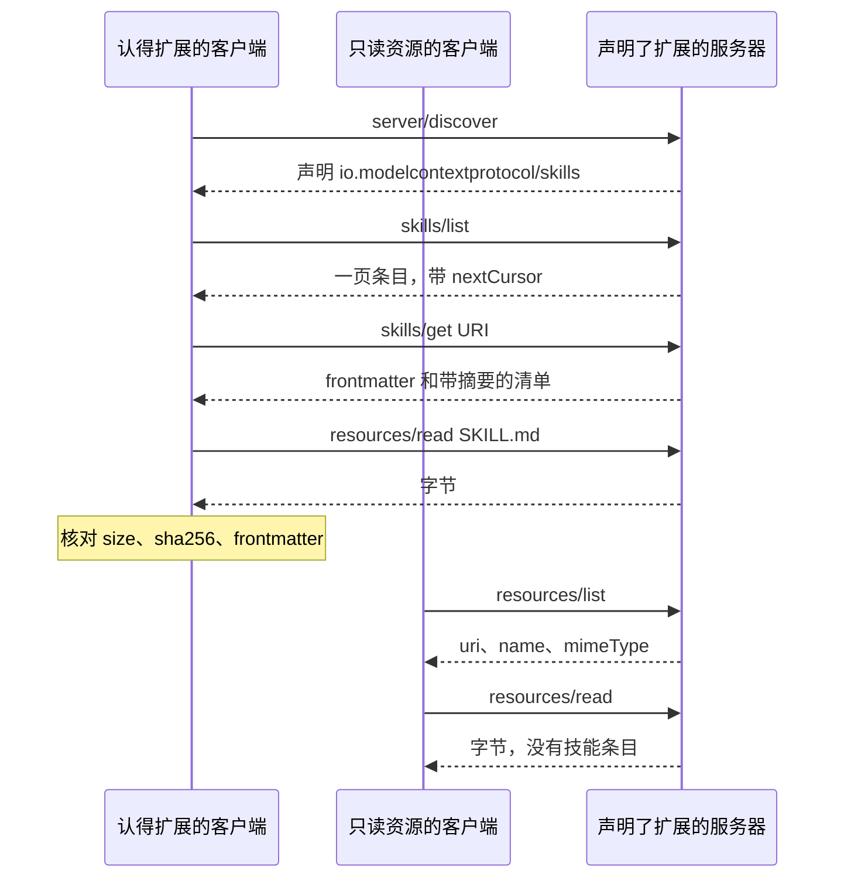

你把 `https://mcp.cloudflare.com/mcp` 贴进客户端。认扩展的那一端会先看服务器有没有声明 `io.modelcontextprotocol/skills`，再发 `skills/list`，按 `skill://<name>/<path>` 去读文件。只认工具和资源的那一端，连上之后看见的仍是资源列表里的文件。2026-10-10 的更新日志说，Cloudflare API 的 MCP 服务器开始用这条扩展提供 Cloudflare skills。我没有 Cloudflare 登录，对这个地址的未授权 POST 得到 401。

技能的步骤和这台服务器的工具走同一条 MCP。身份是主机给服务器的标签，加上技能 URI。frontmatter 里的 `name` 是给模型看的标签。不实现扩展的客户端把 `skill://` 文件当成普通资源。

<!-- more -->

## 更新日志只有三句

[Cloudflare 的更新日志](https://developers.cloudflare.com/changelog/post/2026-10-10-cloudflare-mcp-skills/)写于 October 10, 2026。正文是：Cloudflare API MCP server 现在通过 [Skills over MCP 扩展](https://modelcontextprotocol.io/extensions/skills/overview) 提供 [Cloudflare skills](https://github.com/cloudflare/skills)。支持该扩展的 MCP 客户端用 `skills/list` 发现技能，在 `skill://<name>/<path>` 读取文件。用法是把 `https://mcp.cloudflare.com/mcp` 加到[支持该扩展的客户端](https://modelcontextprotocol.io/extensions/client-matrix)。我在 2026-10-12 打开的就是这三句，页面上没有技能数量，也没有一份 URI 清单。

同一天更新的[服务器文档](https://developers.cloudflare.com/agents/model-context-protocol/cloudflare/servers-for-cloudflare/)（页眉 Last updated Oct 10, 2026）仍把这台服务器写成两个工具：`search()` 和 `execute()`，覆盖 2,500 多个 API 端点，走 Code Mode。新连接用 Streamable HTTP 的 `/mcp`，文档写明支持 MCP `2026-07-28`。连接时走 OAuth，或在 `Authorization` 里放 API token。文档后半段讲的是安装 [Cloudflare Skills 插件](https://github.com/cloudflare/skills)：Claude Code、Cursor、Codex、Pi 把技能目录拷到本机，例如 Cursor 的 `~/.cursor/skills/`。我读到的 [README](https://github.com/cloudflare/skills/blob/main/README.md) 同样是这条安装路径，表格里有 `workers-best-practices`、`wrangler`、`durable-objects` 等名字。README 没有写 `skills/list`，也没有写 `skill://`。

所以 10 月 10 日 Cloudflare 自己的页面上有两条路。更新日志说 MCP 服务器开始提供技能。文档和仓库仍让你把目录装进本机。本机安装为什么有用，[9 月 30 日那篇](https://cfireworks.github.io/2026/09/30/agent-skills-why-installable-skills-matter/)写过。协议和技能各管一段，[10 月 1 日那篇](https://cfireworks.github.io/2026/10/01/2026-10-01-agent-protocols-skills-boundary/)写过。这篇只钉第三条路的地址：说明书跟这台已经连上的服务器走。

我试过未授权访问。对 `https://mcp.cloudflare.com/mcp` 发 POST，`Content-Type: application/json`，方法名是 `initialize`，协议版本 `2026-07-28`。响应是 HTTP 401，空 body。`WWW-Authenticate` 为 `Bearer realm="OAuth"`，`resource_metadata` 指向 `https://mcp.cloudflare.com/.well-known/oauth-protected-resource/mcp`，scope 是 `user:read account:read`。这份受保护资源元数据的 JSON 里，`resource_name` 是 `Cloudflare API MCP Server`，`scopes_supported` 是上面那两个。里面没有技能目录。我没有做 OAuth，也没有拿 API token，所以没有调用过线上的 `skills/list`。

## 声明之后，目录和文件才分开

扩展标识是 `io.modelcontextprotocol/skills`。[总览](https://modelcontextprotocol.io/extensions/skills/overview)写明 SEP-2640 的状态是 Final。[SEP 页面](https://modelcontextprotocol.io/seps/2640-skills-extension)同样标着 Final，并写明这是接受当时设计的历史记录，之后的改动以现行规范为准。[ext-skills 的 README](https://github.com/modelcontextprotocol/ext-skills/blob/main/README.md)把规范源指向 `specification/stable/skills.mdx`，对照的基础协议是 `2026-07-28`，并写 PR #2640 于 2026-09-13 合并。我对照的正文是 [stable 规范](https://skills.extensions.modelcontextprotocol.io/specification/stable/skills)。技能格式仍交给 Agent Skills：目录根上有 `SKILL.md`，frontmatter 里至少有 `name` 和 `description`。这条扩展只规定怎么在 MCP 上发现和读取。

服务器要在 `server/discover` 里同时声明 `resources` 和这个扩展。声明了，就必须实现 `skills/list` 和 `skills/get`。文件走原来的 `resources/read`。`directoryRead` 默认 false。只有把它设成 true，客户端才可以调用 `resources/directory/read`。空对象表示支持扩展、不支持列目录。客户端先看见声明，再发 `skills/list` 或 `skills/get`。

```json
{
  "capabilities": {
    "resources": {},
    "extensions": {
      "io.modelcontextprotocol/skills": {
        "directoryRead": false
      }
    }
  }
}
```

`skills/list` 可以分页。带 `nextCursor` 时，下一请求把该值放进 `params.cursor`。每一条技能是完整的，清单不许拆到两页。结果必须带 `resultType: "complete"`、`ttlMs` 和 `cacheScope`。`skills/get` 也要这三个字段，并且没有分页游标。规范示例里 `ttlMs` 是 `300000`，`cacheScope` 是 `public`。这两个字段表示列表可以新鲜多久、能不能共享，不表示正文可信。正文对不对，看读下来的字节长度和 SHA-256。摘要和批准怎样绑在一起，[10 月 6 日那篇](https://cfireworks.github.io/2026/10/06/2026-10-06-mcp-skills-approval-digest/)已经按规范跑过，这里不重跑。

清单里的每个文件有 `uri`、`digest`（`sha256:` 加 64 位小写十六进制）和 `size`。`SKILL.md` 自己也在清单里。服务器可以返回空列表或不完整列表。空列表只说明这一次没给出条目。已知 URI 时仍走 `skills/get`。服务器必须对它提供的每一份技能回答 `skills/get`，包括没出现在列表里的。找不到则是 JSON-RPC `-32602`。

约定的 URI 是 `skill://<skill-path>/<file-path>`。`SKILL.md` 因此总是 `skill://<skill-path>/SKILL.md`。`<skill-path>` 的最后一段必须等于 frontmatter 的 `name`。前面可以有服务器自己的前缀：`skill://acme/billing/refunds/SKILL.md` 的名字是 `refunds`，前缀是 `acme/billing`。更新日志把占位符写成 `skill://<name>/<path>`。规范允许 name 前面还有一段组织路径。只拿 name 当键，会把 `products/workers` 和 `docs/workers` 收成同一个技能。Cloudflare 线上用的是单段名字还是带前缀，我没读到响应，不知道。

规范还写了两件和「看见文件」有关的事。用 `resources/read` 读到 `SKILL.md`，本身不算加载技能。加载要走主机自己的技能路径：核对清单、该问人的时候问人，再放进模型上下文。主机不得在连接时、列表时或批准时提前把文件拉下来。相对路径按该技能的根解析。`references/endpoints.md` 对在 `skill://products/workers/SKILL.md` 上，就是 `skill://products/workers/references/endpoints.md`。



## 名字可以撞，URI 加上服务器不能撞

规范把技能身份写成两半：主机为来源服务器保留的身份，加上技能 URI。两台连上的服务器都可以提供 `skill://products/workers/SKILL.md`，那是两份技能。主机在注册表、批准和缓存里都要留着这两半，不能只用 URI 当键。落到磁盘或虚拟目录时，路径里也要能看出是哪一台服务器。

`name` 是标签。同一台服务器的列表里，名字应该唯一，但规范不保证。`acme/billing/refunds` 和 `acme/support/refunds` 都可以叫 `refunds`。撞名时要留着能区分的路径，不能悄悄丢掉一条。不同来源撞名时，按每个来源自己的名字空间来解析。主机用自己起的标签标识服务器，这个标签不是 `serverInfo.name`。`serverInfo.name` 两边都可以写成同一个字符串。

不实现这个扩展的客户端，把 `skill://` 资源看成普通资源。这是规范 Capability Negotiation 里的原话。它不一定看得见技能：规范没有要求这些文件出现在 `resources/list` 里。服务器若只在 `skills/list` 里公布它们，不认识扩展的客户端就没有目录。服务器若把文件放进 `resources/list`，客户端能读到 Markdown，读到的是资源字节，不是一条带清单的技能。

| 维度 | 工具上的短描述 | 装进本机目录 | Skills over MCP |
|------|----------------|--------------|-----------------|
| 跟哪条连接走 | 跟 `tools/list` | 不经过 MCP | 跟这台服务器的资源和工具 |
| 正文在哪 | 工具的 description | 本机 `SKILL.md` | `resources/read` 读 `skill://…/SKILL.md` |
| 怎样发现 | `tools/list` | 扫目录 | 看见扩展声明后 `skills/list`；已知 URI 用 `skills/get` |
| 身份 | 这台服务器上的工具名 | 本机路径 | 主机给服务器的标签 + 技能 URI |
| 同名的两份 | 同一列表里的工具名 | 后写的目录盖住先写的 | 名字可重复，URI 和来源分开 |
| 客户端没实现扩展 | 工具调用还在 | 跟这条连接无关 | 列出来的文件只是普通资源 |

Skills over MCP 那一列里的「列出来的文件」取决于服务器。文件若出现在资源列表里，不认识扩展的客户端有字节可读。它没有 frontmatter 对象，也没有逐文件摘要。

## 进程里的两台服务器

官方 SDK 还在补。我 2026-10-12 读的 [implementations.md](https://github.com/modelcontextprotocol/ext-skills/blob/main/docs/implementations.md) 把 Go、TypeScript、Python、C# 的 SDK 标成 in progress，分别指向 [#1238](https://github.com/modelcontextprotocol/go-sdk/pull/1238)、[#2818](https://github.com/modelcontextprotocol/typescript-sdk/pull/2818)、[#3485](https://github.com/modelcontextprotocol/python-sdk/pull/3485)、[#1864](https://github.com/modelcontextprotocol/csharp-sdk/pull/1864)。总览也写着 SDK 和主机支持仍在实现。客户端矩阵页面用图标。我抓到的文字里，ChatGPT、fast-agent、MCP Inspector 的 Skills 列标着 Partial。其余格子我没有按图例逐个翻译，这里不报谁已经支持、谁还没有。演示因此不连官方 SDK，也不连 `mcp.cloudflare.com`。

脚本在 `demos/skills-over-mcp-list/run_demo.py`。两台服务器都在进程里。`edge-api` 是主机标签，`serverInfo.name` 是 `mock-edge`。它声明扩展，并且 `directoryRead` 为 false。技能正文是我写的短 Markdown，用来走协议，不是 Cloudflare 仓库里的文件。`skills/list` 每页一条。`instructions` 里点了 `skill://products/workers/SKILL.md`，客户端用 `skills/get` 核对，再用 `resources/read` 读 `SKILL.md` 和它提到的 `references/endpoints.md`。第二份也叫 `workers`，URI 是 `skill://docs/workers/SKILL.md`，只出现在第二页，演示没有把它的正文拉下来。

没声明扩展的那台，主机标签是 `plain-docs`，`serverInfo.name` 是 `mock-docs`。它的 `skills/list` 返回 `-32601`。同一条 `skill://products/workers/SKILL.md` 仍可以用 `resources/read` 读到，字节和 `edge-api` 上的那份不同。另外一个客户端故意不读 `extensions`，只调 `resources/list` 和 `resources/read`。资源行里没有 `digest`，也没有 `frontmatter`。

声明写在这里。没声明的服务器不会走进这个分支：

```python
def discover(self) -> dict:
    capabilities: dict = {"resources": {}}
    if self.declare:
        capabilities["extensions"] = {EXTENSION_ID: {"directoryRead": False}}
    return {
        "protocolVersion": "2026-07-28",
        "serverInfo": {"name": self.info_name, "version": "0"},
        "capabilities": capabilities,
        "instructions": self.instructions,
    }
```

读完之后用清单里的长度和摘要核对原始字节。对不上就失败。`resultType`、`ttlMs`、`cacheScope` 也要在，演示里后两个照抄规范示例，好让字段缺失时能看出来。它们不是我测到的 Cloudflare 缓存时间。

```python
def verify_read(skill: Skill, uri: str, result: dict) -> str:
    require(result["resultType"] == "complete", "read resultType")
    require(result["ttlMs"] == TTL_MS and result["cacheScope"] == CACHE_SCOPE, "read cache")
    text = result["contents"][0]["text"]
    raw = text.encode("utf-8")
    meta = next(item for item in skill.files if item.uri == uri)
    require(len(raw) == meta.size, f"size {len(raw)} != {meta.size}")
    require(digest_of(raw) == meta.digest, "digest mismatch")
    return f"bytes={len(raw)} {meta.digest} size=match digest=match"
```

资源列表只给普通字段。不认识扩展的客户端能读字节，组不出技能条目：

```python
resources.append(
    {"uri": item.uri, "name": item.name, "mimeType": item.mime}
)
```

我执行的命令是：

```bash
python3 demos/skills-over-mcp-list/run_demo.py
```

环境是 Python 3.12.3。连续两次运行，标准输出逐字节相同。下面是一次完整输出，没有删行。`probe` 那行是测试自己去调了 `resources/directory/read`，确认服务器回 `-32601`。认得扩展的客户端在 `directoryRead=false` 时不会发这个方法，它的日志是 `directory read not called`。

```text
python 3.12.3
transport in-process mock
discover host=edge-api serverInfo.name=mock-edge extension=io.modelcontextprotocol/skills directoryRead=false
directory read not called
skills/list page=1 resultType=complete ttlMs=300000 cacheScope=public nextCursor=1 count=1
skill identity=edge-api skill://products/workers/SKILL.md name=workers files=2
skills/list page=2 resultType=complete ttlMs=300000 cacheScope=public nextCursor= count=1
skill identity=edge-api skill://docs/workers/SKILL.md name=workers files=1
names collide label=workers count=2 uris=2
skills/get skill://products/workers/SKILL.md files=2 SKILL.md size=184 sha256:c8f64f42c53a9750d41dd2e51e79581128e4cbb4c58b49fe38237239db9e7dde
resources/read skill://products/workers/SKILL.md bytes=184 sha256:c8f64f42c53a9750d41dd2e51e79581128e4cbb4c58b49fe38237239db9e7dde size=match digest=match
frontmatter fields=name,description match=yes
resources/read skill://products/workers/references/endpoints.md bytes=73 sha256:15751aa85a8fe3412201dd6895e590db17b8d0cbd86cd626cfd1f7285fa1727b size=match digest=match
skills/get missing error=-32602
probe resources/directory/read error=-32601
naive host=edge-api serverInfo.name=mock-edge reads-extensions=no methods=resources/list,resources/read
resources/list count=3 resultType=complete ttlMs=300000 cacheScope=public nextCursor=
resource skill://docs/workers/SKILL.md name=workers mime=text/markdown
resource skill://products/workers/SKILL.md name=workers mime=text/markdown
resource skill://products/workers/references/endpoints.md name=endpoints.md mime=text/markdown
resources/read skill://docs/workers/SKILL.md bytes=170 skill-entry=no
discover host=plain-docs serverInfo.name=mock-docs extension=absent
skills/list error=-32601 message=Method not found
naive host=plain-docs serverInfo.name=mock-docs reads-extensions=no methods=resources/list,resources/read
resources/list count=1 resultType=complete ttlMs=300000 cacheScope=public nextCursor=
resource skill://products/workers/SKILL.md name=workers mime=text/markdown
resources/read skill://products/workers/SKILL.md bytes=199 skill-entry=no
identity edge-api skill://products/workers/SKILL.md
identity plain-docs skill://products/workers/SKILL.md
same-uri digest edge=sha256:c8f64f42c53a9750d41dd2e51e79581128e4cbb4c58b49fe38237239db9e7dde
same-uri digest plain=sha256:3480315d238c4581d52e00b03d9f439322389df0a342d1186ac64204fcf1f07e
checks passed
```

第一页那条的清单和读到的字节对得上：`SKILL.md` 184 字节，支撑文件 73 字节。两台服务器的同一 URI，摘要不同。身份行因此是两行。`plain-docs` 上那份有 199 字节，客户端没有把它记成技能。

这份模拟把三个文件放进了 `resources/list`。规范只说不实现扩展的客户端把 `skill://` 当成普通资源，没有要求服务器必须在全局列表里公布它们。Cloudflare 列不列，我没登录，不知道。`directoryRead: true` 时长什么样，这次也没做，因为声明的值是 false。

## 先写进注册表的四条

1. 服务器要发技能，就在 `server/discover` 里声明 `io.modelcontextprotocol/skills`，并声明 `resources`。`skills/list` 和 `skills/get` 都要实现。文件仍用 `resources/read`。没打开 `directoryRead`，就不要指望客户端来列目录。
2. 注册键写成主机标签加 URI。`name` 留给模型和界面。同一列表里两个 `workers`，用 `products` 和 `docs` 这两段路径分开。另一台服务器上的同一 URI 再占一行。
3. 列表回来之后只保留清单。等真的要加载，再读 `SKILL.md`。支撑文件等正文点到它再读。读之前对 `size` 和 `sha256`。`ttlMs` 到了就重新要条目，它不代替这次核对。
4. 客户端还不认识扩展时，把它从 `resources/list` 读到的 Markdown 当成一份资源。要把它当技能加载，得走认识扩展的那条路径。`resources/read` 本身不激活技能。

Anaconda 在 2026-10-02 的 [MCP GA 文章](https://www.anaconda.com/blog/anaconda-mcp-general-availability)里写了一条平行的用法。Anaconda Intelligence 是随服务器附带的免费技能，告诉 agent 何时调用只读工具，例如会话开始时调用 `org_config`。文章写明，若手动连接 `https://anaconda.com/api/mcp`，就把文档里的技能正文加进去。我没有在那篇文章里看到 `skills/list` 或 `io.modelcontextprotocol/skills`，也没有调用他们的 MCP。它说明「何时调用」可以跟服务器一起交付。交付走的是不是这条扩展，文章没有写。

## 结语

工具列表回答这台服务器能调用什么。Skills 扩展把步骤放在同一条连接的资源上：先 `skills/list` 或 `skills/get`，再按 URI 读 `SKILL.md`。名字给模型看。要保存、要批准、要和另一台服务器分开，用的是主机给这台服务器的标签，加上那条 URI。客户端还不认识扩展时，这些文件就还是资源。

---

## 扩展阅读

- [Cloudflare API MCP server serves Cloudflare skills](https://developers.cloudflare.com/changelog/post/2026-10-10-cloudflare-mcp-skills/)（Cloudflare Changelog，2026-10-10）
- [Cloudflare's own MCP servers](https://developers.cloudflare.com/agents/model-context-protocol/cloudflare/servers-for-cloudflare/)（文档页眉 Last updated Oct 10, 2026）
- [cloudflare/skills](https://github.com/cloudflare/skills)
- [Skills 扩展总览](https://modelcontextprotocol.io/extensions/skills/overview)
- [stable 规范](https://skills.extensions.modelcontextprotocol.io/specification/stable/skills)
- [SEP-2640](https://modelcontextprotocol.io/seps/2640-skills-extension)（状态 Final；现行要求以规范为准）
- [ext-skills README](https://github.com/modelcontextprotocol/ext-skills/blob/main/README.md) 与 [implementations.md](https://github.com/modelcontextprotocol/ext-skills/blob/main/docs/implementations.md)
- [Anaconda MCP GA](https://www.anaconda.com/blog/anaconda-mcp-general-availability)（2026-10-02，只作平行例子）

---

*更新日志、服务器文档、skills 仓库 README、扩展总览、stable 规范、SEP-2640、ext-skills README 与 implementations.md 核对于 2026-10-12。演示在 Python 3.12.3 上执行 `python3 demos/skills-over-mcp-list/run_demo.py`，连续两次标准输出一致。对 `https://mcp.cloudflare.com/mcp` 的未授权 POST 得到 401，没有完成 OAuth，没有调用线上的 `skills/list`。*

## 讨论

你的注册表里，一份 MCP 技能的主键是主机标签加 URI，还是 frontmatter 的 `name`？客户端还不认识 `skills/list` 时，`resources/list` 里那份 Markdown，你会把它当技能加载，还是只当一份普通文档？
