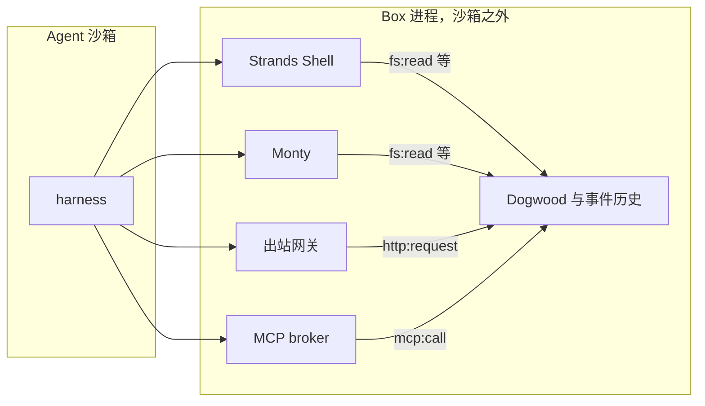

值班 agent 每摸到一条线索，就往事故频道发一条 Slack。沙箱已经让它碰得到 `slack.com`。第四条更新把人写的进度埋掉的时候，缺的那条规则要记得：过去 10 分钟里，这个接口已经成功返回过几次。

2026-10-07，Fernando Dingler 在 AWS 开源博客发布 [Strands Box](https://aws.amazon.com/blogs/opensource/introducing-strands-box-ai-agent-sandboxes-powered-by-dogwood/) 的开发者预览，Apache 2.0。它把两笔账拆开。操作系统隔离回答能碰到什么。Dogwood 策略回答碰到之后、以及做过什么之后，还允许做什么。

<!-- more -->

## 隔离答完，还剩「做过之后」

[给 Agent 一台电脑后，守凭证与出站](https://cfireworks.github.io/2026/10/05/2026-10-05-agent-computer-egress-credential-boundary/)写的是整机和出站代理：令牌留在父进程，允许列表核对方法、主机和路径。那一层这篇不重写。Box 补上的是策略语言，以及能回头看历史的时序运算符。

公告把容器和 microVM 说成第一笔账。进程被圈住之后，只要够得到某个工具，工具里能做什么仍要另写。调查事故可以读日志，不能改基础设施。可以发进度，不能十分钟刷四条成功消息。

Marc Brooker 当天的[配套文](https://strandsagents.com/blog/strands-box-the-big-picture/)解释了隔离层为什么写不出这种句子。microVM 在网卡上看到的多半是 TLS 密文。系统调用看得到 `connect` 和 `open`，看不清一次 MCP 的 `tools/call`，也看不清这次 HTTP 的方法和路径。Box 用内核隔离把出口收成一条。出口上的 shell、Python、出站网关和 MCP broker 再把操作交给 Dogwood。

同一周，Copilot 的本地沙箱也在用策略限制文件系统、网络和凭证。那条路线这里不展开。Box 并排放在旁边时，多出来的是两件事：各工具共用一份事件历史，一条规则可以把「shell 里读过某个文件」和「之后的 HTTP」串起来；出站网关在放行之后才换上真实凭证，agent 手里是占位符，或者干脆不持有 Slack 令牌。

| 问题 | 隔离层通常停在哪 | harness 自带的允许列表 | Strands Box |
|------|------------------|------------------------|-------------|
| 能碰到什么 | 另一台内核、命名空间，或系统调用过滤 | 这次工具调用的名字 | macOS 上由 Seatbelt 按 `box.toml` 限制进程能直接碰到的文件；网络默认送进出站网关 |
| 碰到之后允许做什么 | 密文，或 `open` / `connect` | 判断这次调用，不展开命令将碰到的文件和主机 | shell、Python、网关、MCP 收成同类事件，例如 `fs:read`、`http:request` |
| 做过什么之后 | 隔离层不记「三次 HTTP 200」 | 格式各家不同，响应也通常不跨工具共享 | 同一份事件历史；`forbid` 可以数过去窗口里的响应 |
| 凭证放在哪 | 要另做代理 | 常常出现在 agent 进程里 | 网关在允许的请求上换成真实凭证 |

前两列来自公告和配套文，不是我在这台 Linux 上跑出来的对照。最后一列对得上 [Box 文档](https://strandsagents.com/docs/user-guide/box/) 和仓库 [README](https://github.com/strands-agents/box/blob/main/README.md)。

## 出口收成一类事件

文档的平台表写的是：macOS 15 或更新、Apple 芯片，支持；Linux 尚未支持；Windows 不支持。2026-10-07 的 Release [`v0.1.0`](https://github.com/strands-agents/box/releases/tag/v0.1.0) 只有一份资产，`box-v0.1.0-aarch64-apple-darwin.tar.gz`。发布说明里写 Linux 支持在计划中。文档称 0.1.x 为预发布，配置键、策略动作和 CLI 参数会变，下载时用 `BOX_VERSION` 钉住。钉这一版的写法是 `BOX_VERSION=v0.1.0`。

一个 box 跑一个工作负载。`box.toml` 的 `command` 决定拉起哪一个 harness，Box 不绑死 Strands。策略引擎在 Box 自己的进程里，位于 agent 沙箱外面。Strands Shell、Python 用的 Monty、出站网关、MCP broker 都在这里。agent 通过本地套接字把它们当成普通的 `bash`、`python3` 和 MCP 命令。



shell 里读文件和 Python 里读文件都报 `fs:read`。`curl` 和模型客户端的 HTTP 都报 `http:request`。规则因此不用写是哪个工具干的。文档里有一条：过去一小时内读过 `~/data/customers.csv` 之后，除模型主机以外的 `http:request` 被 `forbid`。读文件和后来的出站可以是两条不同的路，历史是同一份。

直接写在 `box.toml` 里、授给 agent 进程的路径，由 Seatbelt 封住，不进这份历史。harness 自带的 Read 和 Write 走的就是这条。策略文件写得再全，也看不见这些读写。文档的建议是：要让每一次打开文件都变成 `fs:read`，就只给 shell，不要把项目目录放进 agent 的直接读授权。Getting started 用 Strands CLI 时，工作区只给 `list`，打开文件交给 shell。示例日志里，`printf` 写 README 得到 `deny fs:write`。

解释器放在沙箱外面是有意的。它们是执行策略的代码，可信计算基因此更宽。Brooker 写了同一句话的后半截：多租户的云上部署再套一层每会话的 microVM，例如把 Box 放进 AgentCore Runtime。语义策略和虚拟化边界叠在一起用。

默认情况下，box 的出站都进网关。文档留了一个口子：某个工具或本地 MCP 可以把 `network.contain_egress` 设成 `false`，那一路就不进网关。网关看见主机、端口、方法和路径，先问策略，再决定是否把占位符换成真实凭证。公告列出的方式有 Bearer、自定义头、HTTP Basic、查询参数，以及用宿主机上的 AWS 凭证做 SigV4。

## 两个文件，一条计数

公告用 on-call agent 把配置讲完。下面是从该文摘出的精简片段，完整可运行的 Mac 步骤在 [getting started](https://strandsagents.com/docs/user-guide/box/getting-started/)。`command` 在原文里必须是绝对路径，因为 box 不继承 `PATH`。演示目录里的 `box.toml` 故意拿掉了命令和工作区，只留下名字、策略路径和两条出站。

```toml
name = "oncall"
box_dir = "/Users/me/.box/oncall"
policy = "policy.dw"

[egress.aws]
destinations = ["*.us-west-2.amazonaws.com"]
secret.ref = "aws://oncall"

[egress.slack]
destinations = ["slack.com"]
secret.ref = "env://SLACK_BOT_TOKEN"
secret.inject = "always"
```

出处是公告的 Configuring a Box。`secret.inject = "always"` 表示 Slack 机器人令牌由网关注进被允许的请求，调用方不必自己带占位符。AWS 那条更靠外：网关读宿主机上的 oncall profile，给放行的请求签名，agent 和 CLI 都看不到真实密钥。绑定本身不开网。公告写明，每个目的地还要自己的 `permit`。

`policy.dw` 沿用 Cedar 的 `permit` / `forbid`。Box 里 principal 固定是 agent，resource 也固定，规则匹配 action，细节在 `context.input`。仓库 README 写的默认是：引擎检查的操作，没有命中的 `permit` 就拒绝；命中的 `forbid` 盖过 `permit`。

Slack 的两条来自同一篇公告的 Temporal Policies。`allow_https_to_aws` 来自前面的配置节，演示里用它给「再取日志」一条放行。三条文都在 `demos/strands-box-policy-timeline/policy.dw`。

```text
@id("allow_slack_post")
permit (principal, action == Box::Action::"http:request", resource)
when {
  context.input.host == "slack.com" &&
  context.input.port == 443 &&
  context.input.method == "POST" &&
  context.input.path == "/api/chat.postMessage"
};

@id("rate_limit_slack_posts")
@description("Slack posts are capped at three every 10 minutes. Wait before you post again.")
forbid (principal, action == Box::Action::"http:request", resource)
when {
  context.input.host == "slack.com" &&
  context.input.port == 443 &&
  context.input.method == "POST" &&
  context.input.path == "/api/chat.postMessage"
}
when temporal {
  (count for (t: Timepoint). where (
      formerly within 10m (
          Box::Action::"http:request"::response{
              input.host: "slack.com",
              input.port: 443,
              input.method: "POST",
              input.path: "/api/chat.postMessage",
              output.status: 200
          } && tp(t)
      )
  )) >= 3
};
```

从里往外读。`::response{...}` 匹配一条已经记下的请求，主机、端口、方法、路径都对上，并且 `output.status` 是 200。`formerly within 10m` 只留窗口里的那些。`count for (t: Timepoint)` 数这些时刻，`tp(t)` 把时刻绑上。数到大于等于 3，这条 `forbid` 生效。

[Dogwood 指南的时序一节](https://dogwood-policy.github.io/dogwood/guide/04-temporal-expressions.html)把运算符收成三个，都只看过去：`formerly` 是窗口内至少一次，`previous` 是紧邻的上一个时刻，`since` 是自从某个锚点起一直成立。没有将来时，也没有不带 `within` 的运算符。时间单位是 `s`、`m`、`h`、`d`。窗口默认最长 24 小时。边界是闭区间：刚好 W 秒前的事件算在内，再早一秒算出。聚合只有 `count` 和 `sum`。我没有安装 `dogwood` CLI，这些是当天读到的指南，不是本机 replay 的结果。

数的是 200，不是尝试。公告写明规则绑在 `::response` 上，拒绝不计入三次。改绑 `::request` 之后，被拒绝的那次也会占名额，agent 一重试就把自己锁死。配套文里限制 AWS MCP 每小时 60 次 `tools/call` 的例子，绑的就是 `::request`。同一个 `count`，可以数成功，也可以数尝试。先决定失败算不算一次，再选绑哪一种事件。

拒绝要让 agent 看得见。网关回 HTTP 403，正文里有 `policy denied this operation`，带上规则的 `@id` 和 `@description`。上面那句描述写的是先等再发。描述若只写 "denied"，模型只会换个姿势再 POST。

公告给出的时间线如下。10:07 的取日志不走 Slack 那条 `forbid`。10:11 能再发，是因为 10:00 那条已经落出 10 分钟，10:06 的拒绝没有记成 200，窗口里还剩 10:03 和 10:05。

| 时间 | 动作 | 决定 |
|------|------|------|
| 10:00 | 发一条更新 | Allow |
| 10:03 | 发一条更新 | Allow |
| 10:05 | 发一条更新 | Allow |
| 10:06 | 10 分钟内第四次发更新 | Deny |
| 10:07 | 再取日志 | Allow |
| 10:11 | 发一条更新 | Allow |

## 本地对照

脚本在 `demos/strands-box-policy-timeline/`。标准库解析上面的 `box.toml` 和 `policy.dw`，读出窗口 `10m`、阈值 `3`、状态 `200`。然后用一段 Python 计数。当前这次请求还没有响应，所以不在计数里。只有 Allow 才把场景给出的 `upstream` 状态记入历史。`prior_200` 只数状态等于规则里那个值、并且主机、端口、方法、路径都对上的记录。时间差大于窗口的丢掉，等于窗口的留下。这是按指南的闭区间写的本地条件，不是 Dogwood 求值器。

```python
def prior_hits(rule: Rule, history: list[Response], now: datetime) -> int:
    window = timedelta(seconds=rule.window_seconds)
    total = 0
    for item in history:
        age = now - item.at
        if age < timedelta(0) or age > window:
            continue
        if item.status != rule.status:
            continue
        if rule.request.hits(item.host, item.port, item.method, item.path):
            total += 1
    return total
```

`== blog ==` 的六行对上公告那张表。`local extras` 是公告表格里没有的：一次 500 不增加 `prior_200`，所以后面的 200 仍按成功次数计；`example.com` 和另一条 Slack 路径没有 `permit`，落到默认拒绝。`local window edge` 也是本地加的。10:10:00 距第一条正好 600 秒，三条 200 都还在，第四次 Deny。10:10:03 距最后一条 200 是 601 秒，三条都落出窗口，又变成 Allow。这一秒我没有用 `dogwood replay` 验证。

环境是 Python 3.12.3。我执行的命令是：

```bash
python3 demos/strands-box-policy-timeline/run_demo.py
python3 demos/strands-box-policy-timeline/run_demo.py
```

两次标准输出一致。

```text
box.toml name=oncall policy=policy.dw
egress.slack destinations=slack.com secret.ref=env://SLACK_BOT_TOKEN inject=always
egress.aws destinations=*.us-west-2.amazonaws.com secret.ref=aws://oncall
note egress destination is not a permit; the aws allow comes from policy.dw
note local counterpart of the 2026-10-07 blog timeline; not the Dogwood engine
note Deny does not record upstream; prior_200 counts recorded status 200 only
rule allow_https_to_aws permit http:request temporal=no
rule allow_slack_post permit http:request temporal=no
rule rate_limit_slack_posts forbid http:request temporal=yes window=10m status=200 threshold=3
== blog ==
10:00:00 POST slack.com/api/chat.postMessage upstream=200 prior_200=0 Allow allow_slack_post
10:03:00 POST slack.com/api/chat.postMessage upstream=200 prior_200=1 Allow allow_slack_post
10:05:00 POST slack.com/api/chat.postMessage upstream=200 prior_200=2 Allow allow_slack_post
10:06:00 POST slack.com/api/chat.postMessage upstream=200 prior_200=3 Deny rate_limit_slack_posts
10:07:00 GET logs.us-west-2.amazonaws.com/ upstream=200 prior_200=3 Allow allow_https_to_aws
10:11:00 POST slack.com/api/chat.postMessage upstream=200 prior_200=2 Allow allow_slack_post
== local extras ==
10:00:00 POST slack.com/api/chat.postMessage upstream=200 prior_200=0 Allow allow_slack_post
10:01:00 POST slack.com/api/chat.postMessage upstream=500 prior_200=1 Allow allow_slack_post
10:02:00 POST slack.com/api/chat.postMessage upstream=200 prior_200=1 Allow allow_slack_post
10:03:00 POST slack.com/api/chat.postMessage upstream=200 prior_200=2 Allow allow_slack_post
10:04:00 POST slack.com/api/chat.postMessage upstream=200 prior_200=3 Deny rate_limit_slack_posts
10:04:30 GET example.com/ upstream=200 prior_200=3 Deny deny-by-default
10:05:00 POST slack.com/api/chat.update upstream=200 prior_200=3 Deny deny-by-default
== local window edge ==
10:00:00 POST slack.com/api/chat.postMessage upstream=200 prior_200=0 Allow allow_slack_post
10:00:01 POST slack.com/api/chat.postMessage upstream=200 prior_200=1 Allow allow_slack_post
10:00:02 POST slack.com/api/chat.postMessage upstream=200 prior_200=2 Allow allow_slack_post
10:10:00 POST slack.com/api/chat.postMessage upstream=200 prior_200=3 Deny rate_limit_slack_posts
10:10:03 POST slack.com/api/chat.postMessage upstream=200 prior_200=0 Allow allow_slack_post
checks passed
```

10:01 那次 Allow 的 `upstream=500`，下一行的 `prior_200` 仍是 1。10:07 取日志时 Slack 的计数停在 3，请求本身被 `allow_https_to_aws` 放行。出站表里的 `destinations` 没有充当这条 `permit`，脚本把这句话打在 `note` 里。

## 写进配置之前

1. 要被策略看见的文件，不要放进 `[agent.filesystem]` 的直接授权。直接授权由操作系统执行，不产生 `fs:read`。Getting started 里，内建的 `cat` 一类走 `shell:exec`，再为碰到的每个文件单独做 `fs:` 决定；拉起 `aws` 这种外部程序是 `shell:spawn`。只写了 `shell:exec` 的策略，不会放行 CLI。
2. `[egress.*]` 的 `secret.ref` 不开网络。目的地另写 `permit`。公告里的 AWS 规则是 `host like "*.us-west-2.amazonaws.com"` 并且 `port == 443`。
3. 限流先选定数什么。成功才占名额，就绑 `::response` 和 `output.status: 200`。连尝试也要占，就绑 `::request`。`@description` 写成下一步，例如等够再发。
4. 同一只 box 里，agent、每个工具、每个 MCP server 都能用 `box.toml` 声明的全部凭证绑定。不该看见某条凭证的进程，放到另一只 box。这句是文档的安全说明。

云上的 agent 若跑在 Linux 上，今天没有官方的 `box run`。可以把这两个文件放进仓库，用上面的计数把时间线算出来。Seatbelt 的行为留到 macOS 15 的 Apple 芯片机器上再看。

## 预览还没接上的

公告把后面写成四件。操作系统从 macOS 扩出去，每种内核的隔离不同，扩展时要保住「出口只有策略这一条」这句。一个 CLI 会识别已经装好的 harness，生成 `box.toml` 和一份基线策略。自定义 agent 希望连同 Box 部署到 AgentCore、ECS 或 Kubernetes，规则跟着走。Dogwood 还想表达活性：除了「不许发生」，还有「最终必须发生」。这四件是路线，不是 `v0.1.0` 已经做到的行为。

配套文还有一种句子：`git push` 之前 15 分钟内要有成功的 `npm test`，而且从那次测试以来没有 `git add`。他同时写明这条并不完整，中间一次 `git switch` 就会把「测过的才是将要推的」拆掉。窗口和计数记住的是做过几次、以什么顺序做过。会把前提作废的动作，要写进 `since` 的左侧，或者就承认规则还留着旁路。时序策略容易看起来闭合。

## 结语

沙箱让值班 agent 碰得到 Slack，也让它碰得到日志。频道会不会被第四条成功更新淹没，隔离层不记得。记得的是一条绑在 200 响应上的 `forbid`，以及 shell、Python、网关和 MCP 共用的那份历史。占位符解决的是进程里不放真密钥。时序运算符解决的是决策里要放已经发生过的事。两笔账都要记。

---

## 扩展阅读

- [Introducing Strands Box: AI agent sandboxes powered by Dogwood](https://aws.amazon.com/blogs/opensource/introducing-strands-box-ai-agent-sandboxes-powered-by-dogwood/)（Fernando Dingler，AWS Open Source Blog，2026-10-07）
- [Strands Box: The Big Picture](https://strandsagents.com/blog/strands-box-the-big-picture/)（Marc Brooker，2026-10-07）
- [Strands Box 文档](https://strandsagents.com/docs/user-guide/box/)
- [Getting started](https://strandsagents.com/docs/user-guide/box/getting-started/)
- [strands-agents/box](https://github.com/strands-agents/box)（Apache 2.0，Release `v0.1.0`）
- [Dogwood 时序表达式](https://dogwood-policy.github.io/dogwood/guide/04-temporal-expressions.html)
- [策略编写技能](https://raw.githubusercontent.com/strands-agents/box/main/.agents/skills/authoring-box-policy/SKILL.md)
- [给 Agent 一台电脑后，守凭证与出站](https://cfireworks.github.io/2026/10/05/2026-10-05-agent-computer-egress-credential-boundary/)

## 讨论

给聊天接口做每 10 分钟 3 次的上限时，你计入的是 HTTP 200，还是每一次尝试？上游回了 429，这一次该不该占掉那三席？

---

*核对于 2026-10-14。读过 AWS 开源博客、Brooker 的配套文、Box 用户文档与 getting started、仓库 README、Release `v0.1.0`，以及 Dogwood 指南的时序一节。演示在 Python 3.12.3 上执行 `python3 demos/strands-box-policy-timeline/run_demo.py` 两次，标准输出一致，末行是 `checks passed`。没有运行 `box run`，没有 Seatbelt，没有安装 Dogwood CLI，没有调用 Slack 或 AWS。`v0.1.0` 的发布资产只有 macOS Apple 芯片的包，这篇故意没有假装跑过它。*
