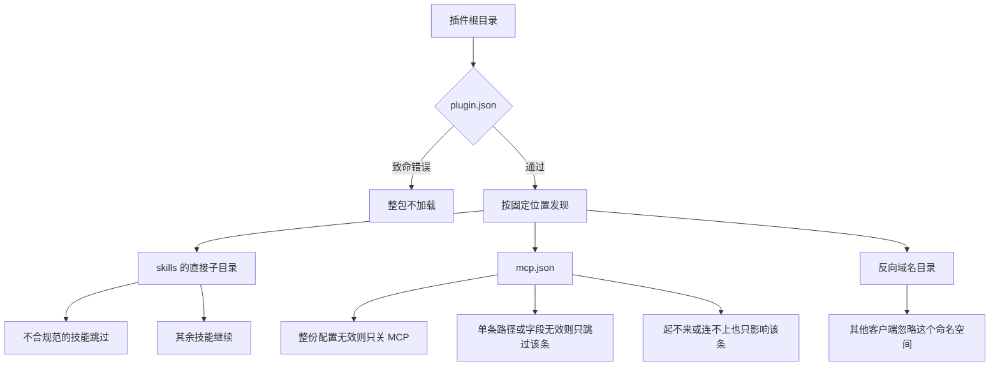

你把同一份退款步骤写进了三处目录。一家客户端认 `skills/refund/SKILL.md`，另一家要你按它的插件格式再放一份，`mcp.json` 的字段还得改成它的写法。服务器如果开了技能扩展，这条连接上还能再出现一份正文。Agent Plugins 1.0.0 把能搬走的两样收进同一个目录：`plugin.json`、`skills/`、`mcp.json`。

说明书可以跟这个目录走，也可以跟一条活着的 MCP 连接走。2026-10-15 我读的已发布规范是 1.0.0。还没定的是打包方向。

<!-- more -->

## 背景

[Vercel 的介绍](https://vercel.com/blog/introducing-agent-plugins)页面印着 Published: August 6, 2026，作者 Jonathan Hefner。文章把问题说成：技能和 MCP 服务器本身可以跨客户端复用，各家打包和发现的方式不一样。Agent Plugins 给兼容的客户端一个目录：根上有 `plugin.json`，组件放在固定位置。安装、分发、策略、界面，以及只有这家才有的能力，留给客户端。

同一篇写，草案由 Amazon Web Services、Anysphere、GitHub、Microsoft、OpenAI 和 Vercel 收成 1.0.0。初始 Technical Steering Committee 的 Core Maintainer 来自 AWS、Cursor、Microsoft、OpenAI 和 Vercel。2026-10-15 我打开的 [MAINTAINERS.md](https://github.com/agentplugins/agent-plugins-spec/blob/main/MAINTAINERS.md) 列出五个人：Clare Liguori（Amazon）、Roshan Sadanani（Cursor）、Harald Kirschner（Microsoft）、Gav Verma（OpenAI）、Jonathan Hefner（Vercel，Lead Core Maintainer）。[章程](https://github.com/agentplugins/agent-plugins-spec/blob/main/GOVERNANCE.md)写治理角色属于个人，不为公司留席位，单一厂商不能占 Core Maintainer 的多数。规范正文和文档是 CC-BY-4.0，代码是 Apache-2.0。章程把项目资产交给 TSC 指定的中立实体保管。我没有看到一份当天打开的原始材料写别的标准组织已经接纳了这套格式。

仓库 README 写 1.0.0 是当前已发布版本，1.1.0 是 working draft。我当天把 [spec/1.0.0.md](https://github.com/agentplugins/agent-plugins-spec/blob/main/spec/1.0.0.md) 和 [spec/1.1.0.md](https://github.com/agentplugins/agent-plugins-spec/blob/main/spec/1.1.0.md) 对过。1.1.0 的状态是 Working Draft。除了版本号、schema 地址，以及几处把 “v1” 改成 “本规范” 的句子，两份正文相同。下面引用的规则都以已发布的 1.0.0 为准。

技能格式仍是 [Agent Skills 规范](https://agentskills.io/specification)。MCP 的线上行为仍是 [MCP 规范](https://modelcontextprotocol.io/specification)。Agent Plugins 规定的是这两样在一个目录里怎么被找到。本站写过本机安装的技能，见[可安装技能](https://cfireworks.github.io/2026/09/30/agent-skills-why-installable-skills-matter/)。协议管调用、技能管步骤，见[协议和技能的边界](https://cfireworks.github.io/2026/10/01/2026-10-01-agent-protocols-skills-boundary/)。

另一头是连接。SEP-2640 让服务器用 `skills/list` 交出目录，再用 `resources/read` 读正文。摘要和批准写在 [10 月 6 日那篇](https://cfireworks.github.io/2026/10/06/2026-10-06-mcp-skills-approval-digest/)。还开着的 [PR #46](https://github.com/cFireworks/cfireworks.github.io/pull/46) 讨论技能跟资源走、名字不是身份。本文不重写那两篇。这里只保留一个差别：那两篇的说明书在当前这条连接上，这篇的说明书在目录里，和 `mcp.json` 并排。

## 技术分析

1.0.0 的插件是一个目录。根上必须有 `plugin.json`。没有第二份文件能替换这份清单里的核心字段。客户端先校验清单，再发现组件。加载时不得去取 `$schema` 指向的那份 JSON Schema，用的是本地已经认识的版本。不认识的版本，整包拒绝。

清单的模式是封闭的。允许的顶层字段只有 `$schema`、`name`、`version`、`description`、`author`、`homepage`、`repository`、`license`、`keywords`、`extensions`。1.0.0 的 `$schema` 必须是 `https://agent-plugins.org/schemas/1.0.0/plugin.schema.json`。`name` 长度 1 到 64，字符只许 `a-z`、`0-9`、`-`、`.`，首尾必须是字母或数字，不许 `--` 或 `..`。`version` 建议用语义化版本，但规范写明不能只因为版本字符串不像语义化版本就拒绝清单。未知顶层字段要报告并忽略，然后继续加载，并且不得给这些字段派语义。`extensions` 如果不是对象，同样报告并忽略。除此以外的模式错误是致命的：拒绝整包，不发现、不执行任何组件。

最少只需要这两个字段：

```json
{
  "$schema": "https://agent-plugins.org/schemas/1.0.0/plugin.schema.json",
  "name": "greet-tools"
}
```

组件位置是固定的。`plugin.json` 不能把它们改到别处，也不能把 MCP 配置内联进来。

| 组件 | 固定位置 | 没有这个路径时 |
|------|----------|----------------|
| 技能 | `skills/` 的直接子目录，里面有 `SKILL.md` | 不算错误 |
| MCP 服务器 | 根上的 `mcp.json` | 不算错误 |

技能不递归。`skills/greet/SKILL.md` 是一份技能。`skills/greet/extra/SKILL.md` 不会被当成第二份。某一份不符合 Agent Skills 规范，跳过它，其他技能和 MCP 继续。技能目录名和 frontmatter 的 `name` 怎样对齐，以 Agent Skills 规范为准。Agent Plugins 只规定怎么发现。

`mcp.json` 顶层只有 `$schema` 和 `mcpServers`。1.0.0 的地址是 `https://agent-plugins.org/schemas/1.0.0/mcp.schema.json`。它的版本必须和 `plugin.json` 相同。不一致时，关掉这个插件的 MCP，其他组件照旧加载。单条服务器字段不对、传输类型这家不支持、或者进程起不来、连不上、握手失败，都只跳过这一条。

stdio 的 `command` 是一个可执行 token，不是交给 shell 的一整串。要么是裸名字，要么是以 `./` 开头、解析后仍在插件根里的路径。包内自带的可执行文件必须用 `./`，因为裸名字走的平台搜索，配置里的 `PATH` 会不会参与，由客户端定，插件不能依赖它。`command` 不做占位符展开。`cwd` 省略时，工作目录就是插件根。写了的话，必须是 `./` 开头、`${PLUGIN_ROOT}` 开头，或 `${PLUGIN_DATA}` 开头，展开后再检查没有逃出对应的根。规范里的反例是 `command` 写成 `../bin/server`，`cwd` 写成 `data`。

客户端启动 stdio 进程时要提供 `PLUGIN_ROOT` 和 `PLUGIN_DATA`。前者是插件根的绝对路径，后者是客户端管的、更新插件时保留的可写目录。`${PLUGIN_ROOT}` 和 `${PLUGIN_DATA}` 只在 `args`、`env` 的值、`cwd` 里做一次文本替换，不递归。`env` 里不许自己写这两个名字。`headers` 和 `env` 都是包里看得见的数据，规范要求不要把凭证写进去。1.0.0 没有可携带的 OAuth 字段。授权失败算这条服务器连不上，不算包无效。

只有一家客户端认的文件，放在反向域名目录里，例如 `com.example.client/hooks/`。清单里的客户端数据放在 `extensions` 下的同一个名字。别的客户端忽略自己没实现的命名空间，连内容都不校验。命令、钩子、代理留在客户端这边，等语义收敛再考虑收进可携带的部分。

失败按最窄的那一圈处理：



三种放法可以并排看。第三列是各家今天自己的插件目录，规范没有给它统一的字段。

| 维度 | Agent Plugins 1.0 | Skills-over-MCP | 客户端自己的包 |
|------|-------------------|-----------------|----------------|
| 说明书在哪 | 插件根下的 `skills/` | 当前连接上的资源 | 这家规定的目录 |
| MCP 配置在哪 | 同目录的 `mcp.json` | 就是这条连接 | 这家的配置文件 |
| 怎么发现 | 固定路径 | `skills/list`，正文 `resources/read` | 扫这家的路径 |
| 换一家客户端 | 同一目录，对方要认这套布局 | 对方要会这个扩展，并且连得上 | 通常再打一份 |
| 正文更新之后 | 换目录或换版本 | 见 [10 月 6 日那篇](https://cfireworks.github.io/2026/10/06/2026-10-06-mcp-skills-approval-digest/) | 看那个宿主 |
| 坏掉时 | 坏掉的组件不拖垮其余部分 | 停在这条连接 | 看那个宿主 |
| 只有一家认的钩子 | 反向域名目录或 `extensions` | 不在这套扩展里 | 写进自家格式 |
| 我会在什么时候用 | 技能和连接配置要给多家客户端 | 步骤必须跟着这台活着的服务器 | 钩子还没有可携带的语义 |

Vercel 那篇在发布时列出的客户端是 ChatGPT、Codex、Cursor、GitHub Copilot、Kiro、VS Code。这是文章里的名单。我没有在这些客户端里加载目录。

### 本地只检查目录

脚本在 `demos/agent-plugins-bundle/`。Hexo 只发布 `source/`，这个目录不会进页面。它在 `/tmp/agent-plugins-bundle/greet-tools` 写一份最小插件：合法的 `plugin.json`、`skills/greet/SKILL.md`、带 `./bin/echo-server` 和 `cwd: ./data` 的 `mcp.json`。`bin/echo-server` 只是磁盘上的文件。

名字按 1.0.0 的字符集检查。两份 `$schema` 的版本号必须相同；我用一个仓库里不存在的 `1.0.1` 地址制造不一致，用来看「只关 MCP、技能文件还在」。路径按插件根解析。`../bin/echo-server` 会落到根外面。`data` 没有 `./` 前缀。

规范里的 `cwd` 还可以写成 `${PLUGIN_ROOT}` 或 `${PLUGIN_DATA}`。脚本没有实现这两支，也不会把它们打成通过。脚本也不检查符号链接逃出根、不认识的 `plugin.json` `$schema`、以及远程 URL 的规则。那些失败圈在规范里，不在这次输出里。

```python
def command_problem(root: Path, command: str) -> str | None:
    if "/" not in command and "\\" not in command:
        return None
    if escapes_root(root, command):
        return "escapes-root"
    if not command.startswith("./"):
        return "not-plugin-relative"
    return None


def cwd_problem(root: Path, cwd: str) -> str | None:
    if not cwd.startswith("./"):
        return "not-plugin-relative"
    if escapes_root(root, cwd):
        return "escapes-root"
    return None
```

我执行的命令是：

```bash
python3 demos/agent-plugins-bundle/run_demo.py
```

环境是 Python 3.12.3。连续两次运行，标准输出逐字节相同。下面是完整输出，没有删行。

```text
python 3.12.3
built greet-tools files=plugin.json,skills/greet/SKILL.md,mcp.json,bin/echo-server,data/
manifest schema=https://agent-plugins.org/schemas/1.0.0/plugin.schema.json name=greet-tools
skill skills/greet/SKILL.md frontmatter_name=greet
mcp echo type=stdio command=./bin/echo-server cwd=./data
name accept greet-tools
name accept acme.tools
name reject My-Plugin reason=charset
name reject -start reason=edge
name reject has--double reason=consecutive-hyphens
name reject too.many..dots reason=consecutive-periods
name reject <empty> reason=length
schema match plugin=1.0.0 mcp=1.0.0
schema mismatch plugin=1.0.0 mcp=1.0.1 mcp=disabled skills=kept
command accept ./bin/echo-server inside=true
command reject ../bin/echo-server reason=escapes-root
cwd reject data reason=not-plugin-relative
cwd accept ./data inside=true
checks passed
```

`schema mismatch` 那一行只说明版本字符串不同，并且技能文件还在磁盘上。它没有启动服务器，也没有走一家客户端的加载器。`inside=true` 只表示解析后的路径留在插件根里。

## 实践建议

打包之前先问说明书跟谁走。

1. 同一份技能和同一份 MCP 配置要给多于一家客户端，用 Agent Plugins 的目录。根上放 `plugin.json`，技能放 `skills/<name>/SKILL.md`，连接放 `mcp.json`。两份 `$schema` 用同一版。包内程序写 `./bin/...`，工作目录写 `./` 或规范允许的占位符，不要写 `../`，也不要写裸的 `data`。
2. 步骤必须和某台正在服务的工具一起变，把说明书留在那条连接上，走 Skills-over-MCP。目录里再抄一份，不会自动跟上服务器刚改的正文。批准怎样绑在摘要上，看 10 月 6 日那篇，这里不重复。
3. 钩子、斜杠命令、只有一家会跑的文件，放进反向域名目录，或放进 `extensions` 里的同名对象。不要写成 `plugin.json` 的未知顶层字段。未知字段会被忽略，没有语义。
4. 凭证不要写进 `env` 或 `headers`。1.0.0 没有可携带的密钥引用。授权交给客户端。
5. 发布前在本地对一下名字、schema 版本和路径是否逃出根。这次的脚本做的就是这三样。它代替不了客户端的一致性清单。

## 以后钩子会不会进包

设计说明里写，v1 只收已经有自己规范、而且多家在用的两样：技能和 MCP。命令、钩子、代理、规则、LSP 还各写各的，留在客户端。反向域名就是给这些试验留的格子。1.1.0 在 2026-10-15 仍是草稿，我对过的正文还没有新的组件类型。钩子要变成可携带的，得先有一份多家都认的语义，再改规范。在那之前，把钩子写进 `skills/` 或 `mcp.json`，别的客户端不会按钩子去跑。

## 结语

三处目录里，能搬走的是技能正文和 MCP 怎么连。Agent Plugins 1.0.0 让这两样并排放。必须跟着某台服务器变的步骤，仍从那条连接读。只有一家认的钩子，留在反向域名里。打包时先选边，再写文件。

---

## 扩展阅读

- [Agent Plugins Specification 1.0.0](https://github.com/agentplugins/agent-plugins-spec/blob/main/spec/1.0.0.md)（Published）
- [Technical Charter](https://github.com/agentplugins/agent-plugins-spec/blob/main/GOVERNANCE.md)（规范正文 CC-BY-4.0，代码 Apache-2.0）
- [MAINTAINERS.md](https://github.com/agentplugins/agent-plugins-spec/blob/main/MAINTAINERS.md)
- [Introducing Agent Plugins](https://vercel.com/blog/introducing-agent-plugins)（页面日期 2026-08-06）
- [Agent Plugins 指南](https://vercel.com/kb/guide/agent-plugins)
- [agent-plugins.org](https://agent-plugins.org)
- [MCP 技能：正文变了要重新批](https://cfireworks.github.io/2026/10/06/2026-10-06-mcp-skills-approval-digest/)
- [PR #46：MCP 技能跟资源走，名字不是身份](https://github.com/cFireworks/cfireworks.github.io/pull/46)
- [可安装技能](https://cfireworks.github.io/2026/09/30/agent-skills-why-installable-skills-matter/)
- [协议和技能的边界](https://cfireworks.github.io/2026/10/01/2026-10-01-agent-protocols-skills-boundary/)

---

*1.0.0 规范、1.1.0 草稿、章程、MAINTAINERS、agent-plugins.org、Vercel 博客与指南核对于 2026-10-15。演示在 Python 3.12.3 上执行 `python3 demos/agent-plugins-bundle/run_demo.py`，连续两次标准输出逐字节相同。没有启动 MCP 进程，也没有在 Cursor、VS Code 或其他宿主里加载这个目录。*

## 讨论

你这份说明书是要拷到第二家客户端，还是必须跟着某一台服务器的工具一起变？只有一家会跑的钩子，放进了反向域名目录，还是写进了 `plugin.json` 的顶层？
