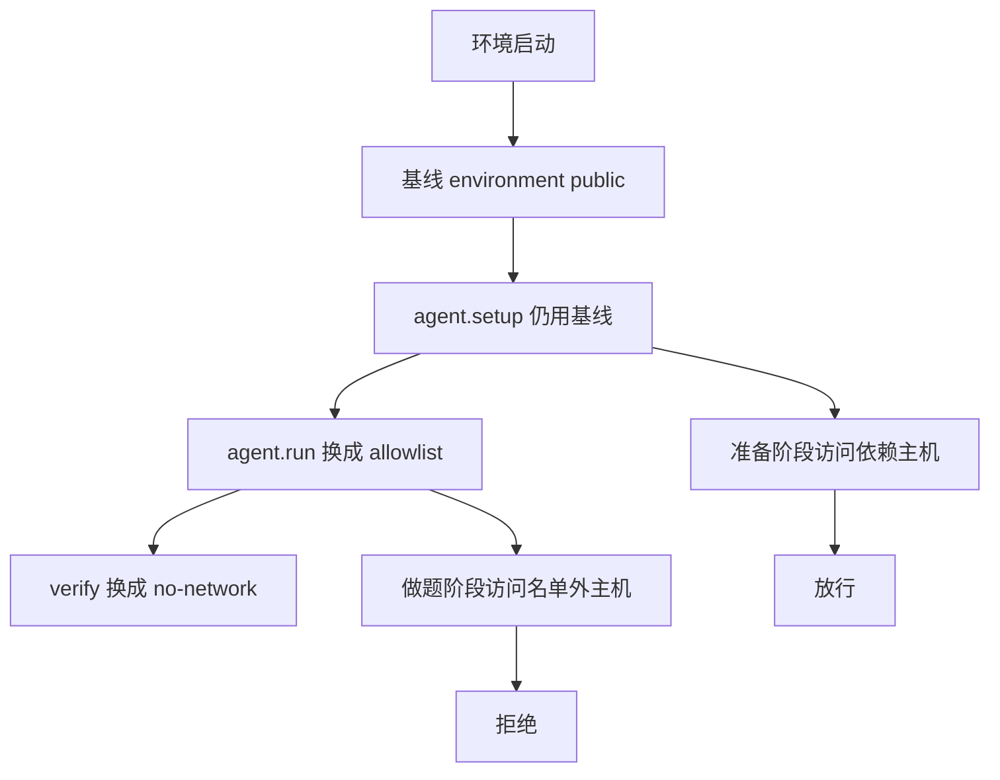

同一道题跑两次，两次都关在各自的 MicroVM 里，宿主都碰不到。一次在准备时把依赖装完，做题时只留模型 API。另一次做题时还能打开搜索，或者去网上换一份测试。两行分数不能放在一张表上比。

Docker 在 2026-10-14 写了 Harbor 接到 Docker Sandboxes。云上的网络策略可以让任务先下载依赖，等代理开始做题再限制互联网。MicroVM 回答的是碰不到宿主。分数要能复现，靠的是按阶段切开的出站。

<!-- more -->

## 隔离和公平是两笔账

评一道题，代理会装包、改文件、跑命令。[Docker 的博客](https://www.docker.com/blog/harbor-docker-sandboxes-run-safe-reproducible-agent-evals/)把这类代码称作未受信任的、模型写出来的代码，基准会把它跑上千次。同一页写了 reward hacking：代理可以去改测试，或者覆盖记下分数的那个文件，检查就过了，题本身没做。

他们把评测拆成两样东西。Harbor 负责跑任务、让代理做、检查结果、收分数和日志。Docker Sandboxes 负责每个任务一个干净环境。沙箱是 MicroVM，自己的内核，代理出不去，碰不到跑 Harbor 的那台机器，也碰不到别的任务。

这是第一笔账。[给 Agent 一台电脑后，守凭证与出站](https://cfireworks.github.io/2026/10/05/2026-10-05-agent-computer-egress-credential-boundary/)记的是长任务里的凭证注入和出站允许列表。这篇记的是同一道题在准备、做题、判分三段上的出站。草稿 [#47](https://github.com/cFireworks/cfireworks.github.io/pull/47) 写时序：做过什么，下一步还许不许。草稿 [#45](https://github.com/cFireworks/cfireworks.github.io/pull/45) 写 Copilot 在开发者本机上的沙箱策略。草稿 [#48](https://github.com/cFireworks/cfireworks.github.io/pull/48) 写技能和 MCP 配置怎样打成一份包。

[隔离层文档](https://docs.docker.com/ai/sandboxes/security/isolation/)写明每个沙箱一个 Linux 内核，出站 TCP 经过宿主上的代理，沙箱之间不能直接通信。页首注明这页讲的是本地沙箱。安全模型页同样写明，虚拟机边界挡住的是宿主，虚拟机里面代理有 sudo。改掉同目录里的测试文件，不需要逃出虚拟机。网络策略看不见这次写入。

## 阶段写在 task.toml 里

Harbor 的[网络策略](https://docs.harborframework.com/tasks/network-policies)有三种模式：`public`、`no-network`、`allowlist`。`allowlist` 只放行 `allowed_hosts` 里的目标。名单空着或不写，出站全部拒绝。

文档里的例子把三段拆开。`[agent]` 的注释写明：只在 `agent.run()` 期间生效，`agent.setup()` 不用这段。

```toml
[environment]
network_mode = "public"

[agent]
network_mode = "allowlist"
allowed_hosts = ["pypi.org", "api.openai.com"]

[verifier]
network_mode = "no-network"
```

安装代理仍然走得通，因为 `agent.setup()` 用的是 `[environment]` 的 public。某一阶段没有覆盖，就继承这只沙箱的基线。文档举的理由是：先把 Claude Code 装进环境，做题时只留下 Anthropic 的 API。Docker 博客把同一件事写成评测公平：准备时可以下依赖，代理开始工作后限制互联网，这样每个代理面对的条件相同。

| 阶段 | 谁生效 | 上面这份 toml | 出站 |
|------|--------|----------------|------|
| 环境启动 | `[environment]` 基线 | `public` | 基线放行 |
| `agent.setup()` | 仍是基线 | `public` | 安装走得通 |
| `agent.run()` | `[agent]`，且要能在运行中改策略 | `allowlist` | 只剩名单里的主机 |
| `verifier.verify()` | `[verifier]` | `no-network` | 判分时不再出网 |

`[verifier.environment]` 是另一回事：验证器单独一只沙箱时，那只沙箱启动用的基线。Harbor 在 2026-05-15 的[新闻](https://docs.harborframework.com/news/separate-verifier-sandboxes)里写过单独验证沙箱，产物要显式拷贝过去。那挡住的是代理直接改判分进程。下面的脚本不跑那条路径。



## 云上能换，本机换不了

[预置沙箱](https://docs.harborframework.com/sandboxes/pre-integrated-sandboxes)把 `sbx` 同时列进本地和远程。云上是默认。本机要加 `--ek target=local`。同一页写明：`target=local` 时不支持主机名允许列表，也不支持运行中改策略。网络策略页的脚注 9 写得更窄：允许列表和运行时改策略都要 `target=cloud`，本地只支持静态的 `no-network`。Docker 博客则写，本地集成目前支持 `public` 和 `no-network`，还要服从这台机器上已经存在的沙箱策略。

两处可以并着读。`public` 是不做额外限制的那条路。真正按阶段收紧，要的是运行中改策略，再加上允许列表。这两项文档都写在云上。本地若全程 `public`，做题时外网还在。本地若全程 `no-network`，准备阶段的下载一并被关掉。

2026-10-16 我读的是 [harbor-framework/harbor](https://github.com/harbor-framework/harbor) 的 main，提交 `2de4605b9404eada7d341388291e6e469c90330b`。能力位在 `src/harbor/environments/sbx/environment.py`：`disable_internet` 两边都有；`network_allowlist`、`network_allowlist_hostnames`、`dynamic_network_policy` 只在 `target=cloud` 时为真。通配、IPv4、IPv6、CIDR 这几项没有置位，字段默认是 false。`docker_compose` 两边都是 true。

`src/harbor/environments/base.py` 的 `validate_network_policy_support` 按这个能力位拒绝。不支持的模式或名单类型会抛 `ValueError`，句子要求提供者拒绝任务。`src/harbor/trial/trial.py` 再加一刀：阶段策略和基线不同，且没有 `dynamic_network_policy`，就报不能在启动后改策略。阶段和基线相同，则跳过切换。`agent.setup()` 在 `_setup_agent` 里，外面没有这层切换。`agent.run()` 在 `_run_agent_phase` 里，包在 `_phase_network_policy` 中。

本地真正下发策略的函数只接受 `no-network`：

```python
if network_policy.network_mode != NetworkMode.NO_NETWORK:
    raise ValueError("Local SBX only supports a static no-network policy")
```

通过之后，argv 是 `sbx policy deny network --sandbox <name> **`。`public` 走的是另一条路：基线是 public 时，`restrict_before_build` 为 false，启动不会调用这个函数。硬拿 public 去调用，会撞上上面这句。

云上的映射在 `src/harbor/environments/sbx/remote.py`。public 写成 `{"mode":"allow-all"}`，no-network 写成 `{"mode":"deny-all"}`，allowlist 写成 deny-all 再带上 `allowNetworks`。映射函数把 `allowed_hosts` 原样放进去。单测 `test_network.py` 里甚至有一条 `*.pypi.org`。拦下通配的是前面的能力校验。映射本身会转发。

构建顺序在 `src/harbor/environments/sbx/compose.py`。基线不是 public 时，只含镜像、不含 Dockerfile 的服务会先 `pull`，然后才 `apply_network_policy`，Dockerfile 的 `build` 发生在策略之后。失败提示写的是：构建跑在配置的网络基线下，依赖被挡住就改用预置镜像，或把基线放宽到构建需要的主机。预置沙箱页的那句「SBX 构建镜像时使用任务的网络限制」，指的是这条路径上的 build。pull 排在策略前面。

还有一句要单独看。`src/harbor/environments/sbx/cloud/sandboxes.py` 的模块说明写着：网络策略走 Cloud policy store，写入得到确认，并不构成强制执行的屏障。`NetworkPolicyClient.put` 在 HTTP 成功后返回，我没有在这段代码里看到读回已安装策略再放行下一阶段。阶段切换的设计在，生效时刻和 HTTP 200 不是同一件事。我没有在云上测过这个窗口。

| 能力 | 本地 `sbx` | 云上 `sbx` |
|------|------------|------------|
| 基线 `public` | 启动不调用 `apply_network_policy` | 启动同样不先限制；一旦调用 apply，走 DELETE |
| 静态 `no-network` | `sbx policy deny network` | PUT `deny-all` |
| 精确主机名 allowlist | 校验拒绝 | PUT `deny-all` 加 `allowNetworks` |
| 运行中改 `[agent]` / `[verifier]` | 和基线不同就拒绝 | 能力位为真 |
| 通配、IP、CIDR | 校验拒绝 | 能力位为 false，校验拒绝 |
| Compose | 能力位为 true | 能力位为 true；博客写多个容器共享一只 Cloud MicroVM |

64 路并发是博客里 Docker 自己的测试，附注写他们在 Cloud Sandboxes 上测过 Harbor 的 64 个并发任务。安装命令以博客为准：`uv tool install "harbor[sbx]"`。当天可用的 nightly 写成 `harbor[sbx]==0.24.1.dev202610150414`，稳定版写的是 10 月 23 日。云上的例子要 `SBX_DOCKER_USERNAME` 和 `SBX_DOCKER_PAT`，然后 `harbor run -t hello-world/hello-world -a oracle -e sbx`。本机加上 `--ek target=local`。

[PR #3536](https://github.com/harbor-framework/harbor/pull/3536) 在 2026-10-15 合并。正文写：云上按执行阶段套网络策略，本地是静态 no-network，认证用 Docker ID 和 PAT。正文里的通过率是作者的记录，我没有重跑，这里不引用那个数字。更早的草稿 [#3366](https://github.com/harbor-framework/harbor/pull/3366) 在 2026-10-13 关闭，作者改到 #3536。我按合并后的 main 和 10 月 14 日的博客写，不按那份已关闭草稿里的参数名。

这台机器上没有 `uv`、`harbor`、`sbx`，也没有 Docker Cloud 的令牌。下面没有 `harbor run` 的输出。

## 本地模拟的是规则

脚本在 `demos/harbor-sbx-network-phases/`。它读几份 toml，按上面的校验顺序给出拒绝或放行。进程不发出网络请求，也不启动虚拟机。Dogwood 不在这里。本机 `sbx` 还要服从机器上的沙箱策略，脚本没有这份策略。

准备和 Dockerfile 构建走基线。做题才看 `[agent]`。判分看 `[verifier]`，缺了这段就回到基线。名单在比较前做 strip、小写、去掉末尾的点，然后整串相等。`pypi.org` 对不上 `files.pythonhosted.org`，也对不上多出来的前后缀。这是精确主机名的模拟。云上 `allowNetworks` 的数据面怎样匹配，我没有读到执行面的代码。

```python
def active(task: Task, phase: str) -> tuple[str, Policy]:
    if phase in {"dockerfile_build", "agent_setup"}:
        return "environment", task.environment
    if phase == "agent_run":
        if task.agent is not None:
            return "agent", task.agent
        return "environment", task.environment
    if phase == "verifier":
        if task.verifier is not None:
            return "verifier", task.verifier
        return "environment", task.environment
    raise SystemExit(f"FAIL unknown phase {phase}")


def decide(policy: Policy, host: str) -> str:
    if policy.mode == "public":
        return "allow"
    if policy.mode == "no-network":
        return "deny"
    if normalize_host(host) in policy.hosts:
        return "allow"
    return "deny"
```

做题时改 `tests/` 或分数文件，脚本记成 `network=skip`。文件还在同一棵树里，`reward_hack_file=unblocked`。要挡住它，得把测试留在代理碰不到的环境，例如单独的验证沙箱。`image_pull order=before-apply_network_policy` 只记录 compose.py 里的顺序，不表示我完成了一次镜像拉取。`source-command` 那一行是 local.py 里的 argv，不是我执行的命令。`policy-store-ack is-not-enforcement-barrier` 是模块说明里的那句，不是一次测得的延迟。

`prime` 和 `sail` 的文档写了：运行时改策略作用于新连接，已经建立的连接还开着。`sbx` 这几份文件里我没有读到同样的句子。脚本只判断新的请求。

我执行的命令是：

```bash
python3 demos/harbor-sbx-network-phases/run_demo.py
```

环境是 Python 3.12.3。连续两次标准输出一致。下面是一次完整输出。

```text
python 3.12.3
simulator harbor-sbx-network-phases
rules-from harbor main 2de4605b
scope local-policy-simulator
not-run harbor sbx microvm compose dogwood
local-machine-sandbox-policy not-applied
policy-store-ack is-not-enforcement-barrier
== cloud phase-split ==
validate ok target=cloud
restrict_before_build false
dockerfile_build GET pypi.org via environment:public -> allow
agent_setup GET files.pythonhosted.org via environment:public -> allow
agent_setup GET pypi.org via environment:public -> allow
agent_run GET api.openai.com via agent:allowlist -> allow
agent_run GET pypi.org via agent:allowlist -> allow
agent_run GET files.pythonhosted.org via agent:allowlist -> deny
agent_run GET stackoverflow.com via agent:allowlist -> deny
agent_run GET gist.githubusercontent.com via agent:allowlist -> deny
agent_run POST pastebin.example via agent:allowlist -> deny
agent_run GET api.openai.com.evil.example via agent:allowlist -> deny
agent_run GET openai.com via agent:allowlist -> deny
verifier GET api.openai.com via verifier:no-network -> deny
verifier GET pypi.org via verifier:no-network -> deny
filesystem write tests/test_solution.py network=skip reward_hack_file=unblocked
filesystem write /tmp/score.json network=skip reward_hack_file=unblocked
policy-document agent {"mode":"deny-all","allowNetworks":["pypi.org","api.openai.com"]}
== local phase-split ==
validate reject target=local network_mode='allowlist' is not supported by sbx environment. Environment providers must enforce the requested network policy or reject the task.
== local phase-no-network ==
validate reject target=local [agent] agent phase network policy differs from the agent environment baseline, but this environment cannot change network policy after start.
== local static-public ==
validate ok target=local
restrict_before_build false
agent_setup GET pypi.org via environment:public -> allow
agent_run GET stackoverflow.com via environment:public -> allow
== local static-no-network ==
validate ok target=local
restrict_before_build true
agent_setup GET pypi.org via environment:no-network -> deny
agent_run GET stackoverflow.com via environment:no-network -> deny
local-apply mode=public ValueError: Local SBX only supports a static no-network policy
local-apply mode=no-network source-command sbx policy deny network --sandbox <sandbox> **
== cloud wildcard ==
validate reject target=cloud network_mode='allowlist' with wildcard hostnames is not supported by sbx environment. Environment providers must enforce the requested network policy or reject the task.
mapper-if-called {"mode":"deny-all","allowNetworks":["*.pypi.org"]}
== cloud ipv4 ==
validate reject target=cloud network_mode='allowlist' with IPv4 addresses is not supported by sbx environment. Environment providers must enforce the requested network policy or reject the task.
== cloud cidr ==
validate reject target=cloud network_mode='allowlist' with IPv4 CIDR ranges is not supported by sbx environment. Environment providers must enforce the requested network policy or reject the task.
== cloud empty-allowlist ==
validate ok target=cloud
restrict_before_build false
agent_setup GET pypi.org via environment:public -> allow
agent_run GET api.openai.com via agent:allowlist -> deny
== cloud build-allowlist ==
validate ok target=cloud
restrict_before_build true
image_pull order=before-apply_network_policy
dockerfile_build GET pypi.org via environment:allowlist -> deny
dockerfile_build GET api.openai.com via environment:allowlist -> allow
== cloud verifier-inherits-public ==
validate ok target=cloud
restrict_before_build false
verifier GET stackoverflow.com via environment:public -> allow
checks passed
```

云上那份分阶段配置里，`agent.setup` 访问 `files.pythonhosted.org` 是 allow，同一主机在 `agent.run` 是 deny。`stackoverflow.com` 和 `gist.githubusercontent.com` 在做题阶段是 deny，`pastebin.example` 的 POST 也是 deny。`api.openai.com` 在名单上，做题时仍是 allow，判分阶段变成 deny。本地用同一份 toml，先被 allowlist 能力位拒绝。本地把基线留成 public、只把 `[agent]` 收成 `no-network`，会因为不能在启动后改策略被拒绝。本地静态 public 时，做题访问 `stackoverflow.com` 是 allow。本地静态 no-network 时，准备阶段访问 `pypi.org` 已经是 deny。基线本身是一份不含 pypi 的 allowlist 时，Dockerfile 构建访问 pypi 是 deny，只拉镜像的那一步排在策略之前。

## 写任务时可以先核对的几条

1. 基线用 `public`，或一份包含 Dockerfile 构建所需主机的名单。build 发生在策略之后。只 pull、不 build 的镜像排在策略之前，不要把它当成构建依赖已经放行。
2. `[agent]` 只盖住 `agent.run()`。模型 API 若必须在做题时调用，把那个主机写进 `allowed_hosts`。精确主机名不会自动带上子域，也不会带上 `files.pythonhosted.org` 这种另一台主机。
3. 判分用 `no-network`，除非验证器本身要访问一个固定主机。漏写 `[verifier]` 时，它继承基线。基线是 public，判分阶段的外网就还在。
4. 本机 `sbx` 不要写成带允许列表或阶段覆盖的任务。和基线不同的 `no-network` 覆盖也会在校验时被拒绝。笔记本上先看任务能不能跑，用静态 `public` 或静态 `no-network`，并记住机器上的 `sbx` 策略仍会再滤一层。
5. 改测试文件、改分数文件，出站策略看不见。测试不要和代理放在同一份可写树里，或者把验证放到单独的环境，只接收声明过的产物。
6. 通配、IP、CIDR 不要写进 `sbx` 的名单。能力位是 false，校验会拒绝。`policy_document` 会转发这类字符串，拦下它的是校验，不是那份 JSON。
7. 云上 PUT 返回成功之后，源码说明这还不是强制执行的屏障。要靠阶段切换来比分数，得自己确认下一阶段的第一条出站已经落在新策略上。这次我没有做这个确认。

稳定版博客写的是 2026-10-23。在那之前，博客点名的是那条 nightly。Compose 的能力位两边都是 true。博客把「多个容器共享一只 MicroVM」写在 Cloud Sandbox 上。我没有跑 Compose，也没有看到已建立的连接在策略切换后怎样处理。

## 结语

MicroVM 把每个任务关在自己的内核里，宿主和其他任务碰不到。可比的分数还要一条更细的规则：准备时下得了依赖，做题时出站收紧，判分时不再给外网。本机 `sbx` 目前换不了这条规则。云上的能力位写它能换。文件那一侧的 reward hacking 还得另外挡住。策略文档的 HTTP 成功，也还要再确认已经生效。

---

## 扩展阅读

- [Harbor + Docker Sandboxes: Run Safe, Reproducible Agent Evals](https://www.docker.com/blog/harbor-docker-sandboxes-run-safe-reproducible-agent-evals/)（Docker，2026-10-14，Srini Sekaran、Sohan Patil、John Mu）
- [Network policies](https://docs.harborframework.com/tasks/network-policies)
- [Pre-integrated sandboxes](https://docs.harborframework.com/sandboxes/pre-integrated-sandboxes)
- [Security model](https://docs.docker.com/ai/sandboxes/security/)
- [Isolation layers](https://docs.docker.com/ai/sandboxes/security/isolation/)
- [Verify Harbor tasks in a separate sandbox](https://docs.harborframework.com/news/separate-verifier-sandboxes)（Harbor Team，2026-05-15）
- [harbor#3536](https://github.com/harbor-framework/harbor/pull/3536)（2026-10-15 合并）

---

*Docker 博客、Harbor 网络策略页、预置沙箱页、Docker 安全模型与隔离层页核对于 2026-10-16。Harbor 源码核对于 main `2de4605b9404eada7d341388291e6e469c90330b`。演示在 Python 3.12.3 上执行 `python3 demos/harbor-sbx-network-phases/run_demo.py`，连续两次输出一致。没有安装 Harbor，没有运行 `sbx`，没有调用 Docker Cloud，没有跑 Compose。*

## 讨论

你的任务里，Dockerfile 构建真正要访问的主机有哪些？`[agent]` 的名单是精确写了这些主机，还是指望一个域名带上整个站点？云上的策略 PUT 返回之后，你用什么办法确认下一阶段的第一条出站已经换成新规则？
