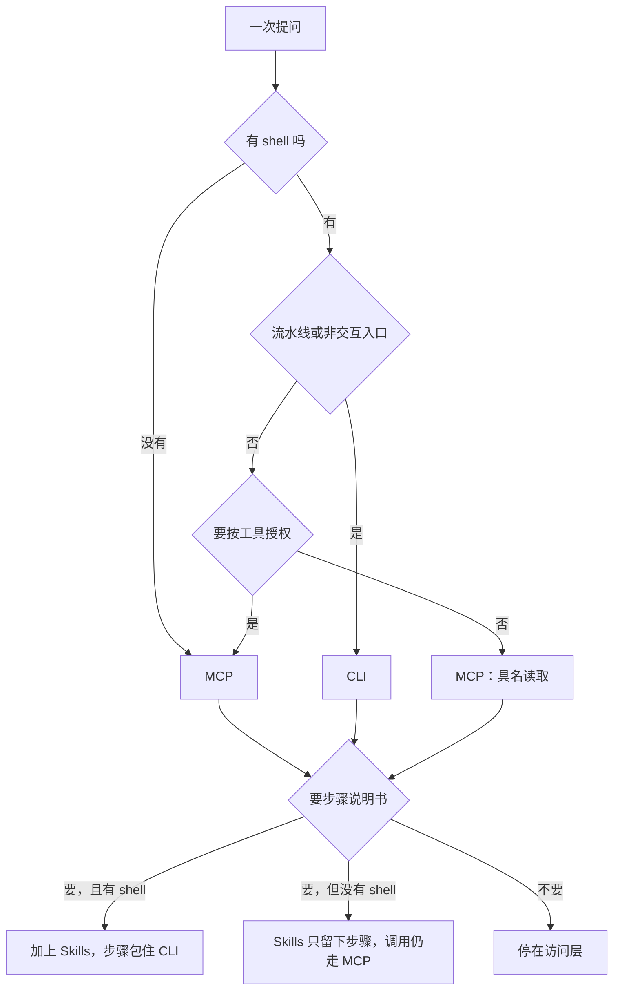

同一句问法：这周哪个实验在幻觉上退步了。问这句话的地方不一样。有人在 Claude Desktop 里，没有终端。有的是夜里的 cron。有的是仓库里已经有 shell 的编码代理。Arize 在 2026 年 10 月把 AX 做成三样东西，底下是同一套接口。MCP 负责任意客户端上的具名能力和发现，CLI 负责有壳时能脚本执行，`SKILL.md` 负责把活干完的顺序。选哪一条，看代理跑在哪、谁在问。

<!-- more -->

## 上下文税当时成立

[Arize 这篇](https://arize.com/blog/extending-your-agent-with-arize-ax-mcp-cli-and-skills/)的作者是 Fuad Ali、Dirk Brand、Sragvi Vadali。页面上的日期是 2026 年 10 月，没有更细的日子。文章引用了首席产品官 Aparna Dhinakaran 今年早些时候在 X 上的一句：MCP = context tax. The future is CLI and files. 原帖我没有打开。文章接着写，这句话在当时成立；harness 补上延迟加载之后，他们还是上线了托管 MCP。文章说那是「上周」。页眉只有月份，我没法把「上周」对到某一天。

税从哪来，2025-11-04 的 [Code execution with MCP](https://www.anthropic.com/engineering/code-execution-with-mcp) 写得很具体。客户端把工具定义放进上下文，中间结果再从模型过一遍。他们举的 Drive 转写进 Salesforce 的例子，token 从 150,000 降到 2,000，省下 98.7%。做法是代理写代码去调 MCP，而不是一步一次工具调用。文件系统上按需读工具定义，或者加一个 `search_tools`，都写在同一篇里。

2025-11-24 的 [advanced tool use](https://www.anthropic.com/engineering/advanced-tool-use) 给了一组他们自己的拆账。五台服务器：GitHub 35 个工具约 26K token，Slack 11 个约 21K，Sentry 5 个约 3K，Grafana 5 个约 3K，Splunk 2 个约 2K。合计 58 个工具，大约 55K，对话还没开始。文中还写，他们见过优化前工具定义吃掉 134K token。Tool Search Tool 把 `defer_loading: true` 的工具先留在外面。开头主要是搜索工具本身，文中约 500 token，再加上没有延迟的少数工具。他们给的对照是：传统路径在开工前大约 77K；打开搜索之后大约 8.7K，少了 85%。内部测试里，Opus 4 从 49% 到 74%，Opus 4.5 从 79.5% 到 88.1%。这些准确率是他们的测试，我没有重跑。同一篇把值得开搜索的门槛写在工具定义超过大约 1 万 token，或者工具多于 10 个。少于 10 个、而且每次会话都要用，搜索多出来的那一步就不划算。

Arize 的文章说 Claude Code、Cursor 和 Codex 现在会做 tool search，启动时上下文里只放已连接服务器的名字。上面那篇平台文章写的是另一套：延迟的是单个工具，开头留下的是搜索工具，不是「只留服务器名字」。我没有在这三个客户端里重测。两套描述按各自的页面保留，不合成一个开销数字。文章还转述了另几组社区测量。原始页面我没打开，数字不写在这里。

工具少于十个时，延迟加载省下的上下文有限。发现成本本来就低。开销不再单独决定选哪一面。

## 三面底下是同一层接口

文章写他们发了三样，底下是同一套 REST。

托管 MCP 没有要安装的进程。客户端指向区域端点，把 API key 放进 `Authorization: Bearer`。文中举例的地址是 `https://api.arize.com/mcp`，并说有三个区域端点。另外两个的主机名我没有去文档里核对。文章写暴露了 45 个工具再加 `server_info`，覆盖项目、trace、数据集、实验、评估器、监控和提示词。每个是带过滤条件的具名操作。我没有去连这个地址，也没有密钥，所以没有数过 `tools/list`。

`ax` CLI 文章写有 22 个命令组，从 `ax experiments list` 到 `ax evaluators create`，再到 `ax role-bindings`。技能用 `ax skills install` 装上，教代理怎么用这些命令把一件事做完。我没有执行 `pip install arize-ax-cli`，也没有跑安装技能的命令。

他们的五问可以收成一张表。这是文章里的框架，不是我在生产流量里统计出来的。

| 问题 | 是 | 原因 |
|------|----|------|
| 代理跑在没有 shell 的地方（Claude Desktop、托管助手、编辑器里的对话） | MCP | 没有别的调用面 |
| 工作是脚本流水线，或者要串起几条命令 | CLI | 可脚本；技能也包在命令上 |
| 要按操作授权，或凭证不进模型上下文 | MCP | 具名工具可以逐个批；shell 继承的是用户权限 |
| 跑在 CI、cron、Lambda 或容器入口 | CLI | 没有人握着一条长连接 |
| 账单才是问题 | 先确认 tool search 开着 | 重活再考虑代码执行。协议本身很少是根因 |



有 shell 的编码代理，读一条实验仍然可以走 MCP。文章把这件事说成：模型更会调工具了，列表工具自己带过滤，组合发生在一次调用里面。治理是另一条。具名操作可以单独允许或拒绝，模型上下文里不必放原始凭证。文章另写了一组调用错误的比较。原始页面我没打开，百分比不写在这里。

## 技能补的是顺序

MCP 给的是发现和调用。工具 schema 不写先确认版本、不知道 space 再去列。CLI 给的是可组合的命令。顺序、易错的地方、哪一步该停，写在 `SKILL.md` 里。文章用他们的 `arize-experiment` 技能举例：核对 `ax --version` 和环境，解析 space 和项目，用对的参数列出实验，再比较运行。那份文件我没有读到，不把他们的句子当成原文引用。

渐进披露是技能本来的放法。启动时先看见名字和描述，正文等到任务对上再读。文章把这一层说成启动开销已经很小。我没有做分词，下面的演示量的是字节。

两条线在收拢。2026-10-17 我重新打开 [SEP-2640](https://modelcontextprotocol.io/seps/2640-skills-extension)，状态仍是 Final。页面写明这是接受下来的设计记录，之后以现行规范为准。摘要把渐进披露交给 Agent Skills 规范，扩展自己规定技能文件怎么放在资源上。Arize 把客户端的用法写成先拿名字和描述，选中再读全文。清单里的逐文件摘要，以及批准绑在哪一组摘要上，本站 [10 月 6 日那篇](https://cfireworks.github.io/2026/10/06/2026-10-06-mcp-skills-approval-digest/)已经写过，这里不重做。合并时刻沿用那篇核对过的 2026-09-13 21:27:51 UTC，今天没有重开 GitHub PR 的时间戳。

Arize 写客户端还在铺开，所以他们今天仍用 `ax skills install`，并预期 MCP 服务器以后直接下发技能。我没有探测他们的服务器有没有 `skills/list`。

[10 月 1 日的边界笔记](https://cfireworks.github.io/2026/10/01/2026-10-01-agent-protocols-skills-boundary/)把协议和技能分成两头：工具怎么调，工作流怎么写。这篇把 CLI 放回同一张图里。技能跟当前这条连接走、名字不算身份，是另一篇还开着的草稿要处理的事。把技能和 MCP 配置打成一个可携带的包，也是另一篇草稿的题目。两篇我都没有改。

| 面 | 给代理的是 | 缺了它会怎样 | 这篇替身 |
|----|------------|--------------|----------|
| MCP | 任意客户端上的具名能力和发现 | 没有 shell 的人问不到 | 4 个假工具，带 `readOnlyHint` |
| CLI | 有壳时能脚本执行 | cron 和流水线没有可组合的命令 | 一段假的 `ax` 帮助 |
| Skills | 把活干完的顺序 | 有工具也不会排步骤 | 一份 `SKILL.md`，正文点名两条命令 |

## 把选择写成表

脚本在 `demos/mcp-cli-skills-surfaces/`。Hexo 只发布 `source/`，这个目录不会进页面。输入是五个布尔值：`has_shell`、`needs_per_tool_grants`、`job_is_pipeline`、`needs_procedural_howto`、`tool_search`。输出是 `mcp`、`cli`、`skills` 的一个子集，顺序固定。规则就这些：没有 shell，只有 MCP；要按工具授权，加上 MCP；有 shell 而且是流水线，加上 CLI；要说明书时加上技能，有 shell 就把 CLI 也算进去，因为步骤包的是命令；有 shell、又不是流水线、也不要求逐工具授权，仍推荐 MCP，记下 shell 在场但这次不用。`tool_search` 只追加一句说明，不改变推荐。

没有 shell 却标成流水线的组合，脚本会记 `pipeline without shell; cli unavailable`。这次的九个例子里没有这一支。

清单、帮助文本和技能都是本地替身。四个工具的名字是我起的，用来站位，不是他们那 45 个。`list_traces` 带 `project` 参数，对应过滤放在工具上。`create_evaluator` 的 `readOnlyHint` 是 false，读操作是 true。字段名用的是文章点名的 `readOnlyHint`。今天没有重开 schema 页逐个注解核对。另一份清单只有 `search` 和 `execute`，用来标反模式。

大小分两种算法，输出开头的 `measure` 那一行写明了。工具的 `card` 是 `name` 加换行加 `description` 的 UTF-8 字节，`full` 是这个工具对象排序后的紧凑 JSON，避免文件里的空格把比较弄歪。技能的 `card` 同样是名字加描述，`body` 是 `SKILL.md` 的原始字节。CLI 的 `line` 是一条具体命令，`help` 是整份帮助文件。技能正文里出现的 `ax experiments list` 和 `ax experiments compare` 必须也出现在帮助文本里。

判断写在 `decide` 里：

```python
def decide(case: dict) -> tuple[list[str], list[str]]:
    chosen: set[str] = set()
    notes: list[str] = []
    shell = case["has_shell"]
    grants = case["needs_per_tool_grants"]
    pipeline = case["job_is_pipeline"]
    howto = case["needs_procedural_howto"]

    if pipeline and not shell:
        notes.append("pipeline without shell; cli unavailable")

    if not shell:
        chosen.add("mcp")
        notes.append("no shell")
    elif grants:
        chosen.add("mcp")
        notes.append("per-tool grants")
    elif not pipeline:
        chosen.add("mcp")
        notes.append("named read; shell present but unused")

    if shell and pipeline:
        chosen.add("cli")
        notes.append("pipeline")

    if howto:
        chosen.add("skills")
        if shell:
            chosen.add("cli")
            notes.append("skill wraps cli")
        else:
            notes.append("skill text only; calls stay on mcp")

    if not case["tool_search"]:
        notes.append("tool search off does not change the surface")

    ordered = [name for name in ORDER if name in chosen]
    require(ordered, f"empty recommendation for {case['id']}")
    return ordered, notes
```

我执行的命令是：

```bash
python3 demos/mcp-cli-skills-surfaces/run_demo.py
```

环境是 Python 3.12.3。连续两次运行，标准输出一致。下面是一次完整输出，没有删行。

```text
python 3.12.3
measure tool=canonical-json skill=raw-file cli=raw-file
network=not_used
== decide ==
desktop-no-shell shell=0 grants=0 pipeline=0 howto=0 tool_search=1 -> mcp | no shell
ci-cron shell=1 grants=0 pipeline=1 howto=0 tool_search=1 -> cli | pipeline
editor-grants shell=1 grants=1 pipeline=0 howto=0 tool_search=1 -> mcp | per-tool grants
shell-read shell=1 grants=0 pipeline=0 howto=0 tool_search=1 -> mcp | named read; shell present but unused
ci-with-grants shell=1 grants=1 pipeline=1 howto=0 tool_search=1 -> mcp,cli | per-tool grants; pipeline
cron-howto shell=1 grants=0 pipeline=1 howto=1 tool_search=1 -> cli,skills | pipeline; skill wraps cli
desktop-howto shell=0 grants=0 pipeline=0 howto=1 tool_search=1 -> mcp,skills | no shell; skill text only; calls stay on mcp
editor-howto shell=1 grants=0 pipeline=0 howto=1 tool_search=1 -> mcp,cli,skills | named read; shell present but unused; skill wraps cli
search-off shell=0 grants=0 pipeline=0 howto=0 tool_search=0 -> mcp | no shell; tool search off does not change the surface
== disclosure ==
tool list_projects readonly=1 card=48 full=287
tool list_traces readonly=1 card=55 full=343
tool get_experiment readonly=1 card=45 full=296
tool create_evaluator readonly=0 card=57 full=329
catalog tools=4 names=list_projects,list_traces,get_experiment,create_evaluator generic_pair=0 card_sum=205 full_sum=1255
tool search readonly=1 card=34 full=272
tool execute readonly=0 card=41 full=307
wrapper tools=2 names=search,execute generic_pair=1 card_sum=75 full_sum=579
cli line=48 help=403
skill compare-experiments card=102 body=584 wraps=ax experiments list,ax experiments compare
checks passed
```

读这张表时按场景看。没有终端的桌面客户端只得到 `mcp`。夜里的 cron 只得到 `cli`。cron 还要一份步骤时，是 `cli,skills`，没有 MCP。桌面客户端如果也要步骤，技能留下文字，调用仍记在 MCP 上，因为没有命令可跑。编码代理既要读、又要步骤，三面都在：具名读取走 MCP，步骤包住 CLI。`search-off` 和 `desktop-no-shell` 的推荐相同。关着搜索，只多一句说明。

四个具名工具的卡片合计 205 字节，完整 schema 合计 1255 字节。技能卡片 102 字节，全文 584 字节。那条命令 48 字节，帮助文件 403 字节。这些是字节，不是 token。替身很小，不能拿去和上面 Anthropic 那组大约 55K 的工具定义对比。它只检查一件事：名字加描述比全文短，而且短是脚本断言出来的。

`generic_pair=1` 的那份清单不会进入推荐。脚本只识别工具名恰好是 `search` 和 `execute`。

## 可以先定下来的几条

1. 先问代理跑在哪。没有 shell，调用面就是 MCP。CI、cron、函数入口，调用面就是 CLI。两件事可以同时为真：流水线用 CLI，逐工具授权仍用 MCP。`ci-with-grants` 就是这一行。
2. 具名工具留给客户端去搜。再包一层 `search` 加 `execute`，模型要走两套发现。Arize 把这个反对意见归到 Max Stoiber。他的原文我没有打开。他们的做法写在文章里：发出那 45 个具名工具。演示只检查名字是不是恰好那一对。
3. 过滤放在工具参数上。`list_traces` 的替身要求 `project`。拉全量再在上下文里筛，中间结果会再进一次上下文。
4. 写操作标出来。文章建议每个工具都写 `title`，并标上 `readOnlyHint` 或 `destructiveHint`。替身里只有 `create_evaluator` 和包装器的 `execute` 把 `readOnlyHint` 设成 false。我没有跑会弹出确认框的客户端。Claude 和 ChatGPT 的目录会不会检查这些注解，文章是这么写的，目录页我没有打开。
5. 账单先看 tool search 有没有开。关着，旧的整表加载还在，选面却不因此改掉。工具多于十个、定义过万 token 时，Anthropic 那篇认为搜索划算。重的多步流程再考虑他们写的代码执行。少于十个工具就不必为了省 token 去改协议。
6. 技能包住已经存在的命令。没有 shell 时，说明书可以留下，命令跑不了，调用仍走 MCP。有 shell 时，技能沿用那套命令，而不是另写一套只有对话才懂的步骤。
7. 三层行为要一致。文章建议 MCP、CLI 和 SDK 都做同一套 REST 上的薄传输。我没有对过 Arize 的三种输出。

文章还把认证的下一步写成 OAuth 2.1，并说连接器目录要求用户同意。目录规则我没有另开页面核对。现在文中的配置仍是 API key 当作 bearer，再传给 REST。

## 结语

没有终端的人问退步了哪个实验，走具名工具。夜里要自己跑完的比较，走命令。编码代理两样都能碰的时候，读可以留在 MCP，步骤写成技能，技能包住 CLI。上下文开销曾经是一条正当的反对理由。延迟加载和代码执行把那条理由拆开之后，剩下的是代理在哪跑、谁在问、这件事要不要说明书。

---

## 扩展阅读

- [Extending your agent with Arize AX MCP, CLI, and skills](https://arize.com/blog/extending-your-agent-with-arize-ax-mcp-cli-and-skills/)（Fuad Ali、Dirk Brand、Sragvi Vadali，页面日期为 2026 年 10 月；2026-10-17 核对）
- [Code execution with MCP](https://www.anthropic.com/engineering/code-execution-with-mcp)（Adam Jones、Conor Kelly，2025-11-04；150,000 到 2,000 这组数字出自该页）
- [Introducing advanced tool use](https://www.anthropic.com/engineering/advanced-tool-use)（2025-11-24；五台服务器约 55K、Tool Search Tool 的对照数字出自该页）
- [SEP-2640](https://modelcontextprotocol.io/seps/2640-skills-extension)（2026-10-17 重开页面，状态仍为 Final）
- [MCP 技能：正文变了要重新批](https://cfireworks.github.io/2026/10/06/2026-10-06-mcp-skills-approval-digest/)
- [Agent 协议与技能的工程边界](https://cfireworks.github.io/2026/10/01/2026-10-01-agent-protocols-skills-boundary/)
- 对照草稿，截至 2026-10-17 未合并，正文不依赖它们：[MCP 技能跟资源走，名字不是身份](https://github.com/cFireworks/cfireworks.github.io/pull/46)、[Agent Plugins：技能和 MCP 配置一起打包](https://github.com/cFireworks/cfireworks.github.io/pull/48)、[Pi Codemode：MCP 清单不必进提示](https://github.com/cFireworks/cfireworks.github.io/pull/44)

---

*Arize 文章、Anthropic 两篇工程博客与 SEP-2640 页面核对于 2026-10-17。演示在 Python 3.12.3 上执行 `python3 demos/mcp-cli-skills-surfaces/run_demo.py`，连续两次输出一致。没有安装 `arize-ax-cli`，没有向 `api.arize.com` 发送 bearer，也没有打开 Claude 或 Cursor 客户端。*

## 讨论

代理已经有 shell 的时候，哪一类问题你仍会先走具名 MCP，而不是一条 `ax experiments list`？逐工具授权，还是这一问只是读？
