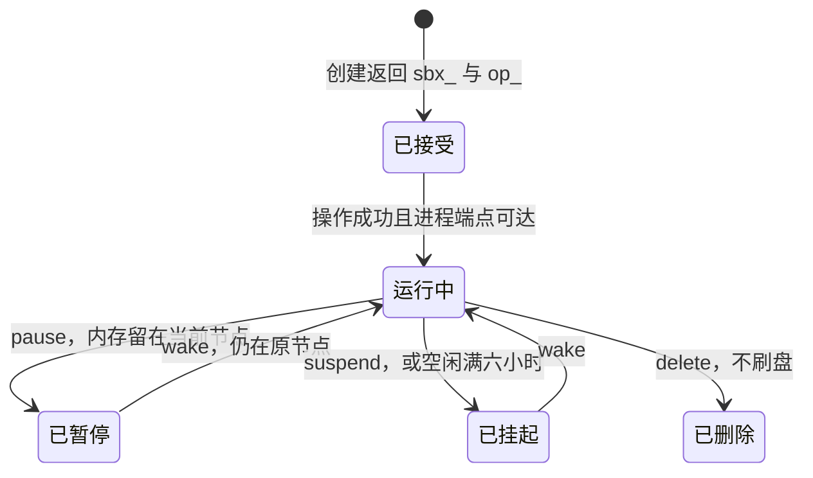

Agent 把一张表洗到一半，停下等你看草稿。Firecracker 微虚拟机保证这台客户机碰不到宿主。它不回答另一件事：这几分钟里，内存里的进程和写了一半的结果还在不在。

只提供创建和删除的沙箱，等人确认、或想试第二条清洗路径时，只能关掉再冷启动。Perplexity 在 2026-10-15 开源了 SPACE（Sandboxed Platform for Agentic Code Execution）。仓库许可证是 Apache-2.0。它把生命周期写成 HTTP 状态机：pause、suspend、wake。隔离只回答「碰不到宿主」。长跑 Agent 还要显式生命周期，再加上磁盘快照和整机检查点的差别，否则原地继续会变成从头再来。

<!-- more -->

## 碰不到宿主之后，会话还要能停

本站 2026-10-05 的文章写过整机沙箱里的密钥注入和出站。还没合并的草稿各自守一条边：[#45](https://github.com/cFireworks/cfireworks.github.io/pull/45) 的 Copilot 本地沙箱用 MXC 合成有效策略，命令不跑在单独的虚拟机里；[#47](https://github.com/cFireworks/cfireworks.github.io/pull/47) 的 Strands Box 用 Dogwood 时序规则限制做过之后还允许什么；[#49](https://github.com/cFireworks/cfireworks.github.io/pull/49) 的 Harbor 评测按阶段切开出站。三篇问的是边界和策略。这篇问会话怎么停、怎么醒、坏了一步怎么退。下面的对照只取这些草稿的论点，不转述正文。

SPACE 的公开材料有两层，日期不要混在一起。

[2026-07-15 的设计文](https://research.perplexity.ai/articles/making-space-secure-and-efficient-runtimes-for-long-running-agents)介绍当时已经铺到 Perplexity Computer 上的运行时。枢纽站有[同题页面](https://www.perplexity.ai/hub/blog/making-space-secure-and-efficient-runtimes-for-long-running-agents)。它把长会话需要的能力写成四件事：尽快创建、可以停很久（等人输入）、分叉和回滚、崩溃之后接着跑。文中写明生命周期是显式状态机，操作包括 create、pause、resume、suspend、restore。

[2026-10-15 的开源公告](https://www.perplexity.ai/hub/blog/open-sourcing-space)写：Computer 今年二月上线，七月用 SPACE 换掉原来的商业沙箱；自七月起全部 Computer 会话跑在 SPACE 上，每天数百万次创建；同一生产流量上，创建比前一家快三到五倍。公告里的用法包括暂停给人审草稿、保留文件和运行状态再继续，以及把工作区复制成两份去试两条清洗路径。仓库是 [perplexityai/SPACE](https://github.com/perplexityai/SPACE)。我核对时 main 为 `80840e883982cf4a47abefbae2ce90ddd6a2c2cc`（提交时间 2026-10-17），许可证 Apache-2.0。开源之后的调用合同以指南和 API 为准。设计文里的产品叙述，不要自动当成今天某条 HTTP 字段。

| 维度 | SPACE 生命周期 | Harbor 分阶段断网（草稿 #49） | Strands 时序策略（草稿 #47） | Copilot MXC（草稿 #45） |
|------|----------------|--------------------------------|------------------------------|-------------------------|
| 要回答的问题 | 会话停在哪一档，醒过来还剩什么 | 评测的某一阶段能不能出网 | 同一类动作做完几次还放不放行 | 本机进程能碰哪些路径和地址 |
| 载体 | Firecracker microVM，HTTP 管生命周期 | 评测任务上的网络阶段 | 沙箱外的策略引擎 | 较轻的本机控制，命令不在单独虚拟机里 |
| 长任务里的那笔账 | 等人、换节点、只退文件或连进程一起退 | 避免用外网把分数做脏 | 限制已经发生的副作用 | 核对合成后的有效策略 |

创建快不快是另一笔账。设计文给出上线那一周和前一家并跑的数字：中位数从 185 毫秒到 60 毫秒，P90 从 447 毫秒到 89 毫秒。开源公告只重复了「三到五倍」和「每天数百万次」，没有再贴这组毫秒。这些都是 Perplexity 的陈述，我没有复测。冷启动变短，只说明再拿一台空机器没那么疼。等人看草稿、内存里还有一份洗到一半的表时，空机器再快也接不回刚才那个进程。

## 四档停法

开源架构把沙箱、生命周期操作和命令流分成三条寿命。API 把期望状态写进 PostgreSQL，控制器再去调和。接受请求只返回操作 ID，沙箱还没有就绪。命令的退出码也不是操作的 `state`。[第一条沙箱指南](https://space.docs.perplexity.ai/guide/first-sandbox.html)里的生命周期入口是：

- `POST /v1/sandboxes/{id}:pause`
- `POST /v1/sandboxes/{id}:suspend`
- `POST /v1/sandboxes/{id}:wake`

每次变更带 `Idempotency-Key`。API 参考写明，沙箱生命周期和创建命令的键保留 24 小时；窗口内用同一方法、路径、请求体和键才会去重。wake 之后要重新等到 `running`，并确认进程端点可达，再发下一条命令。创建命令本身不启动进程，挂上数据面的会话令牌才启动。管理令牌和这条会话令牌不能互换。



架构表把停法写开了。pause 时进程停住，虚拟机内存仍驻留，文件系统仍在那台 worker 上；文档写明这不是一份持久快照，下一步是 wake。suspend 时没有客户机在执行，留下虚拟机内存、运行时状态和根文件系统的快照，活动的虚拟机资源被释放。wake 把暂停或挂起送回运行。删除之后，API 不再提供这只沙箱。表里给「已暂停」列的下一步是 wake。要换成可搬走的快照，按这张表是先回到运行，再 suspend。我没有在实现里再验证「暂停态直接 suspend」会不会被接受。

设计文在这张表外面又放了两档快照，而且先留在节点上，保留份数按层衰减。磁盘快照是文件系统的时间点，取得频繁。文中写它不必为了快照暂停沙箱，用来把删错的文件退回去。整机检查点是整台已暂停虚拟机的检查点，取得没那么勤。崩溃之后可以从最近的运行点继续，而不是从一块冷磁盘重来。suspend 的做法是先暂停虚拟机，打一份整机快照，再把产物上传到对象存储。数据库里那一行要等每个产物都落地，才变成可恢复。半份上传不能被唤醒成一台损坏的机器。恢复是反过来的：调度器选一台节点，拉下产物，把文件系统增量铺回模板之上，再从捕获的状态恢复虚拟机。快照在对象存储里，原节点就不是唯一的家。

开源仓库的[客户机磁盘合同](https://github.com/perplexityai/SPACE/blob/80840e883982cf4a47abefbae2ce90ddd6a2c2cc/docs/space/design/guest-io.md)把「写入确认」和「宕机还在」拆开。根盘使用 Firecracker 默认的 `Unsafe` 缓存：客户机里的 `fsync` 只保证写到宿主页缓存。可以原子替换的文件，确认之后仍可能在沙箱崩溃、强制停止或宿主故障时丢掉。持久化发生在生命周期边界。pause 和 suspend 会先刷客户机文件系统，刷不成就失败，不会带着没刷完的盘继续。成功的 suspend 把客户机已经写下的内容跟快照放在一起。磁盘快照会再刷宿主上的那份镜像。delete 不刷盘，直接丢掉。

四档因此是四笔不同的账：

| 档 | 停的时候留下什么 | 当前节点没了 | 适合的一步 |
|----|------------------|--------------|------------|
| pause | 内存驻留，盘还在这台 worker。架构文档写明不是持久快照 | 驻留内存和这台 worker 上的盘一起没了 | 人在旁边，节点还在，很快要原进程继续 |
| suspend | 内存、运行时和根文件系统的快照，虚拟机资源释放。设计文要求对象存储里的产物齐全 | 齐全的快照可以在别的节点 wake | 要过夜、要腾节点、要换机器 |
| 磁盘快照 | 文件系统时间点。设计文写留在节点上，且不必为它暂停 | 还没被 suspend 带走的副本跟着节点走 | 文件错了，进程可以重读盘 |
| 整机检查点 | 已暂停虚拟机的内存加磁盘，频率更低 | 同磁盘快照，除非这次 suspend 已经上传完成 | 内存里的计算不想从头算 |

模板的 base snapshot 是另一样东西。它保存的是已启动模板的内存和虚拟机状态，用来让新建跳过冷启动。单节点还可以配一个小的预热池。那是下一次创建更快，不是这次洗到一半的表还在。

整机快照绑着捕获它的运行环境。[执行环境指南](https://space.docs.perplexity.ai/guide/execution-environments.html)里的默认 E0 是 x86_64、KVM、Firecracker 1.15.1、客户机内核 6.1.155、快照格式 9.0.0。另外两套已编译绑定是 Firecracker 1.17.0 配 6.1.155，以及 1.17.0 配 6.18.44，支持冷启动和同一环境内的内存快照。指南写明，跨环境身份恢复不是升级路径，每份快照保持原来的 VMM 和内核绑定。装上 1.17.0 也不会自动改用它。想靠整机检查点跨过一次运行时升级，这份指南不支持。

空闲策略会替你做一次状态迁移。架构文档写，经 SPACE API 创建的沙箱，默认在六小时没有访问或命令活动后 suspend。这是空闲上限，不是最长寿命。等人审稿的时候通常正好没有命令。短暂停下用 pause。审稿可能拖过这个窗口，就主动 suspend，并把返回的操作轮询到成功。按了暂停，只说明内存还留在当前节点，不说明平台会按你的节奏一直留着它。

凭证留在虚拟机外面，这条要写进快照策略。第一条沙箱指南写明，`name` 和 `metadata` 可以放可读名字和标签，不要放凭证。架构文档里，凭证由 worker 服务管理。设计文写中央网络网关做出口和凭证注入，密钥不进客户机；企业密钥来自客户自己的密钥管理服务，也不进沙箱。把管理令牌写进客户机环境的快照，wake 到别的节点时会把钥匙一起复制走。

从 E2B 兼容层进来会踩名字。[ECW 文档](https://github.com/perplexityai/SPACE/blob/80840e883982cf4a47abefbae2ce90ddd6a2c2cc/docs/ecw.md)把兼容层的 `pause` 映射成 SPACE 的 `suspend`（持久化虚拟机状态并释放 worker 资源），`resume` 映射成 `restore`。兼容层不提供 SPACE 原生的驻留内存 pause。`memory=false` 会被拒绝，原因写的是 SPACE 不能从只含文件系统的 E2B pause 冷恢复。兼容层列出了被测 Python SDK 用到的 fork 流程，开源公告也把「试两条路径」写成工作区副本。我在原生 API 指南的生命周期表里看到的是 pause、suspend、wake。调用 fork 之前，以你部署的那份兼容层合同为准。

## 先选档，再谈快

下面两个函数是这篇演示自己的策略，不是 SPACE 的配置项。六小时空闲来自架构文档。十五分钟是我用来表示「人还在键盘前」的阈值。

```python
SHORT_HOLD_S = 15 * 60  # 演示阈值，不是 SPACE 的配置

def choose_hold(wait_s: int, node_stable: bool) -> str:
    """节点还在、等待不长：pause。否则 suspend。"""
    if wait_s <= SHORT_HOLD_S and node_stable:
        return "pause"
    return "suspend"

def choose_rollback(files_wrong: bool, memory_worth_keeping: bool) -> str:
    """内存值得留下就打整机检查点；只是文件错了就退磁盘。"""
    if memory_worth_keeping:
        return "full"
    if files_wrong:
        return "disk"
    return "none"
```

对应到操作：

- 人在旁边看草稿，节点没有排空计划，用原生 API 的 pause。wake 仍在原节点，进程里的计数还在。节点如果在暂停期间消失，这档醒不过来。
- 审稿可能过夜、worker 可能被收走、或者就是想把沙箱挪走：从运行态 suspend。轮询操作到成功。设计文的条件是每个快照产物都落地，半份上传不能 wake。齐全之后可以在另一台节点醒来，内存和盘一起回来。
- 命令删错了文件，解释器可以退出重来：磁盘快照够用。退盘不会把进程内存退回捕获点。演示里，删文件之前内存是 `parsed=12`，文件是 `report=v1`；删完内存变成 `0`，文件变成 `deleted`。只退磁盘时文件回到 `v1`，内存仍是 `0`。
- 内存里的聚合不想重算：用整机检查点。恢复后文件和 `parsed` 一起回到捕获时。崩溃后想接着算，走的是这一档。
- 凭证放在控制面。客户机的环境和磁盘里不出现管理令牌。管理面用 bearer，命令流用会话附件令牌。
- 兼容层客户端说的 pause，后续按 suspend 检查：资源会释放，醒过来是 restore。
- 删除会丢掉还没刷上的盘。还要留档，就先拿到一次成功的 suspend，再 delete。
- 同一幂等键在窗口内重放，应该回到同一个沙箱和同一个操作，而不是再开一台。

本地演示在 `demos/space-sandbox-lifecycle/run_demo.py`。它用标准库模拟这些转移：命令在 `running` 之前被拒绝，部分上传不能恢复，pause 期间节点消失则 wake 失败，suspend 完成后可以在 `node-b` 醒来，磁盘回滚不动内存，整机检查点两者都退，空闲满六小时从运行进入挂起，同一幂等键返回同一个操作。脚本不访问 Perplexity，也没有连接 SPACE 集群。

```bash
python3 demos/space-sandbox-lifecycle/run_demo.py
```

标准输出的末行是 `checks passed`。中间几行把上面的数字固定下来，例如 `disk rollback: file=v1 memory=0` 和 `suspend complete: wake on node-b memory=12 file=v1`。

## 调用方要轮询的是一次次操作

设计文写会话可以跑很久，也可以分叉。开源指南把默认空闲 suspend 定在六小时，并把跨环境恢复排除在升级路径之外。两边可以同时成立：控制面可以用一串短命沙箱拼出很长的会话，调用方拿到的仍是 pause、suspend、wake，以及一次次操作轮询。分叉如果是再要一份工作区，复制的是快照，不是同一台永远活着的虚拟机。

公告里的安全测试和生命周期是两笔账。Perplexity 写，108 次尝试里没有从虚拟机逃到宿主，但有一些绕过了网络限制；修复之后，他们点名的两种方法在复查里没有成功。虚拟机边界站住，不代表出站策略也站住。出站怎么按阶段切开，是 Harbor 那篇草稿的题目。这里只说明：微虚拟机回答碰不到宿主，会话能不能续上要另写状态机。

创建延迟的毫秒数和每天数百万次创建，都留在厂商页面上。写进自己的容量规划之前，用自己的模板、节点和快照大小再量。base snapshot 和 warm pool 影响的是创建。它们不回答「这份内存检查点能不能在下一版 Firecracker 上打开」。

## 停在哪一档，才续得上

冷启动再给一台干净的机器。长跑 Agent 中间会等人，会试第二条路，也会在一步上写坏文件。SPACE 把这些停法拆开了：驻留内存的 pause、可以搬走的 suspend、只退文件的磁盘快照、连进程一起退的整机检查点。凭证留在虚拟机外面。半份快照不能拿来恢复。

可以做得很小：给每次等人的等待选 pause 或 suspend，给每次危险命令预先选磁盘档或整机档，然后把操作 ID 轮询到成功，再发下一条命令。

---

## 扩展阅读

- [Open-sourcing SPACE](https://www.perplexity.ai/hub/blog/open-sourcing-space)（页面日期 2026-10-15。2026-10-18 枢纽站直接请求返回 403，正文经由 Internet Archive 核对）
- [Making SPACE：研究站](https://research.perplexity.ai/articles/making-space-secure-and-efficient-runtimes-for-long-running-agents)（页面日期 2026-07-15，同日经由存档核对）
- [Making SPACE：枢纽站同题](https://www.perplexity.ai/hub/blog/making-space-secure-and-efficient-runtimes-for-long-running-agents)
- [SPACE 仓库](https://github.com/perplexityai/SPACE)，main `80840e88`，Apache-2.0
- [Your first sandbox](https://space.docs.perplexity.ai/guide/first-sandbox.html)
- [Architecture](https://github.com/perplexityai/SPACE/blob/80840e883982cf4a47abefbae2ce90ddd6a2c2cc/docs/architecture.md)（pause / suspend 表、六小时空闲）
- [Guest file and disk I/O](https://github.com/perplexityai/SPACE/blob/80840e883982cf4a47abefbae2ce90ddd6a2c2cc/docs/space/design/guest-io.md)
- [Execution environments](https://space.docs.perplexity.ai/guide/execution-environments.html)
- [E2B Compatibility Wrapper](https://github.com/perplexityai/SPACE/blob/80840e883982cf4a47abefbae2ce90ddd6a2c2cc/docs/ecw.md)
- [API 参考](https://space.docs.perplexity.ai/api/index.html)
- 草稿对照：[#45](https://github.com/cFireworks/cfireworks.github.io/pull/45)、[#47](https://github.com/cFireworks/cfireworks.github.io/pull/47)、[#49](https://github.com/cFireworks/cfireworks.github.io/pull/49)

## 讨论

你现在的沙箱在等人的时候，留下的是驻留内存，还是一份已经上传完成的快照？掉一台 worker 时，你期望醒过来的是进程，还是只要文件？
