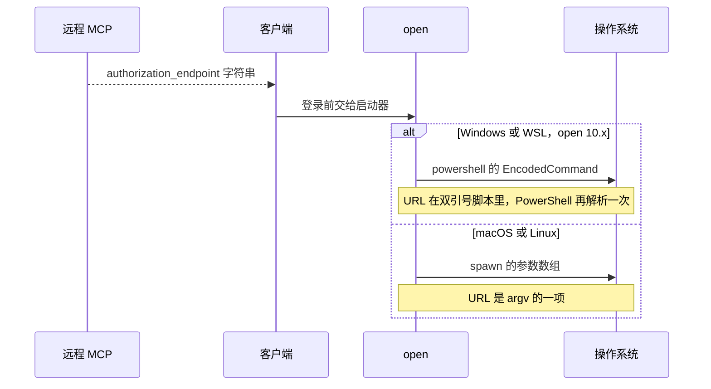

连上一台远程 MCP，谈话通常停在提示注入：工具描述骗模型去跑命令。还有一条更早的缝。OAuth 发现文档里的 `authorization_endpoint` 是对端给的字符串。客户端为了少一次复制粘贴，会在登录前把它交给浏览器启动器。Windows 和 WSL 上，`open@10.x` 把这个字符串放进 PowerShell 的双引号，再作为 `-EncodedCommand` 交出去。双引号里的 `$(...)` 会先被展开。一条格式合法的 `https:` 就能带上子表达式。scheme 白名单只看协议。

模型还没读到工具结果，启动器已经把字符串送进了第二个解析器。

<!-- more -->

## 发现文档是解析器的输入

远程 MCP 要授权时，客户端走发现：401、`WWW-Authenticate`，然后读元数据。`authorization_endpoint` 由对端填写。Pillar Security 的 Eilon Cohen 在页面日期为 2026-10-19 的文章里，把 opencode（npm 包名 `opencode-ai`，厂商 Anomaly / `anomalyco`）的路径写成：发现文档，MCP SDK，`oauth-provider.ts`，`mcp/index.ts`，`browser.ts`，`open()`。受影响范围他们写成 Windows 与 WSL 上 `>= 1.0.137` 且 `<= 1.18.32`，修复版本 1.18.33，发布日 2026-09-28。同一篇把 CWE 标成 CWE-78，次要 CWE-88，并给了一个尚未成为公开 CVE 的 CVSS 3.1 提议：`AV:N/AC:L/PR:N/UI:N/S:U/C:H/I:H/A:H`，9.8。这是研究者页面上的提议分。

我核对过的是版本号和发布动作。1.0.137 到 1.18.32 是否每一版都钉着有问题的 `open`，我没有逐版解开，范围以 Pillar 的表格为准。Pillar 把引入 `open(authorizationUrl)` 的日期写成 2025-12-07。npm 上 `1.0.137` 的发布时间是 2025-12-09T02:59:14Z。我没有核对那次提交。

| 核对项 | 2026-10-19 查到的结果 |
|--------|----------------------|
| npm `opencode-ai@1.0.137` | 2025-12-09T02:59:14Z |
| npm `opencode-ai@1.18.32` | 2026-09-21T22:50:42Z |
| npm `opencode-ai@1.18.33` | 2026-09-28T04:23:28Z |
| GitHub Release [v1.18.33](https://github.com/anomalyco/opencode/releases/tag/v1.18.33) | 2026-09-28T04:22:46Z，作者是 `opencode-agent[bot]` |
| 当时 npm `latest` | `1.19.3` |

我读到的 [v1.18.33 release note](https://github.com/anomalyco/opencode/releases/tag/v1.18.33) 没有 security，也没有 CVE。和启动器有关的一句是：MCP 浏览器启动失败会在启动器立刻退出时被报告。这句话对得上另一条 PR [#51538](https://github.com/anomalyco/opencode/pull/51538)（2026-09-26T19:56:38Z 合并）。它的说明写：`open@11` 在 Windows/WSL 上会等 PowerShell 启动器退出才 resolve，只注册之后的 `exit` 事件会漏掉已经结束的非零退出，于是 `BrowserOpenFailed` 被吞掉。同一段写明不改打开浏览器的行为，也不改 OAuth 决策。

依赖和 scheme 在 PR [#51414](https://github.com/anomalyco/opencode/pull/51414)。标题是 `refactor(core): share a browser opener across opencode and tui`，2026-09-25T23:09:48Z 合并，合并提交 `29f07e0c69ad8668e0e15b0eb54f2fcb342af98c`。说明文字写的是把八处 `open` 收成 `@opencode-ai/core/open`。变更里有三层：`open` 从 10.1.2 升到 11.0.4；新的 `openUrl()` 只放行 `http:` / `https:`；`redirectToAuthorization` 在边界上做同样的 scheme 检查。读 diff 的人看得到依赖升级。只看标题的人看到的是重构。release note 没有把这三层写出来。



本站写过[沙箱边界](https://cfireworks.github.io/2026/10/01/2026-10-01-agent-sandbox-security-boundary/)和 [SDK 重定向](https://cfireworks.github.io/2026/10/04/2026-10-04-mcp-sdk-redirect-audit-blind-spot/)。沙箱管的是模型开始用工具之后。重定向那篇是自定义头跟着 307 走，仓库里已经有公告，CVE 编号是空的。这里是发现字段在模型醒来之前进启动器，而且这一条没有对得上的仓库公告。我没有把 opencode 的 TypeScript 逐行对过。调用链的文件名来自 Pillar。我读的是 PR 说明、release note，以及 `open` 和 SDK 的已发布包。

## 已经在用 spawn，脚本仍被解析

`open` 的 README 写它比老的 `node-open` 安全，因为用 `spawn` 而不是 `exec`。这句话在 10.1.2 和 11.0.4 里都在。`spawn` 说明 Node 没有把整行交给 `cmd.exe`。Windows 分支接着把 URL 写进了另一门语言。

我读了 `open@10.1.2` 的 `index.js`。没有指定 app 时，第 247 行把 `options.target` 放进一对双引号，中间没有转义。第 256 行把拼好的脚本按 UTF-16LE 做 base64，写回 `options.target`。后面的 `spawn` 参数是 `powershell.exe`、`-EncodedCommand` 和这段 base64。URL 不在 cmd 的命令行里。它在 PowerShell 脚本里，并且包在双引号中。双引号字符串会展开 `$(...)`。浏览器最后打不开，也改变不了展开已经发生。Pillar 写旧版本把这次失败丢掉了。#51538 补的是事后能看见非零退出。引号规则在 #51414 把 `open` 升到 11 的那一层。

非 Windows、也不走 WSL 里那条 PowerShell 时，同一文件把原来的 URL 放进参数数组。macOS 和 Linux 因此不是这一种展开。这和 Pillar 的平台结论一致。依据是这份 `open` 源码。我没有在那两个系统上跑过 opencode。

`open@11.0.0`（release 时间 2025-11-15T08:24:33Z）的说明里有 Fix PowerShell argument escaping，提交 `274d704`。这一版开始用 `powershell-utils@^0.1.0`。0.1.0 把参数包进单引号，并加倍 ASCII 单引号。`open@11.0.4`（npm 时间 2026-09-14T20:36:00Z）依赖 `powershell-utils@^0.2.1`。0.2.1 把 U+2018、U+2019、U+201A、U+201B 也加倍。包里的注释写明：PowerShell 把这些弯引号也当成定界符，而且闭合引号不必和开头是同一个字符。只加倍直引号时，弯引号仍能把字符串提前结束。单引号处理的是子表达式展开。弯引号加倍处理的是引号本身被截断。

同一份 README 还有一句：这个包不做安全保证；不可信输入要调用方自己清理。10.1.2 和 11.0.4 都有这句。Pillar 把入库时间写成 2021-09-17。我没有做 blame，只确认这两个 tag 里的句子还在。

## scheme 挡的是协议

MCP TypeScript SDK `1.32.0` 的 `SafeUrlSchema` 拒绝 `javascript:`、`data:`、`vbscript:`。`OAuthMetadataSchema` 的 `authorization_endpoint` 用的就是它。`1.17.4`（npm 时间 2025-08-22T09:22:25Z）里已经是这三条。一条普通 `https:` 会通过，路径里有没有 `$` 都不影响协议判断。Pillar 说 opencode 1.18.33 的 `openUrl()` 同样只卡非 http(s)，他们用的例子是合法 `https:`，scheme 检查会放行。换掉双引号行为的是 `open` 升到 11。PR 里同时落地的 scheme 检查，留着当作挡住 `file:` 和脚本 scheme 的一层。它盖不住这条 `https:`。

2025 年夏天已经有编号的同类汇点。我打开了公告和 NVD 的描述，没有复现，也不转抄载荷：

| 编号 | 公开日 | 公告里写的位置 | 分数 |
|------|--------|----------------|------|
| [CVE-2025-6514](https://github.com/advisories/GHSA-6xpm-ggf7-wc3p) | 2025-07-09 | `mcp-remote` 的 `authorization_endpoint`，`>= 0.0.5` 且 `< 0.1.16`，修复 0.1.16 | GHSA 与 NVD 都是 9.6，`AV:N/AC:L/PR:N/UI:R/S:C/C:H/I:H/A:H` |
| [CVE-2025-58062](https://nvd.nist.gov/vuln/detail/CVE-2025-58062) | 2025-08-28 | openmcp-client，Windows 上由授权端点进 `open()`，修复 0.1.12 | 以 NVD 正文为准 |
| [CVE-2025-10619](https://nvd.nist.gov/vuln/detail/CVE-2025-10619) | 2025-09-17 | sequa-mcp 至 1.0.13 的 `redirectToAuthorization`，修复 1.0.14 | 以 NVD 正文为准 |

Pillar 给 opencode 这条的提议分是 9.8，向量里是 `UI:N`。mcp-remote 已经发布的是 9.6、`UI:R`。没有 CVE，就没有可以写进扫描器的官方分。拿 9.8 排期，用的是研究者的假设。

`open` 自己的 issue 更早。[#202](https://github.com/sindresorhus/open/issues/202) 创建于 2020-10-22，标题是 URL 里的 `$` 在 WSL 2 上会丢，2025-11-12 关闭。[#323](https://github.com/sindresorhus/open/issues/323) 创建于 2023-10-18，标题写成 Windows 上打开 URL 的命令注入，标签是 `enhancement` 和 `help wanted`，2025-11-12 以 `not_planned` 关闭。转义随后进了 11.0.0。issue 里的示例 URL 我没有抄。那一行是载荷。

| 控制 | 普通 https，且含有子表达式 | 它挡住的 |
|------|---------------------------|----------|
| SDK 1.32.0 的三条 scheme 拒绝名单 | 放行 | `javascript:`、`data:`、`vbscript:` |
| 只允许 http 与 https | 放行 | `file:`、自定义 scheme |
| `open@10.1.2` 双引号再 EncodedCommand | 双引号会展开 | 不看目标内容 |
| `open@11` 单引号；11.0.4 连弯引号也加倍 | 单引号内不展开 | 这一层展开；截断要靠加倍 |
| URL 只作为 argv，中间不写脚本 | 不会被当成 PowerShell 语法 | 展开这件事本身 |

「恶意远程 MCP 不在威胁模型里」是 Anomaly 对这份报告的立场，Pillar 在时间线里引了它。立场可以决定发不发 CVE。客户端该解析什么，不由这句立场改写。Pillar 还写：配置当时服务器不必已经是恶意的，载荷在连接时的 HTTP 响应里；后来的失陷、被劫持的注册表项、抢注或过期域名走同一条路径。后半句我没有独立复现，按研究者的威胁描述引用。

自动打开对端指定的 URL 时，这个进程就是解析器。模型是后面的消费者，经常还不是第一个。

## 没有这一条的编号，就对着版本盘点

仓库里有别的安全公告。写作时已公开的三条是另一批：本机服务的跨站升级请求可以给 npm 安装装包（[GHSA-632h-h47v-g4x4](https://github.com/anomalyco/opencode/security/advisories/GHSA-632h-h47v-g4x4)，无 CVE，2026-09-24），Web UI 的 XSS（[CVE-2026-22813](https://github.com/advisories/GHSA-c83v-7274-4vgp)），未认证 HTTP 服务执行命令（[CVE-2026-22812](https://github.com/advisories/GHSA-vxw4-wv6m-9hhh)）。摘要都对不上这次 OAuth 发现字段。去看「仓库有没有 advisory」会看到有，然后漏掉这一条。依赖机器人要有编号才报警。

Pillar 的时间线写：2026-08-29 私下报告，2026-09-25 被告知恶意 MCP 在威胁模型之外，同日 PR 合并，2026-09-28 发到 npm，2026-10-04 在没有 CVE 的情况下公开。页眉却是 October 19, 2026。两个日期都在同一页上。我没有第三份公告能裁定哪一天算正式公开。

扫描器安静的时候，版本还是可以数的。Windows 和 WSL 要分开数。全局 npm、项目锁文件、桌面安装包不是同一个安装。下面两条是在自己的机器上跑的，我没有在写作环境里安装 opencode：

```bash
npm ls -g --depth=0 opencode-ai
opencode --version
```

Windows / WSL 上低于 1.18.33 的安装，按 Pillar 的范围升级到 1.18.33 或更高。写作时 `latest` 已经是 1.19.3，升到当前发布即可，不必停在 1.18.33。暂时不能升，就把还没审核过的远程 MCP 从配置里拿掉。这是在缩小输入面。引号不会因此被补上。

自己写启动器时，远程字符串不要拼进 shell 或 PowerShell 脚本。scheme 检查留下。若仍调用 `open`，把版本钉到 11，并记住 Windows 上仍走 `-EncodedCommand`，依赖的是单引号。更干净的做法是浏览器进程直接接收 argv，中间不写脚本。

`powershell-utils@0.2.1` 的规则可以收成这样。它不打开浏览器：

```js
// 单引号内不展开子表达式。直引号和四类弯引号都要成对加倍。
function escapePowerShellArgument(value) {
  var quoted = String(value).replace(/['‘’‚‛]/g, function (ch) {
    return ch + ch;
  });
  return "'" + quoted + "'";
}
```

本地演示在 `demos/mcp-oauth-quoting/`。它不联网，不启动浏览器，也不调用系统 PowerShell。固定字符串比较三件事：双引号会展开只含 `MARK` 的 `$(...)`，单引号不会，只加倍直引号时弯引号会把字符串截断。URL 用 `example.test`，标明是示意，不指向任何服务器，也不能拿去对客户端复现。

```bash
python3 demos/mcp-oauth-quoting/run_demo.py
```

## 客户端先是解析器

提示注入还会占谈话的中心。它和这条启动器问题各算各的。把远程 MCP 只理解成「模型可能被骗」，会漏掉握手阶段已经发生的那次字符串解析。scheme 名单、CVE 订阅、威胁模型文档，各自覆盖一块。Windows 上这一条缝在引号里。`spawn` 已经用了，也不等于 URL 没有再被解析。

升级版本，把 Windows 和 WSL 的安装位置分开数清楚。URL 要进进程，就让它作为参数进去。

---

## 扩展阅读

- [Pillar：Open and Shut](https://www.pillar.security/blog/open-and-shut-remote-code-execution-in-opencode-via-mcp-oauth)（页眉 2026-10-19；文内公开日写 2026-10-04）
- [opencode v1.18.33](https://github.com/anomalyco/opencode/releases/tag/v1.18.33)、[PR #51414](https://github.com/anomalyco/opencode/pull/51414)、[PR #51538](https://github.com/anomalyco/opencode/pull/51538)
- [open v11.0.0](https://github.com/sindresorhus/open/releases/tag/v11.0.0)
- [open#202](https://github.com/sindresorhus/open/issues/202)、[open#323](https://github.com/sindresorhus/open/issues/323)
- [GHSA-6xpm-ggf7-wc3p / CVE-2025-6514](https://github.com/advisories/GHSA-6xpm-ggf7-wc3p)
- [CVE-2025-58062](https://nvd.nist.gov/vuln/detail/CVE-2025-58062)、[CVE-2025-10619](https://nvd.nist.gov/vuln/detail/CVE-2025-10619)
- [MCP SDK 十月公告：重定向与 npm audit 盲区](https://cfireworks.github.io/2026/10/04/2026-10-04-mcp-sdk-redirect-audit-blind-spot/)
- [Coding Agent 的沙箱边界](https://cfireworks.github.io/2026/10/01/2026-10-01-agent-sandbox-security-boundary/)

## 讨论

你盘点 coding agent 时，CVE feed 安静，Windows 和 WSL 上的安装版本有没有单独列出来？远程 MCP 的授权地址，你允许客户端自动打开吗？
