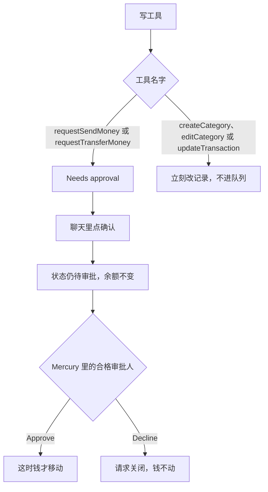

## 开场

文档里的例子是「Request a $500 payment to Acme from my checking account」。对话里弹出确认，你点下去，模型回一句请求已经建好。听着像办完了。打开 Mercury，钱还在。

这不是模型又说错一句话就能解释完的。Mercury 把连上财务系统的写操作拆成两截，而且写进了工具名字和 OAuth 范围。付款、内部转账只负责提交请求，人在 Mercury 里批准之后钱才动。分类和备注没有这一截，调用成功就改掉现有记录。聊天里的确认不是 Mercury 里的批准，「request created」也不是「payment sent」。

<!-- more -->

## 背景

[What is Mercury MCP?](https://docs.mercury.com/docs/what-is-mercury-mcp) 把 Mercury MCP 写成一台托管服务器：用 OAuth 把 ChatGPT、Claude 这类工具接到账户上，能问余额和流水，也能做文档列出的写操作。能用哪些工具，取决于账户类型和你授予的权限。我在 2026-10-20 打开这页，正文开头仍标着 Beta。原话是要理解聊天模型的局限，重要决定要拿 Mercury 账户再核对一遍。页脚写的是 Updated 12 days ago。同目录下 Connecting、Supported tools、Security best practices 三页的页脚是 Updated 11 days ago。这是相对时间，我没有把它换算成某一天的发布时间。

托管地址在 [Connecting Mercury MCP](https://docs.mercury.com/docs/connecting-mercury-mcp) 里写死了：`https://mcp.mercury.com/mcp`。[Security best practices](https://docs.mercury.com/docs/security-best-practices) 让你核对的也是这一个官方端点。Connecting 的 Notes 写明，目前不提供非托管 MCP。添加服务器本身不给权限。浏览器打开 Mercury 的登录页，你看过账户和请求的权限再选 Allow，Mercury 才按这次同意发出令牌。在登录页取消，工具什么都拿不到。安全页写明，不要把 Mercury 密码交给 MCP 客户端或 AI。

官方集成名单，Connecting 页和帮助中心 [Connecting Mercury to ChatGPT, Claude, and other AI tools](https://support.mercury.com/hc/en-us/articles/54640210295956-Connecting-Mercury-to-ChatGPT-Claude-and-other-AI-tools) 当天列出的是同一组：ChatGPT、Claude、Cursor、Perplexity、Gemini Enterprise、Grok Bot、Microsoft 365 Copilot、Notion、Replit。两页的排列顺序不完全一样，名字集合一样。帮助中心这页我这边直连被 Cloudflare 返回 403，正文是从该 URL 的页面文本里读的，和文档站 HTTP 200 的那份名单对过。Claude Code、Codex CLI 和其他 MCP 客户端走手动配置，不在这份官方集成列表里。

已经接过的只读连接不会自动长出写权限。要在客户端里重新授权，在 Mercury 的同意屏幕上逐项看写权限。在聊天里要求一次写操作，本身不会把范围加上去。你的 Mercury 权限和账户实际开通的能力仍然生效。

值得单独看的是他们怎么分写。安全页写的是两种写操作：付款和内部转账请求要在 Mercury 里批准；自定义分类和交易元数据立刻生效。范围表和五个写工具是对齐的，没有一个笼统的 `write`。

## 两段式写工具分析

[Supported tools](https://docs.mercury.com/docs/supported-tools-on-mercury-mcp) 写明写工具一共五个。只读连接要重新授权才能用。我没有调用线上的 `https://mcp.mercury.com/mcp`，下面只引用这几页写明的行为。文档没给的参数表，这里不编。

### 请求停在 Needs approval

| 工具 | OAuth 范围 | 文档写的结果 |
|------|------------|----------------|
| `requestSendMoney` | `transactions:request` | 给已经存在的收款人建付款请求。Mercury 里批准之前，钱不汇出 |
| `requestTransferMoney` | `transfers:request` | 在自己的 Mercury 账户之间建转账请求。批准之前，钱不动 |

收款人必须已经在 Mercury 里。这五个写工具不创建收款人，不删分类，不发卡，也不开发票。公开 API 里还有一些能力，没有做成 MCP 写工具。帮助中心的问答是同一句限制：要付给新人，先在 Mercury 里把收款人加好。

批准不在对话里完成。文档给的步骤是：让 AI 先把请求备好，打开 Mercury，到 Tasks 或 Payments 的 Needs approval 里找到它，核对收款人或目标账户、金额、支付方式和时间，细节正确而且你是合格审批人，再批准，然后在 Mercury 里看状态。组织原有的审批策略继续有效。就算策略本来允许这件事不必再批，请求人仍然必须在 Mercury 里批准。AI 工具不能批准这笔请求，也不能单独把钱移走。

有三句原话值得留在工具返回值里。Supported tools 写的是：聊天里的确认不是 Mercury 里的批准，「request created」不等于「payment sent」。Connecting 的排错条目写：请求建好了，或者在 AI 工具里确认过了，都不代表款已汇出，要到 Needs approval 里把该走的批准做完。安全页写：AI 工具里的确认不能代替 Mercury 里的批准。

帮助中心把主机界面上的用词也写出来了。对话里要点的按钮叫 Approve on Mercury，作用是把请求送进 Mercury，旁边是 Cancel。然后去 Mercury 的网页或手机通知里再看一遍，Tasks 页上也会出现这条审批，在那里批准或拒绝。同一节的注记写：在 AI 工具里选 Confirm Request 并不授权这笔付款，必须在 Mercury 里批准之后才能发起。按钮上的 Approve，和账本里那一次 Approve，在这篇帮助里是前后两步。帮助中心还写，审批请求大约 5 分钟后过期，过期就从 AI 工具重新发起。这句只出现在帮助中心。API 文档这几页我没有看到同一条时限，也没有拿真实请求去计时。

查待审批记录时，文档给了助手，两边不对称。`listSendMoneyApprovalRequests` 在读工具表里，说明可以按账户和状态过滤付款审批请求。转账用的 `listTransferMoneyApprovalRequests` 和 `getTransferMoneyApprovalRequest` 写在 Review and approve 那一段，不在我读到的读工具表里，那一段也没有参数表。文档要求的动作是清楚的：结果不确定时，先查有没有已经存在的请求，再决定要不要再建一笔。



### 分类和备注会盖掉原值

| 工具 | OAuth 范围 | 文档写的结果 |
|------|------------|----------------|
| `createCategory` | `categories:create` | 立刻新建自定义支出分类。Mercury 里没有另一次批准 |
| `editCategory` | `categories:edit` | 立刻改自定义支出分类 |
| `updateTransaction` | `transactions:update` | 立刻改或清空某笔交易的备注或分类 |

安全页把边界说完了：这些动作不搬钱，但会改已经存在的记录。Supported tools 补了一句：分类和交易元数据可以覆盖原值，它们不在 Mercury 的审批队列里等。

「不碰钱」因此不能当成「可以随便授予」。安全页讲提示注入时，举的是把交易数据送到不该去的地方。写权限开着的时候，恶意指令还可以造成不想要的分类或备注修改，或者造出不想要的付款请求。资金移动要批准，挡不住每一次数据被读走，也挡不住立刻生效的编辑。付款请求仍然要在 Mercury 里看过再批。

### 聊天确认和 Mercury 批准

| 维度 | 聊天里的确认 | Mercury 里的批准 | 分类或备注写入 |
|------|----------------|------------------|----------------|
| 发生在哪 | AI 工具的对话。帮助中心里，这一步的按钮可以叫 Approve on Mercury 或 Confirm Request | Tasks 或 Payments 的 Needs approval | 持有对应范围的那次工具调用 |
| 调用之后 | 请求可以仍是 Needs approval，钱不动 | 合格审批人批准之后钱才移动；拒绝则钱不动 | 没有待审批记录，可以覆盖原值 |
| 文档怎么定性 | 确认不是批准，也不等于已汇出 | 组织策略仍生效。本来允许免批的，请求人也要在 Mercury 里批 | 立刻生效，不进审批队列 |
| 范围能做什么 | `transactions:request` 或 `transfers:request` 只够建请求 | 写范围不包括批准，也不能绕过审批策略 | `categories:create`、`categories:edit`、`transactions:update` 单独授予 |

Connecting 的范围表下面有一句，比工具名单更值得抄进自己的服务器：连接上没有某个工具所需的范围，就不能用那个写工具。一个写范围并不授予批准付款的权限，也不能绕过 Mercury 的审批策略。只请求客户端真正要用的权限。

下面这段是本地账本，不是 Mercury API，也不连网。脚本在 `demos/mercury-mcp-two-phase/run_demo.py`。组织策略被设成「人本来可以免批」，聊天确认仍然不动余额。`approve` 和 `decline` 只接受角色 `mercury`。`update_note` 不进队列，第二次调用盖掉第一次。连接上没有 `transfers:request`，转账请求直接拒绝。

```python
def approve(self, role: str, request_id: str) -> str:
    rec = self.requests[request_id]
    if role != "mercury":
        return (
            f"approve role={role} id={rec.id} ok=false "
            f"reason=mercury_role_required status={rec.status} "
            f"balance={self.balance}"
        )
    if rec.status != "needs_approval":
        return (
            f"approve role={role} id={rec.id} ok=false reason=not_pending "
            f"status={rec.status} balance={self.balance}"
        )
    rec.status = "sent"
    self.balance -= rec.amount
    return (
        f"approve role={role} id={rec.id} ok=true status={rec.status} "
        f"balance={self.balance} moved=true"
    )
```

我跑的命令是：

```bash
python3 demos/mercury-mcp-two-phase/run_demo.py
```

标准输出：

```text
policy_allows_unapproved_send=true
request_payment id=pay_1 recipient=Acme amount=500 status=needs_approval balance=1000 moved=false
chat_confirm id=pay_1 chat_confirmed=true status=needs_approval balance=1000 moved=false policy_allows_unapproved_send=true
approve role=chat id=pay_1 ok=false reason=mercury_role_required status=needs_approval balance=1000
uncertain_retry id=pay_1 created=false status=needs_approval balance=1000
approve role=mercury id=pay_1 ok=true status=sent balance=500 moved=true
approve role=mercury id=pay_1 ok=false reason=not_pending status=sent balance=500
update_note role=chat txn=txn_1 note=Annual renewal previous=empty pending=false applied=true overwritten=false
update_note role=chat txn=txn_1 note=Renewed previous=Annual renewal pending=false applied=true overwritten=true
request_transfer role=chat ok=false reason=scope_missing scope=transfers:request balance=500
request_payment id=pay_2 recipient=Northwind amount=100 status=needs_approval balance=500 moved=false
decline role=chat id=pay_2 ok=false reason=mercury_role_required status=needs_approval balance=500
decline role=mercury id=pay_2 ok=true status=declined balance=500 moved=false
checks passed
```

## 实践建议

### 设计写工具的人

高风险副作用用两段式合同。工具名字用 `requestSendMoney` 这种「请求」而不是听起来已经汇出的 `sendMoney`。返回值里留下请求编号和 Needs approval。模型会引用的那句状态，要写到不能被复述成 payment sent。

批准是另一个主体，在这条 MCP 通道外面完成。不要给模型一个 `approved=true` 参数，也不要把聊天里的确认回调当成批准。就算组织策略对真人是免批，代理这条路径仍然要落到人能打开的那个产品里。令牌不是审批人。Connecting 已经把这件事写成范围语义：写范围不能批准，也不能绕过策略。

会改已有状态、但你判定为低风险的写入，要单独标成「立即生效」。写进工具说明，也写进每次调用的结果：这次会覆盖，没有草稿。Mercury 把 `createCategory`、`editCategory`、`updateTransaction` 放在这一类。它们不搬钱。安全页同时写了，注入和误调用仍然会改已经存在的记录。

OAuth 范围跟着这个分界走。请求类是 `transactions:request` 和 `transfers:request`，名字里没有 approve。立即写入是 `categories:create`、`categories:edit`、`transactions:update`。同意屏幕上的人可以只开备注，不开付款请求。一个笼统的 write 做不到这个选择。

结果不确定时要有列表或按编号读取。付款这边，读工具表里有 `listSendMoneyApprovalRequests`。没有这只读口，超时之后模型很容易再请求一笔。转账那两只查询工具，以你连上的那一版 `tools/list` 为准。这篇不替文档补参数。

### 把同类系统接进代理的人

重新授权之前，不要假设旧的只读连接已经能写。同意屏幕上逐项看范围，用不到的写范围不要留。Beta 那句仍然有效：重要决定拿 Mercury 账户再核对，不要只信模型的复述。

模型说请求建好了，下一步是打开 Needs approval，而不是把对话里的确认当成回单。按钮写着 Approve on Mercury，先看帮助中心对它的定义：它把请求送进 Mercury。Confirm Request 不授权付款。帮助中心那条约 5 分钟的过期如果在你的客户端上成立，超时就重新发起，不要对着一条已经过期的请求反复点。这条时限我没有在 API 文档里看到第二处，也没有实测。

分类和备注要当成生产写入来授权。它们会覆盖，也不排队。安全页把提示注入分开写了：批准挡不住数据被读走，也挡不住立刻改备注或分类。共享或公开的会话里不要接这台 MCP。访问可以在 Mercury 后台随时撤销。

这次演示没有网，也没有凭证。它检查的是合同能不能在本地被说清楚：确认不动钱，立即写入不排队，缺范围的工具直接拒绝。

## 展望

两段式合同会从银行账户扩到别的高风险副作用：生产发布、权限授予、删数据。值得留下来的是返回值里分得开「已起草」和「已生效」，以及批准发生在模型碰不到的那个主体上。工具名单会变，这个形状可以留下来。

Mercury 没有把分类和备注放进队列。这是安全页和工具页都写明的产品选择。接下来要问的是立即写入要不要草稿。覆盖和提示注入都已经写在安全页上。主机若只能在调用之后看见新备注，撤销就得再调一次 `updateTransaction`。协议层至少可以要求结果里带一句稳定的 `effect=immediate`，免得模型把它说成已提交、待批准。

主机界面是另一处容易把两段捏成一段的地方。帮助中心里，送出请求的按钮就叫 Approve on Mercury。服务器把请求和批准分开之后，按钮文案和模型的总结仍可能用同一个词。比较稳的做法，是工具结果里给出主机照抄的状态短句，例如 Needs approval in Mercury，而不是让模型自由发挥成 payment sent。

## 结语

对话里那一下确认，和 Mercury 里那一次批准，是两件事。请求建好，只说明账本上多了一条 Needs approval。钱要等通道外的人点头。分类和备注则在调用成功时就改掉原值。高风险副作用做成两段式工具，立刻生效的修改单独标成一类，OAuth 范围照着这个分界来切。模型才没有办法用一句话把「已请求」说成「已汇出」。

---

## 扩展阅读

- [What is Mercury MCP?](https://docs.mercury.com/docs/what-is-mercury-mcp)（2026-10-20 读取，页脚 Updated 12 days ago，文内标 Beta）
- [Connecting Mercury MCP](https://docs.mercury.com/docs/connecting-mercury-mcp)（页脚 Updated 11 days ago）
- [Supported tools on Mercury's MCP](https://docs.mercury.com/docs/supported-tools-on-mercury-mcp)（页脚 Updated 11 days ago）
- [Security best practices](https://docs.mercury.com/docs/security-best-practices)（页脚 Updated 11 days ago）
- [Connecting Mercury to ChatGPT, Claude, and other AI tools](https://support.mercury.com/hc/en-us/articles/54640210295956-Connecting-Mercury-to-ChatGPT-Claude-and-other-AI-tools)（2026-10-20 读取；本机直连 403，正文来自该 URL 的页面文本）

## 讨论

你若要把 MCP 接到会搬钱或会改正式记录的系统上，哪些写操作必须换成另一个主体来批准，哪些可以调用完就生效？范围名字能不能让同意屏幕上的人看出来？
