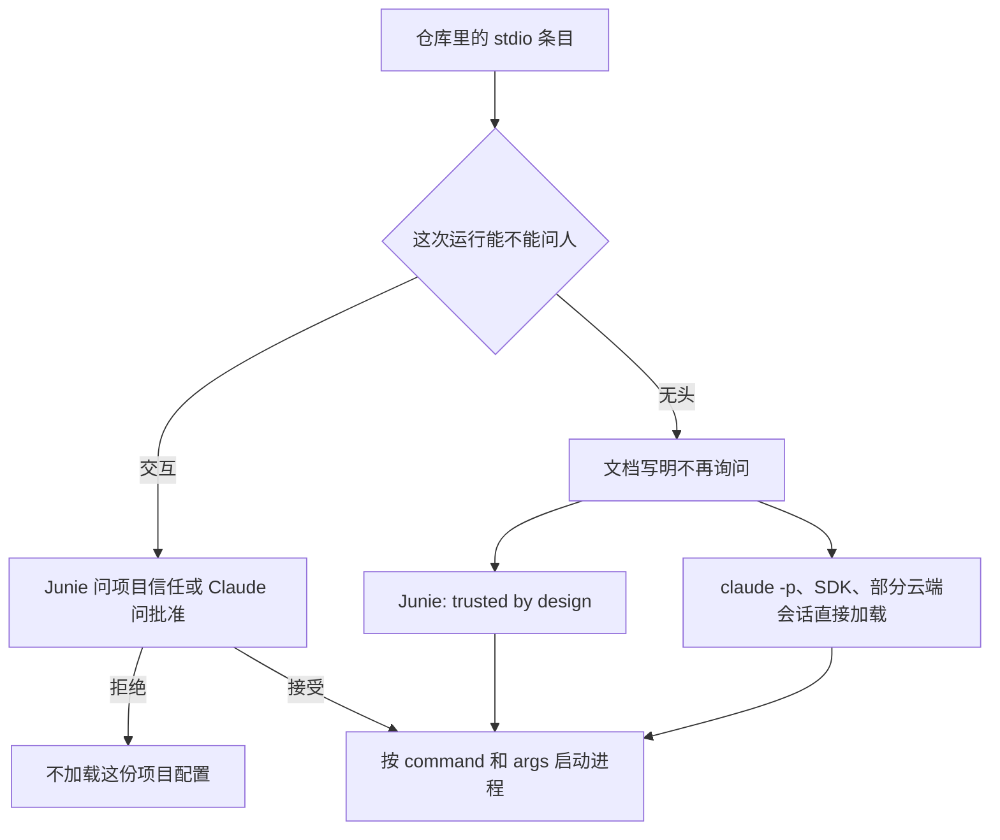

CI 把别人的分支检出到构建机上，无头跑一个编码代理。你记得上周在自己电脑上批准过一个 MCP 服务器，地址是 https 开头的。仓库里多出来的那条不是地址。`command` 是程序名，`args` 是参数列表。规范对 stdio 的要求是：客户端把服务器当成子进程拉起来。加载这条配置，就是在这台机器上启动那个程序，权限跟代理进程一样。

2026-10-15 和 16 日公开的三条记录从三个方向走到这里：JetBrains Junie CLI 的项目 MCP 配置、Z.ai ZCode 的工作区配置、Anthropic Claude Agent SDK 的 `resume` 参数。交互会话还有信任或批准提示。无头（CI、`claude -p`、Agent SDK、云端会话）在厂商自己的文档里经常是默认继续、不再询问。仓库里的 MCP 条目要当代码审，无头加载面要单独收紧。

<!-- more -->

## 条目是命令，不是链接

[2026-07-28 的 stdio 传输](https://modelcontextprotocol.io/specification/2026-07-28/basic/transports/stdio)写得很直：客户端把 MCP 服务器作为子进程启动，两边走这个子进程的标准流。URL 是另一条传输。[2025-06-18 的传输页](https://modelcontextprotocol.io/specification/2025-06-18/basic/transports)里，Streamable HTTP 的服务器提供一个端点，客户端用 HTTP POST 送 JSON-RPC。

桌面和 CLI 把这件事写成 JSON。我今天读到的三份说明，stdio 都是程序名加参数。

Claude Code 的[安装文档](https://code.claude.com/docs/en/mcp)把项目文件放在仓库根 `.mcp.json`，键是 `mcpServers`。远程是 `type` 加 `url`，本地是 `command` 加 `args`。原话：一条启动命令意味着服务器作为本地 stdio 进程运行。没有 `type` 按 stdio 读；只有 `url`、没有 `type` 是配置错误，服务器被跳过，并提示补上 `http`、`sse` 或 `ws`。URL 字符串不会被当成要执行的程序。

Junie 的 [MCP 配置页](https://junie.jetbrains.com/docs/junie-cli-mcp-configuration.html)页脚是 21 October 2026。项目范围在 `.junie/mcp/mcp.json`，用户范围在 `~/.junie/mcp/mcp.json`。示例里本地是 `command` 加 `args`，远程才是 `url`。文档写：在本机跑，例如 `npx` 或 Docker，Junie CLI 会启动这个进程。

ZCode 的 [MCP 文档](https://zcode.z.ai/en/docs/mcp-services)把工作区放在 `.zcode/config.json` 的 `mcp.servers`，字段是 `command`、`args`、`env`。同一范围的 `.agents/mcp.json` 只在 `.zcode` 一台服务器都没有时作后备。表单默认 `stdio`。HTTP 和 SSE 才填 URL。

谁能改仓库里的这份 JSON，谁就指定了要启动的程序。HTTP 条目仍是 URL，不在这里展开。

| 工具 | 项目里常见的文件 | stdio 看什么 | 远程看什么 |
|------|------------------|--------------|------------|
| Claude Code | 仓库根 `.mcp.json` | `command`、`args` | `type` + `url` |
| Junie CLI | `.junie/mcp/mcp.json` | `command`、`args` | `url` |
| ZCode | `.zcode/config.json` 的 `mcp.servers`；该范围没有服务器时才看 `.agents/mcp.json` | `command`、`args` | HTTP / SSE 的 URL |

10 月 19 日 [SpanDock 的综述](https://www.spandock.com/blog/mcp-server-entries-are-commands)把下面三条放在同一篇里。我按 CVE、公告、PR 和厂商文档重读了一遍。机制判断和原文一致。分数归谁、TypeScript 停在哪个版本，原文比综述更细，下面按原文写。

## 三条记录，三条入口

| 记录 | 入口 | 修复版本（记录里怎么写） | 无头或打开项目时 |
|------|------|--------------------------|------------------|
| [CVE-2026-111091](https://www.cve.org/CVERecord?id=CVE-2026-111091) Junie CLI | 不受信任项目的 MCP 服务器配置 | CNA：26.8.3 之前受影响 | 现行无头文档仍写 trusted by design |
| [CVE-2026-88755](https://www.cve.org/CVERecord?id=CVE-2026-88755) ZCode | 仓库工作区配置里声明的 MCP 服务器 | 记录没有修复版本 | 现行文档：会话开始自动连接 |
| [GHSA-h4mw-j7qp-8mwm](https://github.com/anthropics/claude-agent-sdk-python/security/advisories/GHSA-h4mw-j7qp-8mwm) / [CVE-2026-96620](https://www.cve.org/CVERecord?id=CVE-2026-96620) | `resume` 被拆成独立参数；公告写可带入 `--mcp-config` | 公告与 CVE：Python 0.2.121 | SDK 会话属于 Claude 文档里不再弹出批准的那一类 |

### Junie：交互要信任，无头默认信任

JetBrains 是 CNA，`datePublished` 2026-10-15T15:29:52.373Z。描述只有一句：In JetBrains Junie CLI before 26.8.3 code execution was possible via an untrusted project's MCP server configuration。产品是 Junie CLI，版本 `0`、`lessThan` `26.8.3`，`defaultStatus` unaffected，CWE-829。CVSS 3.1 为 7.8（高），`CVSS:3.1/AV:L/AC:L/PR:N/UI:R/S:U/C:H/I:H/A:H`，其中 `UI:R` 是需要一次用户交互。

[NVD](https://nvd.nist.gov/vuln/detail/CVE-2026-111091) 为 Awaiting Analysis（2026-10-15T16:17:48.637）。7.8 来自 `cve@jetbrains.com`，类型 Secondary，没有 NVD 自己的主评分。CISA SSVC（2026-10-15T16:05:16Z）是 Exploitation none、Automatable no、Technical Impact total。参考链接 [issues-fixed](https://www.jetbrains.com/privacy-security/issues-fixed/) 的首屏 HTML 是前端壳，列表不在里面，版本和分数以 CVE 记录为准。[Tenable](https://www.tenable.com/cve/CVE-2026-111091) 复述了描述，另印了 CNA JSON 里没有的 CVSS v2 7.2。

记录没把修复写成信任对话框。能确定的是 26.8.3 落在不受影响一侧。下面的无头行为，没有被这个版本号划掉。

[无头模式](https://junie.jetbrains.com/docs/junie-headless.html)仍标 Early Access。交互先问信任，再加载项目输入。一次性提示、管道、ACP、Gateway 没法问，因此 trusted by design，不加提示就加载 MCP servers、hooks、agents、skills、guidelines。原话是只在信任的项目里非交互运行。[config.json](https://junie.jetbrains.com/docs/junie-cli-configuration.html)的交互选项是保持不信任、只信任本项目、信任父目录下全部项目。不信任时仍可操作项目文件，但不加载项目 MCP 等配置，改用仓库外的临时目录。同一页写：非交互的 JSON、ACP、Gateway 始终 trusted，没有提示、开关或环境变量。

hooks 两页对不上。配置页写，默认项目配置文件里的 `hooks` 为安全起见被忽略，要放 `~/.junie/config.json` 或用 `--config-location`。无头页却把 hooks 列进会加载的项目配置。我无法从这两段判断无头启动的是哪一份，要在 CI 里看进程实际读了哪个文件。MCP 页的 `--mcp-default-locations false` 会关掉默认用户目录和项目目录里的 MCP。这不是 CVE 文本里的缓解，我也没跑 Junie 验证无头是否认这个开关。

升到 26.8.3 或更高，只覆盖记录里的版本范围。文档里的 trusted by design 今天还在。

### ZCode：打开就连，记录里没有修复版本

MITRE 的 `datePublished` 是 2026-10-16。描述是：Z.ai ZCode v3.11.2.6792 was discovered to automatically establish connections with MCP servers declared inside a repository's workspace configuration, possibly allowing attackers to execute arbitrary code via opening a crafted repository。CNA 的 metrics 为空，affected 和问题类型写成 n/a，没有修复版本。

7.8 来自 CISA ADP，不是 MITRE。[NVD](https://nvd.nist.gov/vuln/detail/CVE-2026-88755) 状态 Deferred，该分标成 Secondary，向量与 Junie 那条相同。SSVC（2026-10-16T19:06:22Z）是 Exploitation poc、Automatable no、Technical Impact total。CWE-78、CWE-200、CWE-284、CWE-863 也是 ADP。记录链了一份公开证明，这篇不复述、不给链接。[Tenable](https://www.tenable.com/cve/CVE-2026-88755) 复述描述和 7.8，并多印了 CNA JSON 里没有的 v2 7.2。

[MCP 文档](https://zcode.z.ai/en/docs/mcp-services)有一节 Workspace MCP Servers Connect Automatically：项目里声明的服务器在会话开始时自动连接，不必每次授权，方便提交进仓库。下一句提醒，打开项目会连上列出的每一台，服务器可以跑命令、读写文件、访问网络；来源不明就先看 `.zcode/config.json`。同名时用户配置优先。这是厂商文档，不是我的测试，也没写从某版本起改为先询问。

[安全台账](https://cvd.z.ai/ledger/)只指向 CNVD、CNNVD、NVDB，不列细节。[更新日志](https://zcode.z.ai/en/changelog)我读到的最新条是 2026-10-20 的 3.16.2，安全相关写的是 Windows 本地文件越界读和连接日志泄漏，没有这条 CVE，也没有「改为先询问」。3.16.2 不是补丁声明。比 3.11.2.6792 新，不等于已修。记录没有变通办法。文档让人打开前读 `.zcode/config.json`；该范围的 `.zcode` 里一台服务器都没有时，会改读 `.agents/mcp.json`。只看一个文件会漏。

### Claude Agent SDK：session id 变成了另一个旗标

这条不是从仓库文件进来的。应用把不可信字符串放进 `resume`，SDK 再把它交给 Claude CLI。

[GHSA-h4mw-j7qp-8mwm](https://github.com/anthropics/claude-agent-sdk-python/security/advisories/GHSA-h4mw-j7qp-8mwm) 由 OctavianGuzu 在 2026-09-12 发布。包是 pip 上的 `claude-agent-sdk`，受影响 `< 0.2.121`，修补版本 0.2.121。描述写：`resume` 未经校验就传给 Claude CLI，以 `-` 开头的值会被当成另一个旗标。控制这个值的人可以注入 `--mcp-config`，在里面定义一个 stdio MCP 服务器，于是在 CLI 启动时执行任意命令，并绕过 SDK 的权限控制。前提是应用把不可信输入当成要恢复的 session id。报告者写的是 hackerone.com/moamenmahmood。严重性标 Critical，CVSS 4.0 基线分 9.2，向量 `CVSS:4.0/AV:N/AC:L/AT:P/PR:N/UI:N/VC:H/VI:H/VA:H/SC:N/SI:N/SA:N`。`AT:P` 表示攻击有前置条件，和「应用得先把外部字符串送进 `resume`」对得上。弱点是 CWE-20、CWE-78、CWE-88。

[CVE-2026-96620](https://www.cve.org/CVERecord?id=CVE-2026-96620) 的 CNA 是 GitHub，`datePublished` 2026-10-16T19:44:01.260Z。描述与公告同向：0.2.121 之前单独传递 `resume`，横线开头的值变成独立旗标，可注入 `--mcp-config`，在 CLI 启动时执行命令，并落在 SDK 权限控制之外；修复版本写的是 0.2.121。分数同样是 GitHub 的 CVSS 4.0 9.2。[NVD](https://nvd.nist.gov/vuln/detail/CVE-2026-96620) 状态 Awaiting Analysis，9.2 来源是 `security-advisories@github.com`，类型 Secondary。CISA SSVC 在 2026-10-21T21:28:15Z 更新为 Exploitation none、Automatable yes、Technical Impact total。

时间线比 CVE 日早三个月。[PR 1123](https://github.com/anthropics/claude-agent-sdk-python/pull/1123) 在 2026-07-16T00:59:37Z 合并，提交 `347a1cb88d7652199399db1b7f914e0a459a6662`。[v0.2.121](https://github.com/anthropics/claude-agent-sdk-python/releases/tag/v0.2.121) 发布于 2026-07-17T00:39:25Z。只盯 CVE 编号的人，到 10 月 16 日才看见这条。7 月 17 日的 release note 已经写了修复。

PR 和公告对「算不算命令执行」各写了一句，两句都留着。PR 说 `--resume` 是可选值，下一个以 `-` 开头的 token 不会绑成它的值，会变成独立旗标。旧代码是两个 argv：

```python
cmd.extend(["--resume", self._options.resume])
```

修复是一个 token：

```python
cmd.append(f"--resume={self._options.resume}")
```

`--session-id` 一并改成等号。PR 写，它本来是必填值，横线开头的下一个 token 已经会绑上；改等号是为了统一。严重性原话：只影响把不可信输入送进这两项的应用；没有 shell，是旗标注入，不是任意命令执行。对照是 `--version`：拆开会跑成版本旗标，等号形式被 CLI 拒绝，因为不是 UUID，也不匹配标题。演示只重复 token 个数，不构造 `--mcp-config`。

公告和 CVE 多看了一步：注入的若是 `--mcp-config`，里面的 stdio `command` 会在 CLI 启动时拉起来，并且在 SDK 权限检查之前。没有 shell，和「旗标可以变成一次启动」，两句同时成立。排期按公告。`AT:P` 表示应用得先把外部 session id 传进去。

PR 故意没改 `extra_args`。那是任意旗标的逃生口，无值旗标和用字符串表示布尔都依赖两个 token。[v0.2.124](https://github.com/anthropics/claude-agent-sdk-python/releases/tag/v0.2.124)（2026-07-20T22:28:30Z）补了相邻三件事：Windows 上拒绝通过 `.bat` / `.cmd`（包括 npm 的 `claude.cmd`）启动 CLI；Windows 上 `resume` 和 `session_id` 若含有 cmd.exe 元字符或换行就抛 `ValueError`，发布说明点名的字符是 `&`、`|`、`<`、`>`、`^`、`%`、`!`、`"`，POSIX 行为不变；`extra_args` 的值若以 `-` 开头，改用 `--flag=value`。公告点名的修补版本仍是 0.2.121。工程下限我放到 0.2.124，因为 0.2.121 没覆盖 PR 留出的 `extra_args`，也没覆盖这条 Windows 说明。

TypeScript 不要直接抄 PR 里的一个版本号。PR 1123 写：TypeScript SDK 在 0.3.208 做了同一修复。我读了 [TypeScript 更新日志](https://github.com/anthropics/claude-agent-sdk-typescript/blob/main/CHANGELOG.md)。[v0.3.208](https://github.com/anthropics/claude-agent-sdk-typescript/releases/tag/v0.3.208)（2026-07-14）写的是：`extraArgs` 里看起来像旗标的值（例子是 `resume: '--version'`）改为等号形式。[v0.3.212](https://github.com/anthropics/claude-agent-sdk-typescript/releases/tag/v0.3.212)（2026-07-17）才点名：横线开头的 `resumeSessionAt` 和 `sessionId` 不再作为单独的 argv，改为 `--flag=value`。Python PR 的「0.3.208」和 TypeScript 日志里点名的字段不是同一行。用 `resumeSessionAt` 或 `sessionId`，以 0.3.212 的那一行作为已核对的下限。用 `extraArgs`，0.3.208 的那一行已经写了等号绑定。公告本身只覆盖 Python 包。

## 提示停在无头

交互提示挡的是「人还没看过这条命令」。人点了接受，进程仍按 `command` 和 `args` 起来。



Claude Code [MCP 文档](https://code.claude.com/docs/en/mcp)的项目范围一节写：出于安全，交互会话在使用 `.mcp.json` 里的项目服务器之前会要求批准；`claude mcp reset-project-choices` 可以重置这些选择。下一句是关键：在 `claude -p`、Agent SDK 会话，以及项目线程之外的云端会话里，Claude Code 无法展示那个提示，于是不加询问就加载项目范围的服务器。`bypassPermissions` 并且用户设置或托管设置里有 `skipDangerousModePermissionPrompt` 时，交互会话也会跳过提示。

同一段给出三条办法。[设置参考](https://code.claude.com/docs/en/settings-reference)和 [Agent SDK 的 MCP 页](https://code.claude.com/docs/en/agent-sdk/mcp)、[托管 MCP 文档](https://code.claude.com/docs/en/managed-mcp)把边界写全了：

- `disabledMcpjsonServers` 在每一种权限模式下都挡住这台服务器。任一设置文件里的拒绝都生效，包括仓库里的 `.claude/settings.json`，并优先于 `enabledMcpjsonServers` 和 `enableAllProjectMcpServers`。
- `--setting-sources` 或 SDK 的 `settingSources` 可以不读项目设置。默认 `query()` 会打开 `project`，于是读到 `.mcp.json`；显式设置时必须带上 `"project"` 才会加载。无头任务不要带这个来源。
- `--strict-mcp-config` 只用 `--mcp-config` 传入的服务器。不为未加载的项目服务器再等批准，需要 Claude Code v2.1.246 或更高；更早的严格会话仍会干等，后台任务卡在启动。部署了托管 MCP 文件时，这个旗标是在替换托管集合，工作站和云端都会启动失败。

方向不要搞反。`enableAllProjectMcpServers: true` 会不经提示批准全部项目服务器。未接受信任对话框时，只承认用户设置、托管设置和 `--settings`。仓库里的同一项和 `enabledMcpjsonServers` 无效，服务器停在 Pending approval。文档原话：克隆来的仓库不能批准自己的服务器。拒绝项没有这条例外。

所以「仓库不能自己批准」保的是未信任的交互会话。无头不展示提示，直接加载，不是 CI 的护栏。CI 要自己排除 `project`，或用 `--strict-mcp-config`，或把拒绝名单放在仓库改不了的设置里。

## 这不是授权层，也不是付款

本站另有几篇还开着的稿，边界用一行就够，这里不重讲。

| 已有主题 | 和这篇的分界 |
|----------|----------------|
| Safeguard 分层访问控制（#54） | 那是连上之后这把工具能不能调。这篇是配置被读到时进程会不会起来 |
| Mercury 两阶段付款（#53） | 那是请求建好还不等于汇出。这篇不是付款审批 |
| MCP OAuth 的 scheme（#52） | 那是发现地址时 scheme 挡不住 https。这篇不是 OAuth 发现 |
| SPACE、Harbor、Copilot 的 MXC（#51、#49、#45） | 那是隔离和策略。stdio 条目在隔离讨论之前就把程序名写进了启动参数 |
| Skills 与 MCP 一起打包（#48） | 那是包装格式。这篇不谈包里还有什么，只谈条目被加载时等于一条命令 |

这是「配置即启动」，不是工具授权层、付款审批或 OAuth 发现。

## 给负责人的四件事

1. 把 MCP 条目当代码。上面那些项目文件，以及能变出 `--mcp-config` 的字符串，按脚本的标准审。看每一项 `command` 和 `args`，不要只看名字。
2. 盘点无头任务：CI、分诊机器人、按 id 恢复会话的服务，各自检出哪条分支。跑在贡献者分支或 fork 上的，不要读项目配置。
3. 核对 session id 从哪来。请求体里的 id 不能原样进 `resume` 或 `session_id`。一个 argv 还是两个，以及值是不是 UUID，是两道检查。0.2.121 解决绑定，应用仍要拒绝不像会话 id 的字符串。
4. 问厂商：项目里的什么会在不问的情况下加载？非交互会不会改这条规则？Junie 和 Claude 已经写在文档里。ZCode 把自动连接写成产品行为。没写的，要书面说法，不要用版本号猜。

## 可以做的升级和收紧

- Junie CLI 升到 26.8.3 或更高。无头仍只跑在你愿意交互信任的检出上。
- Python `claude-agent-sdk`：公告修补版本是 0.2.121。工程下限放到 0.2.124，带上 Windows 的 `.bat` / `.cmd` 拒绝、元字符拒绝，以及 `extra_args` 的等号绑定。
- TypeScript `@anthropic-ai/claude-agent-sdk`：`extraArgs` 看 0.3.208；`resumeSessionAt` 和 `sessionId` 看 0.3.212。不要只凭 Python PR 里的「0.3.208」停住。
- 不可信分支上的无头 Claude：`--strict-mcp-config` 加显式的 `--mcp-config`，或收窄 `--setting-sources` / `settingSources`，不要包含 `project`。低于 v2.1.246 时严格模式仍可能在启动时等待批准。有托管 MCP 文件时这个旗标可能让启动直接退出。
- 不要在不可信的检出上跑非交互代理。仓库和 CI 缓存里的 MCP 文件只做清单，不执行。下面的演示就是这件事。

演示在 `demos/mcp-stdio-entry-as-command/`，只用标准库，读两份手写夹具，打印将会启动的 `command` 和 `args`。程序名是 `python3 -m demo_notes` 这种占位，脚本不 spawn。横线例子用 PR 里的 `--version`，只看它会不会脱离成独立旗标。跑两次，标准输出应相同，最后一行是 `checks passed`。

```bash
python3 demos/mcp-stdio-entry-as-command/run_demo.py
```

夹具里故意放了一条只有 `url`、没有 `type` 的条目。分类结果是 `url-without-type`，`launch=no`。这是按 Claude 文档做的静态分类：这种条目是配置错误，不是一条要执行的命令。演示不替 Claude Code 做运行时决定。我这次跑出来的前四行是：

```text
source=claude.mcp.json name=notes kind=stdio launch=yes command=python3 args=["-m","demo_notes"]
source=claude.mcp.json name=shared kind=remote launch=no type=http url=https://mcp.example.com/v1
source=claude.mcp.json name=typo kind=url-without-type launch=no url=https://mcp.example.com/forgot-type
source=zcode.config.json name=memory kind=stdio launch=yes command=python3 args=["-m","demo_memory"]
```

绑定和校验是两段代码，都只操作字符串：

```python
def bind_resume(value: str, style: str) -> list[str]:
    """Show the argv shape. Nothing is executed."""
    if style == "split":
        return ["--resume", value]
    if style == "equals":
        return [f"--resume={value}"]
    raise ValueError(style)
```

拆分 `--version` 得到两个 token，`detached=yes`；等号形式是一个 token，`detached=no`。UUID `11111111-1111-4111-8111-111111111111` 可以通过校验，`--version` 的原因是 `dash-leading`。绑成 `--resume=--version` 之后，校验仍应拒绝。演示还拒绝 0.2.124 点名的元字符和换行，而且每个平台都做，输出才不随操作系统变。SDK 的 `ValueError` 只在 Windows 上抛。

## 往后会怎样

无头没有对话框。替代品只能是仓库作者写不了的允许列表：CI 上的 `--mcp-config`、不含 `project` 的 setting source，或管理员下发的 `disabledMcpjsonServers`。把「这个文件夹可以改代码」和「启动里面写下的每一个程序」做成同一个开关，无头只能二选一。Junie 的文档选了默认信任，责任放回运行者。Claude 把提示留在交互会话，并给了三条收紧手段。ZCode 把自动连接写成协作，阅读配置留给打开项目的人。

更稳的形状是 stdio 默认不从项目文件启动，除非这次运行显式点名。会话 id 先是 UUID 或服务端发出的 id，再绑成单个 token。Python 这条的修复日和 CVE 日错了三个月。只订阅 CVE 的流水线，等于没读 7 月的 release note。

我没有跑 Junie、ZCode 或 Claude CLI。版本、分数和文档句子以今天拉到的页面为准。ZCode 有没有在未写入日志的构建里改过行为，页面没说，沉默也不等于仍然可利用。

## 结语

构建机上的那次无头运行，不会想起你上周在笔记本上点过的批准。它读到的是仓库里的 `command` 和 `args`。三条记录的入口不同，启动的那一下相同。把条目当代码审，把无头任务的配置来源收窄，session id 先校验再绑定。对话框不在的地方，不要假设有人会替你看一眼。

---

## 扩展阅读

- [MCP stdio，2026-07-28](https://modelcontextprotocol.io/specification/2026-07-28/basic/transports/stdio)
- [CVE-2026-111091](https://www.cve.org/CVERecord?id=CVE-2026-111091)（JetBrains CNA），[NVD](https://nvd.nist.gov/vuln/detail/CVE-2026-111091)，[Tenable](https://www.tenable.com/cve/CVE-2026-111091)，[issues-fixed](https://www.jetbrains.com/privacy-security/issues-fixed/)
- [Junie 无头模式](https://junie.jetbrains.com/docs/junie-headless.html)、[config.json](https://junie.jetbrains.com/docs/junie-cli-configuration.html)、[MCP 配置](https://junie.jetbrains.com/docs/junie-cli-mcp-configuration.html)
- [CVE-2026-88755](https://www.cve.org/CVERecord?id=CVE-2026-88755)，[NVD](https://nvd.nist.gov/vuln/detail/CVE-2026-88755)，[Tenable](https://www.tenable.com/cve/CVE-2026-88755)
- [ZCode MCP 文档](https://zcode.z.ai/en/docs/mcp-services)、[更新日志](https://zcode.z.ai/en/changelog)（读到的最新条目为 3.16.2，2026-10-20）
- [GHSA-h4mw-j7qp-8mwm](https://github.com/anthropics/claude-agent-sdk-python/security/advisories/GHSA-h4mw-j7qp-8mwm)、[CVE-2026-96620](https://www.cve.org/CVERecord?id=CVE-2026-96620)、[NVD](https://nvd.nist.gov/vuln/detail/CVE-2026-96620)
- [PR 1123](https://github.com/anthropics/claude-agent-sdk-python/pull/1123)、[v0.2.121](https://github.com/anthropics/claude-agent-sdk-python/releases/tag/v0.2.121)、[v0.2.124](https://github.com/anthropics/claude-agent-sdk-python/releases/tag/v0.2.124)
- [TypeScript v0.3.208](https://github.com/anthropics/claude-agent-sdk-typescript/releases/tag/v0.3.208)、[v0.3.212](https://github.com/anthropics/claude-agent-sdk-typescript/releases/tag/v0.3.212)
- [Claude Code MCP](https://code.claude.com/docs/en/mcp)、[设置参考](https://code.claude.com/docs/en/settings-reference)、[Agent SDK MCP](https://code.claude.com/docs/en/agent-sdk/mcp)、[托管 MCP](https://code.claude.com/docs/en/managed-mcp)
- [SpanDock 综述，2026-10-19](https://www.spandock.com/blog/mcp-server-entries-are-commands)（合成文章；分数与 TypeScript 版本以正文核对过的原文为准）

## 讨论

你们的 CI 里，哪一条任务在别人的分支上无头启动编码代理？那次运行读不读项目里的 `.mcp.json`？session id 是服务端发的，还是从请求体里原样转发的？
