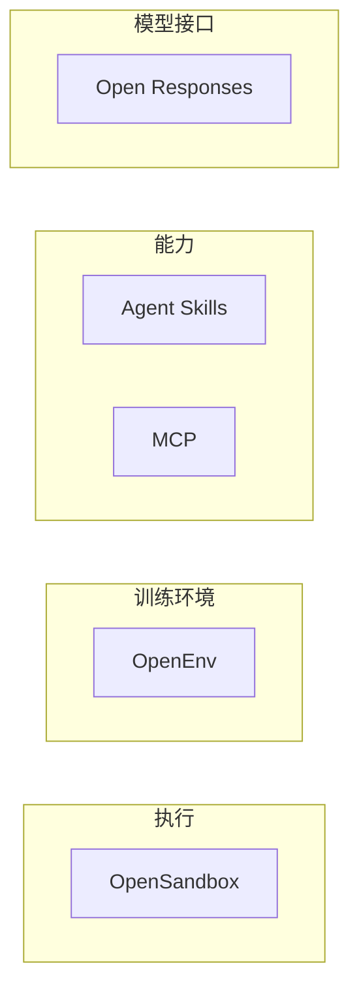

设想一个小组在 Cursor、Claude 和 GitHub Copilot 里装了大约二十个技能目录。有的提交只改说明，有的改了会执行的 `scripts/`。2026-10-22，Anthropic 把 Agent Skills 捐给 Linux 基金会下的 Agentic AI Foundation（AAIF）。`SKILL.md` 没有随这则新闻改版。要问的是：不兼容的改动以后归谁定，安装安全的公开文本又在哪里。

托管换到中立基金会之后，作者要盯三件还没落地的事：版本化发布、正式提案流程、写给作者和安装者的安全指引。字段可以照旧。团队该把技能目录当成带标签的资产来管。

<!-- more -->

## 捐出的是名称和托管

Anthropic 在 2026-10-22 的[捐赠文](https://www.anthropic.com/news/donating-agent-skills-to-the-agentic-ai-foundation)里写：技能是一个带 `SKILL.md` 的目录，可以再放脚本和参考资料。自 2025 年 12 月把标准公开以来，超过 70 个代理平台接过它，点名的有 ChatGPT、Cursor、GitHub Copilot 和 VS Code。已发布的技能约 100 万份，安装近 2.8 亿次。这两组数字是他们的统计，我没有自己数过目录或安装量。

更早的时间线也写在同一篇里。技能是做 Claude Code 时整理出来的：通用知识工作做得动，真实业务缺的是程序性知识。2025 年 10 月推出后的数周内，GitHub 上出现了数千份技能，并有人给 Codex、Cursor、OpenCode 写了加载器。

捐出的清单是名称、标志、GitHub 组织，以及 agentskills.io 域名。不加入 AAIF 也可以继续使用和贡献。牵头维护者是 David Soria Parra 和 Mahesh Murag。Anthropic、Google、OpenAI 及其他公司的工程师以个人身份参与维护。他们提议从一份路线图做起，覆盖三件事：版本化发布、正式的提案流程、给写作者和安装者的安全指引。原文用的是 proposed。这三项还没有写进规范页。

同一天，[AAIF 的公告](https://www.prnewswire.com/news-releases/agentic-ai-foundation-announces-four-new-projects-agent-skills-open-responses-openenv-and-opensandbox-302916689.html)收下四个项目：Anthropic 的 Agent Skills、OpenAI 的 Open Responses、Hugging Face 的 OpenEnv、阿里巴巴的 OpenSandbox。基金会从 2025 年 12 月的三个首发项目，到这一天一共托管十个。公告写这四段分别对应：代理如何获得技能，应用如何跨供应商跟模型说话，代理如何被训练和评估，代理在哪里运行。Anthropic 称 AAIF 由它与 Block、OpenAI 共同创立，MCP 已经捐进这家基金会。公告末尾的基金会简介写，创始项目包括 MCP、goose 和 AGENTS.md。公告还提到已经在托管的 Agent2Agent（A2A）、Agent Router 和 agentgateway。这六个加上四个新项目，数量上对得上「十个」。A2A 等三个的加入日期，公告没有写。

本站写过[技能为什么要能安装](https://cfireworks.github.io/2026/09/30/agent-skills-why-installable-skills-matter/)，也写过 [MCP 与技能各管哪一段](https://cfireworks.github.io/2026/10/01/2026-10-01-agent-protocols-skills-boundary/)。10 月 6 日那篇处理的是 MCP 连接上的技能摘要。下面不重复这三篇。这里只记托管换了之后，作者和平台要改的账。

## 仓库文本还停在八月

2026-10-23 我克隆了 [agentskills/agentskills](https://github.com/agentskills/agentskills)。`main` 的尖端是 `69ef37e9424c0a7ea9dd2293b559e43ec8176379`，提交时间 2026-08-09 20:36:04 UTC，说明是 `docs: add OpenClaw to client showcase (#492)`。捐赠公告之后，这条分支上没有更新的提交。GitHub 组织在后台是否已经过户，我没有查组织设置。

这个提交上的 README 仍写：格式由 Anthropic 发起，作为开放标准发布。示例技能仍链到 `anthropics/skills`。公告捐的是名称、标志、组织和域名，没有写这个示例仓库要不要搬家。Discord 徽章指向 `https://discord.gg/MKPE9g8aUy`。捐赠文让读者去项目 Discord 反馈规范改动，页面上没有另贴一个邀请地址。过户之后这个邀请还是否有效，两份材料都没写。

[CONTRIBUTING.md](https://github.com/agentskills/agentskills/blob/69ef37e9424c0a7ea9dd2293b559e43ec8176379/CONTRIBUTING.md) 把提案放在 GitHub Discussions，Issues 只收具体缺陷。它写明 logo 请求由 Anthropic 团队审核，参考库 `skills-ref` 暂不接受代码贡献，仓库也不收录社区技能目录。所以 Anthropic 说的约 100 万份技能，不在这个规范仓库里。它们发布在哪里，捐赠文没有给出一个总目录。

[规范页](https://agentskills.io/specification) 在这个提交里没有日期版本号。frontmatter 必填 `name` 和 `description`。可选的是 `license`、`compatibility`、`metadata`、`allowed-tools`。`metadata` 是字符串到字符串的映射，示例里有一把叫 `version` 的键，值是 `"1.0"`。那是给客户端自用的附加字段，不是规范的发行号。`allowed-tools` 标成实验字段，各实现可以不一致。`name` 必须和父目录一致，1 到 64 个字符，小写字母、数字和连字符，不能以连字符开头或结尾，也不能出现连续连字符。

加载仍是规范里的三步。启动时只放进 `name` 和 `description`（规范估计大约 100 个 token）。任务对上了才读整份 `SKILL.md`（建议少于 5000 token、500 行）。`scripts/`、`references/`、`assets/` 按需再读。

| 记账项 | 2026-08-09 的仓库文本 | 2026-10-22 的公告 | 今天可以做的 |
|--------|----------------------|-------------------|--------------|
| 格式 | `SKILL.md`，必填 `name`、`description` | 没有宣布改字段 | 按规范页写，目录名与 `name` 一致 |
| 托管物 | README 写 Anthropic 发起 | 捐出名称、标志、GitHub 组织、域名 | 继续用规范站。组织是否过户，我没查后台 |
| 提案 | Discussions 收提案，Issues 收缺陷 | 提议正式提案流程 | 流程文本出现之前，仍走 Discussions |
| 版本号 | 规范页没有日期版本；`metadata.version` 只是示例键 | 提议版本化发布 | 用 git 标签钉你装的那一版 |
| 安全 | 脚本指南写钉版本、避免交互、破坏性步骤给 dry-run。`skills-ref` 自称只供演示 | 提议写给作者和安装者的安全指引 | 人读 `scripts/`。格式检查不等于安全检查 |
| 参与 | 公开仓库，用 PR 贡献 | 不加入 AAIF 也可以使用和贡献 | 外部作者可以直接提 |

## 四个新项目只是分层，还没有接成一条管道

从上到下是阅读顺序：对模型说话、能力怎么交出去、在什么环境里训练、在哪里执行。MCP 不是这四个新项目之一，它早就在 AAIF 里。我把它放在技能旁边，是因为两者都在回答「代理多出来的能力从哪来」，一个是目录里的程序性知识，一个是工具协议。上下顺序只是阅读顺序，图上没有箭头，也不表示调用。公告没有写 `SKILL.md` 必须跑在 OpenSandbox 里，也没有写 Open Responses 的模式里有一个 skill 字段。



Open Responses 是基于 OpenAI Responses API 的开放规范：共享模式、一致的流式事件、可扩展的工具部分，让同一套请求和输出少做翻译就能换供应商。这里的工具部分是这份接口规范自己的扩展点。我没有在公告里看到它等于 Agent Skills。

OpenEnv 是做强化学习环境的框架。公告写它用容器化服务暴露代理接口、MCP，以及训练库使用的 Gym。引述里列举了 Hugging Face、Microsoft、Reflection、Meta-PyTorch、Fleet、Mercor、RadixArk、Modal、Prime Intellect，并写还有更多。这是训练环境，不是装进编辑器的那个文件夹。

OpenSandbox 是通用沙箱平台：多语言 SDK、统一沙箱 API、Docker 与 Kubernetes 运行时，外加一份定义生命周期和执行 API 的沙箱协议。用途写了编程代理、界面代理、评估、代码执行和强化学习训练。阿里巴巴的 Xiaobin Xu 在公告里说，项目诞生在阿里巴巴，但不希望未来由一家公司定义。

## 安装量已经很大，安全文本还在提议里

路线图落地之前，目录本身就是资产。下面这些不依赖基金会的新文件。

1. 技能进版本库。`SKILL.md`、`scripts/`、`references/` 一起评审。聊天记录里的提示词没有标签，也没有回滚。
2. 在规范给出发行号之前，用 git 标签标明「我们装的是哪一版」。`metadata.version` 可以照规范示例写成字符串，供人看。不要在内部制度里把它写成已经存在的规范级 semver。
3. 合并前读完 `scripts/` 和正文里的命令。步骤写成声明：读哪些文件、跑哪条命令、会不会改仓库或访问网络。正文若在未说明的情况下装包或改文件，拒绝合并。
4. 必须跑命令时，沿用规范站现有的[脚本指南](https://agentskills.io/skill-creation/using-scripts)：钉住工具版本，不要交互式提问，破坏性步骤提供 dry-run。这是作者文档，不是 AAIF 的安全基线。
5. `allowed-tools` 仍是实验字段。不要把它当成已经授予的权限。
6. MCP 工具和技能是两张信任面。工具调用留在协议和服务器上。技能正文会进上下文，并可能让宿主执行命令。同属 AAIF，信任不因此传递。
7. `description` 同时写清做什么、何时用。发现阶段加载的就是它和 `name`。规范把这一段当作「要不要启用」的依据。这一条规范已经要求，和基金会无关。
8. 跟踪那三项提议：版本化发布、正式提案、安全指引。仓库文本改写之前，贡献仍按 CONTRIBUTING。不加入 AAIF 也可以提。

## 一份按现行字段写的骨架

目录名是 `release-note`。这是用来核对字段的例子。我没有在 Cursor、Claude 或 Copilot 里安装它，所以不知道某个产品会不会在「写发布说明」时把它激活。

```markdown
---
name: release-note
description: 根据用户给定范围的 git log 与 diff 写发布说明。用户提到 changelog、release note 或准备打标签时使用。
license: Apache-2.0
compatibility: 需要 git。不访问网络。
metadata:
  author: example-team
  version: "2026-10-23"
---

## 步骤

1. 范围必须由用户给出。没有范围就停下来问，不要自己猜从上一个标签到 HEAD。
2. 只读 `git log` 和 `git diff`。输出三节：用户可见变更、不兼容变更、验证方式。
3. 标签规则不在正文里。需要时再读 `references/tag-policy.md`。

## 不要做

- 本技能没有 `scripts/`。不要临时安装包，也不要执行正文以外的命令。
- 不要推送，不要打标签，除非用户在这一轮里写明要这么做。
```

`compatibility` 用来写环境要求，有内容时上限 500 字符。规范写多数技能可以不写。我把 `version` 放进 `metadata`，是因为规范示例就是这么放的。它表示这个例子目录的修订，不是 AAIF 的发行号。

我用上述提交里的 `skills-ref` 0.1.0 做了格式检查。`pyproject.toml` 的 `authors` 仍是一个 `@anthropic.com` 邮箱，和公告里的两位牵头维护者不是同一条信息。库的 README 写明只供演示，不用于生产。隔离目录里的可执行文件先打印 `skills-ref, version 0.1.0`。脚本的 shebang 指向系统 Python，所以我把包所在目录放进 `PYTHONPATH`。在 `/tmp/skillcheck` 下执行：

```bash
skills-ref validate ./release-note
```

标准输出是一行，退出码 0：

```text
Valid skill: release-note
```

`read-properties` 把 frontmatter 打成 JSON。`version` 回来仍是字符串 `"2026-10-23"`。中文被 `json.dumps` 转成了 `\u` 转义，下面是原始标准输出，没有改字：

```text
{
  "name": "release-note",
  "description": "\u6839\u636e\u7528\u6237\u7ed9\u5b9a\u8303\u56f4\u7684 git log \u4e0e diff \u5199\u53d1\u5e03\u8bf4\u660e\u3002\u7528\u6237\u63d0\u5230 changelog\u3001release note \u6216\u51c6\u5907\u6253\u6807\u7b7e\u65f6\u4f7f\u7528\u3002",
  "license": "Apache-2.0",
  "compatibility": "\u9700\u8981 git\u3002\u4e0d\u8bbf\u95ee\u7f51\u7edc\u3002",
  "metadata": {
    "author": "example-team",
    "version": "2026-10-23"
  }
}
```

随后我加了 `scripts/hello.sh`，内容只有 `#!/bin/sh` 和 `echo hello`。再跑一次 `validate`，仍然是 `Valid skill: release-note`，退出码 0。对照这个提交里的 `skills-ref/src/skills_ref/validator.py`，`validate()` 只读取 `SKILL.md` 并检查 frontmatter：字段是否在允许列表里，`name` 是否符合命名并与目录一致，`description` 和 `compatibility` 是否超长。它不遍历 `scripts/`。规范页自己也写了，这条命令检查的是 frontmatter 和命名。通过，只说明这份头符合当前约定。

## 推测：以后可能会写进版本的三处

下面不是公告原文。公告只点了版本化发布、正式提案流程和安全指引，没有列出字段。若这些工作以后落到规范上，我预期会碰到三处，今天都还没有基金会文本。

- frontmatter 里哪些键算稳定。今天必填的是 `name` 和 `description`。`metadata` 里的 `version` 是示例，不是发行号。
- 安装时凭什么相信一份目录。今天的规范没有签名，`skills-ref` 也不读脚本。
- `scripts/` 允许做什么。今天脚本是可选的可执行文件，跑不跑由宿主决定。`allowed-tools` 仍是实验字段。

在文本出现之前，把这三条写进团队的合规清单，会把提议说成已经生效。

## 中立地址管的是路线图，不管这一次安装

名称、组织和域名交到 AAIF，路线图有了一个中立归属。这是捐赠文写出的意图。作者会少被一家产品的发布节奏单独绑住，前提是提案流程真的公开。仓库里的路线图文本还没改。David Soria Parra 在 AAIF 公告里的身份是 MCP 的共同创建者、牵头维护者，并署名为 Anthropic。Anthropic 的捐赠文则把技能的牵头维护者写成他和 Mahesh Murag。两处身份我都记下。技能规范有没有改用 MCP 那套提案编号，两篇公告都没有写。使用和贡献不必先成为会员，这一点捐赠文写明了。

安全指引要追上的是安装量。超过 70 个平台、约 100 万份技能、近 2.8 亿次安装，都是 Anthropic 的数字。提议名单上才有「给写作者和安装者的安全指引」。与此同时，8 月 9 日的 CONTRIBUTING 仍把 logo 审核放在 Anthropic 团队。两套事实可以同时成立：托管的意向已经宣布，你克隆到的贡献规则还没改。平台若把「已进入 AAIF」理解成「装上来默认安全」，缺的就是那份还没写出来的基线。

OpenSandbox 同一天进来，是一个信号。技能项目把程序性知识打成目录。沙箱项目提供执行边界，公告里写了 Docker、Kubernetes，以及生命周期和执行 API。信号的用法是：评审时写明这段命令在哪一种隔离里跑。它还不是一份联合规范。

Open Responses 和 OpenEnv 放在同一张图里，是为了拦住一种误读。跨模型的请求格式、强化学习环境，各自有捐入的项目。作者要带着走的是文件夹。

MCP 已经在这家基金会里。技能再进去，两份规范更容易被写成一种信任。工具协议描述调用怎么写。技能是会进入上下文的文字，并可能指示宿主执行。两份分开批。正式提案流程若做成公开记录，作者才有固定的地方对不兼容改动发言。在那之前，发言的地方是规范仓库的 Discussions，以及 README 上那个 Discord 邀请。

## 结语

名称进了基金会，那大约二十个目录的不兼容改动仍要有人负责。今天能钉住的，是 git 里的那一版，加上宿主自己的执行策略。AAIF 若把版本化发布、提案流程和安全指引写成公开文本，再把团队的钉法从标签迁到那份文本上。

---

## 扩展阅读

- [Anthropic：Donating Agent Skills to the Agentic AI Foundation](https://www.anthropic.com/news/donating-agent-skills-to-the-agentic-ai-foundation)（2026-10-22）
- [AAIF：四个新项目](https://www.prnewswire.com/news-releases/agentic-ai-foundation-announces-four-new-projects-agent-skills-open-responses-openenv-and-opensandbox-302916689.html)（2026-10-22）
- [AAIF](https://aaif.io)
- [Agent Skills 规范](https://agentskills.io/specification)
- [脚本指南](https://agentskills.io/skill-creation/using-scripts)
- [规范仓库 `69ef37e`](https://github.com/agentskills/agentskills/commit/69ef37e9424c0a7ea9dd2293b559e43ec8176379)（本文核对的 README、CONTRIBUTING、`skills-ref` 都在这个提交上）
- [可安装技能为什么重要](https://cfireworks.github.io/2026/09/30/agent-skills-why-installable-skills-matter/)
- [Agent 协议与技能的工程边界](https://cfireworks.github.io/2026/10/01/2026-10-01-agent-protocols-skills-boundary/)
- [MCP 技能：正文变了要重新批](https://cfireworks.github.io/2026/10/06/2026-10-06-mcp-skills-approval-digest/)

## 讨论

你的技能目录今天钉在 git 标签上，还是钉在 `metadata.version` 上？若 AAIF 以后的安全指引只写给作者、不写安装前谁来读 `scripts/`，你希望平台自己补上哪一条？
