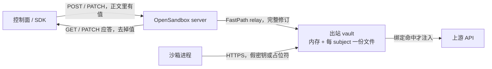

Agent 要调上游 API，密钥总得有个住处。写进沙箱的环境变量、记忆文件或工具参数，隔离墙还在，值已经在墙里面。OpenSandbox [1.2.0-rc.2](https://github.com/opensandbox-group/OpenSandbox/releases/tag/release-1.2.0-rc.2)（2026-10-21 20:39，北京时间；GitHub `published_at` 为 12:39 UTC）是 `1.2.0` 线上的第二个候选版本，GitHub 把它标成 Pre-release。这一版把 fast sandbox 的 Credential Vault 做成出站持有的状态：公开读不带回 credential value，暂停时要先把这份状态导出再拆运行时。

<!-- more -->

## 隔离还在，密钥已经在里面

本站 10 月 5 日写过整机沙箱上的出站注入：[给 Agent 一台电脑后，守凭证与出站](https://cfireworks.github.io/2026/10/05/2026-10-05-agent-computer-egress-credential-boundary/)。那篇对照的是产品公告。这篇只看 OpenSandbox 预发布写进仓库的合同。

2026-10-22，AAIF 公告四个新项目。OpenSandbox 由阿里巴巴贡献，放在「代理在哪里跑」这一层：多语言 SDK、统一 API、Docker 与 Kubernetes 运行时，外加定义生命周期和执行的沙箱协议。Xiaobin Xu（阿里巴巴开发基础设施负责人）说，项目诞生在阿里巴巴，他们不希望未来由一家公司定义。基金会地址和密钥住在哪一侧是两件事。同一天名单里的 Agent Skills，这篇不展开。

我核对的是标签 `release-1.2.0-rc.2`（发布页上的提交 `5659365`）里的提案、指南、架构页和服务器路由，加上该标签的发布说明。没有起集群，没有登录任何一家的沙箱。

## 出站持有，是这一版的边界

[OSEP-0022](https://github.com/opensandbox-group/OpenSandbox/blob/release-1.2.0-rc.2/oseps/0022-multi-sandbox-egress-control-plane.md) 的标题是 Multi-Sandbox Egress Control Plane。发布说明把 Credential Vault 标成这条提案在 fast sandbox 上落地的头条。提案首页到这个标签仍写着 `status: implementing`，`last-updated: 2026-10-19`。索引表的日期更旧。发布说明写的是端到端落地。

fast sandbox 一个 Fastlet Pod 里住多个沙箱，共用一个出站进程。每个沙箱是一个 subject。策略和凭证都挂在 subject 上，不挂在客人能读的盘上。发布说明点名的拉取请求是 [#2249](https://github.com/opensandbox-group/OpenSandbox/pull/2249)、[#2252](https://github.com/opensandbox-group/OpenSandbox/pull/2252)、[#2255](https://github.com/opensandbox-group/OpenSandbox/pull/2255)、[#2250](https://github.com/opensandbox-group/OpenSandbox/pull/2250)、[#2263](https://github.com/opensandbox-group/OpenSandbox/pull/2263)、[#2251](https://github.com/opensandbox-group/OpenSandbox/pull/2251)。网络策略在同一天的说明里走同一模式，见 [#2309](https://github.com/opensandbox-group/OpenSandbox/pull/2309)。



客人发出的请求先到出站。绑定在 scheme、host、method、path 上只命中一条时，出站才把认证头或占位符补上。没命中的请求原样转发。值不需要出现在客人的环境变量里。指南里的 Claude Code 示例把 `ANTHROPIC_API_KEY` 写成 `fake-key-inside-sandbox`，真值只在宿主写进 vault 的那一次请求里。

### 两条通道，材料不进 CRD

提案把 fast sandbox 的控制面拆成两条，互不搭车。

策略走 Sandbox Actions Handler：`SET_BINDING`、`LIFECYCLE_HOOK`、`REMOVE_BINDING`。信封里有 `runtimeInstanceId` 和 `attachmentId`，用来 fencing。注册时先装 deny-first，数据面就绪之后策略和 vault 一起放行。绑定输入里没有 credential material。CRD、etcd、备份都不带 vault 正文。提案写过早一版的取舍：把 vault 封进 `actionBindings` 能白拿回放，但应答要等绑定状态，密文进 etcd，还会撞上 65536 字节上限。出站持有换成一跳 relay 和同步 ack。

凭证走 FastPath `InvokeHandlerAction`。服务器把完整修订推到 Pod 回环上的 `/vault/{sandboxUid}`。relay 的应答就是 ack：成功表示出站已经校验并且落盘。内部 `GET` 返回带值的完整修订，因为服务器做 `PATCH` 时要拿它来合并。公开读在服务器上剥掉值。`PATCH` 的顺序写在变更模型上：每个集合先 `delete`，再 `replace`，再 `add`；每个名字最多解析一次。`expectedRevision` 对不上回 412，跨副本靠这个挡。本进程里还有一把按沙箱的锁。创建是 create-only，库已存在回 409。subject 还没注册回 404。校验失败保留上一份好状态，不留下半份修订。

`server/opensandbox_server/main.py` 把同一组路由挂了两次：根路径，以及 `/v1`。发布说明和提案写的是 `POST|GET|PATCH|DELETE /v1/sandboxes/{id}/credential-vault`。路由函数上的路径是 `/sandboxes/{sandbox_id}/credential-vault`，再加 `/credentials`、`/credentials/{name}`、`/bindings`、`/bindings/{name}`。`fsb-` 前缀走 relay，其他后端代理 sidecar 的 `/credential-vault`（端口 18080，`internal=True`）。我没有对一台活着的服务器发这些请求。

同一文件里的校验异常处理会丢掉 pydantic 错误里的 `input` 和 `ctx`。注释写明原因：422 若把提交对象回显出去，vault 正文里的值会回到调用方，也会进中间日志。公开成功应答和校验失败应答，都按「值不出现」来做。

公开形状以该标签上的生命周期模型为准。`CredentialVaultState` 只有 `revision`、`credentials`、`bindings`。每条 credential 元数据是 `name`、`sourceType`、`revision`。绑定元数据是 `name`、`revision`，外加可选的 `match` 和 `auth`。`auth` 始终有 `type`；`name` 只给 `apiKey`，表示头名，不表示密钥。写入侧的内联源有 `type: inline` 和 `value`。`value` 不在公开模型里。模型注释还写了一句 fsb 的差别：relay 面不带逐条修订，fsb 用刚读到的 vault 修订去填每条记录的 `revision`；其他后端按条记账。客户端不要假设每条记录的修订号在两种后端上含义相同。

指南同时写明：template-backed 的 fast sandbox 不在创建时带上 vault。创建之后再调 API。`credentialProxy` 这个创建字段在该 profile 上被忽略。经典 sidecar 仍要在创建时打开 Credential Proxy，并带上出站网络策略。`docs/cli/index.md` 在同一标签上仍写着 “Template-backed sandboxes do not support Credential Vault”。指南和 `docs/api/index.md` 写的是 fsb 走服务器 relay。我没有跑 `osb`，这里只记下三份文档互相打架。以发布说明、路由代码和指南里的 fast-sandbox 小节为准来读这一版；CLI 那句在合并进稳定版之前要有人改掉，或者有人证明二进制仍拒绝 fsb。

### 暂停带走的是文件，加密信封还没做

发布说明的用词是 sealed snapshot transfer。[#2255](https://github.com/opensandbox-group/OpenSandbox/pull/2255) 的标题把这件事说成 snapshot export/import 和 sealed subject state。导出把该 subject 的文件拷进驱动给的快照包，并且严格发生在运行时拆除之前。拷贝完成后 subject 进入 sealed：暂停期间 vault 操作回 409，策略执行继续。导入是唯一允许改 incarnation 的路径，恢复可能落在别的 Pod 上，所以要按新的 fence 重新盖章，并在 `data-plane-ready` 之前做完。导出真失败时，subject 保持未封，暂停检查点失败，拆除不会在没有包的情况下进行，出站本地文件还在，可以重试。

[#2290](https://github.com/opensandbox-group/OpenSandbox/pull/2290) 给没有 `vaultTransfer` 能力的 egress 留了退路：跳过转移，检查点按转移功能出现之前的语义继续，vault 不跟着走。架构页写明持久化由 `OPENSANDBOX_EGRESS_VAULT_DIR` 打开；不设这个变量时 vault 只在内存里。内存模式对上的就是这条「不转移也能暂停」的退路。想让唤醒后仍能注入，先把目录配上，并确认运行的 egress 带了 `vaultTransfer`。

文件布局在架构页和提案里是一致的：`<egress-volume>/vault/<sandboxUid>.json`，Pod 范围的 `emptyDir`。格式是 `{"v": 1, "incarnation", "attachmentId", "revision", "vault": ...}`。v1 是明文。提案的 Vault Sealing 一节写着加密落盘延期，不在 v1。将来的信封才是 `v: 2`、`A256GCM`，附加数据用 `sandbox.uid`，密钥按池放在 egress Secret 里，服务器不持有 vault 密钥。那一层保护的是静态文件、快照包和备份，不保护 relay 正文、出站内存，也不保护服务器做 `PATCH` 时短暂看到的明文。

这一版的 sealed 是 subject 状态：包已经拷走，再写 vault 会 409。文件字节仍是 v1 明文，`emptyDir` 和快照包都在凭证的信任面上。架构页和指南建议把这块 volume 配成 `medium: Memory`。重启 egress 时，Fastlet 重放 `SET_BINDING`，文件的 incarnation 和 attachmentId 与信封一致才加载，对不上就丢掉。槽位 IP 会复用。`REMOVE_BINDING` 若丢失，[#2250](https://github.com/opensandbox-group/OpenSandbox/pull/2250) 在出站侧拆掉旧 subject 的规则和 vault，再给新 subject 装 deny-first。

经典 sidecar 的指南仍单独警告：vault 是进程内存，Kubernetes 暂停会删 Pod，恢复后的新 sidecar 从空库开始，要等沙箱回到 Running 再由可信客户端重新 create。Docker pause 留着原进程，但 sidecar 一旦被换掉，同样要重写。rc.2 的快照转移写的是 fast sandbox。把这段行为套到 sidecar 沙箱上，会在唤醒后发现库是空的。

### 信任锚钉在池上，重启不再换 CA

fast sandbox 的 MITM CA 由操作员生成，按版本放进 Secret，每个池钉一个版本。egress 从只读种子拷到 mitmproxy 要的文件名，缺失时不自己生成一对新的。客人镜像在构建模板时写入证书（只有证书，没有私钥），环境变量覆盖那些不读系统信任库的客户端。重启、重放 Hook、暂停恢复，客人校验的仍是同一张锚。发布说明把这件事写成：池钉住 CA 之后，egress 重启不再在活着的沙箱下面轮换信任锚。漏拷 Secret 应在 `/healthz` 或模板构建上失败，而不是等客人 TLS 报一串看不懂的错误。

[#2212](https://github.com/opensandbox-group/OpenSandbox/pull/2212) 给经典 profile 的 `NetworkRule` 加了 `ports`（TCP 1–65535，每条最多 256 个）。fast sandbox 在 fastlet 的 nft 路径能执行之前，对带 `ports` 的规则回 400，失败即关闭。这和绑定上已经弃用的 `match.ports` 不是同一个字段。绑定的端口改由 scheme 推导，只接受 80 和 443。

[#2309](https://github.com/opensandbox-group/OpenSandbox/pull/2309) 把记录下来的 fast sandbox 网络策略也收成出站状态：`/policy/{sandboxUid}`、修订前置条件、同样的提交协议、`POLICY_EXPORT` / `POLICY_IMPORT`。未知 subject 404，incarnation 不符 412，sealed 409。同一标签上的 `docs/architecture/fast-sandbox/networking.md` 开头仍写着策略走 CRD 的 `actionBindings`，凭证是旁路且 memory-only；文后的 Credential delivery 已经改成内存加文件。发布说明和架构页开头在这个标签上没有对齐。读行为时我以发布说明和提案为准，并记住架构页开头还没改完。

## 和自动暂停只相邻一笔

[1.2.0-rc.1](https://github.com/opensandbox-group/OpenSandbox/releases/tag/release-1.2.0-rc.1)（2026-10-15 17:20，北京时间）的说明自称 `1.2.0` 的第一个候选版本，头条是 [OSEP-0024](https://github.com/opensandbox-group/OpenSandbox/blob/release-1.2.0-rc.2/oseps/0024-auto-pause-and-wake-on-access-for-fast-sandbox.md)：fast sandbox 的自动暂停和访问时唤醒，默认关闭。GitHub API 里这个标签的 `prerelease` 是 false；rc.2 的同一字段是 true。两版说明都写镜像先发，SDK/CLI 包等到 `1.2.0` 稳定版。rc.1 的旗标和它自己的「候选版本」措辞不一致，引用时要带着这句。

唤醒合同里有一条值得单独记住。网关在 503 上加上它自己的 `OpenSandbox-Wake: expired`，表示这次请求被停在网关里，没有转发进沙箱，因此任意方法都可以按 `Retry-After` 重试，前提是正文还能重放。SDK 默认最多 5 次、总等待 60 秒。裸的 503 没有这个头，沿用原来的重试规则，非幂等方法不会因为 503 就自动再发。这个头证明的是「数据面请求没进沙箱」。它不表示现在可以把密钥写进客人环境来凑合。

## 三种放法

| 维度 | 写进沙箱环境、文件或工具参数 | 宿主进程代发 | OpenSandbox 出站 vault（fast sandbox，1.2.0-rc.2 预发布） |
|------|------------------------------|--------------|--------------------------------------------------------------|
| 值住在哪 | 客人文件系统、环境、命令行、模型上下文 | 宿主进程内存，离开前写入头 | 出站内存，加上每个 subject 一份本地文件；CRD 不带材料 |
| 公开读能看到什么 | 客人里怎么读就怎么看到 | 取决于代理回不回显 | `revision`、名字、`sourceType`、绑定的 match 和 auth 形状；没有 `value` |
| 暂停之后 | 根文件系统快照会把值一起带走 | 看宿主有没有另存 | 导出成功才拆运行时；v1 文件是明文。没开持久化或 egress 没有 `vaultTransfer` 时，检查点可以不带 vault |
| 写冲突 | 没有修订号 | 看实现 | `expectedRevision` 不符为 412；库已存在时 POST 为 409；sealed 时 vault 写为 409 |
| 这一版没做的 | — | — | 静态文件的 AEAD。提案把 Vault Sealing 标成延期 |

第三列来自上述标签里的合同。我没有在集群里量过延迟。第二列这种宿主代发，本篇没有再跑。

## 客户端只把公开读当元数据

下面这份脚本不连接 OpenSandbox。它按上述模型组公开 JSON，把假字符串 `demo-not-a-real-token` 留在出站侧的结构里，并拒绝任何公开正文再出现这个字符串，或出现 `value`、`source`、`input`、`ctx` 这些键。422 的剥离只复现 `main.py` 里丢掉 `input` 和 `ctx` 的那条规则，不是从服务器抓的报文。412 和 409 只打印状态码，因为我没有把这两类错误的响应模式抄进演示。

```python
FORBIDDEN_KEYS = frozenset({"value", "source", "input", "ctx"})


def assert_public_read(body: dict, secret: str) -> None:
    """公开读只当元数据。正文里出现值或写入字段就失败。"""
    blob = json.dumps(body, ensure_ascii=False)
    if secret in blob:
        raise SystemExit("public body contains the credential value")

    def walk(node: object) -> None:
        if isinstance(node, dict):
            for key, value in node.items():
                if key in FORBIDDEN_KEYS:
                    raise SystemExit(f"public body has forbidden key {key}")
                walk(value)
        elif isinstance(node, list):
            for item in node:
                walk(item)

    walk(body)
```

完整脚本在 `demos/opensandbox-credential-vault-read/run_demo.py`。我执行的命令是：

```bash
python3 demos/opensandbox-credential-vault-read/run_demo.py
```

创建之后的公开体（假令牌不在里面）：

```json
{
  "revision": 1,
  "credentials": [
    {
      "name": "example-api-key",
      "sourceType": "inline",
      "revision": 1
    }
  ],
  "bindings": [
    {
      "name": "example-api",
      "revision": 1,
      "match": {
        "hosts": ["api.example.com"],
        "schemes": ["https"],
        "methods": ["POST"],
        "paths": ["/v1/*"]
      },
      "auth": {"type": "apiKey", "name": "x-api-key"}
    }
  ]
}
```

接着四行状态：`guest_env_holds_secret=False`；`PATCH expectedRevision=1 -> 200` 且修订变为 2，每条记录的 `revision` 也是 2（按 fsb 注释，用刚读到的 vault 修订填充）；`PATCH stale expectedRevision=1 -> 412 revision_unchanged=True`；`PATCH while sealed -> 409 revision_unchanged=True`。剥离后的 422 只剩 `type`、`loc`、`msg`，`loc` 里可以出现字段名 `value`，正文里没有那个假令牌。

清单：

- 真值只出现在控制面写 vault 的请求里。客人环境、命令参数、仓库文件、agent 记忆、工具参数放假值或占位符。指南要求 `defaultAction="deny"`，路径收到 `/v1/*` 这一级。default-allow 仍会被接受，指南写明会打安全警告。
- GET 和 PATCH 的成功应答都跑同一套断言。内部 relay 的 GET 带值，那个面在 Pod 回环上，不给沙箱，也不进日志管道。
- 412 之后重新 GET，用新的 `revision` 填 `expectedRevision`。新值从控制面的保管里取。
- 暂停前确认 `OPENSANDBOX_EGRESS_VAULT_DIR` 已设，且 egress 带 `vaultTransfer`。跳过转移会让唤醒后的库为空。空库之后把密钥写回客人，等于把这一版关上的口又打开。
- volume 用 `medium: Memory`。快照仓库按凭证存储来管。sealed 只表示暂停期间拒绝再写。
- fast sandbox 上带 `ports` 的 `NetworkRule` 会 400。镜像现在发，SDK/CLI 包要等 `1.2.0` 稳定版。同一 netns 里再加 Istio/Envoy，指南写明 Credential Vault 目前不支持。

## 还缺的那一层

静态加密的形状在提案里，实现标成延期：池级密钥、服务器不持有 vault 密钥、密文绑 `sandbox.uid`。rc.2 的行为停在明文文件。能读到出站卷的人，和能读客人环境的人，要分成两本账。

提案状态仍是 implementing。CLI 页、架构页开头和指南还没对齐。稳定版发出 SDK 之前，这三处要改文档，或在发行说明里指出以哪份为准。AAIF 给了沙箱协议一个中立地址，v1 文件仍是明文。

和 rc.1 的唤醒放在一起看：503 加上 `OpenSandbox-Wake: expired` 可以安全重试那条没进沙箱的数据面请求。唤醒之后凭证还在不在，取决于暂停时导出有没有发生。导出没发生，重试会打到一个没有 vault 的沙箱。那时补救动作若是把密钥写进环境，rc.2 想关上的口就在唤醒时重新打开。

## 结语

沙箱回答的是客人碰不碰宿主。Credential Vault 回答的是 API 密钥住在哪一侧。1.2.0-rc.2 把 fast sandbox 的答案写成出站状态：公开接口回修订和绑定形状，暂停先导出再拆除。导出的 v1 仍是明文，加密信封还在提案的延期节里。用这一版做预发验证可以，把它当成已经封好的生产密钥层，还差那一层，也差文档对齐。

---

## 扩展阅读

- [OpenSandbox 1.2.0-rc.2](https://github.com/opensandbox-group/OpenSandbox/releases/tag/release-1.2.0-rc.2)（Pre-release，2026-10-21）
- [OSEP-0022：Multi-Sandbox Egress Control Plane](https://github.com/opensandbox-group/OpenSandbox/blob/release-1.2.0-rc.2/oseps/0022-multi-sandbox-egress-control-plane.md)（标签上的状态仍为 implementing）
- [Credential Vault 指南](https://github.com/opensandbox-group/OpenSandbox/blob/release-1.2.0-rc.2/docs/guides/credential-vault.md)
- [Fast Sandbox Networking](https://github.com/opensandbox-group/OpenSandbox/blob/release-1.2.0-rc.2/docs/architecture/fast-sandbox/networking.md)
- [OpenSandbox 1.2.0-rc.1](https://github.com/opensandbox-group/OpenSandbox/releases/tag/release-1.2.0-rc.1) 与 [OSEP-0024](https://github.com/opensandbox-group/OpenSandbox/blob/release-1.2.0-rc.2/oseps/0024-auto-pause-and-wake-on-access-for-fast-sandbox.md)
- [AAIF：四个新项目](https://aaif.io/news/agentic-ai-foundation-announces-four-new-projects)（2026-10-22）

## 讨论

你现在的沙箱里，密钥是在环境变量、工具参数，还是在出站进程？如果暂停不会把 vault 文件带走，唤醒之后第一反应是重写客人环境，还是让注入失败并停下来？
