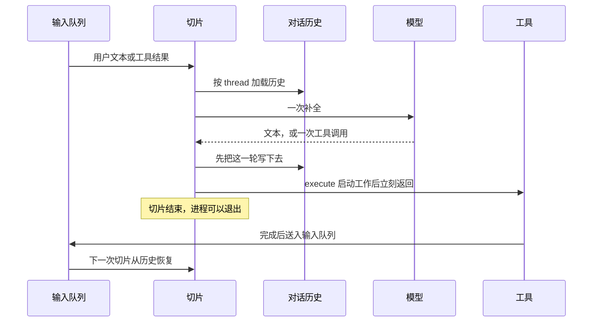
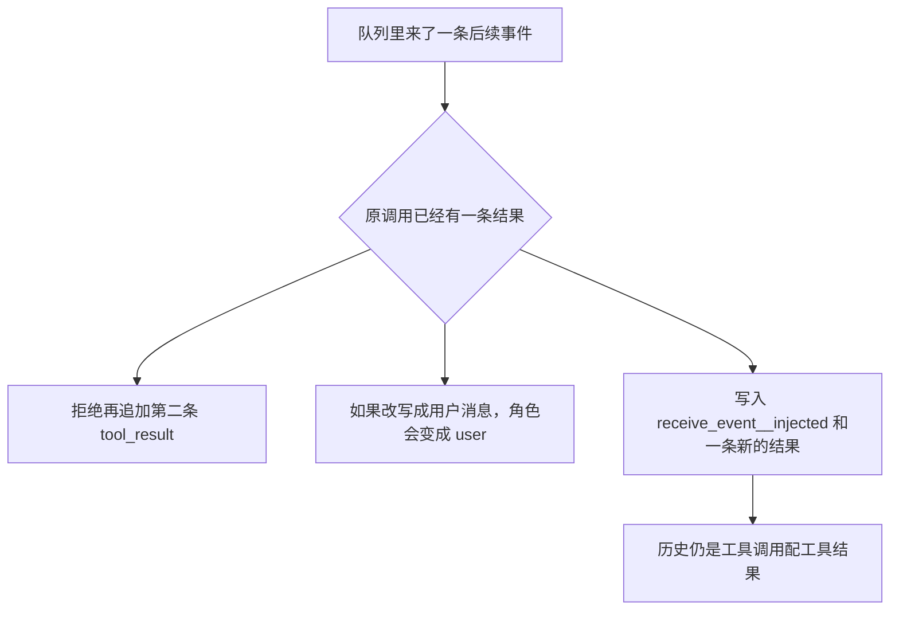

构建要跑二十分钟。人已经去忙别的事，harness 还停在 `await tool()` 上。进程、栈和连接都挂着，等的那段时间和模型无关。

2026 年 10 月 23 日，Shadaj Laddad 在 AWS Open Source Blog 发布 [Infinity](https://aws.amazon.com/blogs/opensource/introducing-infinity-a-runtime-for-extreme-agent-concurrency/)：Apache-2.0，归在 Hydro 项目下，AWS 与 UC Berkeley 合作。作者把这次发布写成 early research release。本文对照的是这篇公告、[infinity.hydro.run](https://infinity.hydro.run/) 上的文档，以及 GitHub [`hydro-project/infinity`](https://github.com/hydro-project/infinity) 的 `main` 提交 [`341f6c2`](https://github.com/hydro-project/infinity/commit/341f6c2d3a32632489c918535a60805089ea0fe1)（2026-10-23，`chore: fix remaining THIRD-PARTY mismatch`）。仓库创建于 2026-04-13，公告日只是公开说明的日期。

> 等工具时还占着进程，是 harness 把 agent 当成同步循环；Infinity 把对话历史当成 continuation，切片结束就可以休眠——代价接近账本大小，而不是常驻任务栈。

<!-- more -->

## 一、一次循环里，等待算在谁的账上

常见 harness 把 agent 写成同步循环：调用模型，调用工具，等到工具返回，再调用模型。工具要是二十分钟的构建、几小时后的下一条 pull request，或者第二天早上的审批，这段时间进程一直在。Infinity 的说法是把挂起点放在工具调用上。运行时派发调用、保存对话、挂起 agent；结果到达后再从保存的状态恢复。语言里的类比是无栈协程：Rust 的 `async fn` 在每个 `await` 只留下状态机需要的值，而不是把整段调用栈留在内存里。博文认为，agent 调用工具的那一刻，对话历史里已经有恢复所需的全部内容。

| | 阻塞式循环 | Infinity 的切片 |
|--|------------|-----------------|
| 等工具时留下什么 | 进程、栈、打开的连接 | 已保存的对话历史 |
| 一轮做什么 | 补全，调用工具，等到返回 | 加载历史，一次补全，至多派发一次异步工具，然后结束 |
| 空闲时的计算 | 任务还在 | 没有排队消息、也没有未完成工具结果时，本地任务退出；step 模式下次投递再加载 |
| 新事件从哪进来 | 多半要等当前工具返回，或另开一条通道 | 用户文本、工具结果、订阅事件、定时器，都进同一条输入队列 |
| 什么时候够用 | 人坐在旁边，工具是毫秒级查询 | 等待远长于补全，agent 数量也上去 |

博文把一个切片写成四步：从可插拔存储加载历史，跑一次模型补全，持久化输出，至多派发一次工具调用，然后结束。切片不等待工具、定时器或其他外部操作。能唤醒 agent 的东西都是输入队列上的消息。博文把目的地写成 `thread_id`，`InputMessage` 的字段是 `group_id`。同一 thread 按顺序处理，不同 thread 可以并行。两个切片同时写同一份历史会互相覆盖，所以顺序是正确性条件。



[`AgentSystem::step`](https://github.com/hydro-project/infinity/blob/341f6c2d3a32632489c918535a60805089ea0fe1/crates/infinity-agent-core/src/system/builder.rs) 的注释把这收成库的接口：一批输入按 `group_id` 分组，加载历史和去重状态，至多一轮 completion，提交，至多派发一次异步工具。调用之间不缓存 thread 状态。

博文那句「一次补全、一次工具」描述的是让出路径。同一次 `run_completion` 里还有回路。同步工具、未知工具名，以及模型自己去调用 `receive_event__injected`，会把结果写回历史，再 `continue 'outer`，切片先不结束。架构文档举的例子是 `spawn_thread`：它对着对话存储，微秒级就能完成；为它让出切片会多一轮存储往返，还可能在派发和结果之间插进别的事件，使这次调用看起来像被取消。[`tools/thread.rs`](https://github.com/hydro-project/infinity/blob/341f6c2d3a32632489c918535a60805089ea0fe1/crates/infinity-agent-core/src/tools/thread.rs) 里它走 `supports_sync()`。

同一条流里如果模型打出多个工具调用，[`event_processor.rs`](https://github.com/hydro-project/infinity/blob/341f6c2d3a32632489c918535a60805089ea0fe1/crates/infinity-agent-core/src/event_processor.rs) 的注释写明只有第一个会被执行，后面的内容丢掉，避免历史尾部对不上即将到达的结果。要并行，就另开 thread，而不是指望一次补全里的 parallel tool calls。这是注释里的行为，我没有拿真实模型去试。

## 二、工具先返回，结果以后自己进队列

差异主要在工具怎么写。博文里的 `GetBuildStatus` 在 `execute` 里启动工作，马上 `Ok(())`；构建状态以后才经 `send_to_input_queue` 回来。下面是按原文缩过的示意，`name()` / `description()` / `parameters()` 仍按原文省略。它用来说明形状，我没有把它放进 Infinity 仓库编译。

```rust
async fn execute(
    &self,
    args: serde_json::Value,
    id: ToolCallId,
    call_id: Option<ProviderCallId>,
    context: &ToolContext<ChannelSender>,
) -> Result<(), Box<dyn std::error::Error + Send + Sync>> {
    let build_id = parse_build_id(&args)?;
    let (builds, sender, thread_id) = (
        self.builds.clone(),
        context.message_sender.clone(),
        context.thread_id.clone(),
    );

    tokio::spawn(async move {
        let text = match builds.status(&build_id).await {
            Ok(status) => format!("Build {build_id}: {status}"),
            Err(error) => format!("Error reading build {build_id}: {error}"),
        };
        let message = tool_result_message(thread_id, &id, call_id, text);
        if let Err(error) = sender.send_to_input_queue(message, id.as_str()).await {
            tracing::error!(%error, "failed to deliver build status");
        }
    });

    Ok(()) // The slice ends without waiting for the build.
}
```

对照 `341f6c2` 的 [`ToolContext`](https://github.com/hydro-project/infinity/blob/341f6c2d3a32632489c918535a60805089ea0fe1/crates/infinity-agent-core/src/tools/mod.rs)，字段是 `group_id`、`message_sender`、`callback_url`、`user_id`、`thread_stack`、`safe_spawn_point`。我在这个结构体里没有读到 `thread_id`。`InputSender::send_to_input_queue` 的第二个参数是去重 id。博文把工具调用 id 传进去，库里的 `send_tool_error` 也这么做。基准示例 [`agent_scale.rs`](https://github.com/hydro-project/infinity/blob/341f6c2d3a32632489c918535a60805089ea0fe1/crates/infinity-agent-core/examples/agent_scale.rs) 的 `RunCommand` 没有外部等待，它在 `execute` 返回之前就用一个新的 UUID 把结果送进队列。要把几分钟或几天让出去，形状是博文这种先把工作交给别的任务，再 `Ok(())`。

本地模式的队列可以是 channel。step 模式不留着任务，平台每次投递调用一次 `step`，返回后进程可以退出。博文写的参考部署是：SQS FIFO，每个 thread 一个 `MessageGroupId`；每次投递触发一次 Lambda，跑完一步就退出；对话历史在 Aurora DSQL，去重状态在 DynamoDB；`sleep` 在 900 秒以内走 SQS 的 `DelaySeconds`，更长走 EventBridge Scheduler。CDK 构造 [`InfinityAgent`](https://github.com/hydro-project/infinity/blob/341f6c2d3a32632489c918535a60805089ea0fe1/agent/lib/infinity-agents/index.ts) 建了输入 FIFO、输出标准队列、延迟队列、名为 `InfinityAgentsState` 的 DynamoDB 表、DSQL 集群和 RAP Receiver。表的注释写明它存元数据和已处理 id，对话历史不再放在这张表里。我读了博文、[AWS Architecture](https://infinity.hydro.run/docs/infinity-runtime/serverless/architecture) 和这份构造，没有执行 `cdk deploy`。

Lambda 的模型 id 写死在 [`event_handler.rs`](https://github.com/hydro-project/infinity/blob/341f6c2d3a32632489c918535a60805089ea0fe1/crates/infinity-agent-lambda/src/event_handler.rs)：`global.anthropic.claude-sonnet-4-6`。同一提交的 README 示例用这个字符串。文档站首页 [`index.tsx`](https://github.com/hydro-project/infinity/blob/341f6c2d3a32632489c918535a60805089ea0fe1/docs/src/pages/index.tsx) 的示例写成 `claude-sonnet-4-5`。抄的时候以 README 和 Lambda 常量为准。

[`thread.rs`](https://github.com/hydro-project/infinity/blob/341f6c2d3a32632489c918535a60805089ea0fe1/crates/infinity-agent-core/src/system/thread.rs) 把提交和派发拆开：先 `history.sync()`，再 `execute_action`。注释写，工具调用先落进历史，结果才可能到达。`HistoryManager::sync` 只给用户文本和订阅事件写 processed id，因为这两类重投会再追加一轮；工具结果靠历史尾部去重。同函数里 `add_processed_message_ids` 的 `Result` 被 `let _ =` 丢掉。切片幂等依赖这次写入真的落下去。我没有构造「历史已追加、去重 id 没写上」的失败实验。

## 三、迟到的事件，仍然要长得像工具结果

模型 API 的对话是用户回合、助手回合，以及一对一的工具调用和工具结果。一次订阅会在确认之后继续来事件，命令输出也会分多段。博文比较了几种塞进历史的办法：

| 写法 | 历史里像什么 | 博文给出的后果 |
|------|----------------|----------------|
| 同一调用再追加一条结果 | 一个 call 对上两个 result | 违反一对一，模型通常直接拒绝这串对话 |
| 写成用户消息 | 这句话是用户说的 | API 接受，模型和用户原话、工具上报分不开 |
| 放进系统提示 | 不在对话顺序里 | 模型少了「这件事发生在哪一步」 |
| `receive_event__injected` | 运行时补上的工具调用，再跟一条结果 | 仍走工具结果那套后训练习惯；名字不提供给模型 |

合成调用的参数带着 `original_tool_name`、`original_tool_call_id`、`original_args`，让模型知道事件属于哪一次请求。名字用 `receive_event__injected`，避免和再次调用原工具混淆。`__injected` 表示运行时造出来的。模型如果自己调用这个名字，运行时注入错误并回到补全回路。错误文本在源码里是：`Error: you cannot directly invoke receive_event__injected, invocations will automatically be injected when events arrive.`



订阅的第一条结果带 `subscription: true`，运行时据此跟踪这条调用。之后的事件另走合成调用。默认每个事件进一个临时子 thread：子线程继承到生成点为止的上下文，处理完可以给父线程一份报告，也可以不报告就关闭；父线程的历史保持原样。工具把事件标成 associative 时，合成调用直接写进订阅者自己的历史，文档举的例子是后台命令的输出行。事件多的订阅会撑满上下文，所以默认的子线程是在省父线程的窗口。

父子 agent 用的是同一条路。内置的 `spawn_thread` 创建子 thread 和它自己的输入队列。父线程先看到「子线程已创建」这条结果，然后可以继续或休眠。子线程调用 `report_to_parent` 或最后 `close_thread` 时，报告作为原来那次 `spawn_thread` 的事件回到父队列，父线程看到的仍是 `receive_event__injected`。博文据此说运行时不必另做一套 agent 消息总线。顺序保证和别的消息一样。这是设计说明，我没有把父子线程跑起来。

网络上的工具走 Reactive Agent Protocol。运行时发一次带 `callback_url` 的 POST，工具先确认，调用立刻返回；结果或订阅事件准备好后再 POST 回来。工具服务可以按普通 Web 服务扩缩，对方 agent 当时可以没有进程。规格在 [RAP 文档](https://infinity.hydro.run/docs/rap/what-is-rap)。MCP 方面，[`infinity-mcp-bridge`](https://github.com/hydro-project/infinity/blob/341f6c2d3a32632489c918535a60805089ea0fe1/crates/infinity-mcp-bridge/src/lib.rs) 提供 stdio 和 Streamable HTTP 的 `McpToolSet`。文档说现有 MCP 服务器经兼容层运行。我没有把一个 MCP 服务器接到 Infinity 上。

## 四、和本站写过的耐久账本放在一起

[Pi Durable 那篇](/2026/10/03/2026-10-03-pi-durable-office-agent-harness/)对的是提交 `e39da9ba`：一个 Node 进程里先后两个 Harness、两份本地目录、一次受控的 `close()` 再打开。账本比那次关闭长。跨进程 lease 和远程 Env 在交接文档里仍是待办。

[Always-on 的第一性原理](/2026/10/01/2026-10-01-always-on-agent-harness-boundary/)把「何时动手、在谁的机器上、用谁的凭证、失败如何审计、空闲如何计费」拆开。Infinity 碰到的是其中的空闲计算：等待可以不占着这一次执行。凭证在谁手里、出站能不能出，留给[给 Agent 一台电脑后，守凭证与出站](/2026/10/05/2026-10-05-agent-computer-egress-credential-boundary/)。切片结束之后，沙箱里的文件和已经发出的外部请求还在；休眠放掉的是这次函数调用。

两边都希望账本比计算单元活得久。Pi Durable 公开实验写到的是本地目录映射和受控重开。Infinity 公开说明的是：续体就是对话历史，切片有界，本地任务可以退出，serverless 调用也可以结束。两份证据各自停在自己的实验和文档上。

## 五、7.5 万这个数字是斜率，不是树莓派上的普查

首页写，二十轮工具调用之后一个 agent 大约占 103 KB，因此 7.5 万能放进 8 GB。AWS 博文写大约 100 KB，大约 7.5 万能放进树莓派 5 的 8 GB，并写明基准是 8 万个 agent、320 万次 completion、AMD EPYC 9R14 的单线程、内存存储。

图表组件 [`MemoryChart.tsx`](https://github.com/hydro-project/infinity/blob/341f6c2d3a32632489c918535a60805089ea0fe1/docs/src/components/MemoryChart.tsx) 把同一次运行的点写死在源码里。注释中的命令参数是 `AGENTS=80000 TURNS=20 WAVE=4000`，机器同样是 EPYC 9R14，单线程，内存存储，进程内脚本模型。每轮是两次 completion 加一次经输入队列的异步工具往返。RSS 在每波 4,000 个 agent 空闲之后采样。斜率按 `(末点 RSS − 起点 RSS) / 80000 / 1024` 计算，四舍五入是 103。文件里的两端是 5,304,320 字节对 0 个 agent，以及 8,406,446,080 字节对 80,000 个 agent。横轴用 `GB = 1e9`，8 GB 参考线画在这个位置。76,000 个 agent 那一点是 8,002,379,776 字节，贴着 8×10⁹ 字节的外侧。博文的「大约 100 KB / 大约 7.5 万」和首页的「大约 103 KB」是对这条曲线的两种取整。

7.5 万是 EPYC 单线程上这条 RSS 斜率、对照 8×10⁹ 字节参考线之后的读数。树莓派 5 的 8 GB 画在同一张图上。serverless 说的是另一件事：等待三天的 CI 时没有正在运行的调用。历史在 Aurora DSQL 里仍占存储。博文没有给存储费用，本文不补。

基准的补全大约 1.2 KB 文本，源码里是 12 段固定句子；工具结果是一句测试摘要重复 5 次。二十轮之后的大约 100 KB 绑在这个脚本形状上。真实对话更长，账本就更大。空闲代价跟着历史走。100 KB 是他们公布的这个测量点。

本文没有运行 `cargo run --release -p infinity-agent-core --example agent_scale`。

## 六、博文自己标成开放的问题

公告末尾有四条，这里保持原问题，不补设计：

1. **交错事件上的推理。** 合成调用把对话补成 API 接受的形状。模型后训练看到的多半是同步工具轨迹。事件有多少、什么顺序、走子线程还是 associative，会怎样改变决定，他们写明还要看。
2. **调度。** 当前按消息到达顺序处理 thread。用户正对着的 thread 和后台事件处理要不要分优先级，还没有策略。
3. **一棵 agent 树上的压缩。** 摘要按历史位置索引，压缩前出生的子 thread 仍能重建当时继承到的历史。架构文档写，本地驱动大约在模型上下文窗口的四分之三处触发压缩。大树跑很久之后该怎么压，他们还没研究。
4. **事件是不是真的。** 运行时把事件锚回原来的请求。暴露在网上的 agent 可能收到假载荷。怎样在没有进程亲和的结构里核对来源、留下责任，博文把它留成问题。

第 4 条和空闲计费是两件事。来源没核对时，休眠只是让假事件也能便宜地唤醒一次切片。

## 七、动手前先对这张清单

1. 人盯着、工具是毫秒级查询、要看流式输出时，阻塞循环仍然直白。切片省的是等待，补全该花的时间和 token 还在。
2. 等待以分钟、小时、天计，而且这样的 agent 会很多时，再把续体放进存储，用持久队列唤醒。本地长进程也可以先做到「这个 thread 没消息时任务退出」，不必第一天就上 Lambda。
3. 异步工具的 `execute` 启动外部工作并返回。结果带稳定 id 入队。建子线程这类存储内就能做完的调用，可以在同一切片里写回结果再补全。
4. 发信、扣款、开 pull request 这些外部副作用单独做幂等键。队列去重管的是「这条输入还要不要再跑一遍切片」。`341f6c2` 里去重写入的错误被丢掉，写入失败时的窗口我没有复现。
5. 同一 thread 保持 FIFO。这份源码在一次补全里只执行第一个工具调用。并行用 `spawn_thread`。
6. 订阅事件默认进子线程。只有需要逐行跟进的输出，才标 associative，写进订阅者自己的历史。上下文预算按这个选择算。
7. 事件锚回 `tool_call_id` 只说明它声称来自哪次调用。载荷真伪、谁可以往回调 URL 上 POST，要在工具服务侧另做核对。
8. 沙箱、凭证和出站允许列表另表。切片休眠不缩小令牌的权限。
9. 这是早期研究发布。Lambda 路径的模型 id 在源码里写死。先读 [serverless quickstart](https://infinity.hydro.run/docs/infinity-runtime/serverless/quickstart)，再决定要不要上 CDK。

仓库里的 [`demos/infinity-slice-runtime/slice_sim.py`](https://github.com/cFireworks/cfireworks.github.io/blob/main/demos/infinity-slice-runtime/slice_sim.py) 用内存队列和脚本模型走上述形状。回调 URL 里的令牌是占位字符串 `inf-demo-not-a-credential`，脚本不访问网络。它打印的 tick 和字节数是玩具历史自己的账：等待的 tick 里槽位是空的，历史还在。下面是脚本里的受理和投递，用来看「先返回、后入队」，完整断言在文件里。

```python
def execute_build(sim: SliceSim, build_id: str) -> str:
    """工具只启动工作。返回值是受理，不是构建结果。"""
    sim.jobs.append(build_id)
    return "accepted"


def deliver_build(sim: SliceSim, group_id: str, build_id: str, dedup_id: str) -> None:
    sim.enqueue(
        QueueMsg(
            msg_id=dedup_id,
            group_id=group_id,
            kind="tool_result",
            text=f"Build {build_id}: green",
            call_id="call_build",
        )
    )
```

```bash
python3 demos/infinity-slice-runtime/slice_sim.py
```

最后一行是 `DEMO OK` 时，只说明脚本里的断言走到了退出码 0。它不测量 Infinity 的 RSS，也不表示 Lambda 已经部署。

## 八、结语

等工具的时间，可以记在进程上，也可以记在一份对话历史上。Infinity 选了后者，并把让出路径收成一次补全加一次异步派发，这样「来一次、干完、就走」的平台才能接上。研究发布的价值，是这个执行模型已经能对着源码读。7.5 万、等待期间的计算，以及 CDK 堆栈，分别停在他们公布的斜率、设计说明和还没在本文里部署的构造上。人盯着的短会话，继续用阻塞循环就好。等待变成默认状态时，把续体、队列和外部副作用的幂等拆开验收。

---

## 扩展阅读

**一手：**

- [Introducing Infinity: a runtime for extreme agent concurrency](https://aws.amazon.com/blogs/opensource/introducing-infinity-a-runtime-for-extreme-agent-concurrency/)（Shadaj Laddad，2026-10-23）
- [infinity.hydro.run](https://infinity.hydro.run/) · [架构](https://infinity.hydro.run/docs/infinity-runtime/architecture) · [AWS 架构](https://infinity.hydro.run/docs/infinity-runtime/serverless/architecture) · [RAP](https://infinity.hydro.run/docs/rap/what-is-rap)
- 仓库 [`hydro-project/infinity`](https://github.com/hydro-project/infinity) @ [`341f6c2`](https://github.com/hydro-project/infinity/commit/341f6c2d3a32632489c918535a60805089ea0fe1)
- 基准程序 [`agent_scale.rs`](https://github.com/hydro-project/infinity/blob/341f6c2d3a32632489c918535a60805089ea0fe1/crates/infinity-agent-core/examples/agent_scale.rs) · 曲线数据 [`MemoryChart.tsx`](https://github.com/hydro-project/infinity/blob/341f6c2d3a32632489c918535a60805089ea0fe1/docs/src/components/MemoryChart.tsx)
- 本文演示：[`demos/infinity-slice-runtime/slice_sim.py`](https://github.com/cFireworks/cfireworks.github.io/blob/main/demos/infinity-slice-runtime/slice_sim.py)

**本博客相关：**

- [常驻个人 Agent：Pi Durable 的本地目录映射与受控恢复](/2026/10/03/2026-10-03-pi-durable-office-agent-harness/)
- [Always-on 的第一性原理：责任、时间、电脑与闸门](/2026/10/01/2026-10-01-always-on-agent-harness-boundary/)
- [给 Agent 一台电脑后，守凭证与出站](/2026/10/05/2026-10-05-agent-computer-egress-credential-boundary/)

---

你手头的工具里，哪些等待已经长到值得把进程让出去？外部副作用的幂等键写在队列去重旁边，还是写在业务请求里？订阅事件进子线程还是留在原对话，上下文预算按哪一边算？

---

*本文依据 2026-10-23 的 AWS 公告、infinity.hydro.run 文档，以及 `341f6c2d3a32632489c918535a60805089ea0fe1` 的源码。约 100 KB、约 103 KB 和约 7.5 万 agent 是他们公布的曲线读数，本文没有重跑 `agent_scale`，没有部署 AWS，也没有把演示脚本的 tick 写成 Infinity 的测量。早期研究发布这个定位沿用作者原文。*
