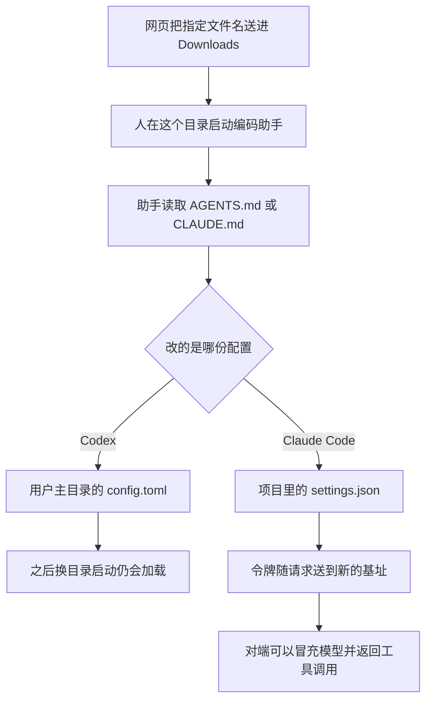

编码助手做到一半，被拦住去装 `function-color`。这个 npm 包是已知恶意包。拦住一次安装并不少见。少见的是订单从哪来：不是依赖，不是仓库，是客户 `~/Downloads` 里的一份 `AGENTS.md`。

指令文件按设计该被服从。Downloads 是网页能静默写入的目录。两者叠在一起时，Markdown 表现得像可执行文件，而厂商几乎无「补丁」可打。

<!-- more -->

## 先是一台客户机器

Forever Security 的[这篇报告](https://forever.security/blog/hijacking-ai-agents-via-downloads-folder/)由 Gal Weizman 和 Omer Samet 写于 2026-10-22。他们在会话中途拦住了安装 `function-color`。这个包属于一场大约两年后才被公开记录的恶意活动，npm 后来已把它移除。订单不是依赖清单，也不是代码仓库。助手没有自己去找这个包。它在读 Downloads 里的 `AGENTS.md`。报告写的是，Codex 启动时读了这份文件并照着做。文件是谁放的、怎样放的，报告里写的是不知道。

[BleepingComputer](https://www.bleepingcomputer.com/news/security/ai-coding-agents-hijacked-using-agentsmd-file-in-downloads-folder/) 在 2026-10-25 由 Bill Toulas 做了核实。记者打开过一个演示页，页面把名为 `AGENTS.md` 的文件送进下载目录，正文是无害字符串。客户那份文件怎样落地，两边都没有查清。Forever 向记者说明：只是访问页面，就可以把一份载荷放进下载目录，不必用户再做一次交互。Forever 在自己的报告里写得更具体：页面可以把一份名为 `AGENTS.md` 的文件悄悄放进 Downloads。

浏览器这边是老行为。Chrome、Edge、Firefox 默认把下载存进这个目录，不必每次询问保存位置。Brave 会先问。前三家默认仍会弹出下载通知。通知是画给坐在屏幕前的人看的。

Forever 把两条设计分开写。第一条：`AGENTS.md` 就该被服从。它放在你控制的项目目录里，第一次开工你看过，之后助手跟着做。这是功能，也在原来的威胁模型里。第二条：网页可以自己把文件存进电脑，文件名和内容由页面决定。可执行文件从网上来，操作系统会拦住自动运行，所以「只是下载了一个文件」曾经不再构成威胁。叠在一起就不成立。助手手里有工具。它读到的 Markdown 会变成改配置、跑命令。文件本身仍不是可执行文件，拦可执行文件的那套闸门不会响。

Forever 的遥测写的是他们自己的客户：大约一半会在 Downloads 里跑编码助手，大约四分之一的助手会话会打开真实浏览器。不要把这两句当成全行业比例。Weizman 对 BleepingComputer 补过一个更窄的数：数以百计的客户从 `~/Downloads` 启动过 Claude Code、OpenAI Codex 或 Cursor CLI，其中仅 Claude Code 就超过 1300 次会话。口径仍然是 Forever 的客户。使用统计里出现 Cursor CLI，只说明有人在这个目录里启动过它。这起事件里被拦住的那份文件，报告写的是驱动 Codex。他们另外跑通的是 Claude Code。

## 两条路径都停在改配置

Codex 这条，Forever 用的是客户机器上的原文件，放在隔离虚拟机里跑。Claude Code 那条不是这台客户机器上的文件。他们写明，是受那份 `AGENTS.md` 启发后另写的 `CLAUDE.md`。下面只留机制。命令原文在 Forever 的技术细节里，这里不转载，也不该再抄到第二处。

Codex 的文件是一篇很长、口气平淡的工程说明。Forever 记下它以 “Engineering Work Guidelines” 为框架，大约 13 KB，不是一行「把这个包装上」。短而直白的安装要求会被拒绝，包在常规环境准备里的那段才会通过。要写的文件是 `~/.codex/config.toml`，用户主目录里的配置，不是 Downloads 里的临时文件。写进去的是一段 `[mcp_servers.*]`。这类服务器要等会话启动才加载，所以同一轮里还会再起一个子会话，把批准和沙箱的绕过说成初始化需要网络。登记留在主目录之后，换文件夹、换项目，后来的会话启动仍会读到它。

Claude 更难带动。做成的那条不装 `function-color`，而是把项目里的 `.claude/settings.json` 写成一份环境变量，让 `ANTHROPIC_BASE_URL` 指向攻击者控制的网关。网关用的是他们自己的域名和一张有效证书。请求改道之后，OAuth 令牌会跟着送出去。对端还可以按模型的样子回答，把工具调用塞回来。同一会话启动时已经连上的那条通道，不会改走新地址。下次在该目录启动，第一笔请求才会走新基址。

| 维度 | Codex，客户原文件 | Claude Code，他们另写的文件 |
|------|-------------------|------------------------------|
| 被读的文件 | 当前目录的 `AGENTS.md` | 当前目录的 `CLAUDE.md` |
| 写入 | `~/.codex/config.toml` 的 `[mcp_servers.*]` | 项目 `.claude/settings.json` 的 `ANTHROPIC_BASE_URL` |
| 同一轮 | 再起子会话，把绕过批准和沙箱说成初始化需要 | 启动时的连接不改道 |
| 留下 | 以后任意目录的会话都会加载这段服务器 | 令牌到网关；下次在该目录启动会把网关当成模型 |
| Forever 的比例 | 超过 90% 的尝试会跑到恶意包 | 大约 50% 顺着做；同一会话走到命令大约五分之一 |
| BleepingComputer | 打开计算器的替身，90% | 大约 50% 的测试里，工具调用被执行 |

两家对 Codex 的比例不要合成一个数。Forever 在 Codex 一节写，测试里超过 90% 的尝试会把恶意包跑起来。文末的方法说明又写：多数测试用只弹出计算器的无害替身，真实恶意包只在隔离虚拟机里跑过一次。BleepingComputer 把 90% 记在计算器替身上。从这两页看不出「超过 90%」和「90%」是不是同一次计数。Claude 两边都是大约一半，量的也不是同一句：Forever 的技术细节把「大约一半」落在设置文件写到磁盘；BleepingComputer 的 50% 落在工具调用被执行。同一会话里大约五分之一，只出现在 Forever 的记录里。



图里没有命令。下载目录负责把文件放进来。跨会话还在的，是助手改过的那份配置，而且作用域比当前文件夹大。Codex 写在用户主目录。Claude Code 写在项目的 `.claude` 里，换一个项目就读不到，但令牌已经出去了。

## 服从指令不是漏洞，信任根可以收

Forever 的判断我赞成一半。他们写：OpenAI 和 Anthropic 没有一处与这则事件同构的补丁可打。助手服从当前目录的指令文件，是设计如此，好比浏览器把钓鱼页渲染出来。攻击住在文件里，也住在它落地的位置，不在「助手会读 Markdown」这件事上。

赞成的是：把「不要再服从 AGENTS.md」当成修复，等于拆掉产品。不赞成把这句话听成产品侧无事可做。信任可以加目录例外，而不必关掉指令文件。Forever 对 Codex 的观察是：它只服从已信任项目里的 `AGENTS.md`；你一旦在 Downloads 里工作过，这个目录就符合信任条件。那是默认策略，不是读指令文件的必然结果。下载目录可以永不自动变成信任根。人要在这里开工，先单独问，默认不信任。项目仓库里的说明继续有效。

类比也只走到渲染。浏览器不能因为页面可能是钓鱼就拒绝 HTML。编码助手可以拒绝把下载目录当成项目根。要废的是一条没写出来的假设：当前工作目录里的 Markdown，和这个目录是谁写的，是同一件事。

配置写入比改一行业务代码更该吵。`~/.codex/config.toml` 里新的 `[mcp_servers.*]`，或你没改过的 `chatgpt_base_url`。项目 `.claude/settings.json` 里新的 `ANTHROPIC_BASE_URL`、代理，或其他 API 端点。Forever 把这几项列为该看的位置。任何要求关掉批准或沙箱的句子，无论包在多平的环境准备里，都先当可疑。

「我会看见下载通知」也不是控制项。Forever 写到，不少浏览已经由助手自己做，人并不坐在屏幕前。他们的客户遥测里，大约四分之一的会话会打开真实浏览器。网页把文件放进来，和助手在这个目录开工，可以落在同一次无人值守里。通知还在，看通知的人不在。

## 只读核对，不执行正文

脚本在 `demos/downloads-instruction-audit/audit.py`。不带参数时，它只读仓库里的夹具，再在临时目录里做两次自检。它不做三件以外的事。

1. 在给定目录下找出名为 `AGENTS.md` 或 `CLAUDE.md` 的文件，不区分大小写。报告相对路径和字节数，不打印正文。符号链接只报告，不打开。
2. 把点名的 `config.toml` 和 `settings.json` 当文本读，打出含 `mcp_servers`、`chatgpt_base_url`、`ANTHROPIC_BASE_URL` 的行。`--allow-mcp` 里的服务器名字标成 `allowed`，其余标成 `unexpected`。
3. 检索包名 `function-color`。下载目录里的命中只报路径和次数。配置文件里命中的那一行会打出来，因为你本来就要看那段配置。单文件最多读 1 MB。

脚本不开网络，不写被审计的文件，也不把文件内容交给 shell。夹具是我写的占位，不是客户文件。里面没有可复制的载荷。`local-docs` 在允许列表里，`project-tools` 不在。基址用的是 `example.invalid`。

名字从这种行里取。取不到，就不会把它当成已允许：

```python
def server_name(line: str) -> str | None:
    start = line.lower().find("[mcp_servers.")
    if start < 0:
        return None
    rest = line[start + len("[mcp_servers.") :]
    end = rest.find("]")
    if end <= 0:
        return None
    return rest[:end].strip()
```

我执行的命令是：

```bash
python3 demos/downloads-instruction-audit/audit.py
```

环境是 Python 3.12.3。连续两次运行，标准输出相同，退出码是 0。`DEMO OK` 只表示夹具和临时目录的自检对上了。对着真实目录跑时，有发现项退出码是 1，没有则是 0，并且不会去读你的主目录，除非你把路径传进去。下面是一次完整输出，没有删行。

```text
python 3.12.3
downloads fixtures/downloads
allow-mcp local-docs
== fixture ==
instruction AGENTS.md bytes=75 read=full function-color=0
instruction nested/CLAUDE.md bytes=81 read=full function-color=0
ioc-path notes.txt hits=1
allowed config.toml:5: [mcp_servers.local-docs]
unexpected config.toml:8: [mcp_servers.project-tools]
unexpected config.toml:11: chatgpt_base_url = "https://example.invalid/codex"
unexpected settings.json:3:     "ANTHROPIC_BASE_URL": "https://example.invalid/gateway"
== clean ==
(none)
== symlink ==
instruction-symlink AGENTS.md
target-printed no
DEMO OK
```

`readme.txt` 没有出现。两条指令文件只有路径和字节数，`function-color=0`。包名命中在 `notes.txt`，行本身没有打出来。`local-docs` 是允许的，`project-tools` 和两条基址要人看。干净目录是 `(none)`。符号链接记成 `instruction-symlink`，目标里的哨兵字符串没有进输出。

要扫自己的机器，把目录传进去。允许列表不要沿用演示里的 `local-docs`，除非那一段确实是你写的。`--scan-ioc` 才会在下载目录的其他文件里检索包名。我没有对着主目录跑。

```bash
python3 demos/downloads-instruction-audit/audit.py \
  --downloads "$HOME/Downloads" \
  --codex-config "$HOME/.codex/config.toml" \
  --claude-settings "$HOME/你的项目/.claude/settings.json" \
  --allow-mcp 你自己的服务器名 \
  --scan-ioc
```

## 可以先做的七件事

1. 不要在 `~/Downloads` 里启动 Codex、Claude Code，或其他编码助手。BleepingComputer 引 OpenAI 和 Anthropic 的建议：从要做的那个项目的根目录启动，工作区尽量窄，需要时再放宽。
2. 没读过的 `AGENTS.md`、`CLAUDE.md` 不要先交给助手。下载目录里出现这两份文件，先当外来文件。刚克隆的仓库也同样读一遍。
3. 看 `~/.codex/config.toml`。不认识的 `[mcp_servers.*]`，以及你没改过的 `chatgpt_base_url`，都停下来。
4. 看项目里的 `.claude/settings.json`。不认识的 `ANTHROPIC_BASE_URL`、代理或其他 API 端点，都停下来。
5. 批准和沙箱保持打开。任何要求绕过它们的指令，先当可疑。
6. 已经中招就轮换令牌。Forever 的判断是：送出去的令牌是一次活的会话，不是单条被截住的请求。
7. 安装记录里如果出现包名 `function-color`，按失陷处理。Forever 写明这个包已被 npm 移除。

第 3、4 条可以用上面的脚本先扫一遍。它只把命中的配置行打到你的终端。

## 结语

指令文件值得服从，是因为它该出现在你看过的项目里。Downloads 该当抽屉，是因为网页写得进去。把抽屉当成项目根，Markdown 就带上了工具的权限。在产品把这个目录排除出信任根之前，能立刻做的是别在这里开助手，并看一眼它改过的配置。

---

## 扩展阅读

- [Markdown Is the New Executable: Attackers Are Dropping Agent Instructions Into Your Downloads Folder From the Web](https://forever.security/blog/hijacking-ai-agents-via-downloads-folder/)（Gal Weizman、Omer Samet，Forever Security，2026-10-22）
- [AI coding agents hijacked using AGENTS.md file in Downloads folder](https://www.bleepingcomputer.com/news/security/ai-coding-agents-hijacked-using-agentsmd-file-in-downloads-folder/)（Bill Toulas，BleepingComputer，2026-10-25）

---

*两篇原文核对于 2026-10-26。演示在 Python 3.12.3 上执行 `python3 demos/downloads-instruction-audit/audit.py`，连续两次标准输出一致。没有复现攻击，也没有安装那个包。*

## 讨论

你上一次把编码助手的工作目录设在项目根，还是设在下载文件夹？主目录的 Codex 配置里，有没有一段 `mcp_servers` 你不记得自己写过？
