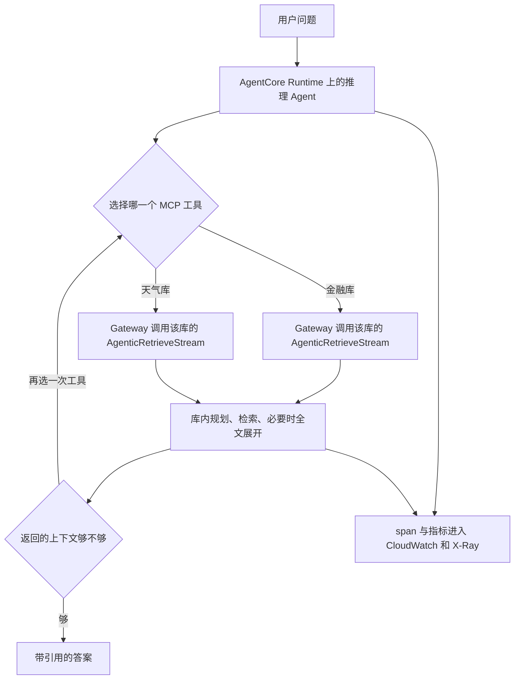

有人把两份毫不相干的 PDF 丢进同一个索引：一份是虚构公司 Octank 的 10-K，一份是美国国会研究处讲龙卷风的报告。问题若是「年报里的风险和龙卷风季节各说了什么」，一次嵌入、一次近邻、一次生成，很容易交出一段很顺、却只覆盖一半的话。2026-10-26，Prabhakar Chandrasekaran 和 Siddhant Sahu 用 AWS CDK 把另一条路铺开：托管知识库里的 `AgenticRetrieveStream` 负责库内多轮检索，AgentCore Gateway 再把每个库挂成一个 MCP 工具。这条路只在 Type 为 `MANAGED` 的库上。路径会随问题改变，只读流水线已经讲不清系统做了什么。可观测性要按产品功能来排期。

<!-- more -->

## 一次检索停住的地方

经典 RAG 的形状很固定：把问题嵌进去，从一个索引取最近的片段，交给模型写答案。问题短、语料只有一份、一次相似度就够时，这是对的设计。2026-10-26 那篇 CDK 博文把失手的情况收成三类。7 月 23 日 Omar Elkharbotly、Sailik Sengupta、Shreya Pawaskar 的博文补了一个原因：多个意图挤在一个查询向量里，top-k 会把它们揉成平均。

| 问题形状 | 单次检索实际做的事 | 停在哪里 |
|----------|--------------------|----------|
| 答案横跨两份语料 | 一个向量，打一个索引 | 回来的是一半材料，句子仍然通顺 |
| 该查哪份语料取决于问题 | 混合索引里没有单独的「选择」 | 路由藏在排序里，外面看不到 |
| 看完第一批还要再查 | 调用在返回 top-k 时结束 | 没有第二次检索的位置 |
| 比较、列举、要判断「够不够」 | 固定返回 k 条，不分解子问题 | 最强的那个信号盖住其余意图 |

检索器按相似度排序，这一步它做完了。缺口在调用形状：一次调用不选源，也没有「看完再查」的步骤。

7 月那篇在公开数据集 MuSiQue 上报告的结果，和这个判断同向。相对单次检索，多跳问题上绝对召回大约高 20 个百分点；单跳问题的提升不到 5 个点。他们的表里，2 跳、3 跳、4 跳的增益分别是 +22.8、+31.9、+37.3，平均步数接近题目本身需要的跳数。数字来自那篇博文的评测。增益集中在本来就需要多步的问题上。

## 托管库和自管库差在能力，不只差运维

Amazon Bedrock 的托管知识库（Type: `MANAGED`）自己做解析、分块、嵌入、索引和检索。2026-10-26 的对比表把自管（DIY）写成：向量库由你选、你扩容，例如 Amazon OpenSearch Serverless。同一张表写了两件只有托管库支持的事：`AgenticRetrieveStream`，以及 AgentCore Gateway 连接器。托管路径上没有要自己创建的 OpenSearch Serverless 集合，也没有按 OCU 计的容量。博文把闲置时的成本底写成「只剩存储」；2024 年那套单次 RAG 样本则要为 OCU 付费。嵌入和重排，表上写的是托管模型、不另计一项。计价是否一直如此，以定价页为准。

自管库仍然有自己的位置。已有的 OpenSearch 集合、数据驻留、自己调索引、合规要求，都是 10 月博文列出的理由。那些场景继续用 `Retrieve`。多轮检索这条产品路径，文档写明只支持托管库。

配额页在 2026-10-27 能读到的表里，和这次讨论直接相关的是两条：英文查询在 `Retrieve` 和 `AgenticRetrieveStream` 上最多 10,000 字符；`AgenticRetrieveStream` 默认每账户每分钟 300 次，可以申请提高。控制台文档写，一次请求最多 5 个 retriever，每个指向一个托管库。`maxAgentIteration` 在 API 参考里最小值是 0，我读到的配额表没有给出默认值和上限，这里不补数字。7 月博文的建议是：单库用 3，多库或对比问题用 4 到 5，规划器认为证据够了可以提前停。

## 一条问题要穿过两层循环

10 月样本的端到端路径是：人把问题交给 AgentCore Runtime 上的推理 Agent；Agent 在多个 MCP 工具里选一个；Gateway 用 IAM 和 SigV4 把这次 `tools/call` 送到对应库的 `AgenticRetrieveStream`；库内分解子查询、迭代检索，需要时展开全文，再流式返回带来源的答案；Agent 若认为上下文不够，再选一次工具。部署时的摄取（解析、分块、嵌入、索引）是第 0 步，发生在提问之前。Runtime 从第一次调用就打 OpenTelemetry span，指标进 CloudWatch 和 X-Ray。

这里有两层循环，叠在一起才是「多轮」。

内层在一次 `AgenticRetrieveStream` 里。7 月博文把 trace 分成几类：`SpeculativeRetrieval`（正式规划前的一次检索，多库时用来探路，不计入 `maxAgentIteration`）、`Planning`（拆子查询，并判断够不够）、`Retrieval` 或 `FullDocumentExpansion`、最后的 `Result`。最终结果会去重，trace 里仍能看到每一步。`generateResponse` 默认打开，答案和引用一起回来；设为 false 就只回片段。相关度分数写在 trace 事件里。最终结果里是去重后的片段和 `sourceRetriever`。

外层在 Runtime 的 Agent 上。样本用的是带插桩的 Strands Agent。它读完一个工具的结果，可以再调另一个库。10 月博文的看板说明用大约号写过一份倍数：N 次提问大约对应 N 次 Agent 调用、2N 次检索、3N 次 LLM 调用、5N 次 Gateway 的 MCP 操作。那是这份样本的循环，换一个 Agent，倍数会变。



Gateway 文档里，Agent 默认只能提交 `messages`。知识库 id、规划模型和迭代上限由管理员绑在 target 上。工具名带 target 前缀，文档示例是 `managed-kb___AgenticRetrieveStream`。下面这份按文档拼出请求形状，问题换成样本里的金融语料。字段仍按文档。

```json
{
  "jsonrpc": "2.0",
  "id": 1,
  "method": "tools/call",
  "params": {
    "name": "managed-kb___AgenticRetrieveStream",
    "arguments": {
      "messages": [
        {
          "role": "user",
          "content": { "text": "What risks does the Octank 10-K discuss?" }
        }
      ]
    }
  }
}
```

直接调 API 时，`retrievers` 和 `agenticRetrieveConfiguration` 在请求体里。API 参考的示例把 `foundationModelType` 和 `rerankingModelType` 都设为 `MANAGED`，由服务选模型。本地的 `demos/agentic-retrieve-shape/` 放了这两份 JSON，脚本只检查字段，不访问 AWS。

CDK 样本把这条路径收成四个栈：`kb`、`gateway`、`agent`、`dashboards`。`app.py` 里跨栈传了七次构造。Gateway 收两个知识库，Agent 收 Gateway，看板再收两个知识库、Gateway 和 Runtime。博文写 Agent 要的是 Gateway 的 URL 和 ARN，这两项跟着同一个 Gateway 构造走。

```python
kb_stack = KnowledgeBasesStack(app, f"{project}-kb", env=env)

gateway_stack = AgenticGatewayStack(
    app, f"{project}-gateway", env=env,
    financial_kb=kb_stack.financial_kb,
    weather_kb=kb_stack.weather_kb,
)

agent_stack = AgentRuntimeStack(
    app, f"{project}-agent", env=env,
    gateway=gateway_stack.gateway,
)

DashboardsStack(
    app, f"{project}-dashboards", env=env,
    financial_kb=kb_stack.financial_kb,
    weather_kb=kb_stack.weather_kb,
    gateway=gateway_stack.gateway,
    agent_runtime=agent_stack.agent_runtime,
)
```

上面略去了各栈的 `description`。依赖顺序由这些引用推出来，`cdk deploy --all` 按图部署，样本里没有单独的部署脚本。默认前缀是 `bmkb-obs-cdk`，默认区域写成 `us-west-2`。托管库、`AgenticRetrieveStream`、AgentCore Runtime 和 Gateway 并不是每个区域都有，部署前要先查区域。

## 两个工具，路由才算一次看得见的动作

样本带了两份很小的语料，都在仓库的 `data/` 下。金融是合成的 Octank 10-K（`octank_financial_10K.pdf`，大约 198 KB）。Octank 是虚构公司，文件由模型生成，许可是 CC0，不能当作真实财报。天气是真实、公有领域的美国国会研究处报告 IF12695（`tornadoes_report.pdf`，大约 560 KB），博文给出的公开地址是 `sgp.fas.org/crs/misc/IF12695.pdf`。两份 PDF 各进一个托管库。博文的摄取结果图是：每个库索引了一份文档，零失败。分块和嵌入不用自己配。

他们把两个库做成两个工具，避开一个混合索引。工具选择会出现在 span 树上。第 3 层的检索质量按库分开，金融和天气的 `retrieval_utilization`、`grounded_coverage`、`duplicate_rate` 不会被平均成一个数。这些是无参考答案的比例，由驱动笔记本从 Agent 实际取回和引用的内容算出来，再作为自定义指标写入 CloudWatch。

7 月的 API 则允许在同一次 `AgenticRetrieveStream` 里登记最多 5 个 retriever，用自然语言 `description` 让规划器把子查询分到不同库。结果里的 `sourceRetriever` 会标出片段来自哪一个。这和 CDK 样本是两条可见性边界。样本把选择放在外层工具上，span 直接写着调了哪一个。一次调用里的多 retriever，路由写在这次调用的 trace 里，外层 span 只看得到「调了 AgenticRetrieveStream」。两份语料主题不相干时，前者让路由变成可以单独计数的动作。主题本来就要对照着读时，后者让规划器在一次调用里来回查。描述要写成一句分得清的话，含糊的描述带来含糊的分流。

## 七层遥测，以及 token 会被数三遍

样本用同一个 CDK 应用拉起两块 CloudWatch 看板：端到端的 agentic observability，和按库的 kb observability。没有流量时是空的。七层是：

| 层 | 看什么 | 谁发出 |
|----|--------|--------|
| L1 | 知识库原生指标 | 自动 |
| L2 | 摄取 | 列入七层。博文把自动发出的写成 L1、L4、L5，把笔记本发布的写成 L3、L6、L7，没有单写 L2 的发布方 |
| L3 | 按库的检索质量（无标准答案） | 驱动笔记本的自定义指标 |
| L4 | Gateway / MCP：调用、系统错误、用户错误、限流 | 自动 |
| L5 | `aws/spans` 里的 OTEL span 树 | 自动，要先打开 CloudWatch Transaction Search |
| L6 | token 用量 | 驱动笔记本的自定义指标 |
| L7 | 评测分数 | 驱动笔记本的自定义指标；在线评测另有一条路径 |

L5 要单独看。一次 LLM 调用在 Strands 里是三层 span：`invoke_agent` 包住这一轮，内部 `chat` 包住模型调用，`kind` 为 `CLIENT` 的 `chat` 才是真正的调用。三层都带同一组 `gen_ai.usage.*`。博文截图里，同一次调用在三层都显示 7,299 输入 token 和 268 输出 token。聚合时要滤到 `CLIENT` 叶子，否则调用次数和 token 都会变成三倍。他们那次加上过滤之后是 14 次 LLM 调用、60,472 输入 token、2,709 输出 token。查询是：

```text
fields attributes.gen_ai.request.model as model,
       attributes.gen_ai.usage.input_tokens as in_tok,
       attributes.gen_ai.usage.output_tokens as out_tok
| filter ispresent(in_tok) and kind = 'CLIENT' and name like /^chat /
| stats sum(in_tok) as input_tokens, sum(out_tok) as output_tokens,
        count(*) as llm_calls by model
```

维度字符串也有一个 CDK 类型系统抓不到的坑。`AWS/Bedrock/KnowledgeBases` 要带前缀的 id，`knowledge-base/<id>`；样本自己的 `BMKB/*` 用裸 id。写错了，`cdk synth` 仍然通过，图是空的。

评测有两条，都由应用拉起。按需：笔记本对会话 span 做 LLM-as-judge，博文点名的内置项是 Correctness、Faithfulness、Tool-Selection Accuracy，分数进 L7。持续：Agent 栈里的 `OnlineEvaluationConfig` 对线上会话抽样。控制台那份配置还有 Response Relevance，四项在博文的实验里都是 100% 抽样。结果要等会话结束，大约是会话空闲超时（约 30 分钟）之后；刚跑完日志组是空的，这是预期。指标在 `Bedrock-AgentCore/Evaluations`。博文那次持续评测四项都是 1.00，每个评估器五条带文字说明的 trace。抽样率 100 是为了让实验马上看得见。博文要求生产环境按质量和预算另选比例。费用随抽样率和流量涨。Octank 语料又是合成的，1.00 只说明答案贴住了那份生成文本。

## 今天先不部署，也要定的三件事

1. **问题还是一次相似度就够时，留在 `Retrieve`。** 它没有规划模型，延迟和单次费用都更低，结果里带分数，自管向量库也能用。问题要拆开、要比较、要跨库、或者第一批结果会改写下一次查询，再用 `AgenticRetrieveStream`。它总是流式的，一次里面有多次模型调用。7 月博文写的托管模型计价是：每 1,000 次 agentic 检索 4 美元，再加上底层 `Retrieve` 每 1,000 次 1 美元；自选 Bedrock 模型则按该模型的通行价，外加同样的底层检索费。这是那篇博文的数字，上线前对定价页。
2. **切到多轮之前，先把这四样接上。** 每次请求一个关联 id；把 trace 的 `step` 和 `status` 留下来，子查询和最终答案一起审计；质量按库拆开，混合索引会把两个领域平均成一个数；token 汇总先滤 `CLIENT` 叶子。在线评测的抽样率按预算设，样本里的 100 是实验值。内层循环已经会再查一次，外层 Agent 再调一次工具，是另一次费用。IAM 上，7 月博文列出调用方需要的四个动作：`bedrock:AgenticRetrieveStream`、`bedrock:Retrieve`、`bedrock:GetDocumentContent`、`bedrock:InvokeModelWithResponseStream`。Gateway 文档写连接器只支持 IAM 出站（`GATEWAY_IAM_ROLE`），服务角色要对知识库有 `bedrock:Retrieve`。护栏只支持 `BLOCK`；用户指南还写，护栏要配合 `foundationModelType=CUSTOM`，和默认的 `MANAGED` 一起用会校验失败。
3. **基础设施的教训是跨栈引用。** 七次构造引用替换手工导出，样本因此不必再维护一份部署脚本。类型化看板让写错的组件在 `cdk synth` 失败。边界也要记住：自由格式 JSON 保持 camelCase，`bucketName` 这种键不会被 CDK 改成 PascalCase；维度 id 带不带 `knowledge-base/` 前缀，类型系统看不出来。

本地可以先跑形状检查，确认「Gateway 上的 Agent 不提交知识库 id」：

```bash
python3 demos/agentic-retrieve-shape/show_shape.py
```

## 多轮检索按失败条件来用

多轮检索更贵，也更难讲清楚。一次调用里的规划、外层 Agent 的第二次工具调用、span 的三层嵌套，都会让「这次为什么查了这个库」变成一份要专门读的记录。10 月博文写，这个应用里大约一半资源用来回答 Agent 做了什么、答案好不好。MuSiQue 上的增益集中在多跳题。单意图、单语料，继续用 `Retrieve`，系统更小。

引用只能把答案钉在语料上。样本的金融语料是模型生成的虚构 10-K，引用再完整，也只是贴住了那份合成文本。接地检查回答的是「有没有照着库说话」，不回答「库外的世界是不是这样」。

可观测性和评测按产品功能排期：关联 id、按库的质量、span 叶子上的 token、以及你付得起的抽样率。路径每问都变的时候，这四样就是还能运营的那一半。

---

## 扩展阅读

- [Build agentic retrieval on a Managed Amazon Bedrock Knowledge Base with CDK](https://aws.amazon.com/blogs/machine-learning/build-agentic-retrieval-on-a-managed-amazon-bedrock-knowledge-base-with-cdk/)（Chandrasekaran、Sahu，2026-10-26）
- [Agentic retrieval for Amazon Bedrock Managed Knowledge Base](https://aws.amazon.com/blogs/machine-learning/agentic-retrieval-for-amazon-bedrock-managed-knowledge-base/)（Elkharbotly、Sengupta、Pawaskar，2026-07-23）
- [AgenticRetrieveStream API](https://docs.aws.amazon.com/bedrock/latest/APIReference/API_agent-runtime_AgenticRetrieveStream.html)
- [Use agentic retrieval to query a knowledge base](https://docs.aws.amazon.com/bedrock/latest/userguide/kb-test-agentic-retrieve.html)
- [Managed knowledge bases as an AgentCore Gateway target](https://docs.aws.amazon.com/bedrock-agentcore/latest/devguide/gateway-target-connector-managed-kb.html)
- [Connect to your knowledge base through AgentCore Gateway](https://docs.aws.amazon.com/bedrock/latest/userguide/kb-gateway-target.html)
- [Service quotas for managed knowledge bases](https://docs.aws.amazon.com/bedrock/latest/userguide/kb-managed-quotas.html)
- [样本：managed-kb-observability-cdk](https://github.com/aws-samples/amazon-bedrock-samples/tree/main/rag/managed-knowledge-bases/07-IaaC/managed-kb-observability-cdk)

---

*CDK 博文、7 月博文、API 参考、Gateway 连接器文档、控制台测试文档和配额页核对于 2026-10-27。跨栈代码对照过样本 `app.py`。本地执行 `python3 demos/agentic-retrieve-shape/show_shape.py`，没有 AWS 凭证，也没有发起检索。*

## 讨论

你的第二个知识库，是做成 Gateway 上的第二个工具，还是放进同一次 `AgenticRetrieveStream` 的 `retrievers`？两种都能查到来源。第一种的选择出现在 span 的工具名上，第二种的选择出现在这次调用的 trace 里。你更想在哪一层报警？
