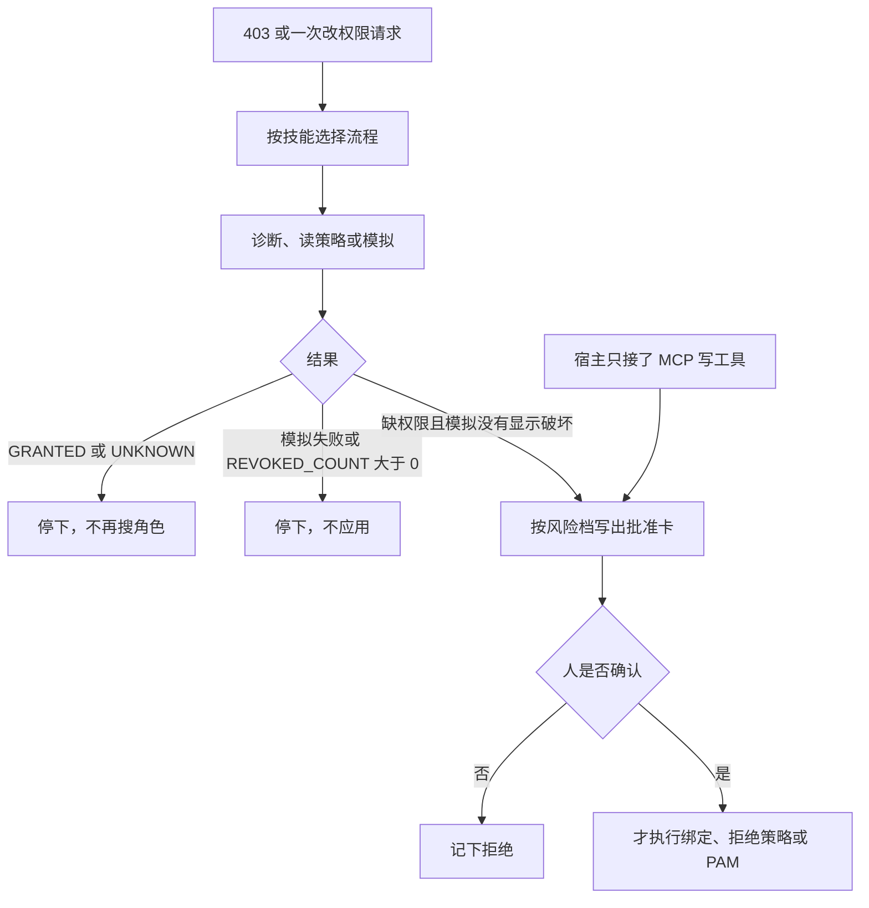

编码助手部署时撞上 403。下一句若是「我帮你绑上 `roles/editor`」，这次对话就已经越界了。Google Cloud 在 2026-10-27 发布 IAM Helper：一组 Agent Skills，放在 Google 托管的 IAM MCP 工具上面，把排障、写策略、模拟和 PAM 即时授权收成多步流程。诊断和模拟可以自己跑。改权限按风险档停下来，等人点头。

MCP 工具清单是原子能力的目录。完整的 IAM 流程在技能的步骤里，写操作的门要装在宿主上。`roles/editor` 停在批准卡上，不能在自动批准工具的模式里直接绑出去。

<!-- more -->

## 四份技能，一个名字

[公告](https://cloud.google.com/blog/products/identity-security/scale-agents-securely-with-iam-helper-agent-skills-and-mcp-tools/)的作者是 Siddharth Deekshit 和 Surekha Balla，栏目是 Security & Identity，日期写着 October 27, 2026。它把 IAM Helper 定义成 Google Cloud IAM 面向代理的编排层，底下是 Policy Intelligence 和 Privileged Access Manager。技能按开放的 [Agent Skills](https://agentskills.io/home) 标准打包。公告点名的宿主有 Gemini CLI、Gemini Cloud Assist、ADK、Claude Code 和 Cursor。

公告里的四条工作流，和仓库目录一一对应。

- `iam-helper-for-policy-management` 写 IAM v1 的 allow 和 IAM v2 的 deny。公开主体 `allUsers`、`allAuthenticatedUsers` 配基础角色（含 `roles/owner`、`roles/editor`）要拒绝。
- `iam-helper-for-troubleshooting` 处理 403。Requester 是被挡住的开发者，Resolver 是安全管理员。排障默认走 Resolver。
- `iam-helper-for-policy-simulator` 先取当前策略，再对最近 90 天的访问日志做 replay，然后才谈应用。90 天写在技能正文里，窗口来自文件，我没有另做测量。
- `iam-helper-for-privileged-access-management` 用 PAM 的 entitlement 和 grant 做有时限的提升。人没写时长时，`maxRequestDuration` 默认 `14400s`，也就是 4 小时。公告场景写的是一小时的 JIT。技能文件在时长省略时用的是 4 小时。

安装命令在仓库 README 里是 `npx skills add google/skills`，装的时候再选技能和宿主。我没有执行这条安装。公告里的「几秒内定位」和「省下几小时」我也没有复测，这里不写成测量结果。

## 门写在 Markdown 里

2026-10-28 我读的是 [google/skills](https://github.com/google/skills) 的提交 [`58869828`](https://github.com/google/skills/commit/588698280ecdf6145aab1ebabad0785d9630a8db)，提交时间是 2026-10-27T18:48:35Z。这一笔的说明是链接检查工作流，四份技能当时已经在 main 上。`iam-helper-for-troubleshooting/SKILL.md` 最近一次被改到，是 [`6a867993`](https://github.com/google/skills/commit/6a8679935b96baf5e959b29b939d81195a489b43)，时间 2026-10-22T22:06:57Z，内容是给安全类技能加上 usage attribution。frontmatter 版本分别是 1.0.3、1.0.1、1.0.2、1.0.1，分类都是 Security。

[skillet.md 上的排障技能页](https://skillet.md/google/iam-helper-for-troubleshooting)写的注册版本是 v1.1.0，更新日期 2026-09-18。那一页的正文还没有 attribution 小节。两个版本号对不上。下文以 main 上的文件为准。

排障技能把查询和改权限拆开，拆法比公告的一句话更细。`accessState: GRANTED` 时立刻结束，不再搜角色，也不提议绑定。`UNKNOWN` 或 `UNKNOWN_INFO` 也结束，正文给出的原因是展不开组成员，缺 `roles/browser`。调用者自己的排障命令返回 403，同样停下，不再改走别的查询。列候选角色之前要先问人。真正绑定或创建 PAM entitlement 时，只读、写入、管理三档全部要人确认，高风险档还要带上警告。`references/guardrails.md` 写明，组织可以改这份分档。仓库里的表是默认。

策略管理技能把 `get-iam-policy` 和列出 deny policy 放在自主执行。`add-iam-policy-binding`、`set-iam-policy`，以及 deny policy 的创建、更新、删除，走 Plan and Confirm：先写出完整的 `gcloud` 命令，说明会碰到线上访问、传播要时间，等人批准才执行。执行后再查一次，确认状态跟上了。

模拟技能写明只用公开的 `gcloud` 命令。当前策略取失败，或者拟议策略和当前策略没有差别，流程终止。`gcloud iam simulator replay-recent-access` 非零退出，不能当成安全。`scripts/analyze_simulation.py` 数 `ACCESS_REVOKED` 和 `ACCESS_MAYBE_REVOKED`，打印 `REVOKED_COUNT`。大于 0 就不应用。等于 0 仍然问人要不要应用。

PAM 技能里，list 和 describe 可以自己跑。创建、更新、删除、批准、拒绝、撤销都要 Yes 或 No。审批人批准 grant 时还要先要一句理由。entitlement 不接受旧的基础角色 `roles/viewer`、`roles/editor`、`roles/owner`。技能文本建议改用 `roles/basic.viewer` 这一类名字。我没有拿角色目录去核对这几个名字是否存在。演示只把「旧基础角色不接受」当成规则。

四份技能的 `references/attribution.md` 都要求：直接执行的 `gcloud`，或打到 MCP 的 HTTP 请求，带上 `agent-skills/1.0 (skill:技能名)`。用户要求关掉时就去掉。交给用户放进自己仓库的 Terraform 或脚本里不要带这个标记。



诊断查询可以自动。列角色、绑定、拒绝策略、自定义角色、PAM 的变更，停在确认上。图的最后一行是给编码助手的：写工具即便没有加载技能，也要进同一道门。

## 参考页上的工具并不都停在查询

公告的原话是，IAM Helper 的 MCP 工具通过原子、只读的函数连到后端，端点覆盖 Policy Troubleshooter、Policy Analyzer、Policy Simulator，以及 IAM v1 和 v2 的 API。层次可以按这句话来理解。我在 2026-10-28 读到的参考页，把查询放在其中几台服务器上，把变更放在 IAM API 那一台的工具表里。

| 端点 | 我读到的工具 | 和改权限的关系 | 页面日期 |
| --- | --- | --- | --- |
| `https://policytroubleshooter.googleapis.com/mcp` | `troubleshoot_access`、`troubleshoot_iam_error_id` | 解释允许、拒绝和 Principal Access Boundary。组主体不支持。使用页写的传输是 Streamable HTTP，范围是 `cloud-policytroubleshooter.readonly` | 使用页 2026-10-26 UTC，工具参考 2026-08-06 UTC |
| `https://cloudasset.googleapis.com/mcp` | `list_assets`、`analyze_iam_policy`、`export_iam_analysis_results`、`get_iam_policy_analysis_status` | 分析 allow 策略。`analyze_iam_policy` 的范围文档写的是项目，文件夹和组织不支持。导出把结果写到 BigQuery 或 Cloud Storage | 参考页 2026-09-01 UTC |
| `https://policyassist.googleapis.com/mcp` | `recommend_iam_roles` | 按意图建议角色，不写绑定。范围是 `policyassist` | 使用页 2026-10-26 UTC，工具参考 2026-09-09 UTC |
| `https://iam.googleapis.com/mcp` | deny policy 的 list、get、create、update、delete；自定义角色的 list、get、create、update、delete、undelete | 查询和变更都在。创建拒绝策略、创建自定义角色会改访问。范围是 `cloud-platform` 或 `iam`。不接受 API key | 使用页 2026-10-26 UTC，工具参考 2026-09-10 UTC |

Policy Simulator 在公告里和这几台 MCP 并列。我读的 [Policy Intelligence API 索引](https://docs.cloud.google.com/policy-intelligence/docs/apis)把 Simulator 放在 REST 一节，MCP 一节是 Analyzer、Assist、Troubleshooter。模拟技能的正文要求只用 `gcloud`，命令是 `gcloud iam simulator replay-recent-access`。我没有找到 Simulator 的 MCP 参考页，也就没有把它写进演示里的清单。

IAM API 这台服务器还有几条边界，技能不会替你补上。`list_roles` 和 `get_role` 针对项目里的自定义角色。参考页写明预定义角色不支持，组织不支持。deny policy 工具同样只写了项目。排障技能要看的组织、文件夹、项目继承，用的是 Troubleshooter，或者 `gcloud` 回退。自定义角色这张表覆盖不到那一层。

调用 MCP 还要 `roles/mcp.toolUser`，对应权限 `mcp.tools.call`。改自定义角色要 `roles/iam.roleAdmin`，改 deny policy 要组织上的 `roles/iam.denyAdmin`。文档建议给代理单独的身份。这些是调用者自己的 IAM。技能文本里的批准卡不会自动出现在服务器上。

排障技能的 `references/mcp-usage.md` 只接了 Troubleshooter 的两个工具，并给了一个 SSE 客户端的配置示例。使用页写的传输是 Streamable HTTP。接的时候以使用页为准。

| 维度 | 裸调 IAM API | 只接 MCP | 技能加上宿主的批准 |
| --- | --- | --- | --- |
| 步骤放在哪 | 调用方自己排 | 模型看见工具就拼 | 四份 `SKILL.md`：Requester 与 Resolver、Plan and Confirm、Plan-Simulate-Analyze-Apply、PAM 三种模式 |
| 403 怎么解释 | Troubleshooter 的 REST | `troubleshoot_access` 或 `troubleshoot_iam_error_id` | 同一对工具。`GRANTED` 和 `UNKNOWN` 终止。调用者自己返回 403 也终止 |
| allow 绑定 | `setIamPolicy` 一类 API | 我读到的 IAM MCP 工具表里没有项目级 allow 绑定 | 模拟技能用 `gcloud projects set-iam-policy`。`REVOKED_COUNT` 为 0 之后仍要 Yes |
| deny 和自定义角色 | IAM v2 与 roles API | `create_deny_policy`、`create_role` 等写工具在 `iam.googleapis.com/mcp` | 策略技能要求先给出完整命令再等人。参考页不暂停调用 |
| `roles/editor` | 接口可以绑 | 工具描述里没有「太宽」这一档 | 公开主体配基础角色要拒绝。PAM 不接受旧的 `roles/editor`。其余情况停在批准卡 |
| 门装在哪 | 你的代码 | 宿主若自动批准工具调用，写工具就会执行 | 技能正文，加上宿主对写工具的拦截 |

第三列的门有两层。一层是模型被要求遵守的 Markdown。另一层是宿主：工具调用要等人点，或者用 deny policy 按工具名、按只读属性拦住写操作。IAM 的 MCP 使用页写了可以按主体、工具是否只读、工具名、OAuth 客户端来限制 MCP。那一页给出的是控制方向。我没有替任何组织配一条策略。

## 对照文件跑一次本地门

脚本在 `demos/iam-helper-hitl/inspect_skills.py`。它从 GitHub 拉取上面那个提交里的四份技能，核对若干句子还在文件里，再对一组标明为 fixture 的例子做分档。主体用的是 `dev@example.com` 和 `allUsers`，项目是 `example-project`。这些字符串是例子，不是某次 API 的返回。

回放计数只认两种 `accessChange`，和技能里的 `analyze_simulation.py` 用的是同一组值：

```python
def revoked_count(rows: list[dict]) -> int:
    count = 0
    for item in rows:
        change = item.get("diff", {}).get("accessDiff", {}).get("accessChange")
        if change in {"ACCESS_REVOKED", "ACCESS_MAYBE_REVOKED"}:
            count += 1
    return count
```

脚本里的 `low`、`medium`、`high` 对应 guardrails 的三档，`broad` 对应正文里要避开的基础角色。Google 的表没有一个叫 broad 的档。`least_privileged_role.py` 会去跑 `gcloud iam roles list`，所以没有执行它。也没有调用 Google Cloud，没有调用任何 MCP 端点。

我执行的命令是：

```bash
python3 demos/iam-helper-hitl/inspect_skills.py
```

环境是 Python 3.12.3。下面是一次完整的标准输出。

```text
python 3.12.3
commit 588698280ecdf6145aab1ebabad0785d9630a8db
source github /tmp/iam-helper-hitl-skills
iam_api_called no
mcp_endpoint_called no
== skills ==
iam-helper-for-policy-management version=1.0.1 category=Security files=4
  SKILL.md 5645
  references/attribution.md 1944
  references/v1-allow-policies.md 6249
  references/v2-deny-policies.md 7786
iam-helper-for-policy-simulator version=1.0.2 category=Security files=3
  SKILL.md 6155
  references/attribution.md 1941
  scripts/analyze_simulation.py 1328
iam-helper-for-privileged-access-management version=1.0.1 category=Security files=7
  SKILL.md 12903
  assets/entitlement_template.yaml 1194
  references/approver.md 3198
  references/attribution.md 1977
  references/requester.md 5998
  scripts/list_entitlements_hierarchy.sh 2920
  scripts/search_eligible_entitlements.sh 3034
iam-helper-for-troubleshooting version=1.0.3 category=Security files=8
  SKILL.md 5575
  references/attribution.md 1938
  references/guardrails.md 3515
  references/mcp-usage.md 3106
  references/requester.md 6673
  references/resolver.md 14239
  scripts/least_privileged_role.py 5030
  scripts/troubleshooting_error_id.py 4810
== anchors ==
skills/cloud/iam-helper-for-troubleshooting/references/guardrails.md:27 Do NOT apply the binding
skills/cloud/iam-helper-for-troubleshooting/references/guardrails.md:43 roles/editor
skills/cloud/iam-helper-for-troubleshooting/SKILL.md:55 accessState: GRANTED
skills/cloud/iam-helper-for-troubleshooting/SKILL.md:57 accessState: UNKNOWN
skills/cloud/iam-helper-for-policy-management/SKILL.md:51 Autonomous Execution
skills/cloud/iam-helper-for-policy-management/SKILL.md:107 allUsers
skills/cloud/iam-helper-for-policy-simulator/SKILL.md:21 standard public gcloud commands
skills/cloud/iam-helper-for-policy-simulator/SKILL.md:125 REVOKED_COUNT
skills/cloud/iam-helper-for-privileged-access-management/SKILL.md:104 14400s
skills/cloud/iam-helper-for-privileged-access-management/SKILL.md:189 Legacy basic roles
== mcp checklist ==
troubleshoot_access read https://policytroubleshooter.googleapis.com/mcp
troubleshoot_iam_error_id read https://policytroubleshooter.googleapis.com/mcp
analyze_iam_policy read https://cloudasset.googleapis.com/mcp
list_assets read https://cloudasset.googleapis.com/mcp
get_iam_policy_analysis_status read https://cloudasset.googleapis.com/mcp
export_iam_analysis_results side_effect https://cloudasset.googleapis.com/mcp
recommend_iam_roles suggest https://policyassist.googleapis.com/mcp
list_deny_policies read https://iam.googleapis.com/mcp
get_deny_policy read https://iam.googleapis.com/mcp
get_deny_policy_status read https://iam.googleapis.com/mcp
list_roles read https://iam.googleapis.com/mcp
get_role read https://iam.googleapis.com/mcp
create_deny_policy write https://iam.googleapis.com/mcp
update_deny_policy write https://iam.googleapis.com/mcp
delete_deny_policy write https://iam.googleapis.com/mcp
create_role write https://iam.googleapis.com/mcp
update_role write https://iam.googleapis.com/mcp
delete_role write https://iam.googleapis.com/mcp
undelete_role write https://iam.googleapis.com/mcp
== gate ==
already-granted -> stop
  fixture accessState=GRANTED; skill says terminate and do not search roles
unknown-groups -> stop
  fixture accessState=UNKNOWN; skill says missing roles/browser expansion, terminate
list-candidates -> ask
  fixture wants gcloud iam roles list; skill gates role discovery before the query
bind-publisher -> hold
  fixture user:dev@example.com roles/pubsub.publisher tier=medium; print approval card, executed=no
  [APPROVAL REQUIRED]: Role 'roles/pubsub.publisher' grants permissions for 'dev@example.com' on '//pubsub.googleapis.com/projects/example-project/topics/example-topic'.
bind-editor -> hold
  fixture user:dev@example.com roles/editor tier=broad; broad basic role stays on the card
public-editor -> refuse
  fixture principal=allUsers role=roles/editor; policy-management skill refuses this pair
pam-editor -> reject
  fixture entitlement role=roles/editor; PAM skill says legacy basic roles are not supported
pam-duration-default -> hold
  fixture create entitlement, duration omitted; skill default maxRequestDuration=14400s, still ask
sim-revoked -> do-not-apply
  fixture REVOKED_COUNT=2; skill says do not apply when the count is greater than 0
sim-crash -> do-not-apply
  fixture simulator exit=1; skill says a failed replay is not a safe result
sim-clean -> ask
  fixture REVOKED_COUNT=0 and no Yes in this run; skill still prompts before set-iam-policy
mcp-troubleshoot -> allow
  tool=troubleshoot_access kind=read; diagnostic query, no policy write
mcp-export -> hold
  tool=export_iam_analysis_results kind=side_effect; reference page writes results to BigQuery or Cloud Storage
mcp-recommend -> allow
  tool=recommend_iam_roles kind=suggest; suggestion only, no binding
yolo-create-deny -> hold
  tool=create_deny_policy kind=write skill_loaded=no; host gate stops the write
checks passed
```

`public-editor` 是拒绝。`bind-editor` 停在卡上：guardrails 把 `roles/editor` 写成要避开的基础角色，三档表的例子里没有把它单列成管理档。`yolo-create-deny` 没有加载技能，宿主仍按工具名把它当成写操作。空隙就在这里。`create_deny_policy` 在参考页上是一个普通工具。清单列出来，不等于产品已经替你停下来。

## 可以先钉在宿主上的四条

1. 诊断放行：`troubleshoot_access`、`troubleshoot_iam_error_id`、`analyze_iam_policy`、`recommend_iam_roles`，以及 deny policy 和自定义角色的 get、list。`export_iam_analysis_results` 会把结果写到别的存储，单独批。
2. `create_deny_policy`、`update_deny_policy`、`delete_deny_policy`、`create_role`、`update_role`、`delete_role`、`undelete_role` 默认暂停。技能没加载时也暂停。
3. `allUsers` 或 `allAuthenticatedUsers` 配 `roles/owner`、`roles/editor`、`roles/viewer` 直接拒绝。具体用户的 `roles/editor` 停在警告上，等人决定。模型选完角色，还不算执行。
4. 模拟没跑成，或者 `REVOKED_COUNT` 大于 0，就不应用。等于 0 只说明这批历史访问没有被标成收回，下一步仍是问人。组织自己的分档改 `guardrails.md`。默认三档全部要人确认，包括名字以 Viewer 结尾的角色。

## 结语

IAM Helper 把「查清缺什么权限」和「改掉这条策略」拆成两层。查，可以交给 Troubleshooter、Analyzer 和角色建议。改，停在人这里。MCP 清单把原子调用列出来。IAM API 那一台已经包含拒绝策略和自定义角色的写工具。编码助手若只把清单接上，并打开自动批准，`roles/editor` 和 `create_deny_policy` 都还在能被点到的地方。

---

## 扩展阅读

- [Scale agents securely with IAM Helper Agent Skills and MCP Tools](https://cloud.google.com/blog/products/identity-security/scale-agents-securely-with-iam-helper-agent-skills-and-mcp-tools/)（Google Cloud Blog，2026-10-27）
- [google/skills](https://github.com/google/skills)，提交 [`58869828`](https://github.com/google/skills/commit/588698280ecdf6145aab1ebabad0785d9630a8db)
- [Use the IAM remote MCP server](https://docs.cloud.google.com/iam/docs/use-iam-mcp)
- [IAM MCP reference](https://docs.cloud.google.com/iam/docs/reference/mcp)
- [Use the Policy Troubleshooter remote MCP server](https://docs.cloud.google.com/policy-intelligence/docs/use-policy-troubleshooter-mcp)
- [Policy Assist MCP reference](https://docs.cloud.google.com/policy-intelligence/docs/reference/policyassist/mcp)
- [Cloud Asset Inventory MCP reference](https://docs.cloud.google.com/asset-inventory/docs/reference/mcp)

---

*公告、google/skills 的 `58869828`、IAM、Policy Troubleshooter、Policy Assist、Cloud Asset 的 MCP 页面，以及 Policy Intelligence API 索引，核对于 2026-10-28。演示在 Python 3.12.3 上执行 `python3 demos/iam-helper-hitl/inspect_skills.py`，从 GitHub 拉取该提交中的四份技能。没有调用 Google Cloud IAM，也没有调用 MCP 端点。没有执行 `npx skills add`。*

## 讨论

你的编码助手里，写工具的暂停是宿主强制的，还是只写在技能正文里？`roles/editor` 绑到一个具体用户时，你要求先出警告，还是直接拒绝？
