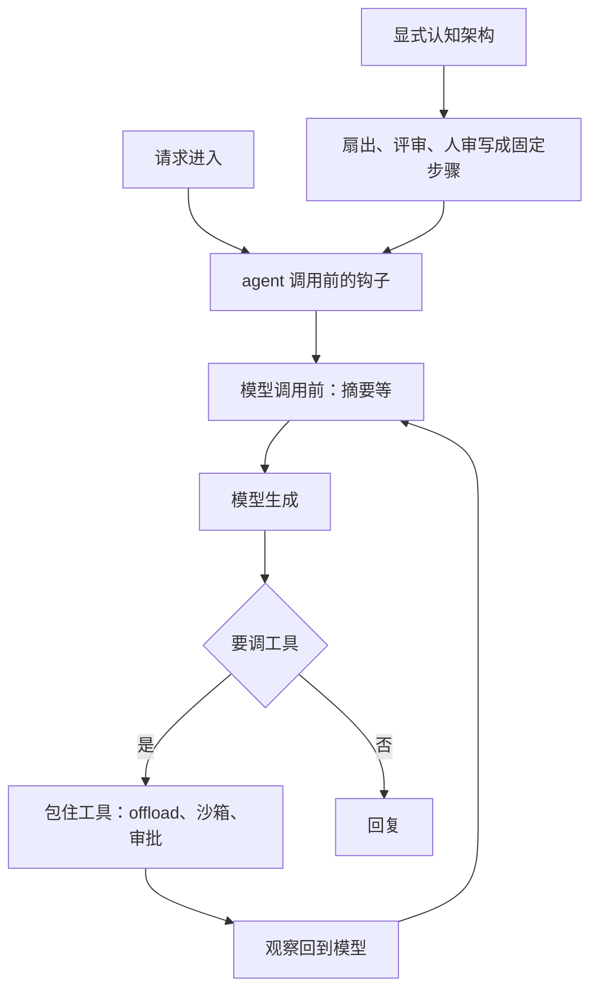
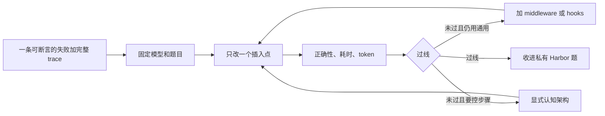

微信上的整理《[LangChain 创始人：什么时候该自建 Agent Harness？](https://mp.weixin.qq.com/s/lbn8brH8990QWaV8u0_xCg)》适合当作阅读入口。事实不从那里取。本文依据 2026-10-28 读到的 Sequoia 讲稿 [Owning Your Intelligence Starts With the Harness](https://sequoiacap.com/podcast/owning-your-intelligence-starts-with-the-harness)，以及 Sonya Huang 2026-08-19 的 [Own Your Intelligence: A How-To Guide](https://sequoiacap.com/article/own-your-intelligence-a-how-to-guide)。视频在 [YouTube](https://www.youtube.com/watch?v=HI2q3ci3Iuc)。Harrison 的话以讲稿为准。数字只写这两页里出现过的。微信稿没有逐段对照。

建不建自己的 harness，是一条谱：现成框架，到 middleware / hooks，再到显式 cognitive architecture。往哪端走，看两件事。任务离模型训练分布有多远。业务要多少可预测性和控制。代码通常买现成、做薄定制。通用办公先分清成品，和嵌进自有流程的编排。法律、金融、医疗通常要自己的 harness；改文件这类仍在分布内的工具，继续用该模型原生的实现。

<!-- more -->

## 三块里，harness 负责把上下文送到点上

Harrison 把 agent 拆成三块：模型、上下文、harness。Harness 编排前两块。若目标是自己掌握智能，三块都想掌握。模型那一块他交给同场的 Fireworks 去讲，自己聚焦 harness，也因为要能换模型：避开锁定，并在更好的模型出现时用上。上下文包括记忆、语义知识和先前对话，用来把 agent 收向这个组织。Harness 的主职，讲稿和 how-to 是同一句：在合适的时间，把合适的上下文送给模型。固定上下文和动态上下文都由它送进窗口。工具打到外部系统，外部系统再吐出新的上下文，回到循环里。

循环他写得很短。请求进来，模型生成；生成里若带了工具调用，就执行工具，把观察塞回模型。他称这是今天几乎所有 agent 的底子。差别在插入点。LangChain 是这条最小循环。Deep Agents 是他们做的、与具体模型无关的 Claude Code 的更通用版本：文件系统、skills、subagents，都加在这条循环上，杠杆是 middleware。他点名的位置有四个：

- agent 被调用之前
- 每次模型调用之前
- 包住模型调用
- 包住工具调用

摘要放在模型调用之前：上下文太长就先摘要。Context offload 包住工具调用，把过大的工具结果卸出去。沙箱、文件系统、记忆、subagent 是同一类插销。Coding agent 里后出现的 hooks 和 plugins，他说本质相同：循环还在跑，只是在若干点上挂钩子。

另一条路是显式 cognitive architecture。2023 和 2024 年，模型还撑不住自由循环，这是当时常见的做法。他举的 deep research 先生成子问题，再扇出执行。Code review 机器人则是一串专门步骤。他的判断是，不少这类步骤已经收进 harness，变成对核心循环的修改；特别窄的流程里，人们仍用这种架构把行为按步骤钉住。两条路可以同时存在。他建议的顺序是：先用通用 harness，换 time-to-value；用例收窄、要做得好时，再加门禁和检查。

上图按讲稿整理插入点，不是 LangChain 仓库里的某张架构图。认知架构可以整段规定流程，也可以只是往循环里多插几道门。讲稿没有规定二者只能留一个。

## 分布是主轴，可预测性是第二条

何时离开现成 harness，他的主轴是分布。相对模型训练分布越靠近，现成 harness 越好用。越往外，越要调。现成产品还常常绑模型：Claude Code 和 Claude Agent SDK 走 Anthropic，Codex 走 OpenAI。换模型的能力，他放在「掌握模型」那一段，不单是某份 harness 的功能列表。

他马上补了一刀，避免把「业务整体偏离训练」理解成「每个工具都要重写」。法律 AI 是例子。他记得 Gabe 提过他们有自己的 harness。法律这件事对主模型偏离训练分布，改文件不是：主流模型都在改文件上做过强化学习，而且 OpenAI 和 Claude 在各自 harness 里的改法并不一样，模型各自最擅长自己被训练的那种改法。法律场景要定制整体 harness，改文件仍用当前模型分布内的那套实现。Deep Agents 的 model profiles 把切换放在 harness 里：按正在用的模型选择 edit-file 实现。整体任务偏离训练，小块仍在分布内的部分尽量贴着模型层。

第二条轴在问答里，不在分布那一页。有人问 harness 会收敛成一个，还是每家各做各的。他说他不知道，这个问题他们和 Factory 的 Eno 都在想。能看见的是：通用 harness 已经好到能应付很多基础任务，起步可以用 Deep Agents、Codex 或 Claude Code，因为模型已经够好，文件系统和 subagent 这些让模型变好用的东西也够用。越偏离训练分布，越要定制。极端是一整套专注的 cognitive architecture。走到那一端还有一个理由：可预测性和控制。他们的金融服务客户需要可预测性。看到 Deep Agents 这类高度自主的通用 agent，客户会觉得太吓人，想要能把步骤控住的认知架构。谱的另一端是直接用现成 harness，中间是 hooks 或 middleware。

收敛还是分化，他同样不给结论。他看到 OpenAI 和 Anthropic 在编码上都很强，若 harness 继续沿编码走，会往「很会写代码」靠拢。同时各家改文件的方式仍有细差。他提到有过某次评测，认为其中一种严格更好。讲稿没有给出评测名字和数字，这里不补。他的假想是：若有实验室把 harness 做深到生物这类方向，harness 会分开。这些差异眼下最具体地出现在小地方。他的收束是：所以要有评测和可观测，把这些量出来。本文不把「会收敛」或「会分化」写成预测。

How-to 把分布判断收成产品语言：任务相对模型越偏离训练，现成 harness 越差。同一篇把「掌握智能」说清楚：这不是要求离开实验室。很多负载上，前沿 API 和现成 agent 仍是对的答案。关着的那一叠是前沿模型，加上开箱 harness（文中举例 Claude Code 或 Codex），加上 prompt 和上下文。地板高，天花板低一些。自己掌握的那一叠，生产侧是开源模型、定制 harness、工具和上下文，开发侧是私有评测、领域数据和在线学习环。地板可能更低，天花板更高。How-to 写的是 potentially 更低的地板。

How-to 另外列了四条「要不要自己掌握模型」的理由：推理成本随用量上升、要速度（编码补全、网络安全这类场景里小的蒸馏模型可能胜过大的通用模型）、反馈和领域数据留在墙内、应用层和智能层正在并到一起。那是模型所有权。编码补全要不要蒸馏一个小模型，和编码 agent 用不用现成 harness，是两件可以分开做的决定。本文只讨论第二件。

## 三场景是本文的推演

下面三节按这两条轴做工程判断，不是讲稿里的三场景。Harrison 没有讨论桌面办公产品，也没有给代码、办公、医疗各下一道命令。法律和金融是他用过的例子。医疗是同一条轴上的外推。Claude Code、Codex、Deep Agents、OpenCode、WorkBuddy、Manus、豆包办公用来标形态。我没有复跑他们的评测，也不排高低。

### 代码：最靠近训练分布

写代码、改文件、跑测试，是讲稿里反复出现的、靠近训练分布的区域。模型在这上面做过大量强化学习。现成 harness 已经接上文件系统和 subagent。Harrison 的起步名单是 Deep Agents、Codex、Claude Code。

默认因此是买或用现成的，再用 hooks、skills、MCP、subagents 做薄定制。薄定制改插入点：摘要策略、审计日志、危险命令的审批、把大工具输出卸出窗口。与该模型训练耦合的 file-edit 保持原样。切换留在 model profiles 一类的位置，实现仍是该模型的 edit-file。按他的逻辑，自建一套和所有模型的训练都无关的编辑协议，会把本来在分布内的子任务推到分布外。

值得离开薄定制的信号，收成三条。每一条都要能指到一次具体故障：

1. 要在多个模型之间路由，又要统一工具语义。Claude Code / Agent SDK 绑 Anthropic，Codex 绑 OpenAI。Deep Agents 是讲稿里点名的、与模型无关的 harness。若只换了模型名字，工具协议对不上，薄钩子不够，需要一层自己的工具适配。适配层仍按 profile 保留各模型的 edit-file。
2. 沙箱和出网策略比产品默认更严，而且要写进每次工具调用前后。写在提示词里不算这层定制。
3. Coding agent 要嵌进更大的产品循环，例如评审机器人、发布门禁、只允许改某类仓库。自由循环外面有一段认知架构，里面仍可以是现成 coding harness。

起步用 Deep Agents、Claude Agent SDK，或 OpenCode 这类把现成 coding 循环当起点的 harness。OpenCode 不在讲稿的推荐名单里。本文没有审计它的插件接口。把它和前两者放在同一句，是因为三者都不必从 LLM loop 重写；私有题上的正确性、耗时和 token 才决定留哪一个。插入点先放摘要、审计和审批。评测用 Harbor 那种任务包。私有题可以长得像 Terminal-Bench：环境、指令、测试，外加一份用来检查题目本身的参考解。Harbor 的结构在后面，不在这里报分数。

### 通用办公：分布是混的，先分成品和编排

桌面 GUI、邮件、日历、跨应用点击，相对纯文本和代码，更远离模型被强化学习的那一类动作。交付物常常是一件做完的事，没有 diff，也没有现成的单元测试。误点的代价是发出错的邮件、删掉不该删的文件。可预测性需求中等偏高，通常还没到金融那种「整段自由循环不可接受」。

WorkBuddy 一类桌面代操作、Manus 一类云端放手做完、豆包办公一类在对话里办完事务，本文归成产品形态：交互、环境、权限和失败提示绑在一起交付。个人和轻量办公用这些成品，time-to-value 最高，符合讲稿「先通用」的顺序。

企业要把办公 agent 嵌进自己的流程、审计、人审和知识库时，要有的是编排层。浏览器和桌面可以继续当工具，点选仍交给现成的计算机使用能力。自己拥有的是：谁有权批准这封邮件、轨迹能否回放、失败能否被环境断言。「这封邮件在已发送里」和「模型说它发出去了」是两种证据。这是本文的判断，不是 Harrison 对某个办公产品的评语。

自建若发生，检查四件事：权限与审批门、可回放轨迹、打到企业内部系统的工具、环境侧的成功断言。模型循环保持通用。

### 垂直领域：整体偏离训练，控制也更强

法律、金融、医疗放在同一格，因为两条轴同时偏高。整体任务远离代码和通用对话的训练分布。业务又要求步骤可解释、可停、可审计。

法律是讲稿和 how-to 都落了地的例子。Harrison 用它说明：要自己的 harness，改文件仍跟模型走。How-to 记录 Harvey 的 Gabe Pereyra 的话：没有好的 benchmark，就没法训练模型。同一篇写明，做「要不要自己掌握智能」的决定之前就要有评测；每次前向都有评测，选模型才是测量而不是猜测。Legal Agent Benchmark 的第一版，包括超过 1,200 个 agent 任务，覆盖 24 个法律业务领域，用超过 75,000 条专家撰写的 rubric 标准来评。这是护城河的形状：真实法律工作拆成可测任务，用专家标准打分。本文不引用任何排行。How-to 还写，Harvey 用就七个人的研究团队，做出的研究量出乎作者意料。那是当时团队规模的陈述，不是「七人就够复制 Harvey」。

金融在讲稿里是控制轴的例子。客户拒绝高度自主的通用 agent，要认知架构把步骤控住。本文据此把金融类系统放在「可控步骤先于全自主」。自由循环可以留在单步推理里。跨账户、下单、改权限落在显式步骤和人审门上。

医疗是外推。讲稿没有医疗专场。外推只用两条轴：病历、医嘱、用药建议相对通用训练更远，误操作的控制需求不低于金融。定制的是步骤、检索、引用和人审。本文没有医疗评测数字。

三块的建法相同，差别在门禁写多死。显式 cognitive architecture 加上 middleware。一套私有 Harbor 任务。Trace 收成问题板，再改 harness 或上下文。讲稿点名的 in-distribution 子能力是改文件，继续用该模型的原生实现，用 profiles 切换。

## 一张对照表

| 场景 | 分布距离 | 控制需求 | 现成 harness 够不够 | 典型定制点 | 评测形态 | 先买 / 后造 |
| --- | --- | --- | --- | --- | --- | --- |
| 代码 | 近。写代码、改文件、跑测试是模型被 RL 过的区域 | 通常中等。危险在命令和仓库边界 | 多数时候够。Claude Code、Codex、Deep Agents 是讲稿点名的起步 | hooks、skills、MCP、subagent；审计和审批。不换掉模型自己的 edit-file | 私有 Harbor。环境里跑测试。Terminal-Bench 是公开样例，不是你的题库 | 先买现成。跨模型工具语义、强沙箱，或要嵌进发布/评审循环时，再加一层 |
| 通用办公 | 混合。对话靠近训练，点 GUI、跨应用更远 | 中等偏高。发错信、删错文件 | 成品够个人用。企业嵌入时，要的是编排层 | 权限、审批、可回放轨迹、内部系统工具、环境断言 | 「做完了吗」：邮件、日历、工单状态 | 个人用成品。要嵌进审计和人审时造编排层，浏览器和桌面仍当工具 |
| 垂直领域 | 远。法律、金融、医疗的整体任务偏离训练 | 高。金融客户在讲稿里拒绝过强自主 | 通常不够。整体要自己的步骤 | 业务流程、检索、引用、人审门。edit-file 仍跟模型 profile | 私有 Harbor。法律侧可参考 how-to 里 Harvey 第一版的任务数和专家 rubric，数字不外推到医疗 | 从定制 harness 开始，模型仍可租前沿 API。先钉评测，再加门 |

「够不够」是本文在两条轴上的归类。它可以被你自己的 Harbor 分数打脸。一份办公题上，现成 harness 的正确性、延迟和 token 已经过线，编排层就还不用造。

## 评测、轨迹、飞轮

Harrison 把评测和可观测说成调模型、调 harness、调上下文时都要用的工具，不限自建 harness。他转述 Satya 大约在那场谈话前两周的一篇文章里让他印象深的三条。讲稿未给原文链接，本文不补日期和链接。第一条：建立私有评测，因为评测定义组织内部的「好」。第二条：保住组织的记忆、轨迹、反馈、决策和制度上下文；轨迹和反馈是他在讲稿里加粗的。第三条：建立持续学习环，一台能爬坡的机器，让 AI 投入滚成复利。How-to 里另有一句对 Nadella 的转述，向实验室买智能像付两次钱，一次是钱，一次是为了让智能有用而交出去的专有知识。那句讲的是数据和学习环的所有权，和上面三条分开记。

他看到的行业约定是 Harbor。Terminal-Bench 2.0 的作者做的开源评测运行器，他称为编码 agent 的行业标准评测之一，并且已经不限编码。一次运行是 agent 对一个数据集。任务放在沙箱里，便于并行，也因为每个任务有自己的环境。一个 Harbor 任务四件套：

- environment：用 Dockerfile 描述 agent 跑在其中的环境
- instruction.md：给 agent 的提示
- tests：评分。可以跑代码、单元测试、LLM-as-a-judge，或 agent-as-a-judge
- solution：参考解，用来检查题目本身能否被完成。他称这部分并不特别有趣

被评分的是模型加 harness。结果里他要求同时看反馈分数、延迟和 token。只报正确率，又慢又贵的组合也会被算成赢。讲稿里的 Frontier-Bench 是另一套编码题，用来演示这种对比，没有给出分数。

可观测他故意说得基础，并认为对 agent 被低估了。Agent 搞砸，是因为某次模型调用错了。原因两类：模型不够好，或者送进去的上下文不够好。他认为更常见的是第二种。要看见窗口里有什么，以及上下文怎么累积：哪一步、哪个工具、怎么堆上去的。能扫读的是 trajectory，也就是 Claude Code 那种消息列表：人的消息、一串工具调用、模型回复，然后再是人的消息。调试还要能点开完整 trace，看到模型内部那一步究竟吃进了什么。只有消息列表、点不开 trace，定位不到上下文是在哪一次工具结果里坏的。

飞轮在讲稿里是一条短环。做出 agent，跑起来，收集大量 trace，整理，再在整理后的数据上做实验。反馈来自环境，或来自合成评估。环境反馈依赖你怎么把 agent 呈现给用户。很少有人会去点赞或点踩。交互若能留下修改、撤销、重试，比拇指按钮有用。How-to 对 trajectory 的定义和这一点对齐：模型看见的上下文、调用的工具和 subagent、给出的答案，以及用户改了、撤销了、重试了什么。合成反馈是在 trace 上跑 online evaluator。他提到和 Harvey 的一次实验，显著降低了部分 LLM-as-a-judge 的成本。若每条 trace 都跑一次法官，账单会很大，所以要便宜且快的做法。讲稿说他们为此微调过小模型，也可以用现成模型加自定义提示，或在要测的东西足够简单时直接用代码。降幅没有数字。

整理之后，三块都可以改。Harness engineering 改编排，微调改模型，记忆改上下文。LangChain 自己主要做第一块。他演示的 LangSmith Engine 是一个坐在 trace 上的 agent：整理、做实验、对三块之一提出修改，产出 issue board，并链回作为证据的 trace。演示里那个简单例子改的是提示和指令，也往 harness 里加了一段代码。问答里他说客户反馈很正面。它找到的是小而确切的错误，不会对 harness 做大改，也找不到「这些问题超出 agent 范围、也许要新数据源」那种方向性缺口。后一种他不确定能自动化多少。他们用 Harbor 格式做了 Issue Bench，拿 Deep Agents、Codex、Claude Code 跑过。Codex 会很积极地给自己写小脚本去扫这些 trace，表现好，于是他们做了一轮称为 Codexification 的吸收，把这个做法放进 Engine 自己的 harness。讲稿没有给三家的分数。私有题的用处是看见别的 harness 实际在做什么，再决定要不要吸收。

How-to 里 Lin Qiao 的分层，用来决定飞轮改哪一块。缺事实，用上下文或 RAG，不必后训练。输出格式或行为不对，监督微调。产品口味，偏好调优。专门任务要变好，强化学习。太慢或太贵，蒸馏。选能推动评测的最轻方法，再用同一套 harness 看质量、延迟和成本。评测说上下文坏了，就不要去微调。

## 如何建

下面七步把「先通用、再门禁、一次看三块」收成检查项。每步写了怎样算没做到。

1. 选一个结果能被环境核验的真实失败，留下完整 trace。失败要能写成断言：测试红了、邮件不在已发送、工单状态没变。只有「感觉答得不好」、没有 trace 的会话，不能当第一题。
2. 模型和这道题固定，一次只改一个插入点。插入点只用讲稿里的四类：agent 前、模型前、包住模型、包住工具。同一次提交里又改摘要又改工具协议，变好或变坏都无法归因。
3. 同一次实验报三列：正确性、耗时、token 或费用。只涨正确性、耗时和 token 不看，按讲稿的标准这轮实验不完整。
4. 顺序固定：先通用 harness，再 middleware / hooks，最后才整段 cognitive architecture。金融那种已经明确拒绝自主循环的，可以从架构开始，但要在题集上写明控制需求，第 1 步的失败样本仍然要留。
5. 子任务若在分布内，工具实现跟模型走。改文件按 model profile 切换。换了模型却沿用上一家的 edit-file，这步算失败。
6. 建最小私有评测。本文的起步线是大约 20 条能自动评分的任务。这个数量不是 Sequoia 的要求。少于此数也可以，但不能只有口头用例。Harbor 四件套（环境、instruction、tests、solution）齐了才算一条。同时打开 trace，看上下文在第几步膨胀，在哪次工具结果之后模型开始胡说。
7. 飞轮改三处：harness、模型、上下文。缺事实补上下文，行为不对再考虑微调，步骤不可控再改 harness。只改一段系统提示，并把它叫做自建 harness，这步不算完成。Engine 那类问题板可以帮忙找小错误。讲稿自己说它不做大改写，方向仍然要人定。

## 本文不主张的事

讲稿没有说所有公司都该离开 Claude Code 或 Codex。How-to 写明，很多负载上前沿 API 仍是对的答案。掌握智能也不是一道离开实验室的命令。

讲稿没有给出「多偏离就要自建」的阈值，没有办公产品评测，没有医疗 benchmark 数字，也没有 Codex 与 Claude 改文件谁赢的分数。How-to 称开源权重前沿推进得比预期快，并点名 Kimi K3 和 GLM 5.2 很强。那是 Sonya 对进度的判断。本文不把它写成模型排行，也不据此建议换底座。

收敛还是分化，Harrison 的答案是不知道。编码能力把 harness 往「会写代码」拉近。专业领域可能把它们拉开。在你的私有题给出相反证据之前，按谱上的位置做决定。

## 来源

- Harrison Chase 讲稿：[Owning Your Intelligence Starts With the Harness](https://sequoiacap.com/podcast/owning-your-intelligence-starts-with-the-harness)（Sequoia，Own Your Intelligence）。视频：[YouTube](https://www.youtube.com/watch?v=HI2q3ci3Iuc)。
- Sonya Huang，2026-08-19：[Own Your Intelligence: A How-To Guide](https://sequoiacap.com/article/own-your-intelligence-a-how-to-guide)。Harvey 第一版任务规模、七人团队、Gabe 关于 benchmark 的话、Lin 的后训练分层、轨迹定义、关着的技术栈和自己掌握的技术栈，都出自这一篇。
- 选题入口，不作为事实来源：[微信整理](https://mp.weixin.qq.com/s/lbn8brH8990QWaV8u0_xCg)。
