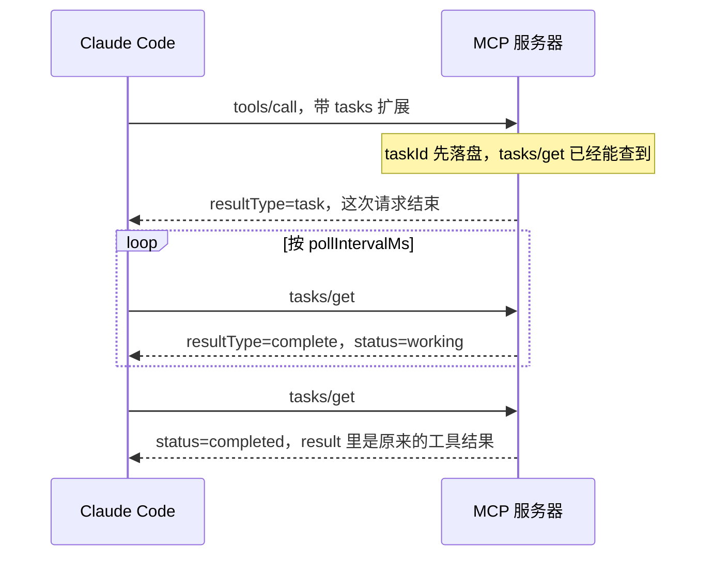

导出报告的工具要跑四分多钟。人还坐在 Claude Code 的主会话里，两分钟一到，这次调用被挪到后台，会话可以继续说话。服务器那边的 HTTP 请求没有结束。函数平台的超时先到，报告仍然出不来。

2026-10-22，David Soria Parra 在圣何塞的 AGNTCon + MCPCon 上宣布 Claude Code 支持 MCP tasks，工具调用可以跑到分钟、小时或天，而不只是几秒。[InfoQ](https://www.infoq.com/news/2026/10/agntcon-mcpcon-2026/) 在 2026-10-26 记下了这句。[Upstash](https://upstash.com/blog/claude-code-mcp-tasks) 在 2026-10-23 写了 CLI 里的接法。官方文档把这项标成公开 beta，版本从 v2.1.304 起。

慢工具要在服务器超时之前结束这次 `tools/call`，靠的是协议里的 task 句柄。两分钟后台把主会话让出来，请求还挂在服务器上。任务里再问一句「要发布吗」，交互终端可以弹表单；GitHub Actions 这类非交互会话会把任务取消掉。

<!-- more -->

## 两层都出现在 `/tasks`，请求结束的时刻不同

[Claude Code 的 MCP 文档](https://code.claude.com/docs/en/mcp)把两件事写在相邻的两节。

自动后台针对主会话里的 MCP 工具调用。跑过两分钟还没结束，就挪成后台任务。Claude 立刻拿到一个客户端任务 ID，会话继续。这个 ID 属于这次还开着的工具调用，不是协议里的 `taskId`。结果在调用真正结束时以任务通知回来。记录出现在 `/tasks`，退出会话就不跟了。人停掉它，Claude Code 取消这次调用，并告诉 Claude 不会再有结果。文档同时写明：停掉并不保证服务器停下，工作可能已经做了一部分，也可能还会做完。调用期间，单服务器的 `timeout` 或 `MCP_TOOL_TIMEOUT`，以及空闲超时 `CLAUDE_CODE_MCP_TOOL_IDLE_TIMEOUT`，仍然算数。阈值用 `CLAUDE_CODE_MCP_AUTO_BACKGROUND_MS` 改，单位是毫秒；设成 `0` 就关掉。`CLAUDE_CODE_DISABLE_BACKGROUND_TASKS=1` 会连自动后台和后台命令一起关掉。

子代理的调用不搬。IDE 服务器的调用不搬。非交互默认不搬，除非 `CLAUDE_AUTO_BACKGROUND_TASKS=1`，因为一次性运行可能在结果到达前就结束了。elicitation 对话框还开着时也不搬。文档的理由是：服务器在等人输入，这次调用慢不在计算上，对话框关掉再考虑要不要搬。

MCP Tasks 是服务器自己用 tasks 扩展跑的长作业，例如导出报告或构建。Claude 的工具调用在服务器接受作业后就返回，会话继续，除非你另让 Claude 干等。作业结束时，记录里会出现一行，结果交给 Claude，不直接写进记录正文。页脚会出现 `1 MCP task` 这类计数，客户端向服务器查状态。远程服务器上的任务，退出之后还在跑。要再跟上，恢复同一个会话。

`/tasks` 详情里若写着 `runs on the server; survives exiting this session`，文档让你去看 MCP Tasks 那一节。stdio 服务器要单独看：Claude Code 一退出，进程就停，尽管那句 survives 仍在。文档写，除非这台服务器自己的说明说工作活得过进程，否则先等它做完，或先在 `/tasks` 里停掉。

| | 两分钟自动后台 | MCP Tasks |
| --- | --- | --- |
| 谁先动 | 客户端。默认 120000 毫秒 | 服务器决定这次请求返回句柄还是普通结果 |
| 这次 `tools/call` | 一直开到工具返回。Upstash 写明服务器仍得保持请求，函数时限帮不上 | 接受作业并返回句柄后，这次调用结束 |
| 退出 CLI | 不存活 | 远程任务继续。stdio 进程随退出停下 |
| 子代理 | 不搬到后台 | 调用来自主会话才走 MCP task |
| 提问弹窗开着 | 先不搬 | 任务里的 `elicitation/create` 只在交互终端处理 |
| 客户端时限 | 墙上时钟和空闲超时在后台期间仍有效 | 句柄返回之后，后台任务默认没有 Claude Code 时限 |

两分钟是文档里的默认阈值。我没有在本机用 CLI 卡一次真实工具来复测。



自动后台是另一条时间线。满两分钟时请求仍开着，退出后客户端不跟。演示里用一个计时模型把这一点印出来：`t=120000ms` 时 `request_open` 仍是 true。

## 句柄和终态用的不是同一个 resultType

扩展标识是 `io.modelcontextprotocol/tasks`。稳定 schema 在 [ext-tasks 的 2026-07-28 快照](https://github.com/modelcontextprotocol/ext-tasks/blob/main/schema/2026-07-28/schema.ts)。[SEP-2663](https://modelcontextprotocol.io/seps/2663-tasks-extension) 状态是 Final，创建日期 2026-04-27，作者是 Luca Chang 和 Caitie McCaffrey。SEP 写明：2025-11-25 里的 tasks 是实验特性，握手要靠 `tools/list` 预热，请求上还要带 `task` 参数；`tasks/result` 会把连接堵住。扩展改成每条请求的 `_meta` 里声明能力，服务器自己决定要不要返回句柄。我没有逐行重读 2025-11-25 那一页，旧行为以这篇 SEP 的记述为准。

客户端把 `"io.modelcontextprotocol/tasks": {}` 放在 `params._meta["io.modelcontextprotocol/clientCapabilities"].extensions`。服务器在 `server/discover` 的 capabilities 里广告同一扩展。SEP 写：客户端声明了扩展，并不表示它要求收到 `CreateTaskResult`。短查询可以仍返回普通工具结果。

创建时的结果带 `resultType: "task"`。`tasks/get`、`tasks/update`、`tasks/cancel` 的成功结果是 `resultType: "complete"`。`complete` 是这一次查询的结果形状。`completed` 才是任务状态。

状态有五种：`working`、`input_required`、`completed`、`failed`、`cancelled`。后三种是终态，到达之后状态不再变。`completed` 的 `result` 与当初同步返回的工具结果同结构，里面可以有 `isError: true`。SEP 把这种工具错误仍放在 `completed`。Claude Code 文档写，它会把这个 `isError: true` 报成失败。`failed` 要带 JSON-RPC `error`。SEP 说这个状态留给执行期间的 JSON-RPC 错误。

`tasks/get` 在句柄发出之前就必须能查到该 `taskId`。最终一致的存储要先等到能读到，再发响应。取消是协作的。`tasks/cancel` 表示意图，服务器可以仍走到别的终态。`notifications/cancelled` 不用于取消任务。需要人输入时，状态是 `input_required`，`inputRequests` 里是待处理的服务器请求，客户端用 `tasks/update` 交 `inputResponses`。SEP 要求这些键在一个任务的一生中不重复。

Claude Code 在 schema 之外还有自己的读法：

| 字段或方法 | schema / SEP | Claude Code 怎么读 |
| --- | --- | --- |
| `taskId` | 字符串 | 最多 128 个可打印 ASCII，不能有空格。否则工具错误以 malformed task handle 起头。恢复会话后会在新连接上再问这个 ID |
| `status` | 上面五种 | 别的值：请服务器取消，并向 Claude 报失败 |
| `createdAt`、`lastUpdatedAt`、`ttlMs` | 必填，`ttlMs` 可为 null | 缺了任一，和缺 `taskId`、`status` 一样，报 `Unsupported result type 'task' for tools/call`。ttl 过了，客户端不因此丢掉任务 |
| `pollIntervalMs` | 可选。客户端应当遵守，值可以变 | 不能是 null。夹在 250 与 30000 毫秒之间。缺省按 2000。每次 `tasks/get` 都重新读 |
| `inputRequests` | 键在单个任务内不重复 | 每个任务超过 16 个键会被忽略。`elicitation/create` 只在交互终端处理，`roots/list` 各处都可以。处理不了就取消任务 |
| `tasks/result`、`tasks/list`、`notifications/tasks` | 通知可选，客户端可改走订阅 | Claude Code 不用这三样。结果放在 `tasks/get` |

没有扩展还返回 `resultType: "task"`，Claude 收到的也是那句 `Unsupported result type 'task'`。这次工作在一次请求里做不完，又不能对这个客户端返回句柄时，SEP 要求错误码 `-32021`（Missing Required Client Capability），data 里指出缺的扩展。

HTTP 和 claude.ai connector 上，句柄必须在 per-request 计时器内开始返回。文档的做法是先接受作业、先回答，再干活。这个计时器取 60 秒、该服务器的工具超时、`MCP_TIMEOUT` 三者中的最大者。未设置的 `MCP_TOOL_TIMEOUT` 那个大约 28 小时的默认值不参与这三项比较。低于 60 秒也不会把计时器缩短。stdio 和 WebSocket 没有这条 per-request 计时器。

公告里的「分钟、小时或天」是台上的范围，不是 Claude Code 写下来的客户端上限。文档写：后台里的 MCP task 默认没有 Claude Code 时限。工具调用的时限只覆盖到服务器答出句柄为止。你若让 Claude 干等，时限才覆盖整段任务。已经得到回答的状态查询，算进空闲超时的活动。作业能跑多久，取决于服务器的 `ttlMs`、工作有没有放在进程外面，以及恢复会话时还认不认这个 ID。我没有跑过跨天任务。

Upstash 抓到的一条真实句柄是 `855bcb4f-6803-4132-8eb7-aa02265caf97`，`pollIntervalMs` 为 2000，`ttlMs` 为 86400000，状态消息是 Queued。Claude Code 随后每 2 秒调用一次 `tasks/get`，直到 `completed`。那是他们服务器上的一次调用。下面演示里的 ID 和消息是本地夹具，只对齐字段形状。

## 今天哪些会话会把调用变成 MCP task

文档把「这次调用变成 MCP task」写成必须同时成立的一组条件。下面的嵌套来自页面 HTML，转成 Markdown 时内层列表会被摊平。

- 服务器支持 tasks。
- 传输是 HTTP、stdio 或 claude.ai connector，协议修订 2026-07-28。`MCP_SDK_GENERATION=v1` 或 `MCP_PROTOCOL_NEGOTIATION=legacy` 排除在外。
- 会话会拉取 feature flags。第三方供应商（页面举例 Amazon Bedrock），以及关掉遥测或 flag 拉取的会话，不在里面。
- 这种会话被打开了这项能力。v2.1.304 及以后覆盖终端 CLI、Agent SDK、GitHub Actions。VS Code 扩展和桌面应用没有。
- 调用来自主会话，不是 subagent。
- 会话是交互的。否则必须是 Agent SDK，或读取 `--input-format stream-json` 的 `claude -p`，并且同时满足三条：`CLAUDE_AUTO_BACKGROUND_TASKS=1`，`CLAUDE_CODE_DISABLE_MCP_TASK_BACKGROUND` 不是 `1`，`CLAUDE_CODE_MCP_AUTO_BACKGROUND_MS` 不是 `0`。

一次性的 `claude -p "<prompt>"` 拿不到 MCP tasks。Agent SDK 或 stream-json 要把输入保持打开。输入一关，这次运行就不再等 MCP tasks。

交互会话里如果想让 Claude 干等，文档另给了两条环境变量。`CLAUDE_CODE_MCP_AUTO_BACKGROUND_MS=0` 会让 Claude 等到每次 MCP 调用结束；自动后台那一节也写，设成 `0` 时交互会话里的 Claude 会等 MCP tasks。`CLAUDE_CODE_DISABLE_MCP_TASK_BACKGROUND=1` 会让 Claude 等任务结果。自动后台仍开着时，两分钟后这次调用变成普通后台调用，退出会话不存活。只设 `CLAUDE_CODE_DISABLE_BACKGROUND_TASKS=1`，或使用裸模式，并不会让 Claude 去等 MCP tasks。

Upstash 的短名单和文档的头条一致：交互终端、Agent SDK、GitHub Actions 有；subagent、一次性 `claude -p`、VS Code、桌面没有。协议修订、feature flag 和那三条环境变量，以 Claude Code 文档为准。他们还写，Anthropic 说过 Tasks 和 Elicitations 会陆续进到更多 Claude 产品。那句话的原始帖子我没有打开。

退出和恢复只记会改变跟进的几条。`/clear`、`/branch`，或在 Claude Code 仍开着时 `/resume` 到别的会话，结果进当前对话。退出不会取消远程任务，退出对话框里就算把它列在将要停止的项目下也一样。`tasks/cancel` 在人还连着服务器并主动停止时才会发，退出时不发。服务器已经断开时，先在 `/mcp` 里重连，否则取消请求发不出去，Claude Code 会忘掉这个任务。按 Esc 停不了后台任务。恢复要用原来的会话：`claude --resume`、`claude --continue` 或 `/resume`，服务器名字和连接参数保持不变。新会话和 `--fork-session` 不跟这个任务。用 `claude -p` 加 `--resume` 或 `--continue` 的一次性运行也不跟。

服务器认不出 ID 时返回 JSON-RPC `-32602`。后台任务上，Claude Code 会再问最多五分钟，然后向 Claude 报告结果未知。文档提醒：再调一次工具可能把工作做第二遍。先用服务器的其他工具问清楚做到了哪一步。

## 任务里面的提问，非交互会取消

Elicitation 是服务器向人要一份结构化输入。Claude Code 文档把表单模式和 URL 模式分开。表单在终端里填。URL 模式问你要不要用系统的 URL 处理程序打开链接。连接协商到 2026-07-28 时，声明是 `elicitation: {form: {}, url: {}}`。Upstash 贴出的客户端能力里也有这一对，外加 tasks 扩展。

他们描述的任务外提问是：人填完之后，Claude Code 再发一次工具调用，把回答放在 `inputResponses` 里，服务器不必堵住第一次请求。我没有单独抓到一帧官方的重复调用报文，重复调用这一步以 Upstash 的记述为准。

任务里面是另一条路。状态变成 `input_required`，`tasks/get` 带上 `inputRequests`，客户端用 `tasks/update` 交回答。Claude Code 把其中的 `elicitation/create` 限制在交互终端。`/tasks` 面板开着时对话框是藏起来的，先关掉面板再答。拒绝或按 Esc 算一次回答，服务器再决定任务还走不走。

非交互会话里，任务一请求输入，Claude Code 就请服务器取消它，并且不跑 `Elicitation` hook，也不调用 Agent SDK 的 `onElicitation`。文档另有一句：可以用 `Elicitation` hook 在不弹对话框的情况下自动回答。任务那一节把非交互的取消写在 hook 之前。想靠 hook 在 GitHub Actions 里自动回答「要发布吗」，走到的是取消，不是 hook。

Upstash 的 `task.elicit` 在内存实现和 `WorkflowDispatcher` 上可以停下来等人，后者等待时不占着一次函数。`QStashDispatcher` 一次调用跑完一个任务，等不了回答。这是他们 toolkit 的行为。我没有部署 Redis、QStash 或 Workflow。

无人值守的流水线把确认留在创建句柄之前。SEP 建议：和任务创建叠在一起的多轮请求，例如创建句柄前用 `InputRequiredResult` 做一次 elicitation，应当在同步阶段做完，再返回 `CreateTaskResult`。句柄发出去之后再问，GitHub Actions 和一次性 `claude -p` 会把任务取消。

本站 10 月 28 日写的 IAM Helper 是技能正文里的批准卡，宿主去拦写工具。那是另一道门，不是 `tasks/get` 轮询。10 月 25 日的 Infinity 是 harness 在等工具时休眠，也不是这条扩展。

## 服务器作者可以先钉住的几条

1. 读这一次请求的 `_meta`。有 `io.modelcontextprotocol/tasks` 时，长作业才返回句柄。没有这个扩展时，返回普通工具结果。这次工作长到不能在请求里做完，返回 `-32021`。短查询即使客户端声明了扩展，也直接返回内容。
2. 先把 `taskId` 写到这次 `tasks/get` 能读到的地方，再发句柄。HTTP 上先接受、先回答，再干活。多实例和 serverless 的进程内存会丢任务：下一次 `tasks/get` 可能打到没见过这个 ID 的实例。Upstash 的写法是 Redis 存任务，QStash 再调一次函数来执行。那是一条公开的接法，不是本机验证过的部署。
3. 句柄用 `resultType: "task"`。查询、更新、取消的成功结果用 `resultType: "complete"`。`ttlMs` 可以是 null，键本身要在。`pollIntervalMs` 给整数。Claude Code 会把它夹到 250 到 30000，缺省 2000。
4. `taskId` 用不超过 128 的可打印 ASCII，中间留空格会变成 malformed task handle。换一条连接还要能回答。恢复会话时 Claude Code 会在新连接上再问。
5. 终态放在 `tasks/get`。`completed` 带原来的工具结果。`failed` 带 `{code, message, data}`。Claude Code 的结果通道是 `tasks/get`。它不用 `notifications/tasks`、`tasks/result`、`tasks/list`。
6. 需要人的步骤放在交互终端，并且放在句柄之前。GitHub Actions、一次性 `claude -p`、输入已经关上的 Agent SDK，任务里的提问会被取消，hook 也不会跑。
7. 取消是协作的。退出 CLI 不会替你发 `tasks/cancel`。远程作业会继续。stdio 的进程会停。`/tasks` 上那句 survives 不能当成作业还在。
8. 未知 ID 用 `-32602`。客户端可能再问五分钟，然后把结果标成未知。重复调用前要能从别处查到工作有没有做完。第二次导出可能再跑一遍。

## 本机只回放了协议

脚本在 `demos/mcp-tasks-claude-code/replay.py`。它读 `fixtures/` 里的 `tools/call`，在进程里走一遍。有扩展的 `export_report` 先把任务放进字典，再返回句柄，此时 `work_steps_left` 还是 1。没有扩展的同一工具返回 `-32021`。带了扩展的 `lookup_status` 直接返回文本。`publish_post` 在交互路径上走 `tasks/update`，在非交互路径上走 `tasks/cancel`，并且不把 hook 标成已运行。两分钟那一段是计时模型：请求保持打开，退出标记为不存活。轮询间隔的 250、30000、缺省 2000，以及缺 `ttlMs` 时的错误字符串，按 Claude Code 文档放进客户端检查。

句柄的形状与这次回放一致。时钟是夹具里的 `2026-10-29T01:10:00Z`，不是进程的墙上时间。`ttlMs` 取 86400000，也就是 24 小时，便于和 Upstash 示例里的数量级对照。

```json
{
  "resultType": "task",
  "taskId": "export-7f3a9c2e",
  "status": "working",
  "statusMessage": "Accepted",
  "createdAt": "2026-10-29T01:10:00Z",
  "lastUpdatedAt": "2026-10-29T01:10:00Z",
  "ttlMs": 86400000,
  "pollIntervalMs": 2000
}
```

我执行的命令：

```bash
python3 demos/mcp-tasks-claude-code/replay.py
```

环境是 Python 3.12.3。下面是这次完整输出。

```text
python 3.12.3
claude_cli not_invoked
upstash not_deployed
transport in_process
== export-with-tasks ==
tools/call capability=tasks resultType=task taskId=export-7f3a9c2e status=working pollIntervalMs=2000 ttlMs=86400000
request_open=false durable_before_response=true work_steps_left=1
tasks/get #1 resultType=complete status=working message=Writing report
tasks/get #2 resultType=complete status=completed message=Done
result_text=A report on urban-beekeeping.
== export-without-tasks ==
error code=-32021 message=Missing required client capability extension_present=true
resultType_returned=no request_open=false
== lookup-with-tasks ==
resultType_absent text=job-14 status=idle
== publish-interactive ==
taskId=publish-1c0e status=working
tasks/get #1 resultType=complete status=input_required message=Waiting for confirmation
inputRequests confirm method=elicitation/create
interactive dialog answer=accept
tasks/update resultType=complete
tasks/get #2 resultType=complete status=completed message=Done
result_text=Published.
== publish-noninteractive ==
tasks/get #1 resultType=complete status=input_required message=Waiting for confirmation
inputRequests confirm method=elicitation/create
noninteractive cancel hooks_ran=false on_elicitation=false
tasks/cancel resultType=complete
tasks/get #2 resultType=complete status=cancelled message=Task was cancelled by the server
== unknown-task ==
error code=-32602 message=unknown task
== client-shape-checks ==
missing_fields=ttlMs client_error=Unsupported result type 'task' for tools/call
space_in_id=malformed task handle
poll absent=2000 poll 100=250 poll 99999=30000 poll_null=rejected
== blocking-two-minutes ==
t=0ms request_open=true client_background=false survives_exit=false
t=120000ms request_open=true client_background=true survives_exit=false
t=180000ms request_open=true client_background=true survives_exit=false
call_settled request_open=false server_had_to_hold_request=true
checks passed
```

`pollIntervalMs` 没有真的睡成 2 秒。非交互那条取消是脚本在模仿文档，不是 Claude Code 进程的日志。

## 结语

两分钟后台解决的是人还坐在主会话里、工具一时不返回。MCP Tasks 解决的是这次 HTTP 不能一直开着，而且人离开之后，远程作业还要能被同一个会话再跟上。句柄先落盘。会决定发布的那一下确认，留在句柄之前，留在看得到终端的会话里。

---

## 扩展阅读

- [AGNTCon + MCPCon 2026](https://www.infoq.com/news/2026/10/agntcon-mcpcon-2026/)（InfoQ，2026-10-26，Andrew Hoblitzell）
- [MCP Tasks and Elicitations in Claude Code](https://upstash.com/blog/claude-code-mcp-tasks)（Upstash，2026-10-23，Cahid Arda Oz）
- [Claude Code MCP 文档](https://code.claude.com/docs/en/mcp)，MCP tasks 与 Automatic backgrounding 两节
- [Tasks 扩展概览](https://modelcontextprotocol.io/specification/2026-07-28/basic/utilities/tasks)
- [SEP-2663: Tasks Extension](https://modelcontextprotocol.io/seps/2663-tasks-extension)（Final）
- [ext-tasks schema 2026-07-28](https://github.com/modelcontextprotocol/ext-tasks/blob/main/schema/2026-07-28/schema.ts)

---

*InfoQ、Upstash、Claude Code MCP 文档（含页面 HTML 中的条件列表嵌套）、SEP-2663 与 ext-tasks 的 2026-07-28 schema，核对于 2026-10-29。演示在 Python 3.12.3 上执行 `python3 demos/mcp-tasks-claude-code/replay.py`。没有安装或运行 Claude Code CLI。没有部署 Upstash Redis、QStash 或 Workflow。*

## 讨论

你的慢工具是函数超时先到，还是人坐在终端前等过两分钟？需要人点头的那一步，是在返回 `taskId` 之前做完，还是写在 `input_required` 里？
