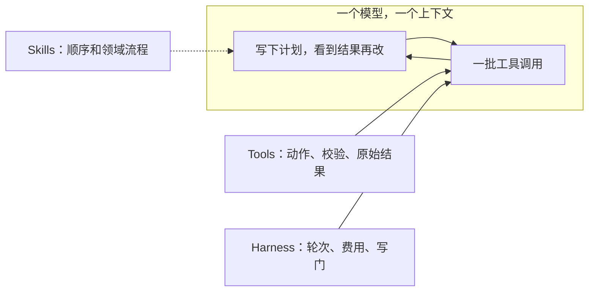

用户问「这单哪天到」。编排器把话派给订单专员，回来一句「已发货」。物流专员接过摘要，说运单号不在里面，查不了。两轮交接做完，用户还是没有日期。客服一个子 Agent，增长再一个，编排器长得和组织图一样。

Anthropic Applied AI 在 [Building agents: When to fold subagents into your main agent loop](https://claude.com/resources/articles/building-agents-when-to-fold-subagents-into-your-main-agent-loop) 里写了何时把这种结构折回去。资源列表页把这篇标在 Oct 22, 2026。正文页我打开时没有另印日期。配套仓库是 [anthropics/single-agent-loop-kit](https://github.com/anthropics/single-agent-loop-kit)，默认分支 `release`，我读的提交是 `c437962`（2026-10-21）。README 写明它是参考实现，不维护，不收贡献。

很多编排器加专科子 Agent，是在替模型做它已经会做的事。流程放进 Skills，动作放进 MCP 工具，折进一个模型、一个上下文、一个开放工具循环。三条硬条件仍要留子 Agent。折的时候带 eval，一次只折一个。

本站写过技能和 MCP [走同一条信道](https://cfireworks.github.io/2026/10/12/2026-10-12-skills-over-mcp-same-channel/)，也写过技能 [捐给 AAIF](https://cfireworks.github.io/2026/10/23/2026-10-23-agent-skills-aaif-neutral-governance/) 和 [要不要自建 harness](https://cfireworks.github.io/2026/10/28/2026-10-28-when-to-build-your-own-agent-harness/)。这篇只谈已经有一排子 Agent 时，哪一条折回主循环。

<!-- more -->

## 组织图会先看起来最省事

子 Agent 在文中的定义是：自己的上下文、自己的工具、自己的指令，由协调者编排。验证、并行、按模块分权限，他们在用。另一类企业部署把路由器、规划器和领域子 Agent 折进主循环之后更好。若干家的对比里，带技能的单 Agent 经常同时赢过「一个提示词包打一切」和子 Agent 方案，质量更高，也更便宜、更快。一家面向用户的客服 Agent 有十几个专科，品牌语气难维持，延迟也伤体验。

常见的设计楼梯是：意图分类器，固定多步推理，用户分群，分开的推荐分支，顶上再加编排器。反馈经常是，这些结构在做模型已经不必别人代劳的事。一句清楚的系统提示、四五个薄的数据工具、收紧的输出护栏，就能盖住大部分用例。文中点名 Conway 定律：每个团队或每种问题一个子 Agent，架构就变成组织图的复印件。

| 失败模式 | 文中怎么写 | 订单加物流时长什么样 |
| --- | --- | --- |
| 上下文交换 | 往返里常常丢掉细节 | 摘要只剩「已发货」，运单号没了 |
| 子 Agent 泛滥 | 可以堆到上百个重叠的，没有统一标准，也没有明确主人 | 订单组和物流组各写一条相反的路由 |
| Frankenprompt | 每队往系统提示加一句，规则打架，语气不统一 | 「绝不能自己回答」和品牌尾句叠在一起 |
| 局部 eval | 每人优化自己的子任务，决策用的是被冲淡的局部分数 | 只记「有没有派对专员」，不记用户有没有拿到日期 |
| 延迟 | 一家客户的多 Agent harness 对单循环，后者大约快 2 倍 | 这是那一家的运行时间，样本仓库里的秒数是另一组 |

2 倍没有附原始秒数，也没有客户名字。我没有复测。同一站点的 [何时使用多 Agent](https://claude.com/resources/articles/building-multi-agent-systems-when-and-how-to-use-them) 另写：他们的测试里，多 Agent 完成同等任务通常多用 3 到 10 倍 token。我读到的那篇正文没有印发布日期。3 到 10 倍是 token，2 倍是运行时间。

## 目标是一条开放的工具循环

文中要走向的形态：一个模型和一个上下文，跑开放的工具循环。轮次、费用预算和写门放在 harness。每一轮模型打出一批工具调用，harness 并行执行，原始结果回到同一个模型。模型再决定下一批、问用户，或回答。循环在回答或撞上预算时停。验证器可以在回答之后可选地跑。模型在第一轮把计划写进上下文，结果到来再改。写计划的模型就是执行的模型，计划可以在回合中途改。

用代码按规则目录重写计划，这一步不再需要。顺序和领域流程进技能。校验、审批，以及对话中途才需要的查询，进工具。又便宜又几乎总用得上的步骤，例如实体解析，仍可以用代码预加载。拼 payload 这类机械活留在工具内部。

渐进披露有三条理由。前面几步的结果留在主上下文，模型能把它们接起来，比一串摘要更富，有损交接更少。技能和工具先只露出短描述，要用时再加载，就不必把全部上下文塞进一条系统提示。他们把 Claude Code 在更强模型上的系统提示削减了 80% 以上，其中包含这项披露。从 Opus 4.5 起，单循环能管的比多数团队预期的多。Opus 5.5 和 Fable 5.1 不能关掉思考。较新的模型会自己叙述进度并检查工作，有些 harness 部件因此多余。他们帮客户迁移时，挡住新模型的常常是僵硬的多 Agent 结构。



`reference_loop/loop.py` 是给读和抄的短循环。文件里的默认值是最多 25 轮、40 万 token（含子 Agent 花费）、每批最多 16 个调用。有工具会写外部状态时写门必需。验证器两次拒绝，回答不返回。延后加载走 `tool_search_tool_bm25_20251119`。写门、预算含子 Agent、批次上限、拒两次即扣答，是两次跑完才改的，只离线查过。我没有把这个文件接到 API 上跑。

仍走多 Agent 时，从能工作的最简模式开始，按上下文切。按问题类型切会玩传话游戏。合适的切分是独立研究路径、接口干净的组件，或当黑盒的验证，交回紧凑结果。

## 三条硬条件，加上一种全文交接

留下子 Agent，当下面三条至少有一条成立：

1. 单循环因为上下文膨胀，性能下降可以测到。
2. 多件任务要并行，各自用一份做完就能丢掉的新上下文。
3. 单个 Agent 选不准工具，或系统提示里的指令互相打架。

kit 的审计把这三条写成了判决。`example-run/plan/inventory.tsv` 里，诊断子 Agent 每次调用的输入 token 中位数是 31,164，约占子 Agent 时间的 31%。日志约 900 行，有用的大约 7 行。判决是 `as-tool`，主循环只收短结果。物流的 96 条轨迹全部紧跟订单，没有运单号就不能干，两边只读、读得少，判决是合并。退货中位数 2,674 token，账户 1,056，判决是折。这些中位数在审计清单里，我没有从轨迹重算。

理赔是 `keep`。外部保险公司拥有提示词，并要求记录是客户和它的 Agent 之间的对话。文中把全文交接收窄：只有子 Agent 必须直接对用户说话，才把整段对话交出去。其余做成主循环里的技能加工具。诊断若把日志工具改成只返回 ERR 和 WARN，审计自己写了，它也许可以从 `as-tool` 改成折。膨胀要能指到一次测量。

## 先看见整条链，再一次折一个

先做任务完成 eval。中央一份端到端集合，每个技能再带小集合。10 条金例够起步。先拿最终回复对评分细则打分。编排器还在时，同时记路由有没有选对。折进去之后，改记有没有加载对应技能或调用对应工具。系统难重放时，给重要事件打时间戳，以后按时间戳重放。

减的办法有三档：合并常一起跑的领域；把仍要留下的子 Agent 当成工具来调；再用技能加工具替换。互相吃对方输出、碰同一份数据、流量里经常连着出现的，先并。第一次合并之前先有小的端到端 eval。

子 Agent 当工具是第一步，因为不用重写它。主 Agent 继续握着对话。同一份响应形状，主 Agent 再用读得到的数据核对结论。失败模式还在：各自的提示、上下文、主人和 eval 都还在；每次仍交回有损摘要；每次仍是嵌套模型循环。

折进主循环时一次一个。提示变成技能，API 调用变成 MCP 工具，用同一套 eval 比有它和没它。不要只看总分，要看哪些题翻盘。官方文用客服样本写了一次：折进去之后延迟降了，一道原来能过的流程坏了。主 Agent 拿着订单查询工具自己作答，没有再问物流要送达日。两次运行里只坏了一次。所以生产里会一起跑的每一条链、每一条不许打破的规则，都要有题，而且每题要跑不止一次。

我没有用真实模型重跑这份样本。我对本机克隆里留下的成绩跑了 `compare.py`。2026-10-08，`KIT_MODEL=claude-opus-5`，每题 2 次，没有 harness 错误。`results/v1/change.md` 写的是：退货折进主 Agent，主 Agent 直接调用 `get_order`、`check_return_eligibility`、`create_return`，资格检查放进工具，退货路由删掉，路由器可以自己回答。当时 12 题。结论后来从 README 里拿掉了，成绩文件还在：

| | baseline | 折进退货之后 | 变化 |
| --- | ---: | ---: | ---: |
| 任务完成 | 11.0/12（92%） | 11.5/12（96%） | +0.5 |
| 单题延迟 | 27.3 秒 | 19.4 秒 | −29% |
| 单题模型调用 | 6.3 | 4.8 | −24% |
| 单题输入 token | 18,154 | 18,203 | 大约持平 |
| 单题输出 token | 1,539 | 1,051 | −32% |

翻盘的是 t01（订单加物流，2/2 变成 1/2）和 t11（跨域，0/2 变成 2/2）。总分更好，t01 更差。`t01_rep1.json` 里，路由器调用 `router.get_order`，结果已有 `TRK-77002`，`delivered_on` 是 null，下一句就说日期还没记下。轨迹里没有 `shipping.get_tracking`。另一次 `t01_rep0` 把运单号写进 brief，物流返回了 October 3。这和正文的断点对得上，它不是那家客户的 2 倍。

2026-10-09 把诊断改成工具调用，17 题，同样的模型和重复次数。完成度 16.0/17 到 15.5/17，延迟 30.8 秒到 28.3 秒，`compare.py` 的判决是还站不住。变差的仍是 t01 的一次。那次摘要里已经写了 `TRK-77002`，路由器没有再调物流。字段没丢，编排器自己停了。随后 t01 和 t10 各补 4 次，两边都是 4/4，记录里的人留下了这次改动。这 16 条补跑我没有逐份重读。kit 写明两次真实运行都是一个人、一个模型。合并、收尾、完成后的 `single_loop/`、t18 和 t19，没有在真实模型上跑过。

不花钱的检查我跑过。`KIT_MODEL=fake python3 evals/run_eval.py --variant smoke` 是 19 题、0 个 harness 错误，替身按关键词走，不计分。`python3 -m unittest discover tests` 是 48 项，通过。我没有设置真实的 `KIT_MODEL`，也没有跑文中的斜杠命令。

## 提示词一行一行分

[`03-fold.md`](https://github.com/anthropics/single-agent-loop-kit/blob/release/skill/steps/03-fold.md) 把子 Agent 提示词逐行分到五处。第一次折同时让路由器可以自己回答，「绝不回答、永远派发」一起删，算进同一次 eval。系统提示这一步应该变短。你若在往里面加句子，那些句子多半属于技能。工具定义超过大约 30 到 50 个，少用的放到工具搜索后面。路由先摘掉，代码留到人点头再删，不必为此再跑一轮。

| 这一行是什么 | 放到哪 |
| --- | --- |
| 流程和领域知识：怎么做、什么顺序、注意什么 | 技能正文 |
| 硬限制：除非 Y 否则绝不做 X，政策，审批 | 写进工具里强制。技能仍可解释规则，方便向用户说明 |
| 事实和参考：政策、定义、规格 | 技能里的参考文件；又大又常改的，改成查询工具 |
| 人设、语气、问候 | 删掉。声音归主系统提示 |
| 写给旧模型的指令：喊话、逐步思考、提醒它用工具 | 删掉 |

技能正文空了，就不要技能。薄的子 Agent 往往只剩工具。描述是加载前唯一可见的部分：用用户会说的话写覆盖什么、何时加载，一两句，并和其他技能区分开。正文按给同事的简报写，模型本来就会做的别写。

工具按用户意图分组，不按 API。连着调的几个端点可以是一个工具。前提放进工具里检查，并返回模型能接着做的话。返回原始结果。会改状态的调用要标明，方便写门。执行层只接受声明过的工具。规则搬进工具之后，用会打破规则的参数直接调用并写成单测。模型从没尝试那个动作时，eval 照样能过。

折完要打开链上的轨迹，过了也要看：一边找到的编号和日期，另一边是否真的用了。主 Agent 刚拿到查询工具，可能用更少的材料回答邻域，然后停止派发。kit 写这种断点在示例里就是若干次里失败一次。修法是写明工具不覆盖什么，或下一步再折邻域。

再跑一次「工具留下、技能拿掉」。分数一样，就不需要这份技能。这是付钱的运行。子 Agent 原来的 eval 改指主 Agent，放在技能旁边。

判决四档：留下、加次数、修好再跑、回退成 `as-tool` 并记下输在哪些题。接近时常见原因是描述没触发、规则丢了、返回太少，或新工具回答了邻域。`/claude-api hillclimb` 改的是描述，作为下一个变体。

## 谁拥有哪一层

各队的所有权从「我拥有一个 Agent」改成「我拥有技能和工具」。一个小的中央组拥有系统提示和端到端质量，新技能、新工具、新 eval 发出去之前由它看过。每队指定负责人，技能要彼此分得开，并带上 eval。`/skill-creator` 起草并审计已有技能。`/skill-doctor` 看每份技能的上下文成本和实际使用次数。

工具适合采取动作、读活数据、按固定形状返回，迁移期间也可以接着调用还没折的子 Agent。权限放进工具，返回读得懂的拒绝，不必按权限再做一个 Agent。知识库放政策、指标定义和产品规格，走查询或技能里的参考文件，不要用代码糊进提示。

kit 把这些交给 `/claude-api build-eval`、`prompt-audit`、`hillclimb`、`cost-optimize`。最后一项在设计稳定之后一次提一项，例如提示缓存、削 token、换模型。起步是 10 题、两到三次重复，每次付钱前用已测运行估计 token。没有生产外的跑法，或没有人能说清怎样算做对，迁移只是意见。

## 夹具里，差在字段还在不在

演示在 `demos/fold-subagents-single-loop/`。它不是官方 kit，也没有模型。订单 `QS-2048` 状态是 `shipped`，运单 `TRK-20481`。物流夹具的预计送达日是 `2026-11-02`。评分只看回复里有没有这个日期。物流提示里「没有运单号就别查」落在工具上：不带运单号调用，返回拒绝，里面没有日期。

```python
def track_shipment(tracking_id: str | None) -> dict:
    if not tracking_id or not str(tracking_id).startswith("TRK-"):
        return {
            "ok": False,
            "message": "没有运单号。先 lookup_order，把 tracking_id 原样传进来。",
        }
    ...
```

| 路径 | 窗口 | 物流 | 评分 |
| --- | ---: | --- | --- |
| `handoff-drop` | 3 | 否。摘要只有「已发货」，运单号被「两句话」丢掉 | fail |
| `handoff-stop` | 2 | 否。摘要里有 `TRK-20481`，编排器说需要的话再查 | fail |
| `same-context` | 1 | 是。原始 JSON 里的运单号原样进入工具 | pass |
| `early-answer` | 1 | 否。工具已经返回运单号，回复仍说没有送达日 | fail |

`handoff-drop` 交换过 160 个字符，`same-context` 留下两份原始 JSON，是 250。夹具证明的是日期还在不在，不能证明更省 token。官方样本那次输入 token 也几乎持平。`early-answer` 对上 t01 第二次：查询工具已经在主循环里，脚本仍可以不叫物流。技能写了日期只来自 `track_shipment`，这条路径故意不听。这里没有模型分数，所以没做「拿掉技能再跑」。

`fold_map.json` 把 15 行非空提示对到桶里，文件和表不一致时脚本失败。人设、问候、逐步思考、提醒调用工具，进删除。退货窗口进参考。运单号前提进工具。路由器上「绝不能自己回答」和两条相反的派发顺序，在第一次折时删除。表是我按 `03-fold.md` 填的，不是模型读出来的。`/skill-creator` 和 `/skill-doctor` 我没有跑。

`python3 demos/fold-subagents-single-loop/run_demo.py` 我跑过，最后一行是 `result=pass`。

## 架构可以变简单

模型更能管长任务之后，更多子 Agent 可以变成技能和工具。不必一步折完。先有一份小的端到端 eval，一次折一个，折完的版本更差才把子 Agent 留下。官方文的收束是：测量，一次改一件，留下能站住的。

你团队里哪条 handoff 最常丢信息？丢掉的是编号、日期，还是「要不要继续问下一家」？

## 扩展阅读

- [Building agents: When to fold subagents into your main agent loop](https://claude.com/resources/articles/building-agents-when-to-fold-subagents-into-your-main-agent-loop)
- [anthropics/single-agent-loop-kit](https://github.com/anthropics/single-agent-loop-kit) 与 [03-fold.md](https://github.com/anthropics/single-agent-loop-kit/blob/release/skill/steps/03-fold.md)
- [When to use multi-agent systems](https://claude.com/resources/articles/building-multi-agent-systems-when-and-how-to-use-them)
- [Agent Skills 捐给 AAIF](https://www.anthropic.com/news/donating-agent-skills-to-the-agentic-ai-foundation)
