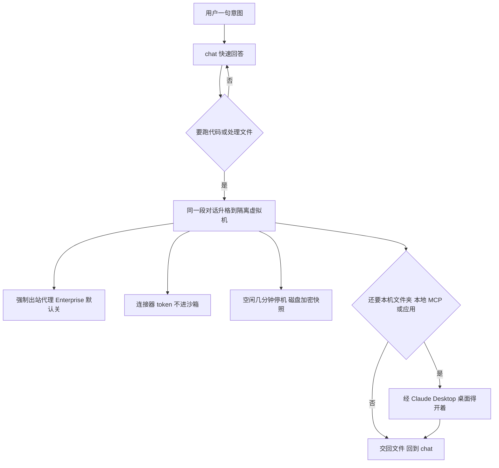

同事把同一道题做了两遍。第一遍开在 Chat，模型说要看那份表。第二遍改开 Cowork，对话是新的，表还得再传一次。中间那句「这题用 Chat 还是 Cowork」不产生答案，只产生一次重开。

昨天那篇写工程侧：别把组织图抄进 Agent，能折的子 Agent 折回一条循环。今天这一页是产品面。对话从 chat 起。要跑代码或碰文件，同一段对话升到 Anthropic 托管的隔离云沙箱，做完再回到 chat。凭证留在沙箱外。Enterprise 默认出站关。Efficient mode 把统一体验压在 Sonnet 和 Haiku 上。

我在 2026-10-31 读了产品文和三篇帮助中心。没有登录 Enterprise，没有在控制台里看过一次升格。

<!-- more -->

## 开工前的那个选择可以拿掉

产品文写，Pro 和 Max 在九月先把 chat 和 Cowork 合上。编者注写明：2026-10-30 之前文中的 Max，包含现在的 Max 和 Ultra。同一套体验对 Claude Enterprise 现在一般可用。我打开该页时，正文没有另印发布日期。页上的 today 我没有换成日历。

用户文和架构文把范围写全了。新体验从 Pro、Max、Ultra 的 web、桌面和手机分批放开。Team 计划是 beta。Enterprise 要组织打开 Chat and Cowork unified。同一计划的账号，看到变化的时间可以不同。输入框还同时显示 Chat 和 Cowork，这个账号就还没有。一旦切过去，不能切回两个选项。聊天、任务、项目和设置跟着走。

一段对话，两态。简单问题仍是快速回答。要跑代码或处理文件时，同一段对话在云里继续，交回文档、分析或幻灯片。合上笔记本，云里的工作还在，web、桌面、手机可以接着拿。产品文写聊天、项目、连接器、技能和插件会带过去。用户文补了已有 Cowork 任务、制品和文件，旧任务按原样打开。模型选择器和 Code 标签还在原处。全局指令并进 Settings 里的 Instructions for Claude。网页搜索不再有开关。Research 用 `/deep-research`，或点输入框下的「+」再选 Research。

还没并进去的，用户文自己列了。从 GitHub 添加不支持。不能从更早的一点分支出对话。无痕聊天仍走旧体验，里面不能建文件、不能跑代码。搜索不含更早的 Cowork 任务。Dispatch 不对新用户开放，已经在用的可以暂时留着。

「一个 Claude」先是对话列表和开工方式。产品文里的客户引言有「不到十分钟」「原来要几周」，页上没有方法。我不把它写成测量。抓下来的页面把引言和人名分成两段重复，署名我也不钉。

## 升格进的是一台隔离虚拟机

管理文把两态写死。需要 agentic 工作时进入 Cowork 云会话，不需要时回到 chat。每一段需要沙箱的对话有自己的虚拟机，由 Anthropic 管。空闲几分钟后虚拟机停下，磁盘存成加密快照。沙箱环境在创建 30 天后过期。「几分钟」没有写成数字，30 天是这一段里的日期。管理文页眉是 Updated over a week ago，没有日历。

架构文并列着另一句时间。云会话默认：agent 循环和代码执行在 Anthropic 的服务器上，会话和文件存到成员的 Claude 账号。每个会话一块隔离的临时沙箱，开始时创建，结束时销毁。沙箱之间、组织之间不共享状态。这套基础设施和 Anthropic 的公司、研究、模型训练环境分开。我在同一天打开架构文和用户文，页眉都是 Updated today，没有日历。管理文的「空闲停机加 30 天过期」和架构文的「结束即销毁」，两页都没有定义「结束」是不是同一次操作。我没有看过快照。



上图按管理文和架构文能对上的句子画，不是 Trust Center 的图。产品文点了 Anthropic Trust Center 上的安全实践指南，管理文点了 Unified Claude and Cowork security best practices。这两页我没有打开。

架构文里我按原句收下的边界：

1. 默认碰不到你的网络。沙箱到不了私有、内部、link-local、云元数据地址，也到不了 Anthropic 内部系统。这句话写在「默认」那一条里。出站改成允许全部域名之后，私有地址是否仍被挡住，这页没有另写。未核实。
2. 出站沿用已经在管本地 Cowork 和 chat 的那份网络策略。Enterprise 默认是无网络访问。离开沙箱的流量过强制代理，沙箱改不了，也绕不过，只有允许列表里的目的地可达。管理文把档位写成四档：关、仅包管理器、自定义域名、全部域名。
3. 沙箱里只有会话范围的短时 token，数小时内过期。小时数没有写。连接器的授权 token 不进沙箱，连接器调用在服务端做。
4. 存下来的记录按组织和账号隔离。
5. 云会话要本机文件或浏览器时，请求经 Claude Desktop，走 Anthropic 中介的连接。文件只限已连接的文件夹，每次本地工具调用先过成员权限。桌面离线就到不了这台设备。经桌面打开的本地文件，处理发生在 Anthropic 的服务器上。架构文写对话数据按 Team 和 Enterprise 的商业承诺处理，不用于训练 Claude。产品文写传输和静态加密，默认不用于模型训练。两句里「默认」盖住的范围我对不上，因为那份指南没打开。SSO 和 Compliance API 沿用。

本地执行还在，收在旧桌面部署。Pro、Max、Ultra 上，只有 2026-10-06 之前在设备上启动的任务和定时任务仍走本地会话。agent 循环在设备上。代码执行在单独的 Linux 虚拟机里，macOS 用 Apple Virtualization.framework，Windows 用 Hyper-V，并限制出站、系统调用，按会话隔离用户。虚拟机起不来时，文件和网页工具还在，shell 和代码执行报 `workspace unavailable`。EDR 看不进这台虚拟机，也看不见端点外的云会话。合规若靠端点可见性，铺开前要算上这一条。这是架构文的提醒，不是我的扫描。

本站 10 月 24 日写过凭证放在出站侧，10 月 18 日写过沙箱停机和快照。这里能对上的只有边界的形状：凭证不进客人环境，空闲之后磁盘还在。修订号和那套状态机不在这篇里重讲。

## 先选模式，和运行时升格

| 维度 | 开工前选 Chat 或 Cowork | 同一段对话里升格 |
| --- | --- | --- |
| 谁做选择 | 人。选错就重开一段 | 文档写 Claude 接着做。成员不会被问模式 |
| 简单问题 | 停在 chat | 仍是快速回答 |
| 代码和文件 | 得先开在 Cowork | 升到隔离云会话，交回文件后再回到 chat |
| 设备 | 两套体验分开管 | web、桌面、手机同一段。合上笔记本，云任务还在 |
| 本机 | 桌面自己的本地会话 | 本地链接可选。文件夹、本地 MCP、应用走桌面。Remote control 和设备策略管 web、手机和定时任务 |
| 带着走的 | 各带各的 | 产品文写聊天、项目、连接器、技能、插件。用户文写旧 Cowork 任务、制品和文件 |
| 组织开关 | Chat、Cowork、Cowork in the cloud 分开 | 要 Chat，外加 Cloud code execution and file creation。不必先开 Cowork 或 Cowork in the cloud。管理文写它会逐步替换后两者 |
| 出站 | 各写各的 | 云会话沿用同一份网络策略。Enterprise 默认关 |
| 审批 | 各产品自己的 | 用户文：Auto 是 Pro、Max、Ultra、Team 的默认。Manual 是 Enterprise 的默认。设置管整段对话 |
| 还拆着的 | 全部 | ZDR、HIPAA-ready、CMEK 开不了统一开关。无痕仍是旧体验。本地 MCP 进程不在云会话里跑 |

Computer use 用户文只写成 Pro、Max、Ultra 上的 beta：在你的电脑上点击、打字、翻界面。Enterprise 和 Team 有没有，这页没写。演示里这条判成 `computer_use_unlisted`，不替官方补。

## Enterprise 上，开关比口号多

现有组织默认关，2026-11-16 起默认开。Owner 或 Primary Owner 在 Organization settings、Capabilities 里能看到 “Will be automatically enabled on November 16, 2026.” Enable now 和 Keep disabled 都可以，之后仍能关掉。已经手动开过或关过的，保持原选择。Chat 或 Cloud code execution and file creation 缺一项，就没有这条通知，也不会打开。11 月 16 日之后，要等两项都开。打开后 User、Admin、Owner、Primary Owner 拿到。自定义角色要自己带上这项。新角色从 All capabilities 起，里面包含它。每次请求都检查。角色拿掉或开关关掉，访问就没了。成员看不到就刷新。

| 今天有什么 | 管理文让你做的 |
| --- | --- |
| 只有 Chat | 打开统一开关。不必另开 Cowork 或 Cowork in the cloud。确认云端代码执行和文件创建开着 |
| 只有 Cowork，或再加上 Cowork in the cloud | 先开 Chat，再开统一开关。同样确认那项云端能力开着 |
| Chat 和 Cowork 都有 | 确认云端代码执行和文件创建开着，再开统一开关 |

ZDR、HIPAA-ready、CMEK 现在不可用。这些组织继续用分开的 chat 和 Cowork，管理员打不开这项。HIPAA 支持写的是一般可用之后才会有。CMEK 计划更晚。先开了统一体验再打开 CMEK，统一体验变为不可用。

同一页的顺序：先给 IT、安全和采购。评审 chat 和云上的 Cowork，进行中的云 Cowork 评审可以沿用。从沙箱组织或一个角色试点起。打开前看过出站、连接器、分享和 remote control。看两到四周，再分波扩大。

和账单、审计咬合的，我只列读到的：

- 出站四档，Enterprise 默认关。连接器策略在沙箱外、每次连接器调用时执行。
- Always allow for connector tools 关掉时，不能给连接器工具长期批准。Allow “Skip all approvals” 关掉时，用户不能让 Claude 不问就用工具、改文件、浏览网站。页上写明这一条管定时任务和统一体验里的内置浏览器。Allow “Automatically approve” 关掉时，用户得逐次批准，范围同样包括工具、改文件和浏览。这一条没有再写成只限定时任务或内置浏览器。
- 用过沙箱的对话要分享，Share chats 和 Share cloud sessions 都得开，更严的那条生效。Remote control 关掉时，web、手机和定时任务用不了链接的电脑。Require Trusted Devices 要求新设备先验证。Scheduled tasks 关掉时，远程定时任务禁用。
- SSO（SAML/OIDC）、SCIM、租户限制照旧，没有第二套登录。Admin API 里这项权限叫 `chat_cowork_unified`。托管电脑可限制文件夹，并可禁用用户添加的本地 MCP 和扩展。`isLocalDevMcpEnabled=false` 禁用插件自带和本地配置的 MCP，`isDesktopExtensionEnabled=false` 挡住 MCPB 和 DXT。前者关掉后，云会话经桌面只剩受文件夹限制的文件工具。

对话保留到成员删除，或按自定义保留期，最短 30 天。对话删除时，从它开出的云会话一起删。记忆迁到新系统后，旧记忆可能在 14 天后删，保留期更短就更早。2026-10-08 及之后交给你的几乎所有文件随对话删除，除非组织里另一处还在用。更早的文件，对话删了也可能还留着。不跟着删的有：成员直接开的 Cowork 云会话、定时任务及其运行、电脑上的 Cowork 历史、离职成员的记忆，以及 Claude Code（含网页版）、Claude Tag 和其他产品的记录。定时任务要停，得关 Scheduled tasks。

费用仍按用量。产品文写的是跑起来的花费：Opus 5.5 在典型负载上比 Opus 5 少 40%，Sonnet 5.5 对大多数工作比 Sonnet 5 少最多 30%。工作集没有附。我没有复测。四条控制是 Efficient mode、模型权益、组织/组/成员花费上限，以及一组人共享的月度池化预算。Efficient mode 打开后，统一体验里只能用 Sonnet 和 Haiku，新会话从 Sonnet 5.5、low effort 起。其他产品不受影响。更便宜的模型出现后，Anthropic 可能改默认模型和 effort。模型允许列表同时管 chat 和 agentic 工作。

用量会换行。成员一旦有了统一体验，chat 和 Cowork 记在 Chat and Cowork unified 下，计费口径不变。加总时把这一行算进去，否则旧的两行会看起来在掉。人数用整体活跃用户。Cost and Usage API 的产品值是 `chat_cowork_unified`。Analytics API 的 `chat_cowork_unified_metrics` 分成 `chat` 和 `sessions`。新活动最多两天才出现。Top connectors 和 Top skills 还不含这一行。Claude Code 和 Claude in Chrome 仍走自己的行。关掉之后，已记成 unified 的历史留着这个标签，新用量回到 Chat 和 Cowork。

## 和单循环是同一类税

10 月 30 日那篇的判断是：很多专科子 Agent 在替模型做它已经会做的路由。先问「这题派给谁」，上下文在交接里丢字段。10 月 28 日那篇把 harness 收成插入点：工具调用外面可以包沙箱、审批和卸载。

升格换掉的是执行环境：隔离虚拟机、Enterprise 默认关上的出站、沙箱外的连接器 token。这是包住工具调用的插入点，对话还是那一段。

边界要能测。文档里能指到的触发是两类：不跑代码、不处理文件，就留在 chat；要跑代码或处理文件，就升到云。本机文件夹、本地 MCP、本机应用是另外写的。桌面得开着，文件夹得已连接。从 web、手机或定时任务过去，还要 Remote control。本地 MCP 的进程不在云会话里。Computer use 只在 Pro、Max、Ultra 的 beta 里被点名。

留下的口要能指到一次任务，这和「三条硬条件才留子 Agent」是同一形状。纯问答对应留在 chat。交回文件对应升格。本地 MCP 对应桌面链接。ZDR、HIPAA-ready、CMEK 仍要人先选 chat 或 Cowork。无痕打开的是旧体验，不能建文件，不能跑代码。搜索也还看不到更早的 Cowork 任务。对话列表并了，检索没有并完。Efficient mode、模型权益和三层花费上限管的是升格之后的账单。

## 样例跑的是决策，不是 Claude

演示在 `demos/claude-chat-cowork-unified/`。不登录，不读密钥，不访问 claude.com。`cases.json` 有 23 条，外加脚本里 Max 对 Pro 的一次对照。期望按上面四页填，脚本只检查判决和期望一致。官方若只看「读已有附件、不新建文件」这类信号，样例会判错。

`base` 是已经打开统一体验、出站为关的 Enterprise。每条只写改动字段。`code-and-local-mcp` 走 `need_local_link`：本地 MCP 进程不在云会话里，脚本让本机需求优先于「要跑代码」。页上没有写官方分类器一定这样排序。

```bash
python3 demos/claude-chat-cowork-unified/run_demo.py
```

我跑过。23 条失败 0，最后一行是 `result=pass`。Max 和 Pro 在「要文件」上的路由都是 `escalate_cloud`。Team 的能力项前提写在 Enterprise 管理文里，脚本没有套到 Team 上。

| 样例 | 特征 | 判决 |
| --- | --- | --- |
| `qa` | 纯问答 | `stay_chat` |
| `deck` | 要交回文件 | `escalate_cloud` |
| `code-no-net` | 要跑代码，不访问网络 | `escalate_cloud` |
| `code-egress-off` | 要跑代码，还要联网，出站关 | `escalate_cloud`，备注 `egress_off` |
| `local-mcp` | 要本地 MCP，桌面开着 | `need_local_link` |
| `local-mcp-offline` | 同上，桌面关 | `blocked_desktop` |
| `local-mcp-mdm` | 本地 MCP 被 MDM 关掉，任务又只要它 | `blocked_local_mcp` |
| `code-and-local-mcp` | 又要代码又要本地 MCP | `need_local_link` |
| `zdr` / `hipaa` / `cmek` | 合规配置 | `keep_split` |
| `unified-off` | 现有组织还没开 | `keep_split` |
| `no-cloud-exec` / `no-chat` | 两项能力缺一 | `blocked_capability` |
| `pro-waiting` | Pro 还显示两个选项，任务却要文件 | `keep_split` |
| `computer-use-pro` | Pro 已是统一界面，要操作本机应用 | `need_local_link` |
| `computer-use-enterprise` | Enterprise 要 computer use | `computer_use_unlisted` |
| `web-folder-no-remote` | 从 web 要本机文件夹，Remote control 关 | `blocked_remote` |

`no-cloud-exec` 把 `unified_on` 设为 true，同时云端代码执行为关。管理文把这项能力写成前提：缺了就不会打开，11 月 16 日之后也要等两项都开。它没有写「开关显示为开、能力却是关」时界面长什么样。真实控制台会不会允许这个组合，未核实。我没有 Enterprise 租户，没有看模型在哪一轮决定升格，也没有对过 token。

## 菜单可以收掉，沙箱还在

用户少问一次「用哪个产品」，就少一次没必要的派发。该留的是能指到任务的那道门。代码和文件进隔离虚拟机。本机能力走桌面链接。ZDR、HIPAA-ready、CMEK 继续分开。升格之后的账单用 Efficient mode、模型权益和花费上限去管。

你团队里，开工前还得先选产品的那一下，剩在哪？是无痕、是 ZDR，还是一条只活在笔记本上的本地 MCP？

## 扩展阅读

- [Claude Cowork and chat come together for Enterprise](https://claude.com/resources/articles/unified-claude-enterprise)
- [Set up and manage the new unified Claude experience](https://support.claude.com/en/articles/17444462-set-up-and-manage-the-new-unified-claude-experience-for-your-enterprise-organization)
- [Claude Cowork architecture overview](https://support.claude.com/en/articles/14479288-claude-cowork-architecture-overview)
- [Claude Cowork and chat are one Claude](https://support.claude.com/en/articles/16761823-claude-cowork-and-chat-are-one-claude)
- [别把组织架构抄进 Agent](https://cfireworks.github.io/2026/10/30/2026-10-30-fold-subagents-single-loop/)
- [到底建不建自己的 Agent Harness](https://cfireworks.github.io/2026/10/28/2026-10-28-when-to-build-your-own-agent-harness/)

## 讨论

若你们已经打开统一体验：纯问答会不会仍起云会话？只生成一份表格、不跑代码，用量记在 `sessions` 还是 `chat`？我这里没有租户，答不了。有计数的话，比产品文里的客户引言有用。
