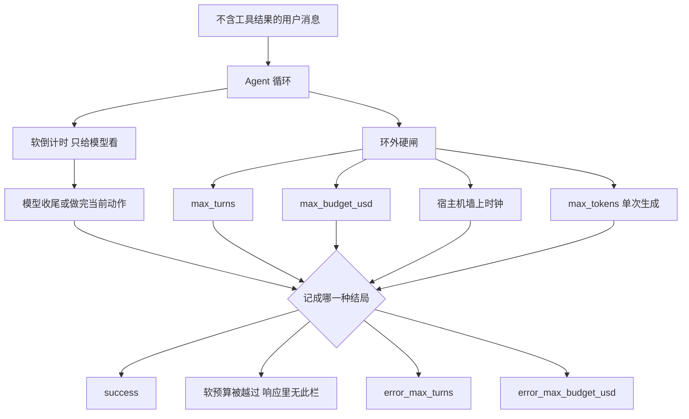

模型说还差一点就写完。工具又跑了一轮，账单已经过线。单循环折回去之后，专科之间的交接少了，下一类事故常常出在这里：把步数和花费交给模型自觉。

Anthropic Messages API 的 `task_budget` 是软提示。倒计时只给模型看，响应里没有 remaining。硬上限仍是这一次请求的 `max_tokens`。配置页写明，两种 SDK 的 options 上都没有 `max_tokens`。task budgets 那页写 Claude Code 和 Cowork 不支持。我在配置页的选项表里也没有看到 `task_budget`，两份 SDK 参考手册没有逐项打开。能把循环掐死、并且写在我读过的页上的，是 `max_turns` 和 `max_budget_usd`。生产控制环要把软提示和硬闸分成两层，并把撞预算记成可分类结局。

我在 2026-11-01 读了 [Task budgets](https://platform.claude.com/docs/en/build-with-claude/task-budgets)、[How the agent loop works](https://code.claude.com/docs/en/agent-sdk/agent-loop) 和 [Configure your agent](https://code.claude.com/docs/en/agent-sdk/configuration)。没有发 Messages API，没有跑 Claude Code。下面的文档数字只转述。演示里的美分是夹具。

10 月 28 日写 harness 的插入点，10 月 29 日写慢工具的两分钟，10 月 30 日写子 Agent 折回一条循环，10 月 31 日写对话不必先选模式。这篇只接花费：循环已经是一条了，谁来停。

<!-- more -->

## 倒计时只给模型看

Task budgets 走 Messages API 的 beta。请求带 header `task-budgets-2026-03-13`。`output_config.task_budget` 三个字段：`type` 固定 `"tokens"`；`total` 是这一整段 agentic loop 能花的 token，含思考、工具调用、工具结果和输出；`remaining` 可选，省略时等于 `total`。文档示例是 `claude-opus-5-5`、`max_tokens` 128000、`task_budget.total` 64000、`effort` 为 high。示例不是我测过的推荐值。64000 比 128000 小，页上另写两者互不要求谁更小。

```json
"output_config": {
  "effort": "high",
  "task_budget": {"type": "tokens", "total": 64000}
}
```

服务端把倒计时标记插进对话。模型用它调节节奏，临近时把发现收成一段，而不是被拦腰截断。标记只给模型看。响应的 `usage` 没有 remaining，SDK 也没有读取器。Availability 那一节写：API 不会在预算处停下 Claude。

页上的原句是 advisory, not enforced。模型若正在做一件打断比做完更糟的动作，可能偶尔越过。真正截断生成的仍是 `max_tokens`，到顶时 `stop_reason` 是 `"max_tokens"`。`task_budget` 罩住可能很多次请求的整段循环，`max_tokens` 只罩这一次请求。循环页列出的常见 `stop_reason` 是 `end_turn`、`max_tokens`、`refusal`。我没有看到 task budget 专用的一种。软预算被越过时，这次生成仍可以正常结束。API 不帮你把这件事标成错误。

`total` 最小 20000，再小返回 400。这个下限对所有支持该功能的模型一样。请求过了关，预算仍可能不够用。文档举例：给一个要跑好几小时的编码任务只给 20000，模型可能拒做、把范围砍得很狠，或早停留下半成品。出现这种拒绝或早停，先把预算加大，再去查别的参数。按任务长度的分布来定，不要用一个固定默认值。

effort 管每一步想多深，task budget 管整段循环做多宽。思考 token 算进预算，自适应思考会随预算变少而收。effort 在 `xhigh` 或 `max` 时，文档要求 `max_tokens` 至少 64k。

Feature support 我按原表记。要带那个 beta header 的有 Claude Fable 5.1、Mythos 5.1、Opus 5.5、Opus 5、Fable 5、Mythos 5、Sonnet 5.5、Haiku 5.5、Opus 4.8、Opus 4.7。不支持的有 Sonnet 5、Opus 4.6、Sonnet 4.6、Haiku 4.5。同页 Availability 还列了 Claude Mythos Preview，云平台是 Claude API、Claude Platform on AWS、Google Cloud 上的 Claude Models（Google 托管）、Microsoft Foundry。Feature support 那张表没有 Mythos Preview。两张表不一致，我没有取舍。Managed Agents 写着不可用，改用 Session budgets。Session budgets 是否强制，这页没写，我没另开。

Claude Code 和 Cowork 不支持 task budgets，要直接走 Messages API。配置页写明 `temperature`、`top_p`、`max_tokens` 在两种 SDK 的 options 上都没有字段。要这些参数就打 Messages API。同一句让你改设 effort，或设花费上限。

在 Claude Code 里设 `task_budget`，和我读过的这三页对不上。参考手册里若有同名字段，这次没核实。

## 两种一轮，两只计数器

Messages API 里，预算盖住的一轮，是对一条不含 `tool_result` 的用户消息的全部回应，中间可以有好几次请求。下一条不含工具结果的用户消息，例如预算用尽后的一句 Continue，另起一轮，预算重新给满。文档用 Today 形容眼下的计数：更早轮次的历史只要还在上下文里，倒计时仍会计入。带 `tool_result` 的用户消息继续当前轮，哪怕旁边再贴一句新指令。

轮中做了服务端 compaction，预算不清零，压缩前这轮已经花的仍算。轮开始之前的 token，若在轮初被压成摘要，不计入。文档写这个排除只对跨服务端 compaction 带着走的预算成立。

你自己改写历史时，服务器不记得压缩前花了多少。下一次要带 `remaining`。文档的例子是已经花了 45000、`total` 为 128000，`remaining` 就是 83000。只在替换历史时更新这个数。仍留在消息里的部分，包括你新写的摘要，留给服务器自己数。这个 `remaining` 之后每次请求都带，不只带在压缩那一次。全程重发未压缩历史的，省略 `remaining`。

若客户端每轮按重发的整段历史去减 `remaining`，倒计时会掉得比实际快，模型提前收工。预算值参与渲染后的提示，改一次就对不上旧缓存。倒计时标记本身每次由服务端注入，本来也不跨请求命中缓存。要保住缓存，第一次设好预算，让模型对着服务端倒计时自己收。中途加大预算可以，缓存后果是同一条。

SDK 的一轮是另一只。模型产出一次。若带工具调用，SDK 执行后把结果自动送回，中间不把控制权交还给你的代码。有工具的轮都要数，再加最后那条纯文本。文档用修测试的例子：三次带工具，一次收尾，共四轮。`max_turns=2` 会在编辑之前停。少留这一轮收尾，结局是 `error_max_turns`，没有最终回复。

10 月 30 日那篇里，harness 上的轮次和费用是环外的数。它不是这条软倒计时。软预算的一轮可以含多次工具往返。`max_turns` 把每次往返和最后一句分开数。

## 硬闸在环外，结局要有名字



`max_turns` / `maxTurns` 和 `max_budget_usd` / `maxBudgetUsd` 默认都不限。不设的时候，循环跑到模型自己停。开放式的改进仓库可以跑很久。`max_turns` 设成 0 和不设一样。`max_budget_usd` 设成 0，CLI 在启动时当成非法金额拒绝，会话不会跑。

花费把子 agent 算进上限。到顶后再派生，失败信息是 `Budget limit reached`，当时还在后台跑的子 agent 会被停掉。循环页写，这些执行行为要求 Claude Code v2.1.217 或更新。比较发生在响应到达之后，因为费用来自这次响应带回的 usage。触顶的那一次响应会做完，并算进 `total_cost_usd`。花费因此可以越过上限：最多越过这一次响应的费用，再加上当时还在跑、尚未停下的子 agent。设上限时留这段余量。余量这一段，页上没有再标版本号。

流式输入另有一个分叉。轮次触顶时，队列里还没送出的消息会新开一轮，`max_turns` 对那一轮重新数。花费继续累加。一旦到了 `maxBudgetUsd`，同一段对话后面的消息都以 `error_max_budget_usd` 结束。`/clear` 才把预算重新开始。

`ResultMessage.subtype` 是分类结局：

| subtype | 发生了什么 | 有没有 result |
| --- | --- | --- |
| `success` | 正常做完 | 有 |
| `error_max_turns` | 轮次到顶，没做完 | 没有 |
| `error_max_budget_usd` | 花费到顶，没做完 | 没有 |
| `error_during_execution` | 循环被打断，例如取消 | 没有 |
| `error_max_structured_output_retries` | 重试上限内没有一次合法的结构化输出 | 没有 |

先看 subtype，再读文本。`total_cost_usd`、`usage`、`num_turns`、`session_id` 在这些 subtype 上都有，触顶之后仍能记账，仍能按 session 续。Python 里 `total_cost_usd`、`usage`、`model_usage` 的类型是可选的，读之前要看是不是 None。`usage` 只盖主循环。整棵树看 `model_usage`，TypeScript 是 `modelUsage`。上限含子 agent。只盯主循环 usage，会对不齐这只闸。我没有在这一页把 `total_cost_usd` 和整棵树的费用画成同一个数。

记录可以长这样。这不是 SDK 的类，也不是演示脚本的输出。`result` 只在 `success` 上有。软预算那一栏要自己算，接口不给。

```python
def run_row(message, soft_tokens_spent, soft_total):
    """错误结果先落库。随后抛出的异常不再负责分类。"""
    if message.subtype == "success":
        result = getattr(message, "result", None)
    else:
        result = None
    over = soft_tokens_spent > soft_total
    row = {
        "subtype": message.subtype,
        "session_id": message.session_id,
        "num_turns": message.num_turns,
        "total_cost_usd": message.total_cost_usd,
        "result": result,
        "soft_budget": "exceeded" if over else "within",
    }
    return row
```

单发 `query()` 先交出这条错误结果，再抛异常。只写 `except`、不看已经交出的 subtype，分类结局就丢了。连接或进程故障则没有这条结果。流式会话在触顶后还活着。会话崩溃是例外：`error_during_execution`，费用字段可能被清零，`stop_reason` 为 null，然后进程退出。

循环页和配置页都没有墙上时钟这个选项。配置页把 API 超时和 stall detection 指到 SDK 参考的另一节，我没有打开。工具一直不返回时，花费要等响应到了才去和 `max_budget_usd` 比。10 月 29 日的两分钟后台是另一只钟，这里不重讲。宿主机自己的截止时间和进程终止要记在环外。那不是这三页里的 subtype。演示没有把它编成 `error_max_turns`。

## 四只闸并排

| | `task_budget` | `max_tokens` | `max_turns` | `max_budget_usd` |
| --- | --- | --- | --- | --- |
| 作用域 | 一次 agentic loop，可跨多次请求。含思考、工具调用、工具结果、输出 | 单次请求的生成 | SDK 的一轮。有工具的轮各算一次，再加最后的纯文本 | 会话估计花费，含子 agent |
| 强制 | 否。可因做完当前动作而越过 | 是。`stop_reason` 为 `max_tokens` | 是。默认不限。0 也是不限 | 是。默认不限。0 在启动时被拒 |
| 撞到之后 | 模型收束、缩范围或早停。usage 无 remaining。没有对应 subtype | 这次响应被截断 | `error_max_turns`，没有 result | `error_max_budget_usd`。触顶那一响仍计入，外加尚未停下的子 agent |
| 放在哪 | Messages API 的 `output_config`，要 beta header。Claude Code / Cowork 不支持 | Messages API。SDK options 没有这个字段 | `max_turns` / `maxTurns` | `max_budget_usd` / `maxBudgetUsd` |

文档有一张 payload 对预算的例子，`total` 为 100000。重发的历史不重复计入。

| 请求 | 发出的输入 token（约） | 这一请求计入预算 | 之后 remaining（约） |
| --- | --- | --- | --- |
| 1 | ~20 | 5000，思考加 tool_use | ~95000 |
| 2 | ~7800 | 6800，其中工具结果 2800 | ~88200 |
| 3 | ~13000 | 7200，其中正文 6000 | ~81000 |
| 合计 | ~20820 | 19000 |  |

用户原话发了三次，第一条助手消息发了两次，预算里各算一次。这是该页的假设，我没有打 API 复测。

## 先量分布，再让两层同时开着

代表任务先不要带 `task_budget`。每个任务把循环里各次 `usage.output_tokens` 与你夹进去的工具结果 token 相加。从 p99 起步，再往上或往下试。

软硬一起开。`task_budget` 给节奏。`max_tokens` 是单次天花板。SDK 会话设轮次和美元。`max_tokens` 不在 options 上。task budget 不在 Claude Code 和 Cowork 上。文档示例里出现过 `max_turns=30`，配置页示例是 `maxTurns: 8`。那是示例。

美元上限留余量，给触顶那一次响应，以及还没停的子 agent。

撞上之后写入 run record：subtype、费用、轮次、session。没有 result 就不要当成正常答案。主循环 usage 和整棵树的 `model_usage` 分开记。软预算被越过时，API 不提供栏位。要分类，就得自己把加总 token 和 `total` 比较，写成记录里的一栏。演示把这一栏叫做 `budget_soft_exceeded`。

不要每轮按重发历史去减 `remaining`。低于 20000 的 `total` 会 400。刚好 20000 能过请求，长任务仍可能拒做。

墙上时钟放在宿主机。响应没回来，美元闸不比较。

流式输入里，轮次上限不是整段会话的上限。排队的下一条会重新数轮。花费不会。

## 夹具里，软的可以过，硬的有名字

演示在 `demos/task-budget-vs-hard-gates/`。不读密钥，不访问网络。`doc_replay` 重放上表的整数。其余步数和美分是为了把分支分开。

```python
def classify_after_response(counted, soft_total, usd_cents, max_usd_cents):
    """响应已经落地再判硬闸。软预算被越过，不改写美元结局。"""
    if max_usd_cents is not None and usd_cents >= max_usd_cents:
        return "error_max_budget"
    if counted > soft_total:
        return "budget_soft_exceeded"
    return None
```

SDK 的 subtype 是 `error_max_budget_usd`。演示打印短名 `error_max_budget`。`budget_soft_exceeded` 不是 API 字段。

| 夹具 | 在看什么 | 结局 |
| --- | --- | --- |
| `doc_replay` | 计入 19000，发出 20820，软预算 100000 | `success` |
| `finish_action` | 软预算 20000，第二步不做自觉停，计入 23000 | `budget_soft_exceeded` |
| `turn_cap` | 两次工具后还有收尾，`max_turns=2` | `error_max_turns`，没有收尾 |
| `usd_cap` | 上限 5 美分，两步各 4 美分 | `error_max_budget`，费用 8 美分，不当成功答案 |
| `mirror_remaining` | 按 payload 减 remaining，真计入 16000，仍低于 30000 | `success`，提前收工 |
| `both_gates` | 同一响越过软预算，也越过美元上限 | `error_max_budget` |

`python3 demos/task-budget-vs-hard-gates/run_demo.py` 我跑过，最后一行是 `result=pass`。`clock` 在第二步派发前停下，打印 `host_stop=wall_clock`，没有 outcome。`zero_usd` 打印 `rejected=max_budget_usd_zero`，循环不开始。`max_turns=0` 在断言里把文档那三步跑完。

## 自觉留在提示里

折回一条循环之后，成本的面还在。倒计时让模型自己排优先级，临近时把话收住。这是提示。步数、美元、进程还在不在，由环外的闸决定。撞上了要有名字。续跑、加预算，或停给人，都从这只名字开始。没有名字的异常，下一次只会被记成模型又跑飞了。

你团队现在哪一层其实是指望模型自觉？是只设了 `task_budget`、没设 `max_turns`，还是花费触顶被 `except` 吃掉、记录里没有 subtype？

## 扩展阅读

- [Task budgets](https://platform.claude.com/docs/en/build-with-claude/task-budgets)
- [How the agent loop works](https://code.claude.com/docs/en/agent-sdk/agent-loop)
- [Configure your agent](https://code.claude.com/docs/en/agent-sdk/configuration)
- [别把组织架构抄进 Agent](https://cfireworks.github.io/2026/10/30/2026-10-30-fold-subagents-single-loop/)
- [到底建不建自己的 Agent Harness](https://cfireworks.github.io/2026/10/28/2026-10-28-when-to-build-your-own-agent-harness/)
- [慢工具先回句柄](https://cfireworks.github.io/2026/10/29/2026-10-29-mcp-tasks-claude-code/)

## 讨论

若已经在 Messages API 上打了 `task_budget`：你们加总的 token，和模型提前收工的时机，差多少？SDK 上触顶那一响，`total_cost_usd` 越过上限的比例有没有留档？我这里没有生产流量。
