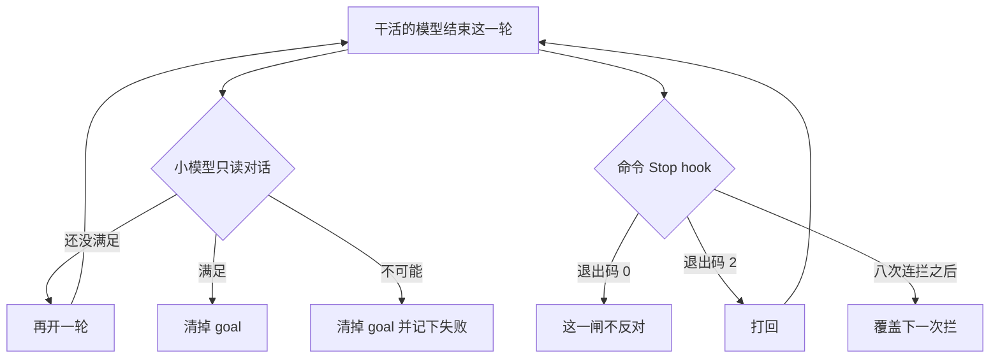

模型说测过了，可以收工。往上翻 transcript，没有那条测试命令，也没有退出码。评估器也可以判 Met，typecheck 仍是红的。

11 月 1 日把花费分成软倒计时和环外硬闸。预算能停住还要跑多久。下一刀是谁说做完了。做完这件事，要换一只评估模型，还要留一只看退出码的闸。

Claude Code 的 `/goal` 是会话级、基于 prompt 的 Stop hook。每轮结束，另一只 small fast model 只看对话里已经出现的证据，判 Not yet met、Met 或 Impossible。它不跑命令，不读仓库。用退出码把收工掐死的，是 `type` 为 `command` 的 Stop hook，失败时 exit 2。连续拦停、中间没有工具调用，文档写的是八次，下一次拦会被覆盖。这次放行记成可分类结局。记成检查通过，下一班对不上。

我在 2026-11-02 读了 [Keep Claude working toward a goal](https://code.claude.com/docs/en/goal)、[Best practices for Claude Code](https://code.claude.com/docs/en/best-practices) 里「When it's done」那一行和 Give Claude a check，以及 [Automate actions with hooks](https://code.claude.com/docs/en/hooks-guide) 里 prompt Stop 和 block cap。没有跑 Claude Code，没有配真实 hook。退出码、环境变量和版本号只转述这三页。

10 月 28 日写 harness 的插入点，10 月 30 日写子 Agent 折回一条循环，11 月 1 日写软预算和环外硬闸。这篇只接完成条件。

<!-- more -->

## 换一只模型，还要留退出码

Best practices 把指令分成两列。非确定的，模型读了再决定，不保证照做。确定的，由 Claude Code 执行，跟模型这次怎么想无关。

「When it's done」那一行，左边是向它要证据、`/goal`、`/code-review`。右边是测试、typecheck、`Stop` hook、CI。同一页后文写：`prompt` 或 `agent` hook 是请另一只模型做决定，因此也不是确定的。要强制，用 `command` 或 `http`。hook 自己崩溃或超时也该停下时，加上 `onFailure: "block"`。

表里的 `Stop` hook 在确定列。`/goal` 在非确定列。Goal 页把它定义成 session-scoped prompt-based Stop hook 的包装。包装换的是谁来判。退出码仍要另配。

Goal 页用三行对比，什么时候给当前会话开下一轮：

| 做法 | 下一轮何时开始 | 何时停 |
| --- | --- | --- |
| `/goal` | 上一轮结束。交互会话里，也可以是 idle check-in 或自动重试到期 | 模型确认条件满足，或判不可能；或一轮败在你必须修的错误上；或你跑 `/goal clear` |
| `/loop` | 时间间隔到了 | 你停掉，或 Claude 认为做完了 |
| Stop hook | 上一轮结束 | 你自己的脚本或 prompt 决定 |

`/goal` 和 Stop hook 都在每轮结束时触发。`/goal` 只活在当前会话，打一条条件就生效。Stop hook 写在 settings 里，覆盖它那个范围里的每个会话，可以跑脚本，也可以跑 prompt。

Auto mode 只在一轮之内批准工具调用，自己不开下一轮。模型觉得做完就停。`/goal` 在每轮之后另请一只模型看条件。完成与否由这只新模型决定。两件事叠在一起：一边去掉每次工具的确认，一边去掉每轮结束时要你点头。

## 评估器只读对话

一个会话同时只有一个 goal。再设一次，新的替换旧的。设下之后立刻开一轮，条件本身就是指令。进行中会显示 `◎ /goal active`。Goal 不改权限模式。要无人值守，在 auto mode 里跑。Manual 模式下，settings 没预先放行的命令，Claude 仍会问。

评估器对着对话里已经浮出来的内容下判断。它不单独跑命令，也不单独读文件。条件写成 Claude 自己的输出演得出来的检查。「`test/auth` 的测试都过」能用，是因为 Claude 跑了测试，结果留在 transcript 里。页上建议三样一起写：一个可度量的终点，一条写明的检查（例如 `npm test` 退出码为 0，或 `git status` 是干净的），以及路上不许改的约束。条件最长 4000 字符。想限制跑多久，把轮次或时间写进条件。页上的例子是 `or stop after 20 turns`。那是例子，默认上限不在这句里。评估器仍只从对话里判这句话有没有被遵守。

每轮结束，Claude Code 把条件和至今的对话发给配置的 small fast model。三态，各带一句短理由：

- Not yet met：继续干。理由当作下一轮的指引。
- Met：清掉 goal，transcript 记一条 achieved。
- Impossible：条件被判成永远满足不了。清掉 goal，记一条 failed 和理由。不用自己再 clear。

干活的模型若连续若干轮不调工具、只在应答评估器，Claude Code 停掉循环，打出警告，把控制权还给你。goal 仍在。你下一条 prompt 之后评估再继续。页上写的是 several turns，没有整数。它让读者去 hooks guide 看底层机制。我打开的那一页里，和「没有工具调用」绑在一起的数字是另一件事：Stop hook 连拦八次。八次留在命令闸上，不挪来填这个「若干」。

要换这只评估模型，设 `ANTHROPIC_DEFAULT_HAIKU_MODEL`。Claude Code 在所有使用 small fast model 的地方读它，包括 `/goal`。`haiku` 别名会解析到这个值，会话标题和另一些后台任务也走它。页上没有给出默认模型 ID。评估 token 按该 provider 上的 small fast model 计费，页上说通常相对主轮花费可以忽略。我没有账单，这句话未核实。

后台子 agent 或后台 shell 还在跑，这一轮跳过评估。下一次结束时若已经没有后台工作，再评。后台做完，结果作为新的一轮交给 Claude。

干等满 30 分钟就该 check-in。Claude Code 列出还在跑的任务，让 Claude 读输出：有进展就继续等，卡住的就修或停。第一次之后等待加倍，最多到首次间隔的四倍。默认是第一次之后 1 小时，然后每 2 小时。`CLAUDE_CODE_GOAL_CHECKIN_MINUTES` 替换那 30 分钟，后面的间隔跟着缩放。设成 `0` 会关掉 check-in，连自动重试一起关。

Check-in 要 v2.1.234 或更新。交互会话在空闲时自己开一轮送 check-in，不等你打字，这要 v2.1.236 或更新。两次 prompt 之间，每个 goal 最多三次这种 idle check-in，第三次会说先暂停，直到你再发一条。v2.1.246 之前不封顶。非交互（例如 `-p`）只在回合结束时送。v2.1.239 之前，只有 idle check-in 按这个加倍退避。

必须你来修的错误会清 goal。警告以 `Goal cleared after an unrecoverable error` 开头，以 `Run /goal again to continue` 结尾。四种：Claude Code 自己管凭证时的认证失败（桌面或云会话由宿主管凭证时 goal 留着，宿主会自己恢复访问）；额度用尽；自动 compaction 清不掉的上下文溢出；模型不可用。其余错误 goal 还在。v2.1.269 起的交互会话会说明原因：过载、断连这类会重试，通知以 `Goal still active` 开头，自动重试三次后改为暂停；rate limit、claude.ai 用量上限、或 hook 结束了这一轮，通知以 `Goal paused` 开头。随时发一条消息可以立刻开下一轮。

`/goal` 不带参数看状态：条件、时长、评过的轮次、token 花费、最近的理由。轮次和理由要等第一次评估之后才有。早先达成过、眼下没有活动 goal 时，状态仍会显示那次条件、时长、轮次和花费。`/goal clear` 提前拿掉。确认语是 `Goal cleared:` 加条件；没有活动 goal 时是 `No goal set`。`stop`、`off`、`reset`、`none`、`cancel` 是别名。`/clear` 开新对话也会拿掉。

恢复会话时，结束时仍活动的 goal 会带回来：`--continue`、`--resume`，以及会话选择器。v2.1.239 之前，选择器那条路不恢复。条件留下，轮次、计时和花费基线重置。已经达成或已经 clear 的不恢复。

`claude -p "/goal ..."` 在一次调用里跑到结束。默认要等循环结束才印最后一句，多轮时看起来像卡住。加上 `--output-format stream-json --verbose` 才逐条出。Ctrl+C 可以在解决之前打断。桌面和 Remote Control 也能设 goal。我没有在那两端操作过。

`/goal` 和 settings 里的 hook 同一套工作区信任。`disableAllHooks` 在优先级算完后为 true，或托管设置里有 `allowManagedHooksOnly`，命令不可用，并且会告诉你原因。

## 硬闸看退出码

Best practices 把 typecheck 收成 `.claude/settings.json` 里的几行。拦住收工的是 exit 2。打到 stderr 的内容回到 Claude，当作还不能结束的理由，所以编译输出转到那里：

```json
{
  "hooks": {
    "Stop": [
      {
        "hooks": [
          { "type": "command", "command": "pnpm tsc --noEmit 1>&2 || exit 2" }
        ]
      }
    ]
  }
}
```

类型被改坏时，这一轮停不下来，编译错误会送回去，直到 `tsc` 通过，或撞上拦截上限。连续八次拦停、中间没有工具调用，Claude Code 覆盖下一次拦，这一轮结束。要抬高这个上限，设 `CLAUDE_CODE_STOP_HOOK_BLOCK_CAP`。Hooks 那一页同一句，并让脚本读 `stop_hook_active`。已经是 true，说明这次是 hook 自己触发的续跑，应 exit 0：

```bash
if [ "$(echo "$INPUT" | jq -r '.stop_hook_active')" = "true" ]; then
  exit 0
fi
```

这行的意思是：没有新的工具调用时，放行这一次收工，免得死循环。检查有没有过，要另记。八次上限是没早退时的安全网。覆盖发生时收工被放行，typecheck 仍可能是红的。记成成功，下一班对不上。

Prompt 类型的 Stop 回的是 JSON。`ok: true` 放行。`ok: false` 时，理由送回，Claude 继续；若同时 `impossible: true`，允许停止，这一轮结束。这和 `/goal` 的三态对得上：没满足就续，不可能就停。Prompt hook 可以另写 `model`。它的默认模型是不是 goal 那只 small fast model，两页都没对上，未核实。Agent 类型的 Stop 会拉起子 agent，能读文件、跑工具，默认超时 60 秒，最多 50 次工具轮，不支持 `impossible`。指南标成实验性，生产优先 command hook。要核对仓库的真实状态，指南指向 agent hook。要每次都执行同一条检查，用 command 的退出码。这篇的硬闸只认后者。

HTTP hook 在 Best practices 里和 command 并列为强制手段。它把同一份 JSON 用 POST 送出去，结果走响应体。我没有把它的失败语义对上 exit 2，未核实。

CI 在确定那一列，和 Stop hook 并排。它不在这三页的会话循环里。会话里的 exit 2 挡的是这一轮收工。合并前的红灯是另一只闸。



无进展时交还控制权、后台跳过评估、四种错误清 goal，图里没画。它们不改变这两层的分工。两层谁先谁后，这三页没有写排序，未核实。

## 五列并排

| | 模型自报 | `/goal` | prompt Stop | command Stop | CI |
| --- | --- | --- | --- | --- | --- |
| 谁判 | 干活的那只 | 另一只 small fast model | 你写的 prompt 所调的模型 | 你的脚本，harness 执行 | 流水线。这三页没有展开 |
| 看什么 | 自己的上下文 | 对话里已有的证据。不跑命令，不读仓库 | hook 输入。这一类不调工具 | 命令的退出码。stderr 回到模型 | 未核实 |
| 强制吗 | 否 | 否。写在非确定列 | 否。另一只模型 | 是。exit 2 拦住，直到通过或连拦被覆盖 | 对合并可以是。会话里不管 |
| 范围 | 这一次回答 | 当前会话。恢复时条件还在，轮次和花费基线重置 | settings 的那个范围 | 同左 | 仓库 |
| 撞到之后 | 你成为测试套件 | Not yet 续跑；Met 或 Impossible 清 goal；若干轮无工具则交还，goal 仍在 | `ok: false` 续跑；`impossible: true` 允许停 | 打回。`stop_hook_active` 为 true 时 exit 0。八次连拦后下一次被覆盖 | 红灯留在合并前 |

Hooks 那一页还写：退出码不是 0 也不是 2、又没有合法 JSON 时，多数事件仍继续，除非这只 hook 的失败本身会拦，例如 `onFailure` 为 `block`。有的事件不能被 exit 2 拦住。Stop 在不在那张例外表里，表我没打开，未核实。Typecheck 这个例子，Best practices 写的是 exit 2 把 Claude 送回去，直到通过或撞上 block limit。下面的夹具按这句走。

## 两层一起开

条件写成对话里演得出来的检查。写「`pnpm tsc --noEmit` 退出码为 0，输出留在对话里」。评估器看不到仓库里的真实退出码，除非干活的模型跑过，而且输出还在 transcript 里。

`/goal` 管进度叙事。长任务里，模型用一段进度总结结束回合、事项还开着，goal 把它送回去。Command hook 管退出码。Goal 判了 Met，只说明对话里的证据够了。脚本仍可以 exit 2。

脚本读 `stop_hook_active`。指南里的早退是直接 exit 0。它没有写工具调用之后要不要再拦。工具调用之后这个旗标还在不在，我没在字段说明里核对，未核实。夹具里，只有「已经连拦、中间没有工具」才把旗标当成 true。

Block cap 留下。默认行为是八次，页上没有另给变量的默认值字符串。被覆盖的那一次写成 `stop_forced_after_cap`。11 月 1 日的花费闸是同一类记录：放行要有名字，下次才分得清是检查过了，还是安全网打开了。

后台工作会跳过当轮评估。30 分钟 check-in 是另一只钟。`CLAUDE_CODE_GOAL_CHECKIN_MINUTES=0` 时，check-in 和自动重试一起关。

不可恢复错误清掉 goal 之后，修完再 `/goal`。认证、额度、压不掉的上下文、模型不可用，页上点了这四种。hook 把回合结束掉，在 v2.1.269 的交互会话里是暂停。

`ANTHROPIC_DEFAULT_HAIKU_MODEL` 会改所有小模型用途。只换 `/goal`、不动标题，这三页里我没看到专用开关。Prompt Stop 的 `model` 是另一条路，默认是谁未核实。

`disableAllHooks` 或 `allowManagedHooksOnly` 会让 `/goal` 不可用。命令会回原因。先读原因，再决定 hook 还要不要留。

## 夹具里，嘴和退出码可以不一致

演示在 `demos/goal-vs-stop-hook/`。不读密钥，不访问网络。评估器是字符串夹具：只在拼接后的 transcript 里找证据。命令闸只看夹具里的退出码。八次来自上面两页的字面。夹具不是那只 small fast model，也不是 `tsc`。我没有在 Claude Code 里数过「下一次」落在第几下。

```python
def judge_transcript(text: str, need: tuple[str, ...]) -> str:
    """只读已经写进对话的文本。不跑命令。"""
    if IMPOSSIBLE in text:
        return "impossible"
    if need and all(piece in text for piece in need):
        return "met"
    return "not_yet"
```

不可能的标记必须出现在对话里。它模拟评估器从对话得出的判决。标记和证据同时在时，夹具取不可能。这是夹具优先级。证据要两个片段都在：`npm test` 和 `exit 0`。只写「exit 0」、没有命令，仍是还没满足。

两层都开时，夹具这样分：exit 2 盖过评估器的 Met；命令闸 exit 0 不把 Not yet 改成做完。文档没写这个排序。这样分，是为了让两种不一致都看得见。

| 夹具 | 在看什么 | 结局 |
| --- | --- | --- |
| `claim_only` | 说测过了，还写了 exit 0，transcript 里没有 `npm test` | `goal_not_yet` |
| `evidence` | 对话里有命令和 `exit 0` | `goal_met` |
| `gone` | 对话写明依赖已删、条件无法满足 | `goal_impossible` |
| `tsc_red` | 只开命令闸，exit 2，第一次拦 | `stop_blocked` |
| `met_but_red` | 评估器会判 Met，命令闸仍是 2 | `stop_blocked` |
| `eight_blocks` | 连续 exit 2，中间无工具，不看早退旗标 | `stop_forced_after_cap`。先记下 8 次拦，第 9 次尝试被覆盖 |
| `active_flag` | 第二次见到早退旗标，脚本 exit 0 | 不记成检查通过 |

`python3 demos/goal-vs-stop-hook/run_demo.py` 我跑过，最后一行是 `result=pass`。

`both_green` 和 `goal_open` 在断言里：证据齐、exit 0，才是 `goal_met`；证据不齐、exit 0，仍是 `goal_not_yet`。`reset_on_tool` 在第三次拦之后插入一次工具调用，连拦从零再数，结局仍是 `stop_blocked`。不另打一行。无进展交还、30 分钟 check-in、四种清 goal，没有编成这五个结局。页上没有给「若干轮」的整数。

## 放行要有名字

预算分层之后，下一刀在完成条件。`/goal` 把「做完没有」交给另一只小模型。这只模型不跑测试。它读对话。对话里没有命令和退出码，Met 就缺少它自己要求的证据。Command Stop hook 用 exit 2 打回。八次连拦后的放行是安全网，单独记账。

你们现在的「做完」，是模型自报，是 `/goal`，还是 hook 和 CI 的退出码？

## 扩展阅读

- [Keep Claude working toward a goal](https://code.claude.com/docs/en/goal)
- [Best practices for Claude Code](https://code.claude.com/docs/en/best-practices)
- [Automate actions with hooks](https://code.claude.com/docs/en/hooks-guide)
- [别把预算交给模型自己掐](https://cfireworks.github.io/2026/11/01/2026-11-01-task-budget-vs-hard-gates/)
- [别把组织架构抄进 Agent](https://cfireworks.github.io/2026/10/30/2026-10-30-fold-subagents-single-loop/)
- [到底建不建自己的 Agent Harness](https://cfireworks.github.io/2026/10/28/2026-10-28-when-to-build-your-own-agent-harness/)

## 讨论

如果 `/goal` 已经在长任务上开着：判 Met 的那一轮，transcript 里有没有条件写明的那条命令和退出码？Stop hook 被连拦盖掉的次数，run record 里有没有单独的一栏？我没有生产流量。
