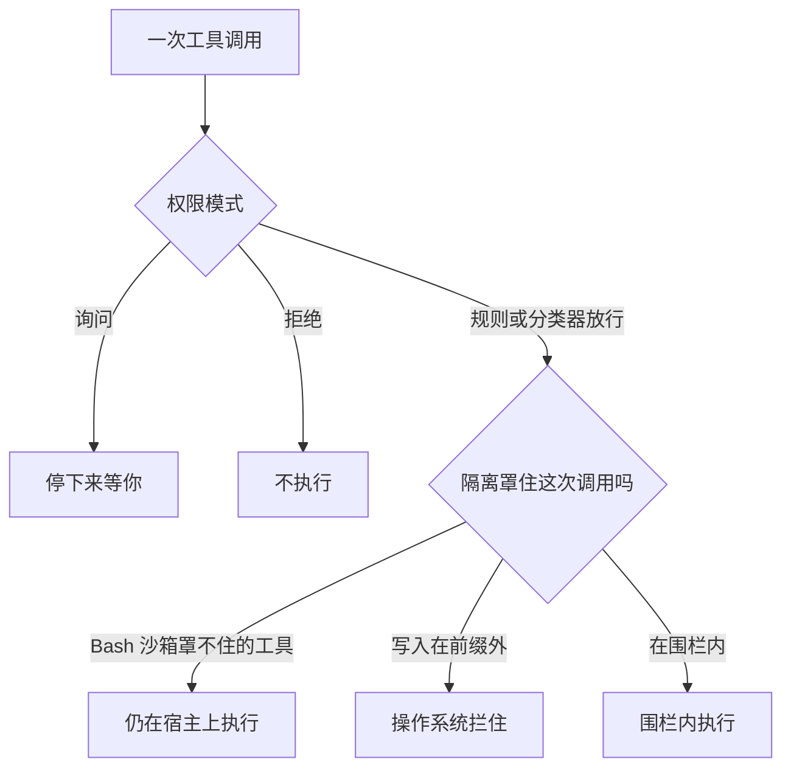

auto 可以不问你，就放行一次 `Write`。目标若是 `~/.ssh/config`，内置 Bash 沙箱仍然罩不住这次调用。`Read`、`Edit`、`Write`、`WebFetch`、`WebSearch` 走权限规则，在 Claude Code 进程里执行。本地 MCP、command hooks、插件监视器是宿主上的独立进程。沙箱页写明：沙箱里的命令默认能读机器上的大部分路径，包括 `~/.ssh` 和 `~/.aws/credentials`。没有内置的凭证拒绝名单。你不写 `denyRead` 或 `credentials`，这次读就开着。

我没有在本机让 Claude Code 写过 `~/.ssh`。`~/.ssh` 不在我读到的受保护路径表里。auto 里，工作区外、又不是只读的动作会交给分类器。这一次它拦还是放，三页没有按这个路径写死。「未核实」。

权限模式决定这次调用跑不跑、跑之前问不问你。隔离限制它一旦跑起来，能读写和出网到哪里。auto 的分类器是逐次动作的控制，不是隔离边界。页上写它减少提示，不保证安全。显式的 ask 规则仍然会提示。

`--dangerously-skip-permissions` 没有提示可拦时，靠你选的隔离保护系统。这类会话必须放进容器、虚拟机或 sandbox runtime，让 file tools、MCP、hooks 也在边界里面。Linux 和 macOS 上，以 root 或 sudo 启动会被拒绝。auto 的无人值守，同一页写成防御纵深，不是和这个旗标同一句「必须」。选环境的表仍把两种无人值守都指到容器、虚拟机或 runtime。只开 Bash 沙箱，auto 和这个旗标的完全无人值守都不够。

我在 2026-11-03 读了 [Choose a sandbox environment](https://code.claude.com/docs/en/sandbox-environments)、[Choose a permission mode](https://code.claude.com/docs/en/permission-modes) 和 [Configure the sandboxed Bash tool](https://code.claude.com/docs/en/sandboxing)。没有跑 Claude Code。模式名、旗标和「必须隔离」只转述这三页。

11 月 1 日把花费分成软倒计时和环外硬闸。11 月 2 日把收工分成评估器和 exit 2。下一刀切在批准和围栏。10 月 18 日的生命周期、10 月 24 日的出站凭证库，这篇不重写。

<!-- more -->

## 先问要不要跑，再问能碰到哪



权限决定是否执行、是否先问。隔离限制执行之后能碰到什么。系统调用的先后，这三页没有写。「未核实」。

权限模式是会话的基线。上面再叠 allow、ask、deny。deny 在每一种模式里都拦，包括 `bypassPermissions`。allow 在 `bypassPermissions` 里不起作用。没有任何模式会自动批准的那一组动作，在 `--dangerously-skip-permissions` 下仍然适用。交互会话里它们仍可能提示。Common setups 写：这条 `-p` 运行里，本来仍会提示的少数调用改为拒绝。

模式表里，Manual 的配置值是 `default`，不询问就能跑的是读取。`acceptEdits` 加上文件编辑和常见文件系统命令。`plan` 是读取，auto 可用时再加上分类器批准的命令。`auto` 的格子是全部，带后台安全检查，适合长任务、少被提示打断。`dontAsk` 放行工作目录内的读取和预先批准的工具，本来要问的改为拒绝。`bypassPermissions` 的格子是全部，适用场景写的是隔离的容器和虚拟机。

受保护路径的写入，除了 `bypassPermissions`，以及把 bypass 放进模式循环的交互式 plan 会话，不会被自动批准。auto 里这些写入交给分类器，不是操作系统拒绝。我读到的目录和文件包括 `.git`、`.claude`、shell 启动文件、`.mcp.json`。`~/.ssh` 不在这张表里。权限系统的受保护路径，管的是工具运行前批不批准。Bash 沙箱自己还有一张表，管的是命令已经跑起来之后。两张表不是同一道门。

## 分类器过关，不是围栏

auto 用另一只模型，在动作执行前审。它拦超出你请求的升级、认不出的基础设施，以及看起来被 Claude 读到的敌意内容推动的动作。显式 ask 仍然强制提示。页上的警告是：减少权限提示，不保证安全。用在你信任大方向的任务上，不要拿它代替敏感操作的复核。

分类器请求默认打到 Claude Sonnet 5。`/status` 里 Auto mode server 为 Enabled 时，这些请求只发给服务器审查范围之外的调用。你的会话此刻走服务器还是客户端分类器，我没有拿账号对过。「未核实」。无论哪一条，审的仍是这一次动作。

v2.1.283 起，交互终端和 VS Code 会话的内置起始模式是 auto。更早版本要 Pro、Max、Ultra 或 Team，且会话会拉 feature flags。v2.1.228（macOS、Linux、WSL）或 v2.1.233（原生 Windows）之前，内置默认是 Manual。`claude -p` 和 Agent SDK 的内置起始模式仍是 Manual。v2.1.302 起，没设权限模式的 `-p` 和 SDK 运行停在 Manual，需要批准的调用会被拒绝，除非 allow 规则、hook、`canUseTool` 或 `--permission-prompt-tool`。要让分类器来审，得显式 `--permission-mode auto`。

Common setups 里，放手用 auto 的那一行，隔离一栏写的是 None，沙箱或容器是防御纵深。组织可以关掉 auto。会话起不来，先看 `disableAutoMode`，以及页上的套餐、模型和供应商。

进入 auto 时，过宽的 allow 会被丢掉，例如 blanket `Bash(*)`。窄规则如 `Bash(npm test)` 还在。离开 auto 再恢复。这是批准规则的收紧，仍然不是文件系统围栏。

分类器连续拦住会退回提示：连拦三次，或一会话累计二十次。两个数都不可配置。没有 `--permission-prompt-tool` 的 `-p` 没有提示可退。到了阈值，那一次动作不跑，Claude 继续干，运行不因此停止。

## 六种环境，两档覆盖

页上的对照：前两种跑在宿主操作系统上，不进容器。其余把整个 Claude Code 放进容器或虚拟机。

| 做法 | 隔离了什么 | 要 Docker 吗 | 准备 |
| --- | --- | --- | --- |
| Sandboxed Bash | Bash、PowerShell、Monitor 及其子进程 | 否 | macOS 上几乎不用准备；Linux 和 WSL2 上低 |
| Sandbox runtime | 整个进程，含 file tools、MCP、hooks | 否 | 低。beta |
| Dev container | 整份开发环境 | 是 | 中 |
| 自定容器 | 整份开发环境 | 是 | 中到高 |
| 虚拟机 | 整个操作系统 | 否 | 高 |
| Cloud sessions | Anthropic 托管的整个操作系统 | 否 | 不用自己装。要 Claude 订阅；除非 `claude --cloud`，还要连上的 GitHub 账号 |

Bash 沙箱内置。file tools、MCP、hooks 仍直接在宿主上。表里其余每一行都把整个进程放进边界，所以这三样也受到限制。原生 Windows 不支持这只 Bash 沙箱，命令不进沙箱。要用，进 WSL2，或改用容器、虚拟机。

沙箱降低突破之后的影响，不消灭风险。允许出网的做法仍可能把代理读得到的数据送出去。项目目录以可写方式挂进去，代码仍能被改。隔离也不改变发给模型的内容。提示和 Claude 读过的文件，有没有沙箱都会送到 API 或你配的供应商。硬边界是爆炸半径的上限。

## 五列并排

| | Manual | auto 分类器 | Bash 沙箱 | sandbox runtime | 容器 / 虚拟机 |
| --- | --- | --- | --- | --- | --- |
| 谁决定 | 你。大多数编辑、shell、出网之前会问。读取可以不问 | 另一只模型逐次审。显式 ask 仍问你。不保证安全 | 操作系统限制已经要跑的 shell。auto-allow 时，沙箱内的命令可以不问 | 同一套 Seatbelt 或 bubblewrap，裹住整个进程。`srt claude`。beta，配置格式可能变 | 容器运行时或另一套内核。云会话是 Anthropic 托管的虚拟机 |
| 覆盖 | 这次调用批不批准 | 决策顺序送去审的那一次动作 | Bash、PowerShell、Monitor 和它们的子进程 | file tools、MCP、hooks，加上 shell | 整个开发环境或整机。云会话另有网络代理的默认允许名单，GitHub 令牌放在沙箱外 |
| 硬边界吗 | 否 | 否。页上的原话是 per-action control, not an isolation boundary | 对它罩住的 shell 是。对会话不是 | 对整个进程是，落在你配的写入和网络之内。Linux 上拒绝名单在启动时生成，之后 `git init`、`git clone` 造出来的副本不在这份名单里 | 专用虚拟机是页上写的最强分离，自有内核。可写挂载和允许的出网仍在边界里面 |
| 无人值守够不够 | 不够。它在等人。`-p` 不设模式时，需要批准的调用会被拒绝 | 页上不把隔离写成和 skip-permissions 同一级的必须。防御纵深仍然建议。只加 Bash 沙箱不够 | 不够。auto 和这个旗标的完全无人值守都不够 | 页上与容器、虚拟机并列，作为这类会话要进入的三种。无 Docker 时，这也是把 MCP 和 hooks 一起隔开的那条 | dev container 示例用默认拒绝的 iptables，页上写它可以支撑这个旗标。Linux 和 macOS 上不要用 root |

## 沙箱内免提示，出了沙箱回到权限流

Bash 沙箱默认关着。`/sandbox` 打开面板，或在设置里把 `sandbox.enabled` 设为 `true`。

两种沙箱模式，文件系统和网络限制相同，差别只在批不批准。auto-allow：命令在沙箱内就自动批准。它因为 `excludedCommands`，或因为失败后改到沙箱外重试，才走原来的权限流。regular permissions：就算在沙箱里，Bash 也走原来的权限流。

auto-allow 和权限模式各自独立，有三处例外：plan 模式、auto 里带了逐命令允许域名的命令、以及 auto 里服务器对沙箱命令的审查。Manual 里，文件编辑工具仍会问。沙箱内、边界之内改文件的 Bash 可以不问。

出了这只沙箱的东西，沙箱页列了这些：

- `Read`、`Edit`、`Write`、`WebFetch`、`WebSearch` 走权限规则。`denyRead` 挡不住 Read 工具。`allowedDomains` 限制不了 WebFetch。
- command hooks、本地 MCP、插件监视器、LSP、状态行命令、`apiKeyHelper` 以你的完整权限跑。
- 你在 `!` 里自己打的命令，多数会话不进沙箱。
- 匹配 `excludedCommands` 的命令不进沙箱，也没有文件系统限制、没有网络代理。

默认写入是工作目录、每用户临时目录，以及你加过的目录。默认读取是机器的大部分，含凭证文件。网络没有直连，先过本机代理，允许域名一开始是空的。别的主机怎么处理，由权限模式决定。

凭证块只作用于沙箱内的 Bash。下面这份是沙箱页上的示例，挡住 AWS 凭证文件和 SSH 目录，并在沙箱命令的环境里拿掉两个令牌：

```json
{
  "sandbox": {
    "enabled": true,
    "credentials": {
      "files": [
        { "path": "~/.aws/credentials", "mode": "deny" },
        { "path": "~/.ssh", "mode": "deny" }
      ],
      "envVars": [
        { "name": "GITHUB_TOKEN", "mode": "deny" },
        { "name": "NPM_TOKEN", "mode": "deny" }
      ]
    }
  }
}
```

没有内置拒绝名单。你没列出的文件，沙箱内的命令仍能读。要让所有子进程都丢掉凭证，页上另指 `CLAUDE_CODE_SUBPROCESS_ENV_SCRUB`。我没有打开它的字段表，具体清掉哪些名字「未核实」。

## 整进程才罩住 Write 和 MCP

sandbox runtime 是 `@anthropic-ai/sandbox-runtime`。它用 Bash 沙箱那套 Seatbelt 或 bubblewrap，裹住整个进程。工具、hooks、MCP 和 shell 一起受到限制。页上标成 beta research preview，配置格式可能变。

默认拒网，写入收在一小撮内置路径上。先写 `~/.srt-settings.json`，或用 `--settings` 传入。至少放行项目目录、`~/.claude`、`~/.claude.json`，以及运行时文件目录。没设 `CLAUDE_CODE_TMPDIR` 时，Linux 和 WSL2 是 `/tmp`，macOS 是 `/private/tmp`。网络至少放行 `api.anthropic.com` 或你的供应商端点。OAuth 还要 `claude.ai` 和 `platform.claude.com`。只用 API key 时，后两个可以不放。

配置文件不存在、又没传 `--settings`，运行时照样启动：拒网，写入落在 `/tmp/claude`、`~/.npm/_logs`、`~/.claude/debug` 这类内置路径。干净地启动，不能当成配置已经载入。文件在，但是空的、读不了或非法，运行时拒绝启动。

`denyWrite` 优先于 `allowWrite`。项目根上，它拒绝 `.git/hooks`，拒绝 `.git/config`（除非 `filesystem.allowGitConfig`），并拒绝 `.mcp.json`、`.claude/commands`、`.claude/agents` 和 shell 启动文件。macOS 上，拒绝在写入当时检查，会话中新建的嵌套仓库也算。Linux 和 WSL2 上，名单在启动时生成一次。项目根可靠。当时已经存在的嵌套副本是尽力浅扫。会话后来 `git init`、`git clone` 或脚手架造出来的，不在名单里。你授予的可写路径里，如果包含 Claude Code 下次会加载的配置，这次沙箱里的写入可以变成下次无沙箱启动时的 hook 或 MCP。页上让你用 `denyWrite` 再挡一层。

Linux 上还要 `bubblewrap`、`socat`，以及 PATH 里的 `ripgrep`。macOS 用系统 Seatbelt，不用另装。全局安装要放在所有可写路径之外，然后在项目目录里 `srt claude`。

`--dangerously-skip-permissions` 与 `claude --permission-mode bypassPermissions` 等价。权限模式页说只在隔离环境里用，举例写到没有互联网访问的 dev container。环境页写，带默认拒绝 iptables 的示例可以支撑这个旗标。两页没有合成必须完全断网。Linux 和 macOS 上，root 或 sudo 会拒绝启动。提示原文是 `--dangerously-skip-permissions cannot be used with root/sudo privileges for security reasons`。这个检查在它认得的沙箱里会自动跳过。容器里要自主跑，用 dev container 配置，那里以非 root 用户跑 Claude Code。

云会话不理会设置文件里的 `defaultMode: "bypassPermissions"` 或 `"dontAsk"`。模式下拉没有 Bypass permissions。仓库里提交的设置不能把云会话开成跳过权限。

组织能靠 Claude Code 自己强制的，只有内置 Bash 沙箱：用 managed settings 下发 `sandbox` 键。dev container 提交进仓库是约定。Claude Code 不要求必须在容器里。人不许在容器外跑，要靠设备管理或软件白名单。自定容器和虚拟机同样。

## 三档怎么配

日常在自己机器上少点几次确认：Manual，加上 Bash 沙箱的 auto-allow。`/sandbox` 里选，或设 `sandbox.enabled`。deny 仍有效。点名命令的 ask，例如 `Bash(git push *)`，仍会问。文件工具不在这只沙箱里。凭证目录要自己写进 `credentials`，否则沙箱内的 shell 默认读得到。原生 Windows 上这条沙箱不成立。

长任务用 auto。分类器去掉例行提示。隔离是防御纵深，页上没有把它写成启动条件。只加 Bash 沙箱，file tools 和 MCP 仍在宿主，完全无人值守不够。分类器放行记成 `permission_allow`，不要记成审计通过。

`-p` 加上 `--dangerously-skip-permissions`：整进程放进容器、虚拟机或 sandbox runtime。Linux 和 macOS 上用非 root。这条 `-p` 里，仍会提示的少数调用改为拒绝。云会话忽略设置文件里的这个模式。跳过提示不是安全检查。页上把提示少、又带后台检查的那条路指回 auto。管理员可以把 `permissions.disableBypassPermissionsMode` 设为 `"disable"`。

runtime 适合不想装 Docker、又要把 MCP 和 hooks 一起罩住。先确认配置真的载入了。Linux 上，会话中新建的 git 目录不在启动时的拒绝名单里。跑完无人值守，复查仍可写的路径。Linux 和 WSL2 上，再复查会话自己创建的东西。

不信任的仓库：专用虚拟机，或有订阅时用云会话。`claude --cloud` 可以打包上传本地仓库，不必先连 GitHub。上传包里有没有密钥文件，环境页没写，我也没有用这个旗标传过仓库。「未核实」。

## 夹具里，放行和围栏可以不一致

演示在 `demos/permission-vs-isolation/`。不读密钥，不访问网络，不打开本机文件。权限决定是夹具里的 ask、allow、deny。围栏是一份工具名单加写入前缀。它不是分类器，也不是 Seatbelt。Bash 那一档的读不做前缀检查，对应沙箱页的默认，所以 `~/.ssh` 的读会落在围栏内。运行时那一档只挡写到前缀外。运行时默认读不读得了宿主密钥，sandbox-environments 那页没写，夹具不编。

```python
def decide(tool: str, op: str, path: str, permission: str, fence: Fence) -> str:
    if permission == "deny":
        return "denied_by_permission"
    if permission == "ask":
        return "prompted"
    if tool not in fence.covers:
        return "host_path"
    if op == "read" and fence.read_policy == "wide":
        return "ran_inside"
    if path_allowed(path, fence.write_allow):
        return "ran_inside"
    return "blocked_by_isolation"
```

| 夹具 | 在看什么 | 结局 |
| --- | --- | --- |
| `allow_outside` | 整进程围栏放行了 Bash 写 `~/.ssh/config`，路径在写入前缀外 | `blocked_by_isolation` |
| `write_on_host` | 分类器 allow，工具是 `Write`，围栏只有 Bash | `host_path` |
| `bypass_write` | 跳过提示也是 allow，工具仍是 `Write`，围栏仍只有 Bash | `host_path` |
| `bash_read_ssh` | Bash 读 `~/.ssh/id_rsa`，读取策略是默认的宽 | `ran_inside` |
| `mcp_host` | MCP 读凭证，围栏只有 Bash | `host_path` |
| `write_fenced` | 整进程围栏，`Write` 的目标在前缀外 | `blocked_by_isolation` |
| `deny_first` | 权限 deny，路径其实在项目里 | `denied_by_permission` |
| `in_repo` | Bash 写项目内文件，前缀罩得住 | `ran_inside` |

`python3 demos/permission-vs-isolation/run_demo.py` 我跑过，最后一行是 `result=pass`。`ask_stops` 只在断言里：还在问，就不会去碰围栏。`hook_host` 也在断言里：分类器 allow 了 Hook，Bash 围栏仍给出 `host_path`。分类器来源的 allow 不会被印成审计通过。

## 过关要有来源

预算和收工各有一层软的、一层硬的。批准也是。分类器可以让长任务少停下来问你。它看的是这一次动作。Bash 沙箱让 shell 在操作系统的限制里跑，file tools 和 MCP 还在宿主。没人看着、或者直接跳过权限时，整进程的容器、虚拟机或 sandbox runtime 才把这三样一起圈进去。圈进去之后，可写目录和允许的出网仍在圈里。放行记下来源。来源是分类器，就不要写成检查已通过。

你们的无人值守跑在哪一层隔离上？auto 放行的那一次 `Write` 或 MCP 调用，run record 里有没有单独的一栏？

## 扩展阅读

- [Choose a sandbox environment](https://code.claude.com/docs/en/sandbox-environments)
- [Choose a permission mode](https://code.claude.com/docs/en/permission-modes)
- [Configure the sandboxed Bash tool](https://code.claude.com/docs/en/sandboxing)
- [别让干活的模型自己判收工](https://cfireworks.github.io/2026/11/02/2026-11-02-goal-vs-stop-hook/)
- [别把预算交给模型自己掐](https://cfireworks.github.io/2026/11/01/2026-11-01-task-budget-vs-hard-gates/)
- [SPACE：隔离之外还要管生命周期](https://cfireworks.github.io/2026/10/18/2026-10-18-space-sandbox-lifecycle/)

## 讨论

如果 auto 已经开在长任务上：分类器放行的动作，记录里写的是逐次批准，还是审计通过？只开了 Bash 沙箱的会话，hooks 和 MCP 是不是仍以你的用户身份跑在宿主上？我没有生产流量。
