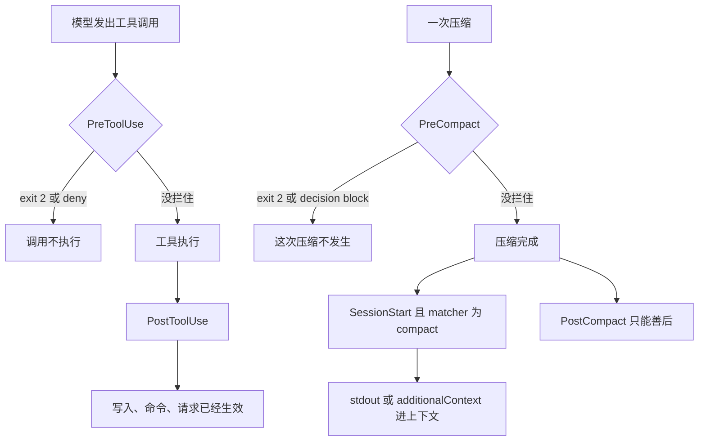

有人把安全检查挂在 `PostToolUse`。格式化和 lint 可以挂这里。想拦 `rm -rf`，或拦住一次危险的 `Write`，挂错边了。工具已经跑完，文件已经改完。

参考页的退出码表把时序写死了。`PreToolUse` 的 exit 2 挡住这次调用。`PostToolUse` 的 exit 2 不挡，stderr 交给 Claude，工具已经跑过。压缩是同一刀：`PreCompact` 能挡住压缩，`PostCompact` 的 exit 2 只把 stderr 给用户看，摘要已经生成。压缩之后要把关键上下文塞回去，指南写的是带 `compact` matcher 的 `SessionStart`。命令打到 stdout 的纯文本会进 Claude 的上下文。`PostCompact` 没有 decision control。exit 0 时，它的纯文本 stdout 进调试日志，不进 Claude 的上下文。

策略脚本默认失败放行。退出码不是 0 也不是 2，stdout 又不是合法 JSON 时，动作照样继续。要脚本挂了就别跑，在 `command` 或 `http` hook 上写 `onFailure: "block"`。参考页写这要 Claude Code v2.1.295 或更新。失败按这一事件上的 exit 2 处理。装在 `PostToolUse` 上，翻译出来的仍是事后的一句话，撤不回已经写入的文件。

我在 2026-11-04 读了 [Hooks reference](https://code.claude.com/docs/en/hooks) 和 [Automate actions with hooks](https://code.claude.com/docs/en/hooks-guide)。没有跑 Claude Code，没有配真实 hook。事件名、退出码和版本号只转述这两页。

11 月 1 日把花费分成软倒计时和环外硬闸。11 月 2 日把收工分成评估器和 `Stop` 的 exit 2。11 月 3 日把批准和隔离分成两道门。下一刀切在同一族事件的前和后。`Stop` 拦的是结束这一轮。八次连拦那篇写过，这里不重写。

<!-- more -->

## 闸门装在调用之前



参考页把主要节奏分成三档。每次会话：`SessionStart`、`SessionEnd`。每一轮：`UserPromptSubmit`、`Stop`、`StopFailure`。循环里的每次工具调用：`PreToolUse`、`PostToolUse`。`EndConversation` 这两只都不触发。压缩不在这三档里，旁边另有 `PreCompact` 和 `PostCompact`。

`PreToolUse` 在 Claude 写完工具参数之后、处理这次调用之前。指南写它发生在任何权限模式检查之前，包括 `dontAsk`。`permissionDecision: "deny"` 在每一种模式里都拦，包括 `bypassPermissions`。11 月 3 日写过批准和围栏。这里只补时序：这道 deny 还来得及让工具不跑。

若机器没有托管设置，会话又不用 Team 或 Enterprise 的 `/login` 凭证，指南写一只 mod 仍可能批准被这只 hook 拦住的调用。计划模式里，这种放行只覆盖只读调用。用 API key 或长期 `CLAUDE_CODE_OAUTH_TOKEN` 的会话不走那次登录。我没有配 mod。

`PostToolUse` 在工具成功之后。输入里同时有 `tool_input` 和 `tool_response`。`duration_ms` 不含权限提示和 `PreToolUse` 花的时间。调用已经开始执行、然后失败的，走 `PostToolUseFailure`，同样是事后。参考页写：校验失败发生在 hook 之前，`PreToolUse` 和 `PostToolUseFailure` 都不触发。权限拒绝会触发 `PreToolUse`，不触发 `PostToolUseFailure`。

提示里用 `@` 点名的文件，默认不经过工具调用，内容在组 prompt 时塞进去。匹配 `Read` 的 `PreToolUse` 不会为这次引用触发。要挡特定路径，参考页写加一条 `Read` 的 deny 规则。要关掉这种插入，设 `CLAUDE_CODE_DISABLE_FILE_MENTIONS=1`，要 v2.1.299 或更新。项目设置和本地设置里的这个变量会被忽略。我没有在会话里用 `@` 试过。

## 五列并排

| | PreToolUse | PostToolUse | PreCompact | PostCompact | SessionStart，matcher 为 compact |
| --- | --- | --- | --- | --- | --- |
| 何时 | 调用执行前 | 调用成功后 | 压缩开始前 | 压缩完成之后 | `source` 为 `compact`，自动或手动压缩之后 |
| exit 2 | 挡住调用。stderr 是拒绝理由，走法和 deny 相同 | 不挡。stderr 给 Claude。工具已经跑完 | 挡住这次压缩。手动 `/compact` 时 stderr 给用户 | 不挡。stderr 只给用户。摘要已经生成 | 不挡。stderr 只给用户，Claude 看不到，会话继续 |
| 还能怎么表示 | exit 0，再在 `hookSpecificOutput` 里给 `permissionDecision`：allow、deny、ask、defer | 顶层 `decision: "block"` 把 reason 放在结果旁边。`updatedToolOutput` 替换模型看到的输出 | exit 2，或 JSON `decision: "block"` | 没有 decision control | 没有拦截。纯文本 stdout，或 `additionalContext` |
| 适合 | 拦危险命令和写入。`updatedInput` 在执行前换掉整份参数 | 格式化、审计、补上下文 | 这次先别压 | 记下摘要，改外部状态 | 把压掉的约束送回上下文 |
| 不适合 | 当成对 `@` 引用和校验失败的全覆盖。把超时当成闸 | 撤销 rm 或 Write。把 `updatedToolOutput` 当成回滚 | 拿来重注上下文 | 把关键约束送回模型 | 用 exit 2 当重注入。那条 stderr 模型看不到 |

`updatedToolOutput` 只改 Claude 看到的结果。参考页写明：文件已经写了，命令已经执行，网络请求已经发出。OpenTelemetry 一类遥测记下的仍是原始输出。形状对不上内置工具的输出时，替换被忽略，原始输出照旧。MCP 输出不做这层校验。

`PostToolUse` 的 `decision: "block"` 同样不撤销。它把 `reason` 放在工具结果旁边。Claude 仍看得到原始输出，除非同一份响应里再给 `updatedToolOutput`。

多只 `PreToolUse` 意见不一致时，优先级是 deny，然后 defer，然后 ask，然后 allow。exit 2 再配一份 `permissionDecision: "allow"` 的合法 JSON，也盖不过这次拦截。defer 要非交互的 `-p`，这篇不展开。allow 跳过权限提示，deny 规则和 ask 规则照样评估。网络路径上的读取，和标了 `requiresUserInteraction` 的 MCP 工具，提示仍在。exit 0 且什么都不打印，调用继续走原来的权限流。沉默不等于批准。

`PreCompact` 挡住自动压缩时，效果分两种。压缩是在触顶之前提前做的，Claude Code 跳过它，对话保持未压缩。压缩是为了从 API 已经返回的上下文上限错误里恢复，底层错误会冒出来，当前请求失败。手动 `/compact` 被挡住时，stderr 给用户。`systemMessage` 和 `continue` 会被丢掉。`PostCompact` 这两个字段同样被丢掉。

`PostCompact` 和带 `compact` 的 `SessionStart` 谁先谁后，这两页没有写。「未核实」。`additionalContext` 在压缩后的摘要里插在哪一行，参考页按事件列了投放位置，没有按 compact 再画一张。「未核实」。指南写明的是：压缩会丢掉细节，用 `SessionStart` 加 `compact` matcher，在每次压缩之后把关键上下文送回去。

## 失败默认放行

退出码分成三档。

- 0：成功。打印的 JSON 字段会生效。字段本身可以 deny。没有字段，动作继续。
- 2：在挡得住的事件上停下动作。`PreToolUse` 挡调用，`PreCompact` 挡压缩。
- 其他，或脚本根本没启动、JSON 不合法：多数时候动作继续。stdout 是通过校验的 JSON 时，参考页写退出码被忽略，字段单独做决定。这只 hook 的失败本身会拦时，这次改算失败。

所以「不是 0 也不是 2 就一定放行」不完整。合法 JSON 仍可能 deny。要表达决定，exit 0 再打印 JSON。要用退出码当闸，exit 2。exit 1 没有合法 JSON 时是非阻塞错误。参考页写，1 虽是 Unix 上习惯的失败码，在这里并不拦截。

超时走同一条。`command`、`http`、`mcp_tool` 在 `PreToolUse` 上超时，调用不因此被挡，除非失败本身会拦。调用继续走权限流。卡住的脚本不是闸。Agent SDK 的 callback hook 超时则会挡住调用。我没有跑 SDK。

```json
{
  "hooks": {
    "PreToolUse": [
      {
        "matcher": "Bash",
        "hooks": [
          {
            "type": "command",
            "command": "node",
            "args": ["${CLAUDE_PROJECT_DIR}/.claude/hooks/check-command.js"],
            "onFailure": "block"
          }
        ]
      }
    ]
  }
}
```

这是参考页上的例子。脚本缺失时，调用被挡住，错误里有 `failed; blocking because onFailure is "block"`。同一只脚本缺失、又不写 `onFailure`，是非阻塞错误，页上的 `ls` 会跑。超时之后的文案把 `failed` 换成 `timed out`。

`onFailure: "block"` 只写在 `command` 或 `http` 上，要 v2.1.295 或更新。它让失败去做这一事件的 exit 2 会做的事。`PermissionRequest` 是页上写明的例外：失败改成拒绝这次权限请求。`Stop`、`SubagentStop`、`TaskCompleted`、`TeammateIdle` 上这个字段不起作用。设了 `async` 或 `asyncRewake` 的后台 command hook 也不起作用。

没有 Git Bash 的 Windows 上，参考页另写了一条例外：shell 形式的 `PreToolUse`，`onFailure` 没设，失败时反而可能挡住调用。我没有在那套环境里复现。

路径写错是同一类失败。提示里出现 `No such file or directory`，说明 hook 没跑起来。策略 hook 第一次就该看这行。不写 `onFailure: "block"`，闸是开着的。

## 事后适合善后，压缩后另挂一只

指南里格式化的例子挂在 `PostToolUse`，matcher 是 `Edit|Write`，成功之后把路径交给 Prettier。成功时对话里什么都不显示。这是善后。文件先被工具写过，再被格式化写第二次。想拦写入，这只 hook 来不及。Bash 改出来的同一文件，匹配 `Edit|Write` 的 `PostToolUse` 不会跑。指南让改用 `FileChanged`。那也是文件已经变了之后，不能当闸。

拦 `.env` 的例子也在 `PreToolUse`，matcher 是 `Edit|Write`。脚本看 `file_path`，碰到 `.env`、`package-lock.json` 或 `.git/`，把理由写到 stderr，exit 2。调用没有执行，Claude 收到这段理由。Bash 里的 `rm` 不经过这只 matcher。参考页拦 `rm -rf` 的例子 matcher 是 `Bash`，返回 `permissionDecision: "deny"`。exit 2 和 deny 都在执行前，走同一条拒绝。要在执行前改参数，走 exit 0 的 JSON，字段是 `updatedInput`。它换掉整份参数，没改的字段也要带上。权限规则按 hook 返回的输入再评，不按模型原来写的那份。

压缩后的重注入，指南是这段：

```json
{
  "hooks": {
    "SessionStart": [
      {
        "matcher": "compact",
        "hooks": [
          {
            "type": "command",
            "command": "echo 'Reminder: use Bun, not npm. Run bun test before committing. Current sprint: auth refactor.'"
          }
        ]
      }
    ]
  }
}
```

`echo` 可以换成会打出动态文本的命令。指南举了 `git log --oneline -5`。仓库里若有一份还在生效的约束，同一只 matcher 把它打到 stdout。`WORKING.md` 这个文件名是做法，不是页上的字段。参考页还允许在 `hookSpecificOutput.additionalContext` 里给同一段文字。静态的、从不变的约定，两页都让你放 `CLAUDE.md`，不必为它跑脚本。

`PostCompact` 拿得到 `compact_summary`，适合记日志。它改不了压缩结果。exit 2 的 stderr 只给用户。exit 0 时，多数事件的纯文本 stdout 进调试日志。会把纯文本 stdout 加进 Claude 上下文的，参考页点名 `UserPromptSubmit`、`UserPromptExpansion`、`SessionStart`、`PostModelSwitch`。`PostCompact` 不在里面。

exit 2 的 `SessionStart` 也不会把 stderr 送给 Claude。重注入走成功那条：exit 0，纯文本或 `additionalContext`。exit 2 时这份 JSON 里的 `additionalContext` 还进不进上下文，两页没有写成一句。「未核实」。夹具不编这条。

## 夹具里，事后的 exit 2 留不下撤销

演示在 `demos/pre-vs-post-hooks/`。不读密钥，不访问网络，不启动 Claude Code。事件名是夹具：`pre_tool`、`post_tool`、`pre_compact`、`post_compact`、`session_compact`。信号是 `exit0`、`exit2`、`miss`、`miss_block`、`deny`、`context`。`miss` 表示脚本没启动，相当于路径写错。`miss_block` 是同一种失败，加上 `onFailure: "block"`，按该事件的 exit 2 结算。这不是那只真 hook，也没有权限弹窗。

```python
BLOCKABLE = frozenset({"pre_tool", "pre_compact"})


def settle(event: str, signal: str) -> str:
    """exit 2 只在动作还没发生时变成 blocked。"""
    if signal == "miss_block":
        signal = "exit2"
    if signal == "context":
        return "reinjected"
    if signal == "deny":
        return "blocked"
    if event == "session_compact":
        return "continues"
    if signal == "exit2" and event in BLOCKABLE:
        return "blocked"
    if signal == "miss" and event == "pre_tool":
        return "allowed"
    if event == "post_tool":
        return "already_ran"
    if event == "post_compact":
        return "already_compacted"
    if event == "pre_compact":
        return "compacts"
    return "proceeds"
```

文件里对未知事件会直接退出。`context` 只接受 `session_compact`，`deny` 只接受 `pre_tool`。上面这段把这两条守卫省掉了，五条主路径还在。`proceeds` 的意思是 hook 没有拦。权限模式接下来问不问，夹具不模拟，那是 11 月 3 日的题目。

| 夹具 | 在看什么 | 结局 |
| --- | --- | --- |
| `pre_exit2` | 工具还没跑，exit 2 | `blocked` |
| `post_exit2` | 工具已经跑完，exit 2 | `already_ran`。stderr 记给模型，文件还在 |
| `policy_miss` | 策略脚本没启动，失败默认放行 | `allowed` |
| `policy_block` | 同一只脚本没启动，`onFailure` 为 block | `blocked` |
| `compact_block` | 压缩还没开始，exit 2 | `blocked` |
| `compact_done` | 压缩已经完成，exit 2 | `already_compacted`。stderr 记给用户 |
| `reinject` | `SessionStart` 的 compact，打出上下文 | `reinjected` |
| `pre_deny` | exit 0，`permissionDecision` 为 deny | `blocked` |

`python3 demos/pre-vs-post-hooks/run_demo.py` 我跑过，最后一行是 `result=pass`。

断言里还有几条不另打一行。`pre_exit0` 是 `proceeds`，沉默没有变成拒绝。`exit2_allow` 仍是 `blocked`：夹具不解析 JSON，exit 2 按参考页盖过 allow。`post_miss_block` 是事后脚本挂了且 `onFailure` 为 block，结局仍是 `already_ran`。`compact_miss` 是压缩前脚本没启动，压缩继续，结局 `compacts`。`session_exit2` 是 `continues`，不会被记成 `reinjected`。`format_ok` 是事后 exit 0，结局 `already_ran`，备注写成适合格式化。

## 硬闸只认还没发生的那一侧

预算、收工、批准，各有一层软的、一层硬的。工具调用和压缩也是。硬闸认的是动作之前：`PreToolUse` 的 exit 2 或 deny，`PreCompact` 的 exit 2 或 `decision: "block"`。`PostToolUse` 适合格式化和审计。它看到的是已经生效的结果。`onFailure: "block"` 把脚本挂掉翻译成这一事件的 exit 2。事件本身挡不住，这行也挡不住。长会话压过一轮之后，还在生效的约束从 `SessionStart` 的 `compact` 回来，不从 `PostCompact` 的 stderr 回来。

你们拦危险 Bash 的 hook 挂在 Pre 还是 Post？压缩之后，关键约束是从哪条 hook 回到上下文里的？

## 扩展阅读

- [Hooks reference](https://code.claude.com/docs/en/hooks)
- [Automate actions with hooks](https://code.claude.com/docs/en/hooks-guide)
- [别把权限模式当成隔离](https://cfireworks.github.io/2026/11/03/2026-11-03-permission-mode-vs-isolation/)
- [别让干活的模型自己判收工](https://cfireworks.github.io/2026/11/02/2026-11-02-goal-vs-stop-hook/)
- [别把预算交给模型自己掐](https://cfireworks.github.io/2026/11/01/2026-11-01-task-budget-vs-hard-gates/)

## 讨论

如果仓库里已经有拦 `rm` 的 hook：它注册在 `PreToolUse`，还是 `PostToolUse`？脚本路径写错时，危险命令会不会照跑？压缩之后还在生效的约束，是 `SessionStart` 打出来的，还是写在一份压缩摘要里、指望模型自己记得？我没有生产流量。
