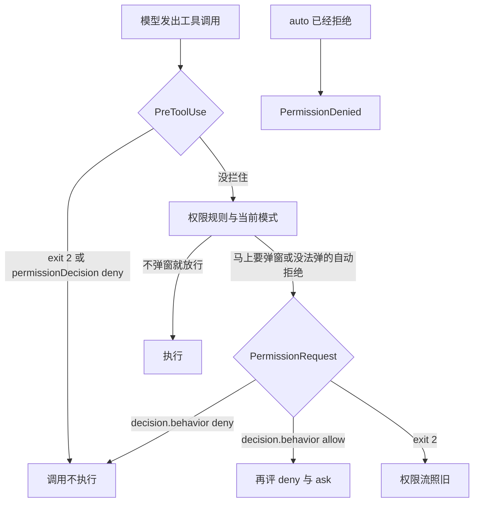

有人把自动批准，或一整套策略，只挂在 `PermissionRequest`。`bypassPermissions` 开着，或者 allow 规则已经盖住这次调用，多数时候根本不弹窗。这只钩子一次都不会跑。危险的 Bash 就这样过去了。

`PreToolUse` 每刀工具都会到。exit 2 挡住这次调用。exit 0 再交 JSON 时，字段是 `permissionDecision`，取值 allow、deny、ask、defer。`PermissionRequest` 只在马上要问你，或者这次调用没法弹窗、本来就会被自动拒绝时才到。参考页的退出码表写明：这只事件的 exit 2 不生效，权限流照旧。允许或拒绝都走嵌套的 `decision.behavior`，取值 allow 或 deny。想拦每一次调用，挂错事件等于没闸。

我在 2026-11-05 读了 [Hooks reference](https://code.claude.com/docs/en/hooks)、[Automate actions with hooks](https://code.claude.com/docs/en/hooks-guide) 和 [Configure permissions](https://code.claude.com/docs/en/permissions)。没有跑 Claude Code，没有配真实 hook。触发条件、退出码和字段名只转述这三页。

11 月 3 日把批准和隔离分成两道门。11 月 4 日把闸门装在动作之前：Pre 能拦，Post 已经发生。下一刀切在同一套批准里。弹窗闸和每刀闸不是同一只事件。两只事件的 JSON 也不是同一套字段。沙箱和 `PostToolUse` 的失败放行，那两篇写过，这里不重写。

<!-- more -->

## 每刀先到，弹窗后到



`PreToolUse` 在任何权限模式检查之前，包括 `dontAsk`。`EndConversation` 两只都不触发。权限页写：exit 2 在权限规则评估之前停掉调用，allow 名单盖不住这次拦截。JSON 里的 allow 绕不过 deny 规则，也绕不过 ask 规则。规则仍按 deny、然后 ask、然后 allow 来评。模式检查和这套规则再往下怎么穿插，两页没有画成一张总图。「未核实」。

不弹窗就放行的调用，到不了 `PermissionRequest`。`bypassPermissions` 和匹配上的 allow 规则会走出这条。哪些动作在这个旗标下仍会提示，11 月 3 日写过，这里不重写。那些仍要问的，弹窗钩子仍可能到。我没有在 bypass 会话里数过弹窗。

触发条件还有后半句。会话没法显示提示时，例如非交互里的后台子代理，`PermissionRequest` 仍会跑。没有钩子给出决定，这次调用被拒绝。指南写，`-p` 里、模式不是 `dontAsk` 时也一样：钩子仍跑；没人决定，也没有别的东西能回答，调用被拒绝。`dontAsk` 里面这只钩子跑不跑，这句没有展开。「未核实」。

调用已经交到 `--permission-prompt-tool` 或 Agent SDK 的 `canUseTool` 时，钩子和宿主一起跑，谁先做出决定用谁的。我没有跑 SDK。

沙箱里一条命令的网络请求不走 `PermissionRequest`。要那个提示的信号，参考页让用通知类型 `permission_prompt`。通知类型这篇不展开。

`PermissionDenied` 是旁路。它只在 auto 模式已经拒绝之后。你亲手拒掉弹窗、`PreToolUse` 拦住、deny 规则命中，都不触发它。`retry: true` 告诉模型可以再试，拒绝本身不撤销。分类器没有裁决时，这个字段被忽略。

## 两列并排

| 维度 | PreToolUse | PermissionRequest |
| --- | --- | --- |
| 何时触发 | 每次工具调用，要不要权限都到。在权限模式检查之前。`EndConversation` 不到 | 马上要问你，或没法弹窗、本来就会自动拒绝。不弹窗的放行不到。沙箱命令的网络请求不到 |
| exit 2 | 挡住调用。stderr 是拒绝理由，走法和 deny 相同 | 不生效。没有 `decision` 对象时，权限流不变，stderr 丢掉 |
| JSON | `hookSpecificOutput.permissionDecision`：allow、deny、ask、defer。`updatedInput` 跟它平级 | `hookSpecificOutput.decision.behavior`：allow、deny。`updatedInput` 在 `decision` 里面，只对 allow 生效 |
| 适合 | 拦每一次危险 Bash 或写入。规则看不清整段命令时，在执行前看 | 代答总会点允许或拒绝的那一次弹窗。指南的例子是 `ExitPlanMode` |
| 不适合 | 当成「只有弹窗才需要的审批」。用 allow 绕过 deny 或 ask | 当每刀闸。用 exit 2 当拒绝。把 `permissionDecision` 填进来 |

两只都能按工具名匹配。参考页的例子是 `Bash`、`Edit|Write`、`mcp__.*`。

exit 2 再带一份合法的 `decision`，参考页没有合成一句。总述里写过，混用时 exit 2 保留拦截效果；这只事件的专项表又写 exit 2 不生效。夹具的 exit 2 不打印 JSON。「未核实」。

Jared Hebb 的 [PermissionRequest 指南](https://jaredhebb.com/guides/permissionrequest) 把 exit 2 写成拒绝，stderr 交给 Claude。我在 2026-11-05 打开过那一页。官方 per-event 表写的是不生效。以官方那张表为准。

多只 `PreToolUse` 意见不一致时的优先级，11 月 4 日写过，这里不重写。`onFailure: "block"` 在 `PermissionRequest` 上把失败改成拒绝这次权限请求，也是那篇转述过的例外。那是失败合同。exit 2 本身这张表不认。没装 Git Bash 的 Windows 上，shell 形式的 `PermissionRequest` 在 `onFailure` 没设时，失败可能挡住调用。参考页把 `PreToolUse` 和这只事件写在同一条例外里。我没有在那套环境里复现。

## 拦危险命令挂每刀，代答弹窗才挂这一只

要拦 `rm -rf` 这类危险 Bash，挂 `PreToolUse`，matcher 写 `Bash`。exit 2，或 exit 0 再给 `permissionDecision: "deny"`。权限页的配法是：想让其余 Bash 不再询问，把 `Bash` 放进 allow，再用这只钩子拒那几条。exit 2 发生在规则评估之前，allow 名单盖不住它。

```json
{
  "hookSpecificOutput": {
    "hookEventName": "PreToolUse",
    "permissionDecision": "deny",
    "permissionDecisionReason": "Destructive command blocked by hook"
  }
}
```

`updatedInput` 跟 `permissionDecision` 平级，换掉的是整份参数。没改的字段也要带上。权限规则按钩子返回的这份输入再评。

要代答「总会点允许」的弹窗，挂 `PermissionRequest`。指南自动批准 `ExitPlanMode` 的例子是 echo 一段 JSON，`behavior` 为 allow。echo 成功时退出码是 0。matcher 收在这一个工具上。空 matcher 或 `.*` 会代答每一次权限弹窗，包括写入和 shell。

```json
{
  "hooks": {
    "PermissionRequest": [
      {
        "matcher": "ExitPlanMode",
        "hooks": [
          {
            "type": "command",
            "command": "echo '{\"hookSpecificOutput\": {\"hookEventName\": \"PermissionRequest\", \"decision\": {\"behavior\": \"allow\"}}}'"
          }
        ]
      }
    ]
  }
}
```

批准之后，Claude Code 退出计划模式，恢复进入计划模式之前的权限模式。记录里会写 "Allowed by PermissionRequest hook"。钩子走的是当前这场对话，上下文留在原地。指南写，它清不掉上下文，也开不了一次新的实现会话。

要改参数再放行，`updatedInput` 放在 `decision` 里面，而且只对 allow 生效：

```json
{
  "hookSpecificOutput": {
    "hookEventName": "PermissionRequest",
    "decision": {
      "behavior": "allow",
      "updatedInput": {
        "command": "npm run lint"
      }
    }
  }
}
```

deny 用同一个对象，`behavior` 写成 deny。`message` 告诉 Claude 为什么。`interrupt` 为 true 时停掉 Claude。这两个字段只属于 deny。allow 绕不过已经匹配的 deny 规则。改过的输入会再对 deny 和 ask 评一次。

固定名单放 settings 里的 allow、deny、ask。hook 留给规则看不清的条件，例如要读整段命令文本才能判断的那一次。权限页写，Bash 规则匹配的是拆开之后的命令文本，同一程序换一种写法就对不上。要在执行前看完整命令，用 `PreToolUse`。

决策控制表给 `PermissionRequest` 的字段是 `decision.behavior`。`PreToolUse` 的字段是 `permissionDecision`。两套不要混填。参考页写过，字段放错层级时 JSON 仍能解析，错位的字段被忽略，不报错。`permissionDecision` 出现在 `PermissionRequest` 的输出里，会不会同样被忽略、会不会打 unrecognized keys，我读到的段落没有按这个事件写。「未核实」。夹具按决策表处理：填错的形状记成 `not_blocked`。

prompt 钩子在这只事件上，`ok: false` 没有效果。要拒绝，用 command 钩子交 `decision.behavior: "deny"`。agent 钩子这只事件不支持。配了会被跳过，权限流照旧。

## 夹具里，弹窗事件的 exit 2 留不住拦截

演示在 `demos/permissionrequest-vs-pretooluse/`。不读密钥，不访问网络，不启动 Claude Code。事件名是夹具：`pre_tool`、`permission_request`。处理器是 `exit2`、`decision_deny`、`permission_decision_deny`、`none`。`dialog` 表示马上要弹窗，或走到「没法弹窗就要自动拒绝」那条。这不是 settings 里的 hook，也没有权限弹窗。

```python
def apply_handler(event: str, handler: str) -> str:
    """exit 2 只在 PreToolUse 上变成 blocked。弹窗事件只认 decision deny。"""
    if event == "pre_tool" and handler in {"exit2", "permission_decision_deny"}:
        return "blocked"
    if event == "permission_request" and handler == "decision_deny":
        return "blocked"
    return "not_blocked"


def settle(dialog: bool, pre: str, request: str) -> tuple[str, str]:
    """返回结局，以及 PermissionRequest 有没有触发。"""
    if apply_handler("pre_tool", pre) == "blocked":
        return "blocked", "never_fired"
    if not dialog:
        return "not_blocked", "never_fired"
    return apply_handler("permission_request", request), "fired"
```

文件里对未知事件和未知处理器会直接退出。上面这段把守卫省掉了。`not_blocked` 的意思是这只钩子没有拦住。权限流接下来问不问、用户点不点拒绝，夹具不模拟。

| 夹具 | 在看什么 | 结局 |
| --- | --- | --- |
| `pr_exit2` | 要弹窗，`PermissionRequest` 交 exit 2 | `not_blocked`。钩子触发了，权限流照旧 |
| `pr_deny` | 要弹窗，`decision.behavior` 为 deny | `blocked` |
| `pre_exit2` | `PreToolUse` exit 2。弹窗钩子上即使配了 deny | `blocked`。`PermissionRequest` 记成 `never_fired` |
| `no_dialog` | 不弹窗。弹窗钩子上配了 `decision_deny` | `never_fired`。结局 `not_blocked` |
| `pre_deny` | `PreToolUse` 的 `permissionDecision` 为 deny | `blocked`。弹窗钩子不触发 |

`python3 demos/permissionrequest-vs-pretooluse/run_demo.py` 我跑过，最后一行是 `result=pass`。

断言里还有几条不另打一行。`wrong_shape` 把 `permissionDecision` deny 填进 `permission_request`，钩子触发了，结局仍是 `not_blocked`。`wrong_shape_pre` 把 `decision.behavior` deny 填进 `pre_tool`，每刀闸不认这个形状。`no_dialog_pre` 是不弹窗加上 `PreToolUse` 的 exit 2，调用仍是 `blocked`，弹窗钩子仍是 `never_fired`。`pr_silent` 是弹窗事件什么都不交，结局 `not_blocked`。沉默没有变成拒绝。

## 挂错事件，闸是空的

预算、收工、批准、动作前后，各有一层软的、一层硬的。批准里面再切一刀。每刀闸认 `PreToolUse`：exit 2，或 `permissionDecision` 的 deny。弹窗闸认 `PermissionRequest` 的 `decision.behavior`。exit 2 只在前一只上是拒绝。不弹窗的放行，后一只不来。auto 已经拒绝的那一次，走 `PermissionDenied`，拒绝已经发生，`retry` 撤不回它。

你们的自动批准挂在哪条事件？有没有在 `PermissionRequest` 里写过 exit 2，然后发现调用还在走？

## 扩展阅读

- [Hooks reference](https://code.claude.com/docs/en/hooks)
- [Automate actions with hooks](https://code.claude.com/docs/en/hooks-guide)
- [Configure permissions](https://code.claude.com/docs/en/permissions)
- [别在事后装闸门](https://cfireworks.github.io/2026/11/04/2026-11-04-pre-vs-post-hooks/)
- [别把权限模式当成隔离](https://cfireworks.github.io/2026/11/03/2026-11-03-permission-mode-vs-isolation/)

## 讨论

如果仓库里已经有自动批准：它注册在 `PermissionRequest`，还是 `PreToolUse`？`bypassPermissions` 或一条很宽的 allow 打开之后，这只钩子还会不会跑？拒绝危险 Bash 时，脚本是 exit 2，还是打印了 `decision.behavior`？我没有生产流量。
