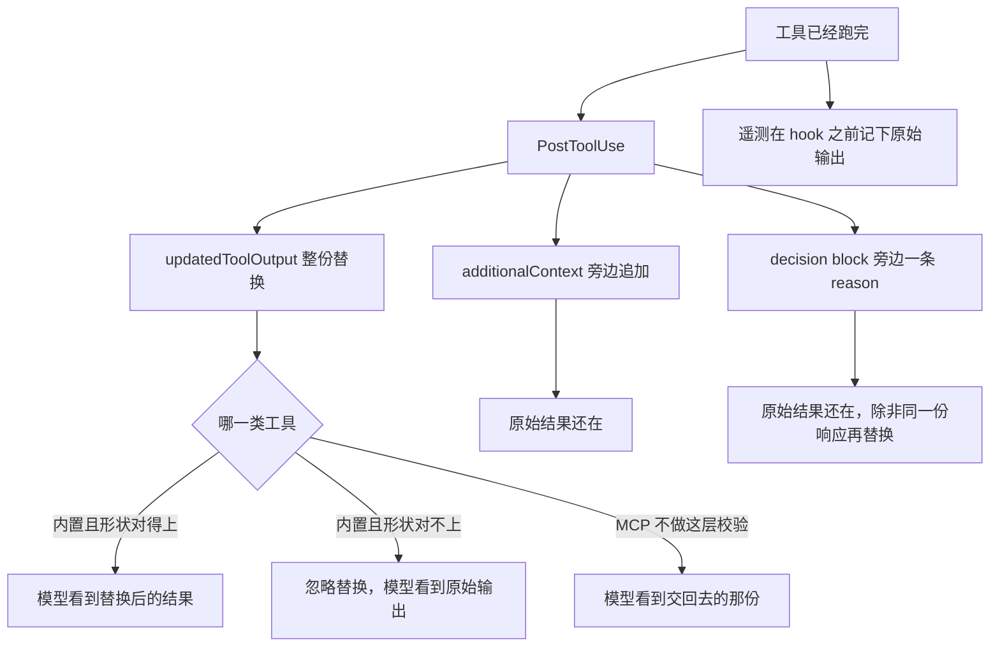

有人让模型先看 `.env`，再答应「密钥不要写进回复」。Read 或 Bash 已经成功。`AKIA_EXAMPLE_NOT_REAL` 这种字符串已经躺在 `tool_response` 里。下一步组上下文时，它就是模型看见的结果。让它读到之后再忘掉，等于没闸。

`PreToolUse` 拦的是别跑。敏感输出要在进上下文之前换掉，字段是 `PostToolUse` 的 `hookSpecificOutput.updatedToolOutput`。它整份替换模型看见的结果。它不是回滚：文件已经写了，命令已经执行，网络请求已经发出。参考页写，OpenTelemetry 工具 span 和 analytics 事件在 hook 跑之前就记下原始输出。`additionalContext` 只在结果旁边追加。顶层 `decision: "block"` 把 `reason` 放在结果旁边，原始输出还在，除非同一份响应再给 `updatedToolOutput`。

我在 2026-11-06 读了 [Hooks reference](https://code.claude.com/docs/en/hooks) 和 [Automate actions with hooks](https://code.claude.com/docs/en/hooks-guide)。没有跑 Claude Code，没有配真实 hook。字段名和时序只转述这两页。对照过一篇社区改写笔记，和参考页冲突的地方写在表后面。

11 月 3 日把批准和隔离分成两道门。挡一条读取路径，是 `PreToolUse` 或权限规则。11 月 4 日把闸门装在动作之前，`updatedToolOutput` 在那篇只作为不能当回滚。11 月 5 日把弹窗闸和每刀闸拆开。下一刀切在事后的几条输出里：有一个正当用途是改写模型看见的进站结果。`PermissionRequest`、沙箱和 `denyRead` 那两篇写过，这里不重写。

<!-- more -->

## 工具跑完，模型还没看见



图上三条从 `PostToolUse` 分出去，不是三选一。参考页的例子把 `updatedToolOutput` 和 `additionalContext` 放在同一份 `hookSpecificOutput` 里。`decision: "block"` 要换掉原始输出，同一句让你再给 `updatedToolOutput`。分开画，是为了看模型最后看见哪一份。

`PostToolUse` 在工具成功之后立刻跑。输入里同时有 `tool_input` 和 `tool_response`。`duration_ms` 不含权限提示和 `PreToolUse` 花的时间。参考页把脱敏和变换的拦截点写成两句：出站的工具参数走 `PreToolUse`，进站的工具结果走 `PostToolUse`。出站那侧换参数的字段是 `updatedInput`。进站这一侧换结果的字段是 `updatedToolOutput`，值必须对上该工具的输出形状，并且发生在结果送给 Claude 之前。

官方例子改的是一次 `Bash`。替换值是对象，不是一段字符串。四个字段是 `stdout`、`stderr`、`interrupted`、`isImage`。`stdout` 写成 `[redacted]`。

内置工具对不上输出模式时，这次替换被忽略，原始输出照旧送给模型。页上的对照是：内置工具返回的是结构化对象，不是纯字符串。MCP 的输出不做这层校验。按这句，MCP 的替换不会因为形状被退回。把 Claude 下一步需要的错误细节剥掉，它可能在错误的前提上继续。这句在同一段警告里。

失败的调用不走这只事件，走 `PostToolUseFailure`。那一节的事件字段表只列了 `additionalContext`。失败结果能不能用 `updatedToolOutput` 换掉，两节没有合成一句。「未核实」。夹具不编失败路径。

exit 2 在 `PostToolUse` 上不拦截。stderr 交给 Claude，工具已经跑过。这句 11 月 4 日按退出码表写过，这里不重做。exit 2 再打印一份 `updatedToolOutput` 时字段还生不生效，总述写的是字段盖不过拦截，而这只事件的 exit 2 本来就不是拦截。两句没有合成。「未核实」。夹具不编退出码。

## 四列并排

| 维度 | PreToolUse | PostToolUse，`updatedToolOutput` | PostToolUse，`additionalContext` | PostToolUse，`decision: "block"` |
| --- | --- | --- | --- | --- |
| 何时 | 调用执行前。出站参数可以在这里换 | 工具成功之后，结果送给模型之前 | 工具成功之后。提醒插在结果旁边 | 工具成功之后。`reason` 放在结果旁边 |
| 模型看见的工具结果 | 拦住时工具不跑，没有这份结果 | 形状通过时是替换后的整份。内置工具形状不对，仍是原始 | 原始结果。提醒是另外一段 | 原始结果。同一份响应再给 `updatedToolOutput`，才换成替换后的 |
| 已经发生的写入、命令、请求 | 还没发生。exit 2 或 deny 挡得住 | 已经生效。替换撤不回 | 已经生效 | 已经生效。block 不撤销 |
| 遥测里的原始输出 | 拦住时还没有工具结果。遥测那句警告写在替换一侧 | hook 跑之前已经记下原始输出 | 记下的是原始输出 | 记下的是原始输出 |
| 适合 | 危险读取和写入别跑 | 工具必须跑，输出里可能有密钥 | 告诉模型这个文件是生成的、下一步该跑哪条命令 | 告诉模型不要顺着这次结果往下做 |
| 不适合 | 改已经打出来的 stdout | 当成回滚。当成遥测里也没了。内置工具交一段字符串 | 指望追加一句「别复述」，就把密钥移出上下文 | 当成删掉原始输出 |

`updatedMCPToolOutput` 只替换 MCP 工具的输出。参考页让优先用 `updatedToolOutput`，它对所有工具都生效。夹具不单列这个字段。

`classifierContext` 是给 auto 模式分类器的短注，不是模型看见的那份结果。参考页写要 Claude Code v2.1.236 或更新，并警告不要把不可信的工具输出抄进去。这篇不展开分类器怎么加权。

多只 `PreToolUse` 同时交 `updatedInput` 时，指南写明不合并，也不保证工具用哪一份。`updatedToolOutput` 这边，参考页只在 `classifierContext` 里写到一种交互：笔记若是在描述你正在替换的那份输出，两个字段要放在同一次响应里。这次改写被拒绝，或另一只 hook 的改写换掉了它，这条笔记会被丢掉。谁的替换留下，没有写成顺序。「未核实」。

`additionalContext` 会包进系统提醒，存进会话 transcript。`PostToolUse` 这种中途事件，用 `--continue` 或 `--resume` 时重放存下来的文字，不再跑 hook，所以时间戳、提交号会过期。这说的是注入的那段。替换后的工具结果在恢复时还是不是模型看见的那份，同一节没有写。「未核实」。

本地 transcript 文件留下的是原始 `tool_response` 还是替换后的那份，我读到的 PostToolUse 小节没有写。「未核实」。

社区笔记 [PostToolUse Output Replacement](https://agentpatterns.ai/tool-engineering/posttooluse-output-replacement/) 我在 2026-11-06 打开过。那页把输入字段写成 `tool_output` 字符串，把 `updatedToolOutput` 也写成一段字符串，并写本地 transcript 只留替换、原始输出哪儿都不留。参考页的输入字段是 `tool_response`。Bash 的替换例子是对象。形状对不上时，内置工具忽略替换，原始输出照旧。警告写遥测在 hook 之前记下原始输出。这几处和那页冲突，以参考页为准。那页的版本号我没有在参考页对上，这里不引用。

## 危险读取别跑，必须跑的再改写

挡 `.env` 这种读取，用 `PreToolUse` 或权限规则，让工具不要跑。结果还没产生，就没有东西要脱敏。11 月 3 日写过：Bash 沙箱的 `denyRead` 挡不住 Read 工具。这里只留这一句。

工具必须跑、输出里却可能有密钥时，用 `updatedToolOutput`。整份按该工具的输出形状交回去。Bash 不要交一段字符串。字符串对不上内置工具的模式，替换被忽略，密钥仍进上下文。MCP 不做这层校验。按上一节那句，一段字符串不会因为形状被退回，于是会进模型看见的结果。内置工具和 MCP 不要抄同一段返回值。

参考页把替换和追加写在同一次响应里：

```json
{
  "hookSpecificOutput": {
    "hookEventName": "PostToolUse",
    "additionalContext": "stdout 已替换。原始输出里有凭证，不要复述。",
    "updatedToolOutput": {
      "stdout": "[redacted]",
      "stderr": "",
      "interrupted": false,
      "isImage": false
    }
  }
}
```

`stdout` 里的 `[redacted]` 是页上的占位。四个字段的名字和类型按那则 Bash 例子。我没有在会话里看过校验器还要求哪些字段。少一个字段会不会被丢掉，「未核实」。夹具把不是对象的值当成对不上，测到的坏形状是纯字符串。缺字段这条不编。

只要提醒、不要改结果，用 `additionalContext`。它追加。原始 `tool_response` 仍是模型看见的工具结果。一句「请不要复述」移不走已经在结果里的密钥。

```json
{
  "hookSpecificOutput": {
    "hookEventName": "PostToolUse",
    "additionalContext": "这个文件是生成的。改 src/schema.ts，再跑生成。"
  }
}
```

`decision: "block"` 是顶层字段。参考页写，唯一的取值是 `"block"`。要放行，就别写 `decision`，或者 exit 0 且不打印 JSON。它把 `reason` 放在结果旁边，适合在 reason 里告诉模型不要顺着这次结果往下做。它不删除原始输出。

```json
{
  "decision": "block",
  "reason": "输出里有凭证。不要复述，也不要据此继续调用。"
}
```

要模型看不见那段密钥，同一份响应再给形状正确的 `updatedToolOutput`。只写 block，密钥还在。参考页没有把 block 和替换放进同一个代码块。夹具里的 `block_and_replace` 按那句结算：模型视图是替换后的，`reason` 还在。

指南把格式化挂在 `PostToolUse`，matcher 是 `Edit|Write`，成功之后把路径交给 Prettier。同一页的限制写明：这只 hook 撤不回已经执行的动作。格式化是再写一次文件。脱敏是换模型看见的结果。两件事都在事后。只有后一件改上下文里的那份输出。

剥掉错误细节要留结构。密钥换成占位，命令是否被打断、stderr 里的失败原因还在不在，按下一步还靠不靠它们来定。参考页写，剥掉 Claude 需要的错误细节，它会在错误的前提上继续。

## 夹具里，模型视图和原始输出是两份

演示在 `demos/updatedtooloutput-redaction/`。不读密钥，不访问网络，不启动 Claude Code。种类是夹具：`builtin`、`mcp`。处理器是 `replace`、`annotate`、`block_only`、`bad_shape`、`none`。假凭证是 `AKIA_EXAMPLE_NOT_REAL` 和 `sk-example-not-a-real-key`。这不是 settings 里的 hook，也没有真的 Bash。

```python
def settle(kind: str, handler: str) -> str:
    """返回形状。遥测始终是原始 stdout。模型看见的文本由形状决定。"""
    if handler in {"annotate", "block_only", "none"}:
        return "not_offered"
    if kind == "mcp":
        return "skipped"
    if handler == "bad_shape":
        return "rejected"
    return "accepted"
```

文件里对未知种类和未知处理器会直接退出。上面这段把「对象还是字符串」的判断省成了处理器名。`not_offered` 是没给 `updatedToolOutput`，模型看见原始 stdout。`accepted` 是内置工具认了那份对象，模型看见替换后的 stdout。`rejected` 是内置工具退回原始输出。`skipped` 是 MCP 不做形状校验，模型看见交回去的那份。`side_effect` 全部记成 `already_ran`。

| 夹具 | 在看什么 | 模型视图 |
| --- | --- | --- |
| `replace` | 内置工具，替换值是 Bash 那种对象 | `accepted`。两段假凭证不在模型看见的文本里。遥测里仍有 |
| `annotate` | 只追加 `additionalContext` | `not_offered`。假凭证还在。旁边多一句提醒 |
| `block_only` | 只给顶层 `decision: "block"` | `not_offered`。假凭证还在。`reason` 在旁边。副作用仍是 `already_ran` |
| `bad_shape` | 内置工具，替换值是字符串 `[redacted]` | `rejected`。假凭证还在 |
| `none` | 什么都不交 | `not_offered`。沉默没有变成脱敏 |

`python3 demos/updatedtooloutput-redaction/run_demo.py` 我跑过，最后一行是 `result=pass`。

断言里还有几条不另打一行。`replace_and_note` 是替换加追加，模型视图没有假凭证，提醒还在，遥测里仍有。`block_and_replace` 是 block 加一份通过的替换，模型视图没有假凭证，`reason` 还在。`mcp_bad_shape` 把同一段字符串交给 MCP，形状记成 `skipped`，模型视图里没有假凭证。`mcp_replace` 同样跳过内置工具那层校验。四条的遥测都仍是原始 stdout。

## 改的是它看见的那一份

预算、收工、批准、动作前后，各有一层软的、一层硬的。进站结果再切一刀。别跑，仍是 `PreToolUse`。工具必须跑、输出却不能原样进上下文时，硬替换是 `updatedToolOutput`：在结果送给模型之前整份换掉。`additionalContext` 只追加。`decision: "block"` 不拿掉原始输出。内置工具形状不对时，替换被忽略，密钥还是进了上下文。OpenTelemetry 一类遥测在 hook 之前记下的仍是原始输出。指望模型读到密钥后再忘掉，等于没闸。

你们的脱敏写在提示词里，还是写在 `PostToolUse`？交回去的是这个工具的对象，还是一段字符串？

## 扩展阅读

- [Hooks reference](https://code.claude.com/docs/en/hooks)
- [Automate actions with hooks](https://code.claude.com/docs/en/hooks-guide)
- [别把 PermissionRequest 当成 PreToolUse](https://cfireworks.github.io/2026/11/05/2026-11-05-permissionrequest-vs-pretooluse/)
- [别在事后装闸门](https://cfireworks.github.io/2026/11/04/2026-11-04-pre-vs-post-hooks/)
- [别把权限模式当成隔离](https://cfireworks.github.io/2026/11/03/2026-11-03-permission-mode-vs-isolation/)

## 讨论

如果仓库里已经有脱敏：它注册在 `PreToolUse`，还是 `PostToolUse`？脚本打印的 `updatedToolOutput` 是对象，还是一段字符串？只写了 `additionalContext` 或 `decision: "block"` 的那次，密钥还在不在模型看见的 `tool_response` 里？遥测管道里，原始输出还在不在？我没有生产流量。本地 transcript 留下哪一份，参考页没有写，我也不替它下结论。
