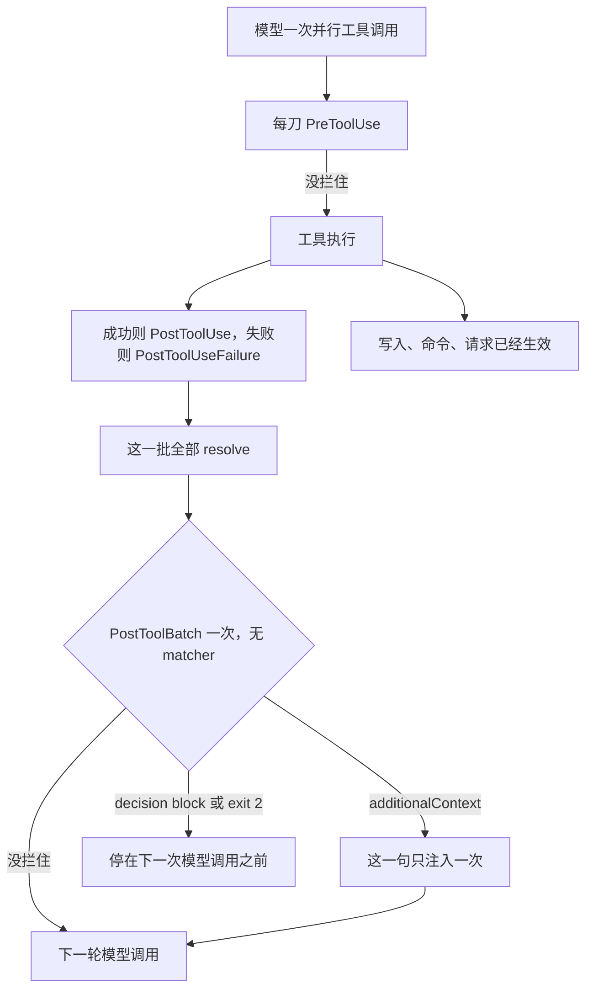

模型一次打出三只 Read、一只 Bash。你在每只 `PostToolUse` 里都注了一句「注意这是生成文件」。四只并行，这句话就有四次机会挨着四份结果。真正只需要在整批落地之后注一次，或者在这批互相矛盾、不该再问下一轮时停住。那一刀是 `PostToolBatch`。

`PostToolUse` 和 `PostToolUseFailure` 是每刀一把。并行的一批全部 resolve 之后、下一次模型请求之前，还有一次没有 matcher 的 `PostToolBatch`。这里的 `additionalContext` 注入一次。exit 2，以及顶层 `decision: "block"`，停的是 agentic loop，不是某一把已经跑完的工具。批里的 `tool_response` 也不是单刀那种结构化对象。

我在 2026-11-07 读了 [Hooks reference](https://code.claude.com/docs/en/hooks) 和 [Automate actions with hooks](https://code.claude.com/docs/en/hooks-guide)。没有跑 Claude Code，没有配真实 hook。字段名和时序只转述这两页。对照过一篇社区批边界笔记，和参考页冲突的地方写在表后面。

11 月 4 日把闸门装在动作之前：Pre 能拦，Post 已经发生。11 月 6 日把单刀入站替换放在 `updatedToolOutput`。下一刀切在并行批的闭合处。工具都已落地，模型还没看见下一轮。`Stop` 拦的是收工。这里拦的是批后的下一次模型调用。那篇的八次连拦不重写。`PermissionRequest` 和沙箱也不重写。

<!-- more -->

## 刀都落地了，下一轮还没发出去



并行时几只 `PostToolUse` 会同时跑。图把它们收成一列，是为了看批在它们之后。参考页写，`PostToolUse` 每刀一次；`PostToolBatch` 带着整批，正好一次。适合注入的是「这一批跑了哪些工具」，不是某一刀自己的 stdout。

生命周期表和指南的事件表是同一句：一批并行工具调用全部 resolve 之后、下一次模型调用之前。单独一刀、没有并行时，这只事件还跑不跑，两页的句子都带了 parallel。「未核实」。被 `PreToolUse` 拦住、根本没执行的那一刀，还进不进后面的数组，例子只给了已经返回内容的 Read。「未核实」。

输入在公共字段之外是 `tool_calls`。例子里每一项有 `tool_name`、`tool_input`、`tool_use_id`、`tool_response`。Read 的 `tool_input` 用的是 `file_path`。`tool_response` 就是模型在对应 `tool_result` 里看见的那份：序列化后的字符串，或内容块数组，工具怎么打出来就怎么在。Read 是带行号的文本，不是文件原文。结果可以很大，参考页让你只解析要用的字段。内容块数组里每一项长什么样，例子没有展开。「未核实」。

失败的那一刀在这个数组里是仍有 `tool_response`、改成 `error`，还是不出现，例子只给了成功的 Read。「未核实」。`PostToolUseFailure` 自己的输入是顶层 `error`，不是这个数组。

没有 matcher。和 `UserPromptSubmit`、`Stop`、`MessageDisplay` 同一列：不支持匹配，每次出现都触发。配了 `matcher: "Bash"` 会不会被丢掉、会不会让这只 hook 不跑，页上没有写。「未核实」。不要指望它只盯 Bash。`if` 是另一字段。指南写它只在 `PreToolUse`、`PostToolUse`、`PostToolUseFailure`、`PermissionRequest`、`PermissionDenied` 上有效，写到别的事件上，hook 不会跑。

`additionalContext` 放在 `hookSpecificOutput` 里，事件名是 `PostToolBatch`。事件小节写：在下一次模型调用前注入一次。总述把投放位置写成挨着工具结果，和三只单刀事件同一句。三份结果里挨着哪一条，两处没有再画。「未核实」。同一事件上好几只 hook 都交了这段，参考页写 Claude 会全部收到。那是好几段，不是按刀数复制同一段。

总述把恢复会话时的重放写成 `PostToolUse`、`UserPromptSubmit` 这种中途事件：`--continue` 或 `--resume` 重放存下来的文字，不再跑 hook。事件小节让去看那一节，恢复那句却没有点名 `PostToolBatch`。「未核实」。

## 三列并排

| 维度 | PostToolUse | PostToolUseFailure | PostToolBatch |
| --- | --- | --- | --- |
| 何时 | 这一刀成功之后 | 这一刀已经开始执行，然后失败 | 并行的一批全部 resolve 之后，下一次模型请求之前 |
| matcher | 工具名 | 工具名，和 Pre 同一套 | 没有。每次出现都触发 |
| 这一批几次 | 成功几刀几次。并行时同时跑 | 失败几刀几次 | 一次，输入是整批 `tool_calls` |
| 拦得住已跑的刀吗 | 拦不住。exit 2 不挡，工具已经跑完 | 拦不住。exit 2 不挡，工具已经失败 | 拦不住。刀已经落地 |
| 拦得住下一轮吗 | exit 2 不拦。顶层 `decision: "block"` 把 reason 放在结果旁边。参考页没有把这只命令钩子写成停掉下一次请求 | exit 2 不拦。总表把它放进顶层 `decision: "block"`。事件小节的字段表只列了 `additionalContext` | 拦得住。exit 2 停 agentic loop。`decision: "block"` 或 `continue: false` 也停在下一次模型调用之前 |
| 模型看见什么 | 结构化 `tool_response`。`updatedToolOutput` 能整份换 | 失败文本在顶层 `error`。能不能换掉这份结果，两节没有合成一句。「未核实」 | `tool_response` 是序列化字符串或内容块数组。`additionalContext` 注入一次 |
| 适合 | 单刀脱敏、格式化、挨着这一刀补一句 | 记下失败，在错误旁边补一句 | 批末一次审计，汇总冲突，注入「本批动了哪些文件」 |
| 不适合 | 把同一句提醒抄到每一刀上 | 当成撤销 | 撤已写入。用 matcher 只盯 Bash。把单刀脚本原样挂过来读 `.stdout` |
| `tool_response` | 结构化对象。Write 的例子是 `filePath` 和 `type`。Bash 的替换例子是 `stdout` 那四个字段 | 例子里没有这个字段 | 模型在 `tool_result` 里看见的那份。Read 是带行号的文本，不是原始文件 |

参考页把两只事件的差别写成一句：`PostToolUse` 给的是工具的结构化 Output，例如 Write 的 `{filePath, type}`；`PostToolBatch` 给的是模型看见的那份序列化 `tool_result`。能改写内容的清单只点名 `PostToolUse` 的 `updatedToolOutput`。批上的决策控制表只有 `additionalContext`。在批边界交一份 `updatedToolOutput` 会不会被忽略、会不会改某一刀的入站视图，两节没有合成一句。「未核实」。单刀改视图仍在 `PostToolUse`。11 月 6 日写过形状和回滚，这里不重做。

社区笔记 [PostToolBatch Hook](https://agentpatterns.ai/tool-engineering/posttoolbatch-hook-batch-boundary/) 我在 2026-11-07 打开过。那页把数组里的结果字段写成 `output`，还写成只有 TypeScript SDK 才有这只事件。参考页的字段是 `tool_response`。五种类型都支持的事件名单里有它：`command`、`http`、`mcp_tool`、`prompt`、`agent`。哪一种 Agent SDK 语言暴露它，hooks 参考页没有写。「未核实」。字段以参考页为准。那页写一批里只有一只工具时也会触发。参考页的句子带了 parallel，这里不跟着写。

## 每刀改视图，批末再决定要不要下一轮

脱敏和换 stdout，仍在 `PostToolUse`，字段仍是 `updatedToolOutput`。Bash 要交回那个对象，不要交一段字符串。这是 11 月 6 日的题目。

批末只需要一句，用 `PostToolBatch` 的 `additionalContext`。参考页的例子是账本模块，让模型在标完成之前跑 pytest：

```json
{
  "hookSpecificOutput": {
    "hookEventName": "PostToolBatch",
    "additionalContext": "These files are part of the ledger module. Run pytest before marking the task complete."
  }
}
```

要停住下一轮，exit 2，或 exit 0 再给顶层 `decision: "block"`。参考页还写 `continue: false` 同样停在下一次模型调用之前。拦截文案来自 JSON 的 `reason` 或 `stopReason`，或 exit 2 的 stderr。transcript 里是一条警告，留在对话里。对话再继续时，模型看得到这段。它撤不回已经写入的文件，也撤不回已经发出的命令。

决策控制总述里的 block 是这段。`PostToolBatch` 小节没有再单独给一个代码块：

```json
{
  "decision": "block",
  "reason": "Test suite must pass before proceeding"
}
```

`decision` 的唯一取值是 `"block"`。要放行，就别写 `decision`，或者 exit 0 且不打印 JSON。这句在总述里，不是这只事件的专项例外。

prompt 钩子在这只事件上，`ok: false` 让回合结束，reason 出现为警告行。同一段写，这只事件遇到 `decision: "block"` 就结束回合，不看 `continue`。`PostToolUse` 的 prompt 钩子还可以设 `continueOnBlock: true`，把 reason 交回去再继续。这只事件的那句没有写成同样可以退。

别把 `PostToolUse` 的脚本原样挂到 `PostToolBatch`。单刀里 Bash 的 `tool_response` 是带 `stdout` 的对象。批里同一字段可能是字符串，也可能是内容块数组。按对象去读 `.stdout` 会炸。exit 1，而且 stdout 不是通过校验的 JSON 时，总述写这是非阻断错误，动作照旧，除非这只 hook 的失败本身会拦。`PostToolBatch` 的专项小节没有另写一份失败合同。没写 `onFailure` 时，夹具把这种解析失败记成 `non_blocking`，下一轮仍去。总述写 `onFailure: "block"` 让失败去做这一事件的 exit 2，例子用的是 `PreToolUse`。用在批边界上会不会同样停住下一轮，两句没有放进同一个例子。「未核实」。夹具不编这条。

`Stop` 的 exit 2 是不让它收工，对话继续。这里的 exit 2 方向相反：不让它发出下一次模型请求。收工闸那篇写过，不要把这两只退出码当成同一件事。

## 夹具里，三刀一次批注

演示在 `demos/posttoolbatch-boundary/`。不读密钥，不访问网络，不启动 Claude Code。假一批三只 Read。`tool_response` 是带行号的字符串，形状按参考页的 Read 例子，不是 `{stdout, stderr, interrupted, isImage}`。开场的第四只 Bash 在批里会序列化成哪一段，例子没有给，夹具不编。处理器是 `annotate_batch`、`block_batch`、`misparse_as_object`、`none`。这不是 settings 里的 hook。

```python
def settle(handler: str) -> tuple[int, int, int, str]:
    """三只成功的刀：PostToolUse 计 3，PostToolBatch 计 1。

    批注只在 annotate_batch 上记 1。block 停的是下一轮。
    把字符串当对象去读 stdout，记成非阻断，循环继续。
    """
    post_tool_use = 3
    post_tool_batch = 1
    if handler == "annotate_batch":
        return post_tool_use, post_tool_batch, 1, "continues"
    if handler == "block_batch":
        return post_tool_use, post_tool_batch, 0, "stop_before_next_model"
    if handler == "misparse_as_object":
        return post_tool_use, post_tool_batch, 0, "continues"
    return post_tool_use, post_tool_batch, 0, "continues"
```

文件里对未知处理器会直接退出。`misparse_as_object` 会真的对字符串做 `["stdout"]`，接住 `TypeError` 之后才记 `parse=error`、`failure=non_blocking`。上面这段把这次异常省掉了。`continues` 的意思是下一轮模型调用仍会发出。`stop_before_next_model` 不把 `side_effect` 从 `already_ran` 改掉。

| 夹具 | 在看什么 | 结局 |
| --- | --- | --- |
| `annotate_batch` | 批末交一次 `additionalContext` | `injection_count=1`。`loop=continues`。两只计数是 3 和 1 |
| `block_batch` | 顶层 `decision: "block"` | `loop=stop_before_next_model`。三刀仍是 `already_ran`。批注次数是 0 |
| `misparse_as_object` | 把批里的字符串当成带 `stdout` 的对象 | `parse=error`。`failure=non_blocking`。`loop=continues` |
| `none` | 什么都不交 | 批注次数是 0。沉默没有变成拦截，也没有变成批注 |

`python3 demos/posttoolbatch-boundary/run_demo.py` 我跑过，最后一行是 `result=pass`。

断言里还有两条不另打一行。`per_tool_annotate` 是每只 `PostToolUse` 各注一句，`injection_count=3`，批事件的计数仍是 1，循环仍是 `continues`。`exit2` 和 `block_batch` 一样停在下一轮之前，副作用仍是 `already_ran`。结构化的 `{stdout: ...}` 只有在对照值上读得到 `stdout`。三条夹具字符串都会让这次读取抛错。

## 批的闭合处，不是多出来的第四只 Post

预算、收工、批准、动作前后、进站替换，各有一层。并行批再切一刀。每刀改视图、每刀那句提醒，仍是 `PostToolUse`。整批落地之后只注一次，或停住下一次模型调用，是 `PostToolBatch`。它没有 matcher。exit 2 在单刀 Post 上不拦，在这里拦的是 agentic loop。`decision: "block"` 同样停在下一轮之前，撤不回已经发生的写入。`tool_response` 在批上是模型看见的序列化内容。按单刀的对象去读 `.stdout`，脚本会炸，exit 1 默认还拦不住下一轮。

你们的审计挂在每刀，还是批末？有没有把 `PostToolUse` 的脚本直接挂到 `PostToolBatch`，然后在日志里只剩一行非阻断？

## 扩展阅读

- [Hooks reference](https://code.claude.com/docs/en/hooks)
- [Automate actions with hooks](https://code.claude.com/docs/en/hooks-guide)
- [别把脱敏交给模型自己做](https://cfireworks.github.io/2026/11/06/2026-11-06-updatedtooloutput-redaction/)
- [别在事后装闸门](https://cfireworks.github.io/2026/11/04/2026-11-04-pre-vs-post-hooks/)
- [别让干活的模型自己判收工](https://cfireworks.github.io/2026/11/02/2026-11-02-goal-vs-stop-hook/)

## 讨论

如果仓库里已经有事后 hook：它注册在 `PostToolUse`，还是 `PostToolBatch`？同一句「这是生成文件」会不会随着并行的刀数出现好几次？批边界上的脚本是在读 `tool_calls[].tool_response` 的文本，还是在读 `.stdout`？exit 2 停住的是下一轮模型调用，还是你本来想撤掉的那一次写入？我没有生产流量。失败的刀进不进 `tool_calls`，参考页的例子没有写，我也不替它下结论。
