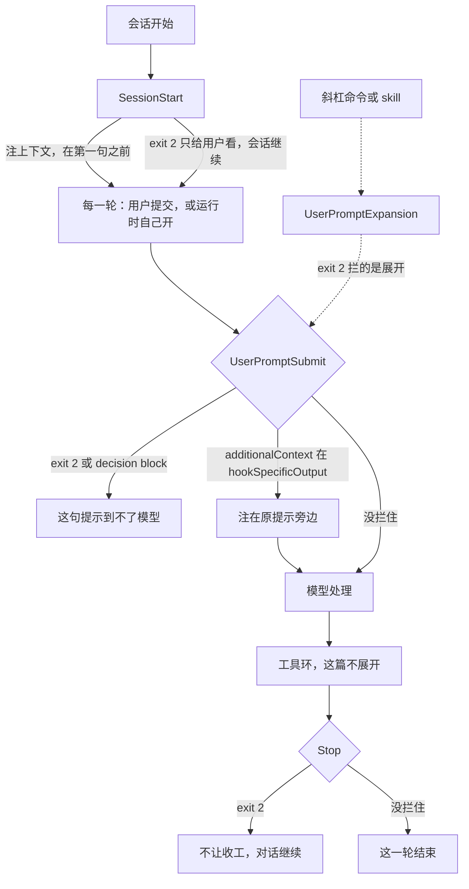

有人把两件每轮都该生效的事挂在 `SessionStart`。一件是「禁止把生产密钥贴进对话」，脚本 exit 2。另一件是「每轮带上当前分支和发布冻结」。密钥那句提示照样进了模型。分支那句只在开场出现一次。后面运行时自己续上的回合，开场脚本不再跑。

入口闸是 `UserPromptSubmit`。它在提示提交之后、Claude 处理之前触发。自己开的回合也会触发。exit 2，或顶层 `decision: "block"`，能让这句提示到不了模型。`SessionStart` 能注上下文、设环境。它的 exit 2 只把 stderr 给用户看，会话照旧往下走。`UserPromptSubmit` 改不了用户原话，只能在旁边注入 `additionalContext`。这段必须放进 `hookSpecificOutput`。写在 JSON 顶层，会被静默丢掉。

我在 2026-11-08 读了 [Hooks reference](https://code.claude.com/docs/en/hooks) 和 [Automate actions with hooks](https://code.claude.com/docs/en/hooks-guide)。没有跑 Claude Code，没有配真实 hook。字段名和时序只转述这两页。

11 月 2 日讲收工闸：`Stop` 不让它停。11 月 4 日讲动作前后：Pre 能拦，Post 已经发生。`SessionStart` 的 `compact` matcher 是压缩后把关键上下文塞回去，不是入口闸。11 月 7 日讲批后下一轮：`PostToolBatch` 停的是工具都落地之后的下一次模型调用。下一刀切在回合入口。用户交出提示之后，或者运行时自己交出一轮之后，模型处理之前。

<!-- more -->

## 提示还没进模型



生命周期三档里，`SessionStart` 和 `SessionEnd` 是 per session。`UserPromptSubmit`、`Stop`、`StopFailure` 是 per turn。工具环是 per tool，这篇不展开。

事件表对 `UserPromptSubmit` 的一句是：提示提交之后、Claude 处理之前。自己开的回合也会触发。专项小节点了三处：会话级定时任务，包括一次 `/loop`；后台子代理向开它的会话回报；别的会话发进主对话的消息。有没有字段标「这一轮是运行时自己开的」，输入表没有这一列。「未核实」。

输入在公共字段之外是 `prompt`，提交的原文。粘贴被收成 `[Pasted text #N]` 的，到这里是展开后的正文。会话有自定义标题时还有 `session_title`，意思和 `SessionStart` 的同名字段一样。你打的是 `/deploy staging` 这种技能或自定义命令时，这只 hook 收到的是你打的那一行，不是展开后的技能正文。拦住了，命令就不跑。

`UserPromptExpansion` 在用户打的命令展开成提示之前。matcher 对的是命令名。exit 2 拦的是展开。它不是这篇的主线。

没有 matcher。和 `PostToolBatch`、`Stop`、`MessageDisplay` 同一列：不支持匹配，每次出现都触发。给没有 matcher 的事件写 `matcher`，参考页写会被静默忽略。`matcher: "startup"` 是 `SessionStart` 的值。写在 `UserPromptSubmit` 上，它滤不掉后面的回合，hook 仍每次都跑。

`if` 只在工具事件上算：`PreToolUse`、`PostToolUse`、`PostToolUseFailure`、`PermissionRequest`、`PermissionDenied`。写到别的事件上，这只 hook 不会跑。`if: "Bash(...)"` 挂在入口闸上，等于这只闸没装。

## 三列并排

| 维度 | SessionStart | UserPromptSubmit | Stop |
| --- | --- | --- | --- |
| 何时 | 会话开始或恢复。matcher 是 `startup`、`resume`、`clear`、`compact`、`fork` | 提示提交之后、Claude 处理之前 | Claude 回应结束时。细则见 11 月 2 日 |
| matcher | 会话怎么开始的 | 没有。写了会被静默忽略，每次都触发 | 没有。每次出现都触发 |
| 自己开的回合 | 按会话触发，不按回合。matcher 里没有「自己开的一轮」 | 会触发。专项点了定时任务、`/loop`、子代理回报、别的会话发来的消息 | 事件表没有把这句写在 `Stop` 上。「未核实」 |
| exit 2 | 不拦。stderr 只给用户看，transcript 里是一条 hook error。Claude 看不见，会话继续 | 拦。提示到不了 Claude | 不让它收工，对话继续 |
| decision block | 没有 decision control | 顶层 `decision: "block"` 加 `reason`。`reason` 给用户看，不进上下文 | 顶层 `decision: "block"`。不让收工。细则见 11 月 2 日 |
| 能否改写原话 | 不替换已经提交的提示。`-p` 的 `initialUserMessage` 是另一件事，这篇不展开 | 不能 replace。只能在旁边注 `additionalContext` | 不改用户原话 |
| additionalContext | `hookSpecificOutput` 里。会话开头，第一句提示之前 | 必须在 `hookSpecificOutput` 里，并带 `hookEventName: "UserPromptSubmit"`。挨着提交的提示。顶层同名字段静默忽略 | `hookSpecificOutput` 里，回合末尾。对话继续。不展开 |
| 适合 | 会话级环境、开场一次的状态。压缩后重注走 `compact`，见 11 月 4 日 | 每轮动态上下文。拦截不该进模型的提示 | 收工条件没满足时不让停 |
| 不适合 | 当入口闸。指望自己续上的回合再跑一遍 | 改写用户原话。用 `startup` 只拦第一句。用 `if` 去滤 Bash | 当入口闸 |

`SessionStart` 的 exit 2，参考页写 Shows stderr to user only。表下面还有一句：这条 stderr 在 transcript 里显示成 hook error，和一次非阻断错误用同一种提示。Claude 看不见。会话继续。

`UserPromptSubmit` 的 exit 2，参考页写 Blocks the prompt, so it never reaches Claude。exit 2 的 stderr 走和 `reason` 一样的路：拦的那句话给用户看，不进上下文。exit 0 再给顶层 `decision: "block"`，也停在进模型之前。`decision` 的唯一取值是 `"block"`。要放行，就别写 `decision`，或者 exit 0 且不打印 JSON。这句在总述里。

插件有一条窄例外。插件的 `UserPromptSubmit` 在 exit 2、stdout 为空、stderr 像「文件不存在」时，会被当成非阻断错误。别的插件特例这篇不写。

命令钩子超时，多数事件不构成决策。`PreModelSwitch` 超时会拦切换。`UserPromptSubmit` 的专项把命令、HTTP、MCP tool 写清楚了：到点取消，输出丢掉，包括 `additionalContext`，提示仍进 Claude，只是没有这段上下文。transcript 里会有一条通知，点名这只 hook、触发的超时，以及输出被丢掉。要超时也拦提示，给 command 或 http 写 `onFailure: "block"`。Agent SDK 的 callback 超时会拦提示，并点名 hook 和超时。那是另一条合同。命令钩子别跟着那条写。

`onFailure: "block"` 要 Claude Code v2.1.295 或更新。失败按这一事件的 exit 2 处理。参考页的例子就是：`UserPromptSubmit` 失败会拦住提示。默认没写这个字段时，脚本挂了、路径写错、退出码不是 0 也不是 2，提示照进。入口上的政策脚本要把失败写成拦。

## 每轮一句放旁边，原话留在原地

每轮会变的上下文，当前分支、发布冻结、谁在值班，用 `UserPromptSubmit` 的 `additionalContext`。指南的例子是：

```json
{
  "hookSpecificOutput": {
    "hookEventName": "UserPromptSubmit",
    "additionalContext": "Current branch: release-42. Deploy freeze until Friday."
  }
}
```

顶层再写一个同名字段，JSON 仍能解析，字段被静默忽略，transcript 里也不报错。调试日志里的句子是 `Hook JSON output had unrecognized keys`。这段要放进 `hookSpecificOutput`，并带上事件名。

exit 0 且 stdout 被当成纯文本时，`UserPromptSubmit`、`UserPromptExpansion`、`SessionStart`、`PostModelSwitch` 会把这段纯文本加进 Claude 看得见的上下文。解析失败的 stdout 不加。纯文本和 `additionalContext` 都不进可见的 transcript 条目，也不出现成聊天消息。参考页写，它们各自被包成一条以 hook 名字开头的 system reminder。Claude 读得到。要确认送到没有，看调试日志。

几乎不变的项目约定放 `CLAUDE.md`。参考页写，静态说明不必为了省事每轮跑脚本。同一段每轮用 hook 再注一遍，恢复会话时还会过期：中途事件包括 `UserPromptSubmit`，`--continue` 或 `--resume` 重放存下来的文字，不再为过去的回合重跑 hook。时间戳和 commit SHA 会旧。`SessionStart` 在恢复时会再跑，`source` 是 `"resume"`，加了 `--fork-session` 则是 `"fork"`，可以刷新。

会话级环境走 `SessionStart` 的 `CLAUDE_ENV_FILE`。压缩后重注走 `compact` matcher。11 月 4 日写过，这里不重做。

要拦某些提示，exit 2，或 exit 0 再给顶层 `decision: "block"` 和 `reason`。拦得住的是模型看不见这句。页上「What a blocked prompt leaves behind」写的是留下什么。提示到不了 Claude，文字却不是从所有地方消失。默认拦下的那条消息以 `Original prompt:` 结尾，后面跟着提交的原文。这条消息会写进会话的 transcript 文件。想让原文不出现在这条消息里，在 `hookSpecificOutput` 里给 `"suppressOriginalPrompt": true`。`decision: "block"` 和 exit 2 都认。它只改这条拦下的消息。原文仍可以出现在本地文件里，例如会话 transcript 和提示历史。拦提示不是把秘密从磁盘上清掉的办法。

改写用户原话做不到。改写能力清单的原句是：`UserPromptSubmit` can't replace the prompt; it only injects `additionalContext` alongside it。想换掉的是工具参数或工具结果，那是 `PreToolUse` 的 `updatedInput` 和 `PostToolUse` 的 `updatedToolOutput`。11 月 6 日写过进站替换，这里不重做。

会话标题的字段名是 `sessionTitle`，放在 `hookSpecificOutput` 里，和 `SessionStart` 同名。专项写：按提示内容自动给会话起名。`SessionStart` 上它只在 `source` 为 `startup`、`resume`、`fork` 时生效。`UserPromptSubmit` 的专项没有再写这三条 source 限制。「未核实」。

默认超时：`command`、`http`、`mcp_tool` 在多数事件上是 600 秒。`UserPromptSubmit`、`PreModelSwitch`、`PostModelSwitch` 降到 30 秒。这只 hook 挡在每次提示前面，跑完之前模型不会处理。到点就取消，提示仍进去，这次的上下文丢掉。入口闸脚本要快。

prompt 钩子在 `UserPromptSubmit` 上 `ok: false`：回合结束，reason 出现为警告行。同一段写，这只事件遇到 `decision: "block"` 就结束回合，不看 `continue`。

## 夹具里，exit 2 挂错事件

演示在 `demos/userpromptsubmit-gate/`。不读密钥，不访问网络，不启动 Claude Code。假一次 `SessionStart`，再假一次带 `prompt` 字段的 `UserPromptSubmit`。原文是一句固定的用户提示。处理器是 `session_start_exit2`、`user_prompt_exit2`、`user_prompt_block_json`、`inject_nested`、`inject_toplevel`、`none`。这不是 settings 里的 hook。

注入只认嵌套。顶层的 `additionalContext` 在这个函数里根本不会被读到：

```python
def nested_context(payload: dict | None) -> int:
    """只认 hookSpecificOutput 里的 additionalContext。顶层同名字段不算。"""
    if not isinstance(payload, dict):
        return 0
    nested = payload.get("hookSpecificOutput")
    if not isinstance(nested, dict):
        return 0
    if nested.get("hookEventName") != "UserPromptSubmit":
        return 0
    text = nested.get("additionalContext")
    if isinstance(text, str) and text:
        return 1
    return 0
```

文件里对未知处理器会直接退出。`session_start_exit2` 只让 `SessionStart` 以 2 退出，后面的 `UserPromptSubmit` 什么都不交，所以 `prompt` 仍是 `reaches_model`，`notice` 记成 `user_only`。`user_prompt_exit2` 和带顶层 `decision: "block"` 的那一刀把命运记成 `blocked`。原话字符串不改。

| 夹具 | 在看什么 | 结局 |
| --- | --- | --- |
| `session_start_exit2` | exit 2 挂在会话开头 | `prompt=reaches_model`。`notice=user_only` |
| `user_prompt_exit2` | exit 2 挂在这一轮提示上 | `prompt=blocked`。原话字符串还在 |
| `user_prompt_block_json` | exit 0，顶层 `decision: "block"` | `prompt=blocked` |
| `inject_nested` | `additionalContext` 在 `hookSpecificOutput` 里 | `injection=1`。`prompt` 仍是原文 |
| `inject_toplevel` | 同名字段写在 JSON 顶层 | `injection=0`。`prompt=reaches_model` |
| `none` | 什么都不交 | 沉默没有变成拦截 |

`python3 demos/userpromptsubmit-gate/run_demo.py` 我跑过，最后一行是 `result=pass`。

## 闸要装在每一轮的前面

收工闸不让它停。动作之前那闸拦住还没发生的工具。批边界那闸停的是下一轮模型调用。回合入口这一闸，停在模型看见这句提示之前。`SessionStart` 的 exit 2 做不到这件事。自己开的回合也不会再跑开场脚本。每轮要带上的那一句，放进 `UserPromptSubmit` 的 `hookSpecificOutput.additionalContext`。写在顶层，模型看不见。用户原话换不掉。拦下之后，界面里默认仍会在 `Original prompt:` 后面带上原文，transcript 文件里也留着这条消息。

你们把「每轮都要生效」的策略挂在 `SessionStart` 还是 `UserPromptSubmit`？有没有把 `additionalContext` 写在 JSON 顶层，然后奇怪模型怎么没看见？

## 扩展阅读

- [Hooks reference](https://code.claude.com/docs/en/hooks)
- [Automate actions with hooks](https://code.claude.com/docs/en/hooks-guide)
- [别把批当成单刀](https://cfireworks.github.io/2026/11/07/2026-11-07-posttoolbatch/)
- [别在事后装闸门](https://cfireworks.github.io/2026/11/04/2026-11-04-pre-vs-post-hooks/)
- [别让干活的模型自己判收工](https://cfireworks.github.io/2026/11/02/2026-11-02-goal-vs-stop-hook/)

## 讨论

如果仓库里已经有开场 hook：exit 2 是写在 `SessionStart` 上，还是 `UserPromptSubmit` 上？每轮要让模型看见的分支和冻结，是写进 `hookSpecificOutput.additionalContext`，还是写在 JSON 顶层？拦住之后，你在界面里还看不看得到 `Original prompt:` 后面的原文？我没有生产流量。自己开的回合有没有单独的来源字段，参考页的输入表没有列，我也不替它补一列。
