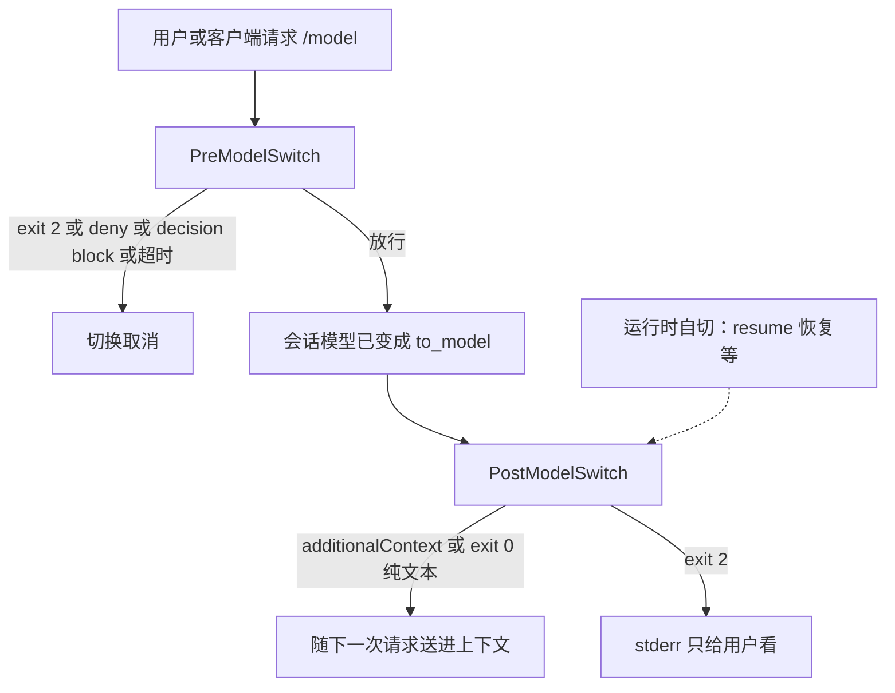

有人在 settings 里写了两句。一句是「禁止切到最贵那档」，脚本 exit 2。一句是「切完告诉模型今天预算还剩多少」。两只都挂在 `PostModelSwitch` 上，或者挂在 `SessionStart` 上。`/model` 照样切过去。预算那句读的是 `$ANTHROPIC_MODEL`。会话里的 `/model` 改不了这个环境变量。

能拦的是 `PreModelSwitch`。它在你或客户端请求的切换生效之前触发。exit 2、`hookSpecificOutput` 里的 `permissionDecision: "deny"`、顶层 `decision: "block"`，都能取消这次切换。超时也会拦。这点和多数事件不同。`PostModelSwitch` 来的时候，会话模型已经变了。运行时自己恢复的切换，比如 resume 把模型拨回去，Pre 不开火，只有 Post 看得到。Post 的 exit 2 只把 stderr 给用户看。想跟着模型走、切完再注一句上下文，用 Post 的 `hookSpecificOutput.additionalContext`。

我在 2026-11-09 打开并重读了 [Hooks reference](https://code.claude.com/docs/en/hooks) 的 PreModelSwitch、PostModelSwitch 小节，和 [Automate actions with hooks](https://code.claude.com/docs/en/hooks-guide)。没有跑 Claude Code，没有配真实 hook。字段名和时序只转述这两页。这两只事件写在 Claude Code [v2.1.251](https://github.com/anthropics/claude-code/releases/tag/v2.1.251) 的 release notes 里，原句是 block, confirm, or annotate a model switch。本文只点这一句。

11 月 4 日讲工具侧那套 Pre/Post：能拦的是动作之前，事后只剩善后。11 月 8 日讲回合入口：`UserPromptSubmit` 停的是提示进模型之前。下一刀切在模型身份。请求切换生效之前能不能拦。已经切完，只能注上下文、记日志。

<!-- more -->

## 请求切换还没生效



matcher 对的是从 `to_model` 推导出的 canonical name，不是你随口写的别名。别名 `opus`、带日期的模型 ID、Bedrock 那种供应商 ID，都落到同一个 canonical name 上。参考页的例子是 `claude-opus-5` 盖住 Opus 5 的每一种写法，`[1m]` 后缀忽略。写法是精确名、`claude-opus-4-6|claude-opus-5` 这种竖线列表，或 `.*opus.*` 这种正则。网关自己的型号认不出 canonical name 时，每一只 Pre hook 都跑，matcher 挡不住。要拦，脚本里再看一眼输入里的 `to_model`。Post 的 matcher 跟 Pre 同一套规则，完整写法在 Pre 小节。

Pre 会为这些请求跑：`/model` 和 `/model` 选择器，`Option+P` 或 `Alt+P`，`/config` 里的 Model 设置，打开 fast mode 且因此换了会话模型，以及 Agent SDK 或 Remote Control 的 `set_model`、`apply_flag_settings` 里的模型变更。`source` 三档：`"command"` 盖住 `/model`、`/config` 的 Model、打开 fast mode；`"picker"` 是选择器；`"sdk"` 是上面那两种宿主请求。

运行时自己改会话模型时，Pre 不跑。参考页点了自动 fallback，以及 resume 时把模型拨回去。这些只到 Post。Post 另外还覆盖：你或客户端请求的切换已经生效之后，以及 `opusplan` 这类设置进出 plan mode。只顶替一轮、会话模型没变的 fallback chain，Post 也不跑。

两边都收 `from_model` 和 `to_model`。这不是 `SessionStart` 那个不一定出现的单字段 `model`。专项表里还有 `requested_model`、`source`，以及切之前能拿来展示的五列估价：`context_tokens`、`prompt_cache_warm`、`cache_ttl`、`estimated_cache_write_usd`、`pricing`。`pricing` 是 `"configured"`、`"catalog"` 或 `"default"`。`requested_model` 在 `source` 为 `"auto"` 时是 `null`；`"resume"` 时是恢复回来的那份已保存设置。公共字段不在这里重列。

`if` 只在工具事件上算。写到 Pre 或 Post 上，这只 hook 不会跑。`if: "Bash(...)"` 挂在模型闸上，等于这只闸没装。

## 三列并排

| 维度 | PreModelSwitch | PostModelSwitch | UserPromptSubmit |
| --- | --- | --- | --- |
| 何时 | 你或客户端请求的切换生效之前 | 会话模型已经变了之后 | 提示进模型之前。细则见 [11 月 8 日](https://cfireworks.github.io/2026/11/08/2026-11-08-userpromptsubmit-vs-sessionstart/) |
| 谁触发 | `/model`、选择器、`/config` 的 Model、换模型的 fast mode、SDK 的 `set_model` | 请求切换生效之后，加上运行时自切：改会话模型的自动 fallback、resume 恢复、`opusplan` 进出 plan mode | 用户提交的提示，以及运行时自己开的回合 |
| matcher | `to_model` 的 canonical name | 同一套规则 | 没有。写了会被静默忽略 |
| exit 2 | 拦。取消切换，stderr 给用户 | 不拦。stderr 只给用户看，transcript 里是一条 hook error。模型已经换了 | 拦。提示到不了模型 |
| decision | `hookSpecificOutput.permissionDecision`：allow、deny、ask。或顶层 `decision: "block"`。不接受 defer | 没有。Context only | 顶层 `decision: "block"`。细则见 11 月 8 日 |
| 能否改模型名 | 不接受 `updatedInput`。`to_model` 换不掉 | 没有改名的字段 | 换不了用户原话。跟模型名无关 |
| additionalContext | 不接受 | 放在 `hookSpecificOutput` 里，带 `hookEventName`。随切换后的下一次请求。顶层同名字段丢掉 | 必须嵌套。细则见 11 月 8 日 |
| 超时默认 | 命令、HTTP、MCP tool 降到 30 秒 | 同样 30 秒 | 同样 30 秒 |
| 超时是否拦 | 会取消切换 | 撤不回已经换上的模型。输出丢掉 | 提示仍进模型。细则见 11 月 8 日 |
| 适合 | 禁止未备案型号。切之前把重写缓存的估价给人看 | 切完注一句模型相关的上下文。跟着模型记日志 | 每轮动态上下文，拦截不该进模型的提示 |
| 不适合 | 看见 resume 自切。把纯文本 stdout 当成切后的上下文。加 `if` | 用 exit 2 拦住 `/model`。读 `$ANTHROPIC_MODEL` 当当前模型 | 拦住一次模型身份切换 |

`permissionDecision` 的三档，参考页写：`"allow"` 放行，并跳过提示缓存还热着时那次确认。`"deny"` 取消切换。`"ask"` 让人确认。多只 Pre 意见不一致时，优先级是 deny，然后 ask，然后 allow。`"ask"` 的确认框只出现在交互式 `/model`。参考页点名 `-p`、`/config`、`set_model` 把 `"ask"` 当拒绝。指南的句子是：除了交互式 `/model`，别处都当拒绝。别把 `"ask"` 写成默默放行。

deny 的 `permissionDecisionReason` 给用户看，作为取消的理由；`set_model` 请求上则作为错误返回。ask 的理由出现在确认框里。allow 的理由被忽略。`systemMessage` 不论这次决策是什么都会给用户看。估价脚本可以只回这一句，exit 0，切换照旧。

exit 2 配一份合法 JSON 时，exit 2 的拦截还在。参考页写，即便 `permissionDecision` 是 `"allow"`，也放不过这次动作。Pre 不接受 `additionalContext`。纯文本 stdout 会进上下文的名单是 `UserPromptSubmit`、`UserPromptExpansion`、`SessionStart`、`PostModelSwitch`。Pre 不在这列。想在切完之后注一句，写在 Pre 的 stdout 上，模型看不见。

退出码不是 0 也不是 2、stdout 又不是合法 JSON 时，参考页写这是非阻断错误，切换照旧，除非这只 hook 的失败本身会拦，例如 `onFailure: "block"`。超时是另一条：到点取消，输出丢掉，切换被拦。脚本挂了和脚本卡住，在 Pre 上方向相反。政策闸要快，或显式写 `timeout`，并接受「挂起也拦」。崩溃、路径写错、退出码跑偏，要另加 `onFailure: "block"`。这要 Claude Code v2.1.295 或更新。失败按这一事件的 exit 2 处理。

Post 的 exit 2，参考页和 `SessionStart` 放在同一句里：stderr 在 transcript 里显示成 hook error，Claude 看不见，会话继续。模型已经是 `to_model`。

## 切完再注一句，原模型留在原地

禁止 opus、禁止未备案型号，用 `PreModelSwitch`。matcher 盯目标模型的 canonical name，脚本再读 `to_model`。exit 2，或 exit 0 再给嵌套的 deny：

```json
{
  "hookSpecificOutput": {
    "hookEventName": "PreModelSwitch",
    "permissionDecision": "deny",
    "permissionDecisionReason": "这个仓库没有备案 claude-opus-5。"
  }
}
```

顶层再写一个 `permissionDecision`，指南写 JSON 仍能解析，字段被静默忽略。调试日志里的句子是 `Hook JSON output had unrecognized keys`。同一只政策脚本加上 `"onFailure": "block"`，路径写错时切换也不会漏过去。

交互确认用 `"ask"`，只对坐在终端里打 `/model` 的人有确认框。CI、`-p`、SDK 的 `set_model` 里，这一档等于拒绝。

切完要告诉模型「现在是 Haiku，长推理不在这一档」，用 `PostModelSwitch`。`additionalContext` 放进 `hookSpecificOutput`，并带上事件名。指南页的嵌套例子写在 `UserPromptSubmit` 上，没有再贴一份 Post 的。字段名以 hooks 页为准：决策总表写的是 `hookSpecificOutput.additionalContext`，投放位置是切换之后的下一次请求。

```json
{
  "hookSpecificOutput": {
    "hookEventName": "PostModelSwitch",
    "additionalContext": "当前会话模型是 claude-opus-5。长推理要再显式切换。"
  }
}
```

exit 0 的纯文本 stdout，Post 也会加进 Claude 看得见的上下文。解析失败的 stdout 不加。你发出下一条提示之后，这只 hook 若五秒内还没结束，这次请求不带这段输出，改挂到再下一次请求。切换后、下一条提示之前模型又变了好几次，只送最后一次目标模型的输出。

跟着模型记日志、打指标，也用 Post，读输入里的 `from_model` 和 `to_model`。没有 `$CLAUDE_MODEL`。`$ANTHROPIC_MODEL` 是你在 shell 里设的，`/model` 改完它也不会跟着变。`SessionStart` 有时会带一个 `model` 字段，而且不是每次都有。会话中途换模型，那一刀看不见。

## 夹具里，exit 2 挂错事件

演示在 `demos/premodelswitch-gate/`。不读密钥，不访问网络，不启动 Claude Code。假一次请求切换：`from_model` 是 `claude-sonnet-5`，`to_model` 是 `claude-opus-5`，`source` 是 `"command"`。没拦住才把模型记成 `to_model`，再走 Post。另假一条 resume：`source` 是 `"resume"`，Pre 不调用。处理器是 `pre_exit2`、`pre_deny_json`、`pre_block_decision`、`pre_timeout_sim`、`post_exit2`、`post_inject_nested`、`post_inject_toplevel`、`none`。这不是 settings 里的 hook。

注入只认嵌套，而且事件名要对上：

```python
def nested_context(payload: dict | None, event_name: str) -> int:
    """只认 hookSpecificOutput 里的 additionalContext，且事件名要对上。"""
    if not isinstance(payload, dict):
        return 0
    nested = payload.get("hookSpecificOutput")
    if not isinstance(nested, dict):
        return 0
    if nested.get("hookEventName") != event_name:
        return 0
    text = nested.get("additionalContext")
    if isinstance(text, str) and text:
        return 1
    return 0
```

文件里对未知处理器会直接退出。`pre_exit2`、嵌套 deny、顶层 `decision: "block"`、超时，都把 `switch` 记成 `blocked`，模型留在 `from_model`。超时那一刀的 JSON 里写了 `permissionDecision: "allow"`，函数先看超时，这份 allow 不算数。`post_exit2` 的 `switch` 是 `applied`，`notice` 是 `user_only`。`resume_auto` 假设 settings 里装着 `pre_exit2`，这条路径仍不调用它。

参考页写 Post 在会话模型已经变了之后才跑。Pre 取消切换时 Post 会不会仍触发，页上没有单独写一句。「未核实」。夹具按「没变就不跑 Post」记 `post_fired=0`。夹具不模拟纯文本 stdout，也不模拟那五秒延迟。

| 夹具 | 在看什么 | 结局 |
| --- | --- | --- |
| `pre_exit2` | exit 2 挂在请求切换之前 | `switch=blocked` |
| `pre_deny_json` | `permissionDecision: "deny"` 在 `hookSpecificOutput` 里 | `switch=blocked` |
| `pre_block_decision` | 顶层 `decision: "block"` | `switch=blocked` |
| `pre_timeout_sim` | Pre 到点取消，输出里的 allow 丢掉 | `switch=blocked` |
| `post_exit2` | exit 2 挂在已经切完之后 | `switch=applied`。`notice=user_only` |
| `post_inject_nested` | `additionalContext` 在 `hookSpecificOutput` 里 | `injection=1`。`model` 已是 `to_model` |
| `post_inject_toplevel` | 同名字段写在 JSON 顶层 | `injection=0`。切换照旧 |
| `none` | 什么都不交 | 沉默没有变成拦截 |
| `resume_auto` | 运行时自己把模型拨回去 | `pre_fired=0`。`post_fired=1`。`switch=applied` |

`python3 demos/premodelswitch-gate/run_demo.py` 我跑过，最后一行是 `result=pass`。

## 身份也是一扇门

工具之前那闸拦住还没发生的调用。回合入口那闸停在提示进模型之前。模型身份这一闸，停在请求切换生效之前。`PostModelSwitch` 的 exit 2 做不到这件事。resume 把模型拨回去的那一次，Pre 也看不见。切完要让模型看见的那一句，放进 Post 的 `hookSpecificOutput.additionalContext`。写在顶层，模型看不见。shell 里的 `$ANTHROPIC_MODEL` 也不是会话当前模型。

你们把「不准切到这档」写在 `PreModelSwitch` 上，还是写在 `PostModelSwitch` 的 exit 2 上？切完要注入的那句，在 `hookSpecificOutput` 里，还是在 JSON 顶层？

## 扩展阅读

- [Hooks reference](https://code.claude.com/docs/en/hooks)
- [Automate actions with hooks](https://code.claude.com/docs/en/hooks-guide)
- [别把入口闸挂在会话开头](https://cfireworks.github.io/2026/11/08/2026-11-08-userpromptsubmit-vs-sessionstart/)
- [别在事后装闸门](https://cfireworks.github.io/2026/11/04/2026-11-04-pre-vs-post-hooks/)
- [Claude Code v2.1.251](https://github.com/anthropics/claude-code/releases/tag/v2.1.251)

## 讨论

如果仓库里已经有模型 hook：exit 2 是写在 `PreModelSwitch` 上，还是 `PostModelSwitch` 上？matcher 写的是 canonical name，还是 `/model` 里随口打的别名？切完要让模型看见的那一句，是 `hookSpecificOutput.additionalContext`，还是 JSON 顶层？我没有生产流量。Pre 取消切换之后 Post 还会不会再跑一次，参考页没有单独写，我也不替它补一刀。
