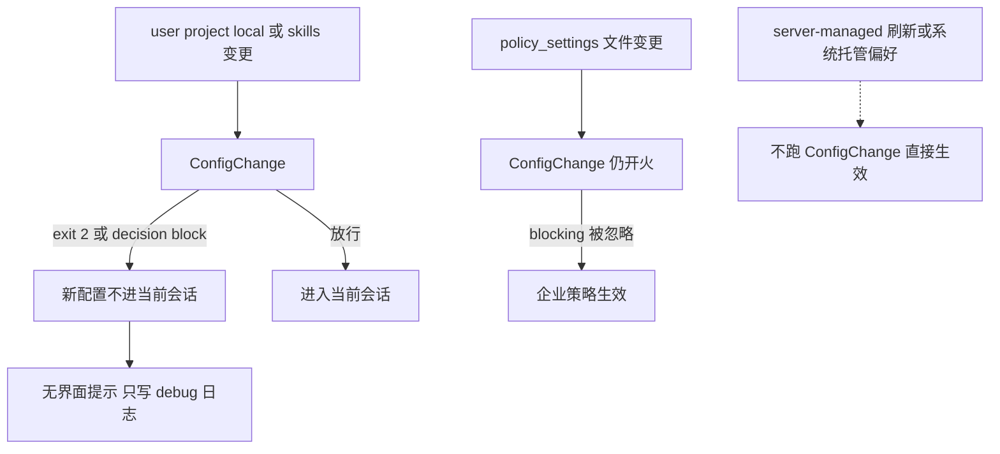

有人在会话还开着的时候改了 `.claude/settings.json`。想当场关掉一只危险 hook，或者打开 bypass。保存完就当它已经进了当前会话。审计脚本挂在 `FileChanged` 上，或者挂在 `SessionStart` 上。`FileChanged` 看得见磁盘上的文件变了，exit 2 只把 stderr 给用户看，拦不住这次写入。`SessionStart` 的 exit 2 也只给用户看，会话照旧。两只都不是配置闸。

能拦的是 `ConfigChange`。它在 settings 文件、托管策略文件、或 skill 文件变更时触发。exit 2，或顶层 `decision: "block"`，能让新配置不应用到正在跑的会话。`policy_settings` 除外。那一路 hook 仍会开火，任何 blocking 决策被忽略。企业托管设置必须生效。拦成功的时候界面一片安静。`reason` 收下了，从不展示。exit 2 的 stderr 也不会出现在你或 Claude 面前。只有 debug 日志有一行。`systemMessage` 和 `continue` 被丢掉。

server-managed settings 到达或刷新，不开火，直接生效。macOS 的 managed preferences、Windows 的注册表策略，也不开火。WSL 上开了 `wslInheritsWindowsSettings` 时，Windows 侧托管设置文件在策略 poll 时应用，同样不开火。

我在 2026-11-10 打开并重读了 [Hooks reference](https://code.claude.com/docs/en/hooks#configchange) 的 ConfigChange 小节，和 [Automate actions with hooks](https://code.claude.com/docs/en/hooks-guide)。没有跑 Claude Code，没有配真实 hook。字段名和时序只转述这两页。

昨天讲模型身份。`PreModelSwitch` 停在你或客户端请求的切换生效之前。下一刀切在配置平面。中途写入能不能进当前会话。企业策略永远能进。

<!-- more -->

## 写入还没进会话



闸拦的是进当前会话，不是把磁盘上已经写好的文件改回去。参考页写：被拦时，新 settings 不应用到运行中的会话。被拦之后磁盘文件会不会回滚，页上没有写。「未核实」。夹具只记 `applied`，不模拟回滚。

matcher 对的是配置来源：

| Matcher | 何时开火 |
| --- | --- |
| `user_settings` | `~/.claude/settings.json` 变了 |
| `project_settings` | `.claude/settings.json` 变了 |
| `local_settings` | `.claude/settings.local.json` 变了 |
| `policy_settings` | `managed-settings.json`，或 `managed-settings.d/` 里的文件变了 |
| `skills` | `.claude/skills/` 下的技能文件变了 |

托管策略这一侧，只有 `managed-settings.json` 或 `managed-settings.d/` 里的文件变了才跑。指南把这件事收成审计：外部进程或编辑器改了配置文件，可以记合规日志，或拦住未授权的修改。要确认，指南写的是会话开着的时候用另一个编辑器改文件，再看日志多了一行。我没有跑这一步。

参考页写的是文件变更，没有把写入者限定成外部编辑器。会话里 Claude 自己改 settings 会不会也开火，两页没有放进同一句。「未核实」。这篇按参考页的文件变更写闸。

专项输入是 `source`，以及可选的 `file_path`。`source` 标明哪一种配置变了。`file_path` 是被改的那个文件。公共字段不在这里重列。脚本别假设 `file_path` 每次都在。

`if` 只在工具事件上算：`PreToolUse`、`PostToolUse`、`PostToolUseFailure`、`PermissionRequest`、`PermissionDenied`。写到别的事件上，这只 hook 不会跑。`if: "Bash(...)"` 挂在 ConfigChange 上，等于这只闸没装，变更照进会话。

这只事件支持 `command`、`http`、`mcp_tool`。不支持 `prompt` 和 `agent`。想用另一只模型来决定拦不拦，ConfigChange 不接。

## 三列并排

| 维度 | ConfigChange | PreModelSwitch | FileChanged |
| --- | --- | --- | --- |
| 何时 | 会话中途 settings、托管策略文件、或 skill 文件变更 | 你或客户端请求的切换生效之前。细则见 [11 月 9 日](https://cfireworks.github.io/2026/11/09/2026-11-09-premodelswitch-vs-postmodelswitch/) | 被盯住的磁盘文件变了。谁写的都行 |
| matcher | `source`：上面五档。竖线或逗号都可以 | `to_model` 的 canonical name | 字面文件名。监听列表只按竖线切 |
| exit 2 | 拦。新配置不进当前会话。`policy_settings` 除外 | 拦。取消切换，stderr 给用户 | 不拦。stderr 只给用户看 |
| decision | 顶层 `decision: "block"`，加 `reason`。`reason` 收下但从不展示 | `hookSpecificOutput` 里的 `permissionDecision`，或顶层 `decision: "block"` | 没有。拦不住这次写入 |
| 界面 | 被拦时你和 Claude 都看不到提示。`systemMessage` 和 `continue` 丢掉。只写 debug 日志 | stderr 给用户。deny 的理由给用户看 | exit 2 的 stderr 给用户看 |
| 企业策略 | `policy_settings`：hook 仍跑，block 被忽略。server-managed、macOS 托管偏好、Windows 注册表策略、WSL 继承的 Windows 托管文件：不跑这只 hook，直接生效 | 这一列只作对照。企业策略例外是 ConfigChange 这页写的 | 没有。它不是 settings 热加载闸 |
| 适合 | 记下 `source` 和 `file_path`。拦住项目侧或技能文件热加载进当前会话 | 禁止未备案型号 | 盯某个磁盘文件，记日志、重载环境 |
| 不适合 | 拦住 `policy_settings`。以为 server-managed 刷新会过这道闸。加 `if`。用 `FileChanged` 或 `SessionStart` 当配置闸 | 看见运行时自己把模型拨回去 | 拦住 settings 进当前会话 |

`decision` 的值就是 `"block"`。要放行，别写 `decision`，或者 exit 0、什么 JSON 都不交。别把 `continue: false` 当成第二套闸。ConfigChange 的决策表是顶层 `decision`。`continue` 在这只事件上被丢掉。

`policy_settings` 和 server-managed 不是一条路。前者 hook 仍跑，你可以记日志，block 会被忽略。后者连 hook 都不跑。macOS 托管偏好、Windows 注册表策略，以及 WSL 上 `wslInheritsWindowsSettings` 时那次 poll，跟 server-managed 一样，直接生效。

命令、HTTP、MCP tool 的默认超时是 600 秒。参考页把降到 30 秒写在 `UserPromptSubmit`、`PreModelSwitch`、`PostModelSwitch` 上。ConfigChange 不在那一列。到点取消，输出丢掉。多数事件上，超时不构成决策。页上把「超时就拦住」点在 `PreModelSwitch`。ConfigChange 没有被点名。

要路径写错、脚本崩溃或超时也拦，给 `command` 或 `http` 写 `onFailure: "block"`。这要 Claude Code v2.1.295 或更新。总述写：设了 `"block"`，失败去做这一事件的 exit 2 会做的事。例外两处。`PermissionRequest` 上失败改成拒绝这次权限请求。`Stop`、`SubagentStop`、`TaskCompleted`、`TeammateIdle` 上这个字段不起作用。设了 `async` 或 `asyncRewake` 的后台 command hook 也不起作用。`ConfigChange` 不在这两处。它的 exit 2 是拦住配置生效，`policy_settings` 除外。页上没有把 ConfigChange 和 `onFailure` 放进同一个例子。我按这两句拼：settings 和 skills 的热加载，脚本没起来就按 exit 2 拦住；`policy_settings` 上 exit 2 本来就不拦，失败按同一句处理也拦不住。夹具不模拟脚本缺失，也不模拟超时。

## 审计、拦住、别拦错

审计所有来源，记 `source` 和 `file_path`。指南的例子把 matcher 留空，往日志里追加一行。那个空 matcher 是为了记下每一次变更。要只盯项目侧，写成 `project_settings|local_settings`。挂错 source，技能文件的热加载从这只闸旁边走过去。

拦住会话中途改项目 settings。被拦时用户看不到 `reason`，所以脚本自己留一份日志：

```json
{
  "hooks": {
    "ConfigChange": [
      {
        "matcher": "project_settings|local_settings",
        "hooks": [
          {
            "type": "command",
            "command": "${CLAUDE_PROJECT_DIR}/.claude/hooks/block-project-settings.sh",
            "args": [],
            "onFailure": "block"
          }
        ]
      }
    ]
  }
}
```

```bash
#!/bin/bash
# stdin 里有 source，file_path 可能没有。exit 2 拦住进当前会话。
# 界面上看不到这句 stderr。要留痕，写到你自己的日志。
input=$(cat)
printf '%s\n' "$input" >> "${CLAUDE_PROJECT_DIR}/.claude/config-change.log"
echo "会话中途不准改项目 settings" >&2
exit 2
```

同一只闸也可以 exit 0，交顶层决策。`reason` 可以写，不会有人在界面上看见：

```json
{
  "decision": "block",
  "reason": "会话中途改项目 settings 要先审批"
}
```

要让人知道拦住了，走你自己的日志，或会话外的通知。`Notification` 是另一只事件，这篇不展开。别指望 `systemMessage`。

技能文件用 matcher `skills`。未审批的技能热加载，同样 exit 2 或 `decision: "block"`。来源不同，闸是同一只。

别指望拦住 `policy_settings`。hook 可以记一笔。block 会被忽略。也别以为 server-managed 刷新会先过你这道闸。

不要给 ConfigChange 加 `if`。非工具事件，hook 直接不跑。政策脚本加上 `onFailure: "block"`，防的是路径写错之后静默放行。

## 夹具里，policy 的 exit 2 拦不住

演示在 `demos/configchange-gate/`。不读密钥，不访问网络，不启动 Claude Code。假一次 `project_settings`，一次 `skills`，一次 `policy_settings`。处理器是 `exit2`、`block_decision`、`allow_silent`、`none`。另假一条 `server_managed_skip`。这是夹具里的名字，表示这次刷新不调用 hook，不是参考页上的 matcher 值。再假一条 matcher 只写了 `project_settings|local_settings`，变更来源却是 `skills`。同一条 matcher 对上 `local_settings` 时，exit 2 仍然拦住。再假一条给 ConfigChange 写了 `if`。这不是 settings 里的 hook。

只认两种拦截。`policy_settings` 上两种都忽略：

```python
def blocks(source: str, code: int, payload: dict | None) -> bool:
    """非 policy 上，exit 2 或顶层 decision block 让新配置不进会话。

    policy_settings 上两种都忽略。continue、systemMessage、单独的 reason 不读。
    """
    if source == "policy_settings":
        return False
    if code == 2:
        return True
    if isinstance(payload, dict) and payload.get("decision") == "block":
        return True
    return False
```

`allow_silent` 的 JSON 里写了 `continue: false` 和 `systemMessage`，没有 `decision`。夹具不拿它们当闸。`block_decision` 的 `reason` 和 `systemMessage` 都在 JSON 里。被拦时 `ui_notice` 仍是 0。每一行都是 0。这只夹具没有第二条提示通道。

| 夹具 | 在看什么 | 结局 |
| --- | --- | --- |
| `project_settings_exit2` | exit 2 挂在项目 settings | `applied=0`。`ui_notice=0` |
| `project_settings_block_decision` | 顶层 `decision: "block"` | `applied=0`。`ui_notice=0` |
| `skills_exit2` | 技能文件，exit 2 | `applied=0` |
| `policy_settings_exit2` | exit 2 被忽略 | `applied=1`。`hook_fired=1` |
| `policy_settings_block_decision` | `decision: "block"` 被忽略 | `applied=1`。`hook_fired=1` |
| `server_managed_skip` | 装着 exit 2，仍不调用 hook | `hook_fired=0`。`applied=1` |
| `project_settings_allow_silent` | 没有 `decision` | `applied=1` |
| `project_settings_none` | 什么都不交 | `applied=1` |
| `skills_wrong_matcher` | matcher 是项目侧，来源是 skills | `hook_fired=0`。`applied=1` |
| `project_if_skipped` | 写了 `if` | `hook_fired=0`。`applied=1` |

`python3 demos/configchange-gate/run_demo.py` 我跑过，最后一行是 `result=pass`。

## 配置也是身份

工具之前那闸拦住还没发生的调用。回合入口那闸停在提示进模型之前。模型身份那闸停在请求切换生效之前。配置这一闸，停在中途写入进当前会话之前。`policy_settings` 没有这扇门。server-managed 和系统托管偏好连钩子都不经过。拦成功了界面仍是安静的。别把没有提示当成没装闸。

你们把「不准中途改项目 settings」写在 `ConfigChange` 的 `project_settings|local_settings` 上，还是写在 `FileChanged` 上？`policy_settings` 那一路，脚本是在记日志，还是在 exit 2 里以为拦住了？

## 扩展阅读

- [Hooks reference](https://code.claude.com/docs/en/hooks#configchange)
- [Automate actions with hooks](https://code.claude.com/docs/en/hooks-guide)
- [别把 /model 当成已经切完](https://cfireworks.github.io/2026/11/09/2026-11-09-premodelswitch-vs-postmodelswitch/)
- [别把入口闸挂在会话开头](https://cfireworks.github.io/2026/11/08/2026-11-08-userpromptsubmit-vs-sessionstart/)
- [别在事后装闸门](https://cfireworks.github.io/2026/11/04/2026-11-04-pre-vs-post-hooks/)

## 讨论

如果仓库里已经有配置 hook：exit 2 是写在 `ConfigChange` 上，还是 `FileChanged` 上？matcher 写的是 `policy_settings`，还是 `project_settings`？被拦时你们靠什么知道它拦住了，debug 日志，还是一条根本不会出现的界面提示？我没有生产流量。被拦之后磁盘上的文件会不会被改回去，参考页没有写，我也不替它补一刀。会话里 Claude 自己改 settings 会不会开火，指南和参考页没有放进同一句，我也不替它补。
