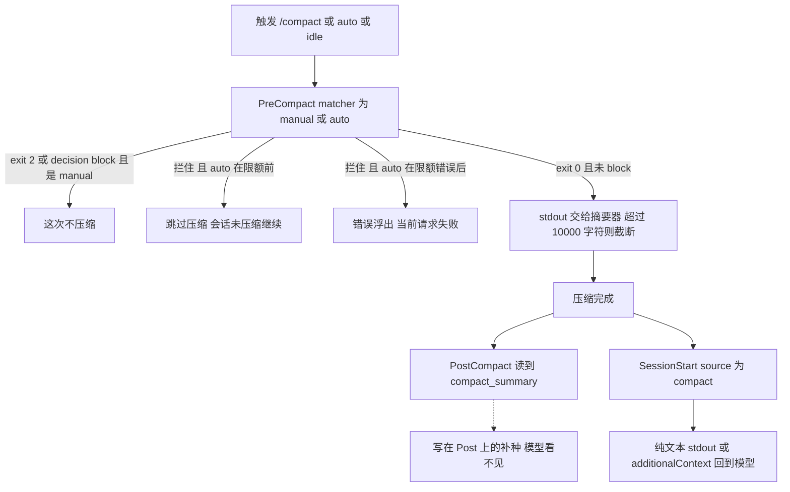

长会话跑到后半段，关键约束和未收工的检查清单不见了。有人把「压完把事实补回去」写在 `PostCompact` 上。也有人把 exit 2 挂在压缩之后，以为还能撤回。压缩一旦完成，这两只都改不回窗口。

能拦的是 `PreCompact`。它在压缩之前触发。exit 2，或顶层 `decision: "block"`，能让这次压缩不发生。放行时，hook 的 stdout 变成给摘要器的指令。每条 hook 超过 10,000 字符会被截断，并追加一个标记。`PostCompact` 在压缩已经完成之后才跑。它没有决策权。它看见的是 `compact_summary`。它补不回模型眼前的上下文。要让下一轮还看得见那些事实，走 `SessionStart` 的 matcher `compact`。

拦自动压缩要分清时机。限额之前拦住，跳过压缩，会话以未压缩状态继续。若这次压缩是为了从 API 已经返回的上下文限额错误里恢复，拦住会让底层错误浮出，当前请求失败。

我在 2026-11-11 打开并重读了 [Hooks reference](https://code.claude.com/docs/en/hooks#precompact) 的 [PreCompact](https://code.claude.com/docs/en/hooks#precompact)、[PostCompact](https://code.claude.com/docs/en/hooks#postcompact)、[PreCompact output](https://code.claude.com/docs/en/hooks#precompact-output)，以及 [Automate actions with hooks](https://code.claude.com/docs/en/hooks-guide) 里 [Re-inject context after compaction](https://code.claude.com/docs/en/hooks-guide#re-inject-context-after-compaction)。没有跑 Claude Code，没有配真实 hook。字段名和时序只转述这两页。10,000 这一刀，我对过 [v2.1.314](https://github.com/anthropics/claude-code/releases/tag/v2.1.314) 的 changelog。GitHub 上这条 release 的发布时间是 2026-10-30。

昨天讲配置平面。那一闸拦的是 settings 和 skills 进当前会话。`policy_settings` 拦不住。今天这刀切在上下文平面。窗口被折薄之前才有闸。折薄之后的补种走 `SessionStart` 的 `compact`。模型身份是前天那篇的题目，这里不重写。上下文窗口也是控制环里的稀缺资源。预算和收工不展开。

<!-- more -->

## 折薄之前才有闸



生命周期表把 `PreCompact` 写成压缩之前，把 `PostCompact` 写成压缩完成之后。matcher 两只相同。

| Matcher | 何时 |
| --- | --- |
| `manual` | `/compact`。PostCompact 是这次手动压缩完成之后 |
| `auto` | 对话到达 [auto-compact window](https://code.claude.com/docs/en/model-config#set-the-auto-compact-window)，以及 [idle compaction](https://code.claude.com/docs/en/settings-reference#idlecompaction)。阈值和闲置条件以这两页为准，这篇不抄数字 |

输入在公共字段之外是 `trigger` 和 `custom_instructions`。`manual` 时，`custom_instructions` 是用户传给 `/compact` 的内容，没传就是 `null`。`auto` 时恒为 `null`。这是输入，不是摘要指令。摘要指令是放行之后的 stdout。

参考页没有字段区分「限额前主动压」和「限额错误之后的恢复压」。`trigger` 都是 `auto`。`custom_instructions` 又都是 `null`。两种后果要按这次压缩为什么发生来分，不能从输入里读出来。

exit 2 拦住压缩。手动 `/compact` 时，stderr 展示给用户。顶层 JSON 也可以拦。`decision` 的值就是 `"block"`，配上 `reason`。要放行，别写 `decision`，或者 exit 0、什么 JSON 都不交。自动压缩被拦住之后，参考页写了跳过或请求失败。stderr 会不会像手动那样展示，PreCompact 小节没有写。「未核实」。

`systemMessage` 和 `continue` 被丢掉。PostCompact 同样丢掉这两项。`continue: false` 在这只事件上不构成第二套闸。

放行，也就是 exit 0 且没有 block 时，stdout 作为压缩摘要的指令。每条 hook 的 stdout 保持在 10,000 字符以内。更长的输出会在上限处截断，并追加一个标记。标记原文，我打开的 PreCompact output 小节没有给出。「未核实」。v2.1.314 的 changelog 原句是：Fixed a PreCompact hook with very large output making compaction fail or repeat; each hook's output is now cut at 10,000 characters。修的是过长输出让压缩失败，或让压缩反复发生。

Exit code 0 那一节把纯文本 stdout 的去向点了名。`UserPromptSubmit`、`UserPromptExpansion`、`SessionStart`、`PostModelSwitch` 进 Claude 的上下文。`PreCompact` 变成摘要指令。`PostCompact` 不在这两列里。多数事件的 stdout 写进调试日志。

`additionalContext` 的投放点列表有 SessionStart，没有 PostCompact，也没有 PreCompact。PostCompact 的 JSON 里写这个字段，到不了模型眼前。

`if` 只在工具事件上算：`PreToolUse`、`PostToolUse`、`PostToolUseFailure`、`PermissionRequest`、`PermissionDenied`。写到 PreCompact 或 PostCompact 上，这只 hook 不会跑。`if: "Bash(...)"` 挂在压缩闸上，闸等于没装，压缩照常发生。

要路径写错、脚本崩溃或超时也按拦住处理，给 `command` 或 `http` 写 `onFailure: "block"`。这要 Claude Code v2.1.295 或更新。总述写：设了 `"block"`，失败去做这一事件的 exit 2 会做的事。例外是 `PermissionRequest`，失败改成拒绝这次权限请求。`Stop`、`SubagentStop`、`TaskCompleted`、`TeammateIdle` 上这个字段不起作用。设了 `async` 或 `asyncRewake` 的后台 command hook 也不起作用。PreCompact 和 PostCompact 不在这几处。PreCompact 的 exit 2 是拦住压缩，所以失败按这一句会拦住。PostCompact 的 exit 2 只把 stderr 给用户看。失败按同一句处理，撤不回已经压完的窗口。页上没有把这两只事件和 `onFailure` 放进同一个例子。我按这两句拼。夹具不模拟脚本缺失，也不模拟超时。

PostCompact 和 `SessionStart` 的 `compact` 谁先跑，两页仍然没有写。11 月 4 日留过这个空。我这次重开，还是没有顺序。图上画成压缩完成之后的两路，不排先后。

## 三列并排

| 维度 | PreCompact | PostCompact | SessionStart（matcher=`compact`） |
| --- | --- | --- | --- |
| 何时 | 压缩之前 | 压缩完成之后 | 压缩之后的开局。`source` 为 `compact`。自动或手动都会 |
| matcher | `manual`、`auto`。空 matcher 每次都跑 | 与 PreCompact 相同 | `compact`。这是会话怎么开始，不是 `manual` / `auto` |
| exit 2 | 拦住压缩。手动 `/compact` 时 stderr 给用户。自动压缩分两种后果，见上 | 不拦。stderr 只给用户看 | 不拦。stderr 只给用户看。11 月 8 日写过入口闸，这篇只借用补种 |
| decision | 顶层 `decision: "block"`，加 `reason` | 没有。和 Notification、SessionEnd、InstructionsLoaded 同一行，只做副作用 | 没有 decision control。能加 `hookSpecificOutput.additionalContext` |
| stdout | exit 0 且未 block：给摘要器的指令。每条 10,000 字符，超出截断并加标记 | 不进模型上下文。按 Exit code 0 那一节，落在调试日志那一档 | 纯文本 stdout 加入 Claude 的上下文 |
| 能否把事实放回模型眼前 | 这条 stdout 是摘要指令，不是补种 | 投放点列表没有这只事件 | 能。指南写的补种口就是这条 |
| 适合 | 拦住不该发生的手动压缩。未落盘时推迟限额前的自动压缩。告诉摘要器要留住什么 | 把 `compact_summary` 记到外部日志，或更新看板 | 压缩后让模型再看见清单、分支、约定。动态一句可以换成 `git log --oneline -5` 这种命令 |
| 不适合 | 把 stdout 当成压完后的上下文。加 `if`。以为拦住限额错误恢复之后，当前请求还会成功 | 当闸。当补种通道 | 当压缩闸。把每次开局都要的静态说明全塞进 hook。静态的放 CLAUDE.md |

`InstructionsLoaded` 的 `load_reason: "compact"` 是另一只事件。压缩之后，指令文件被重新加载，它会开火。它不能拦，也不能改内容。JSON 字段被丢掉。只供观测。观测点留在日志里就好。补种和闸都不是它。

## 拦住、下令、补种

要拦危险的手动压缩，matcher 写 `manual`。要在未落盘的关键状态还在时推迟自动压缩，matcher 写 `auto`。两条都要，写成 `manual|auto`，或把 matcher 留空。exit 2 和顶层 `decision: "block"` 都能拦。自动那一路先问清：这次是限额前，还是已经在从限额错误里恢复。前者拦住，会话还在，窗口还是厚的。后者拦住，当前请求失败。

```json
{
  "hooks": {
    "PreCompact": [
      {
        "matcher": "auto",
        "hooks": [
          {
            "type": "command",
            "command": "${CLAUDE_PROJECT_DIR}/.claude/hooks/hold-compact.sh",
            "args": [],
            "onFailure": "block"
          }
        ]
      }
    ]
  }
}
```

```bash
#!/bin/bash
# stdin 里有 trigger。auto 时 custom_instructions 是 null。
# exit 2 拦住这次压缩。限额前：跳过，会话未压缩继续。
# 已经是限额错误恢复：当前请求失败。
input=$(cat)
printf '%s\n' "$input" >> "${CLAUDE_PROJECT_DIR}/.claude/compact-hold.log"
echo "关键状态还没落盘，先别压" >&2
exit 2
```

同一只闸也可以 exit 0，交顶层决策：

```json
{
  "decision": "block",
  "reason": "未落盘的检查清单还在"
}
```

要让摘要留住某些事实，exit 0，别写 `decision`，把指令放在 stdout，并且控制在 10,000 字符以内：

```bash
#!/bin/bash
# 纯文本。这是给摘要器的指令。
echo "摘要里保留未收工的检查清单，以及当前分支名"
```

要在压缩后让模型再看见清单、分支或约定，用 `SessionStart`，matcher 写 `compact`。指南的例子是 `echo` 一段提醒。命令打到 stdout 的纯文本会进 Claude 的上下文。参考页还接受 `hookSpecificOutput.additionalContext`。静态、每次开局都要的说明，放 CLAUDE.md。

```json
{
  "hooks": {
    "SessionStart": [
      {
        "matcher": "compact",
        "hooks": [
          {
            "type": "command",
            "command": "echo '压缩后仍有效：未收工的检查清单见仓库根的 TODO。'"
          }
        ]
      }
    ]
  }
}
```

PostCompact 适合把 `compact_summary` 记到外部日志，或更新一块看板。它改不了压缩结果。exit 2 的 stderr 只给用户看。

不要给 PreCompact 或 PostCompact 加 `if: "Bash(...)"`。非工具事件，hook 直接不跑。政策脚本加上 `onFailure: "block"`，防的是路径写错之后静默放行。这只防得住 PreCompact 那种 exit 2 本来就拦的事。挂在 PostCompact 上，失败翻译出来的仍是事后一句 stderr。

## 夹具里，拦早和拦晚不是一回事

演示在 [`demos/precompact-vs-postcompact/`](https://github.com/cFireworks/cfireworks.github.io/tree/main/demos/precompact-vs-postcompact)。不读密钥，不访问网络，不启动 Claude Code。假一次 `manual`，一次限额前的 `auto`，一次限额错误恢复的 `auto`。后两档是夹具里的 `kind`，不是参考页上的字段。处理器是 `pre_exit2`、`pre_block_decision`、`pre_stdout_instructions`、`post_only`、`sessionstart_compact`、`none`。

只认两种拦截。`continue` 和单独的 `reason` 不读。拦住之后的两种结局分开记：

```python
def outcome(kind: str, blocked: bool) -> tuple[int, int, int]:
    """返回 compacted, request_failed, continued。

    没拦住：压缩发生，请求不失败。
    manual，或限额前的 auto：拦住就跳过，会话未压缩继续。
    限额错误恢复的 auto：拦住则当前请求失败。
    这是对 Hooks reference 里 PreCompact 那两句的模拟，不是 Claude Code。
    """
    if not blocked:
        return 1, 0, 1
    if kind == "auto_limit_error":
        return 0, 1, 0
    return 0, 0, 1
```

| 夹具 | 在看什么 | 结局 |
| --- | --- | --- |
| `manual_pre_exit2` | 手动压缩，exit 2 | `compacted=0`。`request_failed=0`。`continued=1` |
| `auto_before_limit_pre_exit2` | 限额前 auto，exit 2 | `compacted=0`。会话未压缩继续 |
| `auto_before_limit_pre_block_decision` | 限额前，顶层 `decision: "block"` | `compacted=0`。`continued=1` |
| `auto_limit_error_pre_exit2` | 限额错误恢复，exit 2 | `compacted=0`。`request_failed=1` |
| `auto_limit_error_pre_block_decision` | 限额错误恢复，`decision: "block"` | `compacted=0`。`request_failed=1` |
| `manual_pre_stdout_instructions` | 放行，短 stdout | `compacted=1`。`summary_has_stdout=1`。`truncated=0` |
| `manual_stdout_over_cap` | stdout 超过 10,000 字符 | `compacted=1`。`truncated=1`。截断点后的 `TAIL` 不在指令里 |
| `manual_post_only` | 压缩后跑，JSON 里写了 `additionalContext` | `compacted=1`。`saw_summary=1`。`model_context_reinjected=0` |
| `manual_sessionstart_compact` | `SessionStart` 的 `compact`，纯文本 stdout | `compacted=1`。`model_context_reinjected=1` |
| `manual_none` | 什么都不交 | `compacted=1`。没有指令，也没有补种 |
| `manual_pre_discarded_fields` | 只有 `continue: false` 和 `systemMessage` | `compacted=1` |
| `auto_before_limit_if_skipped` | PreCompact 上写了 `if` | `hook_fired=0`。`compacted=1` |
| `auto_before_limit_wrong_matcher` | matcher 是 `manual`，来的是 auto | `hook_fired=0`。`compacted=1` |

`manual`、`auto_before_limit`、`auto_limit_error` 三档都打了这六只处理器。表里只列分得开结论的那几行。`python3 demos/precompact-vs-postcompact/run_demo.py` 我跑过，最后一行是 `result=pass`。

## 上下文也是身份

工具之前那闸拦住还没发生的调用。回合入口那闸停在提示进模型之前。模型身份那闸停在请求切换生效之前。配置那闸停在中途写入进当前会话之前。上下文这一闸，停在窗口被折薄之前。折薄之后，PostCompact 只能看着摘要做记录。事实要回到模型眼前，走 `SessionStart` 的 `compact`。别把 PostCompact 当成还能改写记忆的第二道门。

你们把「先别压」写在 `PreCompact` 的 `manual` 上，还是写在 `auto` 上？拦住的那次，是限额之前，还是已经在从限额错误里恢复？摘要指令和压缩后的补种，各写在哪一只事件上？

## 扩展阅读

- [Hooks reference：PreCompact](https://code.claude.com/docs/en/hooks#precompact)
- [Hooks reference：PostCompact](https://code.claude.com/docs/en/hooks#postcompact)
- [Hooks reference：PreCompact output](https://code.claude.com/docs/en/hooks#precompact-output)
- [Re-inject context after compaction](https://code.claude.com/docs/en/hooks-guide#re-inject-context-after-compaction)
- [Set the auto-compact window](https://code.claude.com/docs/en/model-config#set-the-auto-compact-window)
- [idleCompaction](https://code.claude.com/docs/en/settings-reference#idlecompaction)
- [别把改 settings 当成已经生效](https://cfireworks.github.io/2026/11/10/2026-11-10-configchange-gate/)
- [别把 /model 当成已经切完](https://cfireworks.github.io/2026/11/09/2026-11-09-premodelswitch-vs-postmodelswitch/)
- [别把入口闸挂在会话开头](https://cfireworks.github.io/2026/11/08/2026-11-08-userpromptsubmit-vs-sessionstart/)
- [别在事后装闸门](https://cfireworks.github.io/2026/11/04/2026-11-04-pre-vs-post-hooks/)

## 讨论

如果仓库里已经有压缩 hook：exit 2 是写在 `PreCompact` 上，还是 `PostCompact` 上？matcher 写的是 `manual`，还是 `auto`？stdout 那段，你是在给摘要器下令，还是以为它会在压完之后出现在模型眼前？我没有生产流量。自动压缩被拦住时 stderr 会不会展示，参考页没有写，我也不替它补。截断标记的原文，PreCompact output 小节没有给出，我也不替它编一个。PostCompact 和 `SessionStart` 的 `compact` 谁先跑，两页还是没写。
