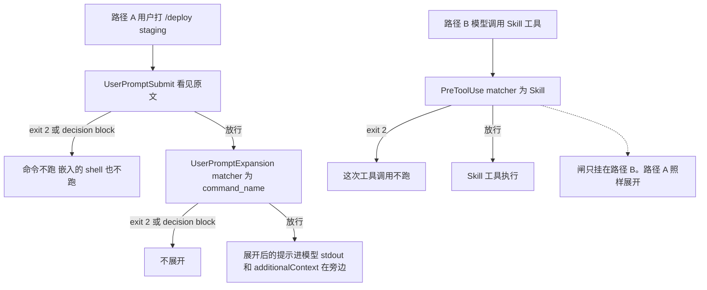

有人把「禁掉 /deploy」挂在 `PreToolUse` 上，matcher 写 `Skill`。队友在输入框里打 `/deploy staging`。这只闸不开火。命令照样展开。技能正文里用 `!` 注进去的 shell 也跑了。

打进输入框的斜杠命令，不是一次 `Skill` 工具调用。`PreToolUse` 匹配 `Skill`，只在 Claude 自己调用这个工具时开火。直接打 `/skillname`，绕过 `PreToolUse`。这条直路上的闸是 `UserPromptExpansion`。它在用户打的命令展开成提示、正文到达 Claude 之前触发。matcher 对的是 `command_name`。exit 2，或顶层 `decision: "block"`，拦住的是展开。

`UserPromptSubmit` 仍能拦住打出来的那一行。拦住了，命令不跑，`!` 注进去的 shell 也不跑。它收到的是没展开的原文。要对命令名或参数做匹配，用 `UserPromptExpansion`。

我在 2026-11-12 打开并重读了 [Hooks reference](https://code.claude.com/docs/en/hooks) 的生命周期表、[UserPromptExpansion](https://code.claude.com/docs/en/hooks#userpromptexpansion)、[UserPromptSubmit](https://code.claude.com/docs/en/hooks#userpromptsubmit)、[Add context for Claude](https://code.claude.com/docs/en/hooks#add-context-for-claude)，以及 [Automate actions with hooks](https://code.claude.com/docs/en/hooks-guide) 的事件表和 matcher 表。没有跑 Claude Code，没有配真实 hook。字段名和时序只转述这两页。`UserPromptSubmit` 先于展开，我对过 [v2.1.299](https://github.com/anthropics/claude-code/releases/tag/v2.1.299) 的 changelog。GitHub 上这条 release 的发布时间是 2026-10-14。

11 月 8 日把 `UserPromptSubmit` 写成每轮入口闸。`UserPromptExpansion` 当时是一条虚线。这篇补上虚线没写完的一句：打进去的 `/skill` 不经过 `PreToolUse` 的 `Skill`。昨天讲的是上下文窗口。今天这刀切在一条斜杠命令怎么进模型。

<!-- more -->

## 打出来的命令走另一扇门



虚线是只挂在路径 B 上的那只闸。路径 A 不从这里过。先后是这两句。`UserPromptSubmit` 在 skill 或自定义斜杠命令展开之前。`UserPromptExpansion` 在用户打的命令展开成提示、到达 Claude 之前。两页没有画成一张总图。

生命周期表把 `UserPromptExpansion` 写成：用户打的命令展开成提示时，到达 Claude 之前，可以拦住展开。matcher 表对的是 command name。空 matcher 对每一次 prompt-type 命令开火。`slash_command` 和 `mcp_prompt` 都是这只事件的 `expansion_type`。夹具把空 matcher 当成两种都对上。

输入在公共字段之外是 `expansion_type`、`command_name`、`command_args`、`command_source`，以及原来的 `prompt`。`expansion_type` 两个值。`slash_command` 是 skill 和自定义命令。`mcp_prompt` 是 MCP server 的 prompt。页上的例子：

```json
{
  "hook_event_name": "UserPromptExpansion",
  "expansion_type": "slash_command",
  "command_name": "example-skill",
  "command_args": "arg1 arg2",
  "command_source": "plugin",
  "prompt": "/example-skill arg1 arg2"
}
```

`command_source` 的例子是 `"plugin"`。其余取值页上没有枚举。我不补 user、project、bundled。「未核实」。

`/deploy staging` 按这个形状读。`command_name` 是 `deploy`，`command_args` 是 `staging`，`prompt` 是打出来的整行。页上的命令名例子是 `example-skill`，参数例子是 `"arg1 arg2"`。matcher 对的是 `command_name`，不对参数。参数给脚本自己读。

退出码表这一行能拦。`UserPromptExpansion` 的 exit 2 拦住展开。顶层 `decision: "block"` 加 `reason`，和 `UserPromptSubmit` 同一族。`decision` 的唯一取值是 `"block"`。要放行，别写 `decision`，或者 exit 0、什么 JSON 都不交。exit 2 的 stderr 走和 `reason` 一样的路，拦的那句话给用户看。

指南的 prompt 钩子那一节写：`PostToolBatch`、`UserPromptSubmit`、`UserPromptExpansion` 上，`ok: false` 会结束回合，`reason` 出现为警告行。参考页同一段补了一句：这几只事件遇到 `decision: "block"` 就结束回合，不看 `continue`。这是 prompt 钩子的响应合同。command 钩子的专项写的是：`decision: "block"` 让命令不展开。

放行时，exit 0 的纯文本 stdout 会进 Claude 的上下文。同一句点了名的还有 `UserPromptSubmit`、`SessionStart`、`PostModelSwitch`。解析失败的 stdout 不加。`additionalContext` 放在 `hookSpecificOutput` 里，`hookEventName` 写 `"UserPromptExpansion"`。字段说明写的是 alongside the expanded prompt。多只 hook 都交了，Claude 全都收。`additionalContext`、`systemMessage`、`initialUserMessage` 和纯文本 stdout，各自 10,000 字符封顶。

页上的例子 JSON 同时写了 `decision: "block"` 和 `additionalContext`。展开被拦住时，这段还交不交，和「挨着展开后的提示」对不齐。「未核实」。夹具在拦住时不把上下文记成已送达。

`suppressOriginalPrompt` 写在 `UserPromptSubmit` 的 What a blocked prompt leaves behind。`UserPromptExpansion` 写全部 JSON 输出字段都可用，字段表和例子都没有这个字段。认不认，页上没有演示。「未核实」。

`if` 只在工具事件上算：`PreToolUse`、`PostToolUse`、`PostToolUseFailure`、`PermissionRequest`、`PermissionDenied`。写到 `UserPromptExpansion` 上，这只 hook 不会跑。

`UserPromptSubmit` 的专项把 `command`、`http`、`mcp_tool` 的默认超时写成 30 秒。`UserPromptExpansion` 的专项没有再写超时。总述里的 600 秒是多数事件的默认，再点名三只降到 30 秒：`UserPromptSubmit`、`PreModelSwitch`、`PostModelSwitch`。`MessageDisplay` 是 10 秒。这一只不在那两句里。「未核实」。我不把它写成 600，也不写成 30。

`onFailure: "block"` 仍要 Claude Code v2.1.295 或更新。总述写：设了 `"block"`，失败去做这一事件的 exit 2 会做的事。例子点名的是 `PreToolUse` 拦住工具调用，`UserPromptSubmit` 拦住提示。`UserPromptExpansion` 不在「这个字段不起作用」那几只里，也不在例子里。失败会不会拦住展开，「未核实」。夹具不模拟脚本缺失，也不模拟超时。

我打开的 `UserPromptSubmit` 小节已经写：你打的是 `/deploy staging` 这种技能或自定义命令时，这只 hook 收到的是那一行，不是展开后的技能正文。拦住了，命令不跑，技能用 `!` 注进去的 shell 也不跑。要对名字或参数匹配，用 `UserPromptExpansion`。小节没有写这句从哪一版开始。changelog v2.1.299 的原句是：UserPromptSubmit hooks now run before a skill or custom slash command expands, so a hook that blocks the prompt now also stops its embedded shell commands。同一条还改了一句：技能自己 front-matter 里的 `UserPromptSubmit`，改成从唤起这次技能之后的下一句提示才开始跑。我只核对了 changelog，没有在会话里试。

## 三列并排

| 维度 | UserPromptExpansion | UserPromptSubmit | PreToolUse（matcher=`Skill`） |
| --- | --- | --- | --- |
| 何时 | 用户打的命令展开成提示之前 | 提示提交之后、Claude 处理之前。v2.1.299 起，在 skill 或自定义斜杠命令展开之前 | Claude 调用工具之前。11 月 5 日写过每刀都会到，这篇只借 `Skill` 这一格 |
| matcher | `command_name`。空 matcher 每次 prompt-type 命令都跑 | 没有。写了会被静默忽略 | 工具名。这里是 `Skill` |
| 用户打 `/skill` | 会开火。这就是直路 | 会开火。收到的是打出来的那一行 | 不会。直接打 `/skillname` 绕过它 |
| Claude 调用 Skill 工具 | 不开火。事件写的是用户打出来的命令 | 不按这次工具调用触发 | 会开火 |
| exit 2 | 拦住展开 | 提示到不了 Claude。命令因此不跑，`!` 注进去的 shell 也不跑 | 拦住这次工具调用 |
| 命令名或参数 | matcher 对 `command_name`。`command_args` 在输入里，脚本自己读 | 没有 matcher。参考页让你改用左边这一只 | 对的是工具名，不是 `/deploy` 的参数 |
| stdout / additionalContext | 放行时，纯文本 stdout 进上下文。`additionalContext` 在 `hookSpecificOutput` 里，挨着展开后的提示 | 同一套纯文本通道。位置 11 月 8 日写过 | 决策字段是 `permissionDecision`。注入不是这扇门的用途 |
| 适合 | 按名字拦住或审计用户打出来的 `/deploy`、某个 skill、某条 MCP prompt。给某一只技能旁边加清单 | 跟命令名无关的每轮政策。密钥、发布冻结。拦住时，展开和嵌入 shell 也不发生 | 模型自己调用 `Skill` 时拦住 |
| 不适合 | 当模型调用 `Skill` 的闸。写 `if`。把默认超时写成 30 或 600 | 按命令名或参数分流 | 拦住用户打进去的 `/skillname` |

## 按名字拦，按回合拦，按工具拦

要拦住或审计用户打出来的 `/deploy`，把闸放在 `UserPromptExpansion`，matcher 写 `deploy`。批准文件的路径是脚本自己定的，不是参考页上的字段。参考页的例子是：匹配 `deploy` 的 hook，没有批准文件就拦住 `/deploy`。

```json
{
  "hooks": {
    "UserPromptExpansion": [
      {
        "matcher": "deploy",
        "hooks": [
          {
            "type": "command",
            "command": "${CLAUDE_PROJECT_DIR}/.claude/hooks/hold-deploy.sh",
            "args": [],
            "onFailure": "block"
          }
        ]
      }
    ]
  }
}
```

```bash
#!/bin/bash
# stdin 里有 command_name、command_args、expansion_type。
# matcher 已经对上 deploy。exit 2 拦住展开。
input=$(cat)
if [[ ! -f "${CLAUDE_PROJECT_DIR}/.claude/deploy-approved" ]]; then
  echo "没有批准文件，/deploy 不展开" >&2
  exit 2
fi
exit 0
```

同一只事件也可以 exit 0，交顶层决策。下面这份不带 `additionalContext`。页上的例子把这两样放在一起。拦住之后上下文还交不交，「未核实」。

```json
{
  "decision": "block",
  "reason": "没有批准文件，/deploy 不展开"
}
```

要给某一只技能旁边加清单，exit 0，别写 `decision`，放进 `hookSpecificOutput`：

```json
{
  "hookSpecificOutput": {
    "hookEventName": "UserPromptExpansion",
    "additionalContext": "发布清单：先看冻结窗口，再核对目标环境。"
  }
}
```

写在 JSON 顶层，Add context 那一节要的不是这个位置。指南里「顶层同名字段静默忽略」的原句点名的是 `UserPromptSubmit`。11 月 8 日写过。

跟命令名无关的政策，密钥、冻结窗口，留在 `UserPromptSubmit`。自 v2.1.299 起，它拦住的那一行不会再展开，技能用 `!` 注进去的 shell 也不跑。它看不了展开后的正文，也没有 `command_name` 这种 matcher。

不要指望 `PreToolUse` 的 `Skill` 接住打进去的 `/skillname`。那只闸等的是模型自己发出的工具调用。

不要给 `UserPromptExpansion` 加 `if`。非工具事件，hook 直接不跑。`expansion_type` 还有 `mcp_prompt`。审计用户唤起的 MCP prompt，同样挂在这只事件上，matcher 写那条 prompt 的 `command_name`。唤起时输入框里到底是什么字，例子 JSON 只给了 `slash_command`。「未核实」。

政策脚本可以写上 `onFailure: "block"`。这一只事件上失败会不会拦住展开，见上，「未核实」。

## 夹具里，打进去的命令不算工具调用

演示在 [`demos/userpromptexpansion-gate/`](https://github.com/cFireworks/cfireworks.github.io/tree/main/demos/userpromptexpansion-gate)。不读密钥，不访问网络，不启动 Claude Code。假一次打出来的 `/deploy staging`（`slash_command`，`command_name` 为 `deploy`，正文里带一条 `!` shell），一次 `/review`，一次 MCP prompt（`expansion_type` 为 `mcp_prompt`，命令名是夹具自己的 `release-note`），一次 Claude 调用 `Skill` 工具。处理器是 `upe_exit2`、`upe_block_decision`、`upe_stdout_context`、`ups_exit2`、`pretooluse_skill_only`、`upe_with_if`、`none`。一次只挂一只。这不是 settings 里的 hook。

`PreToolUse` 只看见工具调用：

```python
def pretooluse_sees(kind: str) -> bool:
    """打出来的命令不算工具调用。只有 Skill 工具那条路才看见。"""
    return kind == "skill_tool"
```

拦住只认两种：exit 2，或顶层 `decision: "block"`。`ups_exit2` 那一行是对 changelog v2.1.299 的模拟。展开还没开始，嵌入的 shell 记成没跑。`UserPromptExpansion` 拦住时，夹具里的 shell 写在展开正文里，所以也记成没跑。参考页对这只事件写的是拦住展开，没有把 `!` shell 再写一遍。

| 夹具 | 在看什么 | 结局 |
| --- | --- | --- |
| `typed_deploy_upe_exit2` | matcher `deploy`，exit 2 | `expanded=0`。`model_saw_prompt=0` |
| `typed_deploy_upe_block_decision` | 顶层 `decision: "block"` | `expanded=0`。`model_saw_prompt=0` |
| `typed_review_upe_exit2` | 同一条 matcher，来的是 `/review` | `upe_fired=0`。`expanded=1` |
| `typed_deploy_upe_stdout_context` | 放行。两条通道分开记 | `expanded=1`。上下文里有 stdout，也有 `additionalContext` |
| `typed_deploy_ups_exit2` | `UserPromptSubmit` exit 2。模拟 v2.1.299 | `expanded=0`。`embedded_shell_ran=0` |
| `typed_deploy_pretooluse_skill_only` | 闸只挂在 `Skill` 上，人打了 `/deploy staging` | `expanded=1`。`pretooluse_fired=0` |
| `skill_tool_pretooluse_skill_only` | 模型调用 `Skill` | `pretooluse_fired=1`。工具被拦住。`upe_fired=0` |
| `typed_deploy_upe_with_if` | `UserPromptExpansion` 上写了 `if` | hook 不跑。`expanded=1` |
| `typed_deploy_none` | 什么都不交 | 展开发生，没有闸 |
| `mcp_prompt_matched_exit2` | MCP prompt，matcher 对上命令名 | `expanded=0` |
| `skill_tool_upe_exit2` | 展开闸挂着，来的是工具调用 | `upe_fired=0`。`pretooluse_fired=0` |

`upe_stdout_context` 把纯文本 stdout 和 `hookSpecificOutput.additionalContext` 分成两条通道。一条真实 command hook 的 stdout 要么是纯文本，要么是一份 JSON，不是同一次里两样都有。夹具分开记，只为断言放行时各自会到。空 matcher 的同一只放行也打在 MCP prompt 上，`upe_fired=1`，展开发生。命令名对不上 `deploy` 的那条 MCP prompt，`upe_fired=0`，`expanded=1`。

拦住时不记注入。页上那份同时带 `decision: "block"` 和 `additionalContext` 的例子，夹具核对过：拦住之后 `model_has_additional` 仍是 0。这是夹具的选择。「未核实」留在上面。`command_source` 从 `"plugin"` 换成空字符串，结局不变。夹具不解释这个字段。`hookEventName` 写成 `UserPromptSubmit` 的那段，不记进这只闸。

`python3 demos/userpromptexpansion-gate/run_demo.py` 我跑过，最后一行是 `result=pass`。

## 展开和工具调用是两扇门

工具之前那闸等的是模型已经写出的一次调用。回合入口那闸等的是提交上来的一行字。上下文那闸等的是窗口被折薄之前。命令展开这一闸，等的是用户打出来的命令变成提示之前。打进去的 `/deploy` 归 `UserPromptExpansion`。只守 `PreToolUse` 的 `Skill`，留下一条根本不算工具调用的路。

你们把「禁掉 /deploy」写在 `PreToolUse` 的 `Skill` 上，还是写在 `UserPromptExpansion` 的 `command_name` 上？跟命令无关的冻结，还留在 `UserPromptSubmit` 吗？

## 扩展阅读

- [Hooks reference：UserPromptExpansion](https://code.claude.com/docs/en/hooks#userpromptexpansion)
- [Hooks reference：UserPromptSubmit](https://code.claude.com/docs/en/hooks#userpromptsubmit)
- [Add context for Claude](https://code.claude.com/docs/en/hooks#add-context-for-claude)
- [Automate actions with hooks](https://code.claude.com/docs/en/hooks-guide)
- [changelog v2.1.299](https://github.com/anthropics/claude-code/releases/tag/v2.1.299)
- [别把压缩当成已经发生](https://cfireworks.github.io/2026/11/11/2026-11-11-precompact-vs-postcompact/)
- [别把入口闸挂在会话开头](https://cfireworks.github.io/2026/11/08/2026-11-08-userpromptsubmit-vs-sessionstart/)
- [别把 PermissionRequest 当成 PreToolUse](https://cfireworks.github.io/2026/11/05/2026-11-05-permissionrequest-vs-pretooluse/)
- [别在事后装闸门](https://cfireworks.github.io/2026/11/04/2026-11-04-pre-vs-post-hooks/)

## 讨论

如果仓库里已经有「禁掉 /deploy」：它注册在 `PreToolUse` 的 `Skill` 上，还是 `UserPromptExpansion` 的 `command_name` 上？`UserPromptSubmit` 拦住的是打出来的那一行，还是你以为它看见了展开后的技能正文？我没有生产流量。`command_source` 除了例子里的 `"plugin"` 还有哪些值，参考页没有枚举，我也不替它补。`UserPromptExpansion` 的默认超时，专项没有写，我也不把它当成 600 秒或 30 秒。展开被拦住时 `additionalContext` 还交不交，例子和字段说明对不齐，我也不替它选边。`suppressOriginalPrompt` 在这只事件上认不认，页上没有演示，我也不把它写成和 `UserPromptSubmit` 一样。`onFailure: "block"` 挂在这只事件上，失败会不会拦住展开，例子没有点到它。总述那句我没有套过来。
