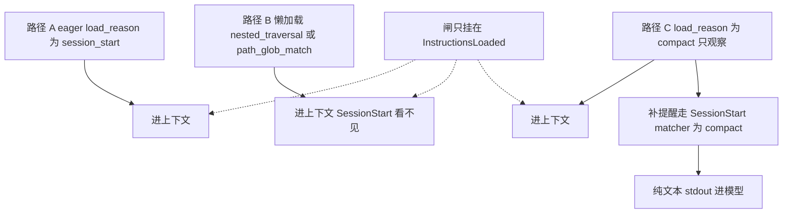

有人把「敏感仓库的嵌套 `CLAUDE.md` 不许进上下文」写在 `InstructionsLoaded` 上。脚本 exit 2，或者交一份顶层 `decision: "block"`。Claude 走进子目录，文件照样进上下文。这只事件不是闸，是摄像头。

`CLAUDE.md` 和 `.claude/rules/*.md` 被读进上下文时，会触发 `InstructionsLoaded`。会话开头的急加载会跑。子目录里的嵌套 `CLAUDE.md`、带 `paths:` 的条件规则后来被懒加载时，也会再跑。matcher 对的是 `load_reason`。五个值是 `session_start`、`nested_traversal`、`path_glob_match`、`include`、`compact`。这只事件没有 decision control。它拦不住加载，也改不了规则正文。exit 2 被忽略。`systemMessage`、`continue` 这类 JSON 输出字段会被丢掉。它异步运行，只适合审计、合规追踪和可观测性。想在会话开头或压缩之后给模型补一句提醒，走 `SessionStart`。那边的 matcher 可以是 `startup` 或 `compact`。不要把 `InstructionsLoaded` 的 `session_start` 写成 `SessionStart` 的 `startup`。这两个字符串不是同一个。

我在 2026-11-13 打开并重读了 [Hooks reference](https://code.claude.com/docs/en/hooks) 的生命周期表、matcher 表、[InstructionsLoaded](https://code.claude.com/docs/en/hooks#instructionsloaded)、退出码表、Decision control 总表、[Add context for Claude](https://code.claude.com/docs/en/hooks#add-context-for-claude)、Exit code 0，以及 [How Claude remembers your project](https://code.claude.com/docs/en/memory) 里 `InstructionsLoaded` 和 `AGENTS.md` 那一行，还有 [Automate actions with hooks](https://code.claude.com/docs/en/hooks-guide) 的事件表、matcher 表和 [Re-inject context after compaction](https://code.claude.com/docs/en/hooks-guide#re-inject-context-after-compaction)。没有跑 Claude Code，没有配真实 hook。字段名和时序只转述这三页。事件是 [v2.1.69](https://github.com/anthropics/claude-code/releases/tag/v2.1.69) 加上的。changelog 原句是：Added `InstructionsLoaded` hook event that fires when CLAUDE.md or `.claude/rules/*.md` files are loaded into context。GitHub 上这条 release 的发布时间是 2026-03-05T00:26:21Z，北京时间 2026-03-05 08:26。

昨天讲斜杠命令。`UserPromptExpansion` 能拦住展开。11 月 11 日讲压缩。`PreCompact` 能拦住压缩。压缩之后指令文件会重载，`load_reason` 是 `compact`。要补提醒，走 `SessionStart` 的 matcher `compact`。11 月 10 日讲配置。`ConfigChange` 能拦住 settings 和 skills 进当前会话。不要把指令文件加载写成那一闸。11 月 8 日讲会话开头。`SessionStart` 能把上下文注进模型。`InstructionsLoaded` 连这条路都没有。这四篇不重写。

<!-- more -->

## 三条路都放行



虚线是只挂在 `InstructionsLoaded` 上的那只闸。exit 2 或顶层 `decision: "block"` 都在这只事件上。三条路都进上下文。路径 B 是会话开场之后才发生的懒加载。`SessionStart` 的 matcher 里没有这一档，它看不见。路径 C 上，`InstructionsLoaded` 只告诉你指令文件被重新加载了。补一句提醒，走旁边的 `SessionStart`。

生命周期表把这只事件写成：`CLAUDE.md` 或 `.claude/rules/*.md` 被读进上下文时。会话开头会跑，会话中途文件被懒加载时也会跑。专项把急加载和懒加载分开写。急加载在会话开头。懒加载的例子有两个。Claude 走进带嵌套 `CLAUDE.md` 的子目录。带 `paths:` frontmatter 的条件规则对上了。原句是：The hook doesn't support blocking or decision control. It runs asynchronously for observability purposes。

matcher 表对的是 load reason。专项的例子是 `"matcher": "session_start"` 只看会话开头加载的文件，`"matcher": "path_glob_match|nested_traversal"` 只看懒加载。空 matcher、`"*"`、或省略，总述写成对上每一次。`InstructionsLoaded` 在有 matcher 的那一列里。夹具把空 matcher 当成五个 `load_reason` 都对上。非空只按 `|` 切。参考页写多数事件也接受逗号。夹具不模拟逗号，也不模拟正则。

五个值的字段说明：

| `load_reason` | 页上怎么写 |
| --- | --- |
| `session_start` | 会话开头加载的文件。matcher 例子用它只看这一档 |
| `nested_traversal` | 懒加载的一类。专项的例子是走进带嵌套 `CLAUDE.md` 的子目录 |
| `path_glob_match` | 懒加载的另一类。带 `paths:` frontmatter 的条件规则对上了。`globs` 只在这一档出现 |
| `include` | `CLAUDE.md` 引入另一个文件。引入的是 `AGENTS.md` 时也是这个值 |
| `compact` | 压缩事件之后，指令文件被重新加载 |

记忆页写，没有 `paths` 的规则在启动时加载，和 `.claude/CLAUDE.md` 同一优先级。这落在急加载那一档。它的 `load_reason` 字符串，hooks 页没有单独点名。「未核实」。我按「启动时加载」放进路径 A。带 `paths` 的规则，记忆页写在 Claude 用 Read、Write 或 Edit 碰对上的文件时加载，用 `cat` 或 `head` 看单个文件也算。这和专项的懒加载例子对得上。路径 B 的 `path_glob_match` 就指这一档。

`include` 是另一条，没有画进上面三路。记忆页写，被 import 的文件和引用它的 `CLAUDE.md` 一起加载。hooks 页写这次的 `load_reason` 是 `include`，`parent_file_path` 是引入它的父指令文件。两页没有写这是一枪还是两枪。「未核实」。夹具把 `include` 记成单独一次开火。

## 输入只有观察

公共字段不在这里重列。专项在公共字段之外给了这些：

| 字段 | 页上怎么写 |
| --- | --- |
| `file_path` | 被加载的指令文件的绝对路径 |
| `memory_type` | `"User"`、`"Project"`、`"Local"`、`"Managed"` |
| `load_reason` | 上面五个值。`"compact"` 是压缩之后重新加载指令文件 |
| `globs` | 来自该文件 `paths:` frontmatter 的 glob。只在 `path_glob_match` 时出现 |
| `trigger_file_path` | 懒加载时，触发这次加载的那个文件 |
| `parent_file_path` | `include` 时，引入它的父指令文件 |

例子 JSON 是一次急加载。`file_path` 是 `/Users/my-project/CLAUDE.md`，`memory_type` 是 `"Project"`，`load_reason` 是 `"session_start"`。`globs`、`trigger_file_path`、`parent_file_path` 都没出现。这三项在别的原因下是省略还是空着，例子没有演示。「未核实」。夹具只在懒加载填 `trigger_file_path`，只在 `path_glob_match` 填 `globs`，只在 `include` 填 `parent_file_path`。

`memory_type` 四个字符串以字段表为准。例子只把根上的 `CLAUDE.md` 写成 `"Project"`。嵌套文件、`.claude/rules/*.md`、`AGENTS.md` 各落在哪一档，专项没有逐条映射。「未核实」。夹具在其余行也填了 `"Project"`，只为字段形状，不当成页上的分类。

symlink 按普通 `CLAUDE.md` 加载触发。专项写的是：`CLAUDE.md` 是指向 `AGENTS.md` 的 symlink 时，按一次正常的 `CLAUDE.md` 加载。没有单独的 `load_reason`。`file_path` 记的是链接路径还是目标路径，专项没有写。「未核实」。夹具只断言开火，`load_reason` 用 `session_start`，不解析目标。

直接经 Project instructions 设置读进来的 `AGENTS.md`，这只事件不开火。记忆页的对照表同一句：`InstructionsLoaded` hooks 对 `CLAUDE.md` 会开火。对「通过设置直接读取的 `AGENTS.md`」不开火。经 `CLAUDE.md` import 或 symlink 的，仍会开火。设置有哪几档、默认读哪一个文件，这篇不展开。审计要记住的只有这一条边界：钩挂在 `InstructionsLoaded` 上，直接走设置的 `AGENTS.md` 会从日志里漏掉。文件本身还是进了上下文。漏掉的是这一枪。

决策小节的原句是：InstructionsLoaded hooks have no decision control. They can't block or modify instruction loading. Claude Code discards their JSON output fields, such as `systemMessage` and `continue`. Use this event for audit logging, compliance tracking, or observability。

退出码表这一行是 No。Exit code is ignored。它没有写成「stderr 给用户看」，也没有写成「stderr 被忽略」。stderr 去哪，「未核实」。

Decision control 总表把 `Setup`、`Notification`、`SessionEnd`、`PostCompact`、`InstructionsLoaded`、`StopFailure`、`CwdChanged`、`DirectoryAdded`、`FileChanged` 放在同一行。None。No decision control。用来做日志或清理这类副作用。顶层 `decision: "block"` 不是这一行的字段。写了，也不是闸。

Add context 的投放点列表有 `SessionStart`、`SubagentStart`、`UserPromptSubmit`、`UserPromptExpansion`、`PreToolUse`、`PostToolUse`、`PostToolUseFailure`、`PostToolBatch`、`Stop`、`SubagentStop`、`PostModelSwitch`。没有 `InstructionsLoaded`。不要写它能把 `additionalContext` 送进模型。丢掉 JSON 的那句点名的是 `systemMessage` 和 `continue`。它没有点名 `additionalContext`。我不把那句改写成已经点了名。进不了模型，依据是投放点列表，加上 Exit code 0 那一节的 stdout 名单。两处都没有这只事件。

Exit code 0 把纯文本 stdout 点了名。`UserPromptSubmit`、`UserPromptExpansion`、`SessionStart`、`PostModelSwitch` 把纯文本 stdout 加进 Claude 的上下文。`PreCompact` 的 stdout 成为压缩摘要的指令。大多数事件的 stdout 写进调试日志，不在 transcript 里展示。`InstructionsLoaded` 不在那两列例外里。我按「大多数事件」写。专项没有把这只事件的 stdout 再写一遍。

`if` 只在工具事件上算：`PreToolUse`、`PostToolUse`、`PostToolUseFailure`、`PermissionRequest`、`PermissionDenied`。写到别的事件上，这只 hook 不会跑。`if` 挂在 `InstructionsLoaded` 上，审计等于没装。文件照样加载。

`CLAUDE_ENV_FILE` 只对 `SessionStart`、`Setup`、`CwdChanged`、`FileChanged` 可用。别的事件没有这个变量。`InstructionsLoaded` 不在那四个里面。想在规则加载时顺便 `export` 一条环境变量，没有这个文件可写。

命令、HTTP、MCP tool 的默认超时是 600 秒。参考页把降到 30 秒写在 `UserPromptSubmit`、`PreModelSwitch`、`PostModelSwitch` 上。`MessageDisplay` 是 10 秒。`InstructionsLoaded` 的专项没有另写超时。我按总述的 600 秒写，并注明专项没有改写。到点取消、输出丢掉，那是总述。这只事件上超时算不算一次决策，专项没有点名。「未核实」。它本来就没有决策可交。

异步只引用专项那句：它为了可观测，异步运行。异步到什么程度、会不会堵住会话去等它连上，专项没有再写。总述里 `"async": true` 那一节是另一套配置，讲后台跑、不等待。我不把那一节的连接和等待套到这只事件上。「未核实」。

总述写，`onFailure: "block"` 要 Claude Code v2.1.295 或更新。设了 `"block"`，失败去做这一事件的 exit 2 会做的事。这只事件的 exit 2 被忽略。页上没有把 `InstructionsLoaded` 和 `onFailure` 放进同一个例子。我按这两句拼：脚本没起来，翻译出来的仍拦不住加载。夹具不模拟脚本缺失，也不模拟超时。不要把 `onFailure` 当成另一种加载前的闸。页上也没有另一只「加载之前」的事件。我不编。

子 agent 不是这篇的主线。公共字段里的 `agent_id` 和 `agent_type` 是 v2.1.69 同一条 release 加进 hook 事件的。changelog 还写：Added `agent_id` (for subagents) and `agent_type` (for subagents and `--agent`) to hook events。[v2.1.288](https://github.com/anthropics/claude-code/releases/tag/v2.1.288) 修的是另一件事。原句是：Fixed the InstructionsLoaded hook omitting `agent_id` and `agent_type` when a subagent's file access loads a rule or nested CLAUDE.md。同一句还写，按文件访问加载的规则和嵌套 `CLAUDE.md` 现在也报告 `effort`。GitHub 上这条 release 的发布时间是 2026-10-02T20:19:57Z，北京时间 2026-10-03 04:19。这只事件的例子 JSON 没有这两项，也没有 `effort`。主会话里什么时候带，「未核实」。我没有跑子 agent。

## 三列并排

| 维度 | InstructionsLoaded | SessionStart | ConfigChange |
| --- | --- | --- | --- |
| 何时 | `CLAUDE.md` 或 `.claude/rules/*.md` 被读进上下文。急加载，以及后来的懒加载 | 会话开始或恢复。压缩之后也会，`source` 为 `compact`。细则见 [11 月 8 日](https://cfireworks.github.io/2026/11/08/2026-11-08-userpromptsubmit-vs-sessionstart/) | 会话中途 settings、托管策略文件、或 skill 文件变更。细则见 [11 月 10 日](https://cfireworks.github.io/2026/11/10/2026-11-10-configchange-gate/) |
| matcher | `load_reason`：`session_start`、`nested_traversal`、`path_glob_match`、`include`、`compact` | `source`：`startup`、`resume`、`clear`、`compact`、`fork` | 配置来源：`user_settings`、`project_settings`、`local_settings`、`policy_settings`、`skills` |
| 和旁边一列的字符串 | `session_start` 不是 `startup`。`compact` 这个词两边都有，字段不是同一个 | 对的是 `source`。`startup` 对不上左边的 `session_start` | 对的不是 `load_reason`。指令文件进上下文不是这只事件 |
| exit 2 | 被忽略。加载照常发生 | 不拦。stderr 只给用户看，会话继续。11 月 8 日写过 | 拦。新配置不进当前会话。`policy_settings` 除外 |
| decision | 没有。和 `PostCompact`、`SessionEnd` 同一行 | 没有 decision control。能加 `hookSpecificOutput.additionalContext` | 顶层 `decision: "block"`，加 `reason`。`reason` 收下但从不展示 |
| JSON | `systemMessage`、`continue` 被丢掉。投放点列表没有这只事件 | 纯文本 stdout 进上下文。`additionalContext` 在会话开头、第一句提示之前 | `systemMessage` 和 `continue` 被丢掉。界面上看不到拦住 |
| 懒加载 | 会再跑。`SessionStart` 看不见路径 B | 不开火。matcher 里没有 `nested_traversal` 或 `path_glob_match` | 不开火。它等的是配置文件变更 |
| 直接读取的 `AGENTS.md` | 不开火。import 或 symlink 仍会开火 | 这篇不把它当成规则加载的审计口 | 不是这只闸的输入 |
| `if` | 写了，钩不跑 | 写了，钩不跑 | 写了，钩不跑 |
| `CLAUDE_ENV_FILE` | 没有这个变量 | 有。可以往那个文件追加 `export` | 不在那四个事件里 |
| 适合 | 记下 `file_path`、`memory_type`、`load_reason`。审计懒加载和压缩后的重载 | 会话开头补一句，matcher 写 `startup`。压缩之后补一句，matcher 写 `compact` | 拦住项目 settings 或技能文件热加载进当前会话 |
| 不适合 | 当闸。改写规则正文。把 `additionalContext` 送进模型。写 `if`。用它代替 `SessionStart` | 看见后来才加载的嵌套 `CLAUDE.md`。拦住一次加载 | 把指令文件加载当成配置变更。拦住 `policy_settings` |

`compact` 这个字符串要拆开读。`InstructionsLoaded` 的 `load_reason: "compact"` 表示指令文件在压缩之后又被加载了一次。`SessionStart` 的 matcher `compact` 表示会话以压缩作为这次开始。指南把补提醒写在第二只上。第一只只负责看见。

## 审计用摄像头，补一句用另一只事件

要记下哪些规则文件进了上下文，把钩放在 `InstructionsLoaded`。空 matcher 记下每一次。只看懒加载，写成专项那个例子 `path_glob_match|nested_traversal`。只看压缩后的重载，写成 `compact`。exit 0。别写 `decision`。日志是你自己的文件。参考页不规定这条路径。

```json
{
  "hooks": {
    "InstructionsLoaded": [
      {
        "matcher": "path_glob_match|nested_traversal|include|compact",
        "hooks": [
          {
            "type": "command",
            "command": "${CLAUDE_PROJECT_DIR}/.claude/hooks/log-instructions.sh"
          }
        ]
      }
    ]
  }
}
```

```bash
#!/bin/bash
# stdin 里有 file_path、memory_type、load_reason。
# globs 只在 path_glob_match。trigger_file_path 是懒加载。
# parent_file_path 是 include。exit 2 改不了加载。
input=$(cat)
printf '%s\n' "$input" >> "${CLAUDE_PROJECT_DIR}/.claude/instructions-loaded.log"
exit 0
```

记忆页的排查提示是同一只钩：记下哪些 `CLAUDE.md` 和规则文件被加载、何时、为什么。用来看路径规则和子目录里的懒加载有没有发生。它没有写这只钩能拦住。

会话开头要给模型补一句，用 `SessionStart`，matcher 写 `startup`。参考页写，纯文本 stdout 会进 Claude 的上下文。`hookSpecificOutput.additionalContext` 也可以，放在第一句提示之前。11 月 8 日写过这个位置。静态、每次开局都要的说明，放 `CLAUDE.md`。那一页把 `CLAUDE.md` 写成上下文，不是强制配置。要拦的是动作，它让你用 `PreToolUse`。那只闸这篇不重写。

压缩之后要补一句，用 `SessionStart`，matcher 写 `compact`。指南的例子是 command hook 的 stdout。我没有跑这段命令。夹具只模拟这个输出会被记进上下文：

```json
{
  "hooks": {
    "SessionStart": [
      {
        "matcher": "compact",
        "hooks": [
          {
            "type": "command",
            "command": "echo 'Reminder: use Bun, not npm. Run bun test before committing. Current sprint: auth refactor.'"
          }
        ]
      }
    ]
  }
}
```

指南写，可以把 `echo` 换成 `git log --oneline -5` 这种命令。几乎不变的约定仍放 `CLAUDE.md`。环境变量走 `CLAUDE_ENV_FILE`，那是 `SessionStart` 的能力，不是 `InstructionsLoaded` 的。

`InstructionsLoaded` 的 `load_reason: "compact"` 只说明指令文件又加载了。把上面那段 `echo` 挪到这只事件上，stdout 不进模型。`additionalContext` 也不在投放点里。

不要给 `InstructionsLoaded` 加 `if`。非工具事件，钩直接不跑，敏感目录的审计会沉默，文件照样进去。不要在这只事件里读 `CLAUDE_ENV_FILE`。变量不在。不要再编一只「加载之前」的事件来当闸。页上没有。规则正文要改，改文件本身。这只钩改不了已经读进上下文的那一份。

直接走设置的 `AGENTS.md` 要另计。审计只挂在 `InstructionsLoaded` 上，这一路没有一行日志。要让它开火，让 `CLAUDE.md` 去 import，或让 `CLAUDE.md` 成为指向它的 symlink。那是记忆页的边界，不是一篇 `AGENTS.md` 教程。

`ConfigChange` 继续守 settings 和 skills。matcher 是配置来源。不要把 `CLAUDE.md` 被读进上下文写成 `project_settings`。11 月 10 日那只闸拦的是热加载进当前会话的配置。`policy_settings` 它也拦不住。

## 夹具里，exit 2 拦不住加载

演示在 [`demos/instructionsloaded-observe/`](https://github.com/cFireworks/cfireworks.github.io/tree/main/demos/instructionsloaded-observe)。不读密钥，不访问网络，不启动 Claude Code。假一次急加载，一次嵌套 `CLAUDE.md`，一次带 `paths` 的规则，一次 import，一次压缩后重载，一次 symlink，一次设置直接读取的 `AGENTS.md`。处理器是 `il_exit2`、`il_block_decision`、`il_additional_context`、`il_discarded`、`il_audit_log`、`il_with_if`、`il_env_write`、`sessionstart_compact_stdout`、`none`。一次只挂一只。这不是 settings 里的 hook。

退出码和 JSON 都不读成闸。函数把它们看过，然后固定返回拦不住：

```python
def load_blocked(code: int, payload: dict | None) -> bool:
    """exit 2 被忽略。没有 decision control。

    顶层 decision、continue、systemMessage 都读过，不拿来当闸。
    """
    if code == 2:
        return False
    if isinstance(payload, dict):
        if payload.get("decision") == "block":
            return False
        if payload.get("continue") is False:
            return False
        if payload.get("systemMessage"):
            return False
    return False
```

`loaded` 在每一行都是 1。直接读取的 `AGENTS.md` 也是 1：正文进了上下文，钩没开火。`il_additional_context` 把 `hookSpecificOutput.additionalContext` 和一段纯文本 stdout 都准备了。两条都不进 `model_context`。一条真实 command hook 的 stdout 要么是纯文本，要么是一份 JSON。夹具分开准备，只为断言两样都到不了。

`sessionstart_compact_stdout` 只在压缩这一次注入。注入的句子是指南里的那句 Reminder。这是模拟，不是 Claude Code。同一只处理器挂在嵌套懒加载上，`sessionstart_fired=0`。`SessionStart` 看不见路径 B。

| 夹具 | 在看什么 | 结局 |
| --- | --- | --- |
| `eager_il_exit2` | 急加载，matcher `session_start`，exit 2 | `il_fired=1`。`loaded=1` |
| `eager_il_block_decision` | 顶层 `decision: "block"` | `loaded=1`。`model_has_il_context=0` |
| `eager_il_additional_context` | `additionalContext` 加一段 stdout | `loaded=1`。两样都不在模型上下文里 |
| `eager_il_discarded` | 只有 `continue: false` 和 `systemMessage` | `loaded=1` |
| `eager_il_with_if` | 这只事件上写了 `if` | `il_fired=0`。`loaded=1` |
| `eager_il_env_write` | 想写环境变量 | `env_persisted=0` |
| `eager_matcher_startup` | matcher 写成 `startup` | `il_fired=0`。`load_reason=session_start`。`loaded=1` |
| `nested_il_exit2` | 走进子目录，exit 2 | `load_reason=nested_traversal`。`loaded=1` |
| `nested_il_audit_log` | 空 matcher 审计 | 日志里有 `nested_traversal` 和触发文件 |
| `nested_matcher_session_start` | matcher 只写了 `session_start` | `il_fired=0`。懒加载仍发生 |
| `path_il_block_decision` | 条件规则，`decision: "block"` | `load_reason=path_glob_match`。`loaded=1` |
| `path_il_audit_log` | 审计这一档 | 日志里有 `globs=src/api/**/*.ts` |
| `compact_il_exit2` | 压缩后重载，exit 2 | `loaded=1`。没有注入 |
| `compact_il_audit_log` | 审计 `compact` | `audit_logged=1`。`model_has_sessionstart_stdout=0` |
| `compact_il_additional_context` | 观察事件想补上下文 | `model_has_il_context=0` |
| `compact_sessionstart_compact_stdout` | 模拟指南，`SessionStart` matcher `compact` | `sessionstart_fired=1`。stdout 在模型上下文里。`il_fired=0` |
| `nested_sessionstart_compact_stdout` | 补提醒钩挂着，来的是懒加载 | `sessionstart_fired=0`。`loaded=1` |
| `agents_direct_il_audit_log` | 设置直接读取的 `AGENTS.md` | `il_fired=0`。`load_reason=na`。审计行是空的。`loaded=1` |
| `include_il_audit_log` | `CLAUDE.md` import `AGENTS.md` | `load_reason=include`。日志里有 `parent_file_path` |
| `symlink_il_exit2` | symlink 按普通 `CLAUDE.md` | `il_fired=1`。`load_reason=session_start`。`loaded=1` |
| `eager_none` | 什么都不交 | `loaded=1`。沉默没有变成拦截 |

`python3 demos/instructionsloaded-observe/run_demo.py` 我跑过，最后一行是 `result=pass`。

## 进模型的东西不都有闸

斜杠命令展开之前有闸。压缩之前有闸。settings 热加载之前有闸。会话开头能把一句提醒注进模型。规则文件进上下文，这只事件只负责看见。exit 2 被忽略。JSON 被丢掉。嵌套 `CLAUDE.md` 和带 `paths:` 的规则后来才加载时，`SessionStart` 根本不再跑。压缩之后它会再看见一次，`load_reason` 是 `compact`。要补的那一句，写在 `SessionStart` 的 `compact` 上。

你们把「不许进上下文」写在 `InstructionsLoaded` 的 exit 2 上，还是写在一份改不了正文的 `decision: "block"` 上？压缩之后的提醒，在 `SessionStart` 的 `compact` 上，还是在这只摄像头上？直接走设置的 `AGENTS.md`，审计日志里有没有一行？

## 扩展阅读

- [Hooks reference：InstructionsLoaded](https://code.claude.com/docs/en/hooks#instructionsloaded)
- [Hooks reference：Add context for Claude](https://code.claude.com/docs/en/hooks#add-context-for-claude)
- [How Claude remembers your project](https://code.claude.com/docs/en/memory#where-agents-md-differs-from-claude-md)
- [Re-inject context after compaction](https://code.claude.com/docs/en/hooks-guide#re-inject-context-after-compaction)
- [Automate actions with hooks](https://code.claude.com/docs/en/hooks-guide)
- [changelog v2.1.69](https://github.com/anthropics/claude-code/releases/tag/v2.1.69)
- [changelog v2.1.288](https://github.com/anthropics/claude-code/releases/tag/v2.1.288)
- [别把斜杠命令当成工具调用](https://cfireworks.github.io/2026/11/12/2026-11-12-userpromptexpansion/)
- [别把压缩当成已经发生](https://cfireworks.github.io/2026/11/11/2026-11-11-precompact-vs-postcompact/)
- [别把改 settings 当成已经生效](https://cfireworks.github.io/2026/11/10/2026-11-10-configchange-gate/)
- [别把入口闸挂在会话开头](https://cfireworks.github.io/2026/11/08/2026-11-08-userpromptsubmit-vs-sessionstart/)

## 讨论

如果仓库里已经有「嵌套 `CLAUDE.md` 不许进上下文」：exit 2 是写在 `InstructionsLoaded` 上，还是你其实没有闸？压缩之后的提醒，是写在 `SessionStart` 的 `compact` 上，还是写在 `load_reason` 为 `compact` 的这只观察事件上？直接经设置读进来的 `AGENTS.md`，审计日志里有没有一行？我没有生产流量。exit 2 被忽略之后 stderr 去哪，退出码表没有写，我也不替它补。`file_path` 在 symlink 上是链接还是目标，专项没有写。`memory_type` 四个值怎么对应到嵌套文件和规则，例子只给了 `"Project"`。没有 `paths` 的规则，`load_reason` 是不是就叫 `session_start`，hooks 页没有单独点名。`include` 和父文件是一次开火还是两次，两页没有写。异步会不会堵住会话，专项只写了 asynchronously for observability purposes，我也不把 `"async": true` 那一节套过来。默认超时我按总述写成 600 秒，专项没有另写，我也不把它改成 30 秒。
