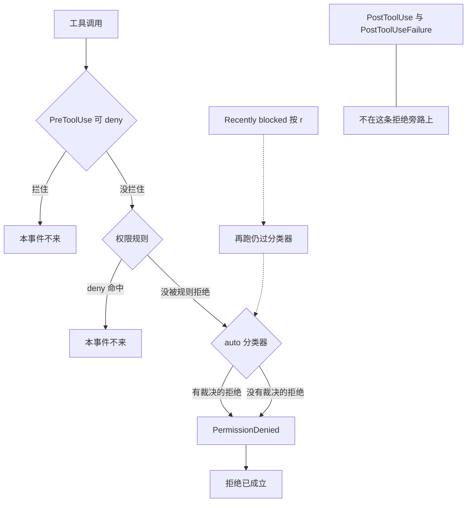

有人在 auto 模式里把「被拦了就改判放行」写在 `PermissionDenied` 上。脚本 exit 2，或者交一份 `decision: "allow"`。调用还是没跑。这只事件到来时，拒绝已经发生了。`retry: true` 也不是改判。

`PermissionDenied` 只在 auto 模式拒绝一次工具调用之后开火，包括分类器没有给出裁决的那次。exit 2 和 stderr 会被忽略，因为拒绝已经发生。JSON 里的 `hookSpecificOutput.retry: true` 不会撤销这次拒绝，只是往对话里加一句，告诉模型可以再试同一刀。分类器没有裁决时，`retry: true` 会被忽略。文档写明，这时拒绝消息里已经告诉模型该稍后再试，还是换别的事。手动点拒绝、`PreToolUse` 拦住、`deny` 规则命中，这只事件都不会跑。`PostToolUseFailure` 也不会因为这次权限拒绝而来。想拦调用，走 `PreToolUse` 或权限规则。想在弹窗时代答，走 `PermissionRequest`。人手重试是另一条路：`/permissions` 的 **Recently blocked** 页按 `r`。批准不会写成一条权限规则。

我在 2026-11-14 打开并重读了 [Hooks reference](https://code.claude.com/docs/en/hooks) 的生命周期表、生命周期图、matcher 表、`if`、退出码表、Decision control 总表、[Add context for Claude](https://code.claude.com/docs/en/hooks#add-context-for-claude)、Exit code 0、[PermissionDenied](https://code.claude.com/docs/en/hooks#permissiondenied) 和 [PostToolUseFailure](https://code.claude.com/docs/en/hooks#posttoolusefailure) 的注记，以及 [Automate actions with hooks](https://code.claude.com/docs/en/hooks-guide) 的事件表、matcher 表和 `if`。人手那条对过 [Review denials](https://code.claude.com/docs/en/auto-mode-config#review-denials)。无通知、无 Recently blocked、评价顺序，对过 [Choose a permission mode](https://code.claude.com/docs/en/permission-modes#when-auto-mode-falls-back)。无裁决的用户侧句子，对过 [Errors](https://code.claude.com/docs/en/errors#auto-mode-cannot-determine-the-safety-of-an-action)。Agent SDK 的表只作对照。没有跑 Claude Code，没有配真实 hook。字段名和时序只转述这些页。

这只事件是 [v2.1.89](https://github.com/anthropics/claude-code/releases/tag/v2.1.89) 加上的。changelog 原句是：Added `PermissionDenied` hook that fires after auto mode classifier denials — return `{retry: true}` to tell the model it can retry。同节 Changed 写：Auto mode: denied commands now show a notification and appear in `/permissions` → Recent tab where you can retry with `r`。GitHub 上这条 release 的 `published_at` 是 2026-04-01T01:07:06Z，北京时间 2026-04-01 09:07。我打开的 changelog 里，这只 hook 只在 2.1.89 出现过一次。页首一节是 2.1.325，日期 November 13, 2026。

[11 月 5 日](https://cfireworks.github.io/2026/11/05/2026-11-05-permissionrequest-vs-pretooluse/)讲过弹窗闸和每刀闸。那边只点过 `PermissionDenied` 一句。昨天讲 `InstructionsLoaded`。那只只观察，拦不住，也改不了。今天这只也是事后。它多了一枚 `retry`。这枚字段仍不能改判。[11 月 3 日](https://cfireworks.github.io/2026/11/03/2026-11-03-permission-mode-vs-isolation/)的模式和隔离、[11 月 4 日](https://cfireworks.github.io/2026/11/04/2026-11-04-pre-vs-post-hooks/)的 Pre 与 Post 主链，不重写。

<!-- more -->

## 拒绝已经在旁边成立



生命周期图的图注把 `PermissionDenied` 写成从 `PermissionRequest` 分出的旁路，原文是 side branch from PermissionRequest for auto-mode denials。图里的工具主链是 `PreToolUse`、`PermissionRequest`、`PostToolUse`、`PostToolUseFailure`、`PostToolBatch`。这只事件不在那一串里面。图注另有一列 standalone async events，里面没有它。我不把它写成异步事件。

专项原句是：This hook only fires in auto mode: it doesn't run when you manually deny a permission dialog, when a `PreToolUse` hook blocks a call, or when a `deny` rule matches. Use it to log denials, adjust configuration, or tell the model it may retry the tool call。

「adjust configuration」是用途，不是一枚改判字段。页上没有写脚本改了配置，这次拒绝就撤销。我不把它读成放行。

没有裁决的两种原因，专项写在同一句里。一种是 a safety check separate from auto mode refused the classifier's own request。另一种是 response didn't parse。权限模式页的评价顺序把 allow、ask、deny 规则放在分类器之前。命中 deny 规则，这次调用不会走到分类器，因而也不会走到这只事件。这和专项那句是对齐的。allow 规则仍可能把一些动作送去分类器。那份例外清单，这篇不展开。

`PostToolUseFailure` 的注记写：权限拒绝会触发 `PreToolUse`，但不会触发 `PostToolUseFailure`。执行前被拒的调用，未知工具名、schema 或校验失败、权限拒绝，都不是这只失败事件。校验拒绝连 `PreToolUse` 都没有。这只事后钩子看不见那一次校验失败。

matcher 和 `PreToolUse` 一样，对的是工具名。例子是 `Bash`、`Edit|Write`、`mcp__.*`。`if` 只在工具事件上求值，名单含 `PermissionDenied`。写到非工具事件上，那只 hook 不会跑。写在这只事件上，会求值。不要把昨天 `InstructionsLoaded` 的「写了 `if`，钩不跑」搬过来。

## 三列并排

| 维度 | PreToolUse | PermissionRequest | PermissionDenied |
| --- | --- | --- | --- |
| 何时 | 每刀工具调用之前。细则见 [11 月 5 日](https://cfireworks.github.io/2026/11/05/2026-11-05-permissionrequest-vs-pretooluse/) | 马上要弹窗，或没法弹窗、就要自动拒绝。细则见同一篇 | auto 已经拒绝之后。包括分类器没有裁决 |
| 只在 auto | 否 | 否 | 是。手动拒绝、`PreToolUse` 拦住、deny 规则命中，都不跑 |
| exit 2 | 挡住这次调用 | 不生效 | 退出码和 stderr 都忽略。拒绝已经发生 |
| JSON | `permissionDecision`：allow、deny、ask、defer | `decision.behavior`：allow、deny | `hookSpecificOutput.retry`。`true` 只是告诉模型可以再试 |
| 能不能撤销本次 | 能拦住。调用还没跑 | 能代答这次弹窗 | 不能。`retry` 不改判。无裁决时这个字段被忽略 |
| 适合 | 拦危险调用 | 代答弹窗 | 记下 `tool_input` 和 `reason`。有裁决时告诉模型可以再试 |
| 不适合 | 等拒绝发生后再改口 | 当每刀闸。用 exit 2 当拒绝 | 交 `decision: "allow"`。把另外两列的字段填进来 |

退出码表这一行是 No。原文是：Exit code and stderr are ignored because the denial already occurred。同一格接着写，用 `hookSpecificOutput.retry: true` 告诉模型可以再试，无裁决的拒绝会忽略 `retry: true`。

Decision control 总表里，它单独一行。模式是 `hookSpecificOutput`。`retry: true` tells the model it may retry the denied tool call。无裁决则忽略。它不在 None 那一行。None 那一行是 `Setup`、`Notification`、`SessionEnd`、`PostCompact`、`InstructionsLoaded`、`StopFailure`、`CwdChanged`、`DirectoryAdded`、`FileChanged`。昨天那只摄像头在这一行。这只不在。

## reason 有三种文档形态

公共字段不在这里重列。专项在公共字段之外给了 `tool_name`、`tool_input`、`tool_use_id`、`reason`。MCP 工具还有 `mcp_server`。例子 JSON 没有展开这个对象。里面有哪些键，「未核实」。

例子是一次 auto 拒绝。`permission_mode` 是 `"auto"`。`tool_name` 是 `Bash`。`tool_input.command` 是 `rm -rf /tmp/build`。`reason` 是 `"[Irreversible Local Destruction]"`。

`reason` 不要发明第四种，也不要把错误页的整段 UI 文案写成这个字段。

| 形态 | 页上怎么写 |
| --- | --- |
| 分类器裁决 | 多数会话是方括号规则名，如 `[Data Exfiltration]`。例子是 `[Irreversible Local Destruction]` |
| 无裁决 | 以 `Auto mode could not evaluate this action and is blocking it for safety` 开头 |
| 分类器模型不可用 | 固定文本 `Classifier unavailable` |

Review denials 是另一种已经写下来的读法。钩子读 `reason` 时，不要指望有 `Auto mode:` 前缀。文档举例是 `Blocked by classifier`，而不是 `No reason provided`。通知文案是另一句，长这样：`bash blocked by auto mode · /permissions · Auto mode: [Data Exfiltration]`。那是界面上的通知。方括号里的规则名可以出现在通知里，也可以出现在 hook 的 `reason` 里。`Blocked by classifier` 是 Review denials 给钩子举的例子。哪一种在什么会话出现，两页都没有对照表。「未核实」。

分类器模型不可用时，错误页给用户的句子是另一份。模型名，然后 `is temporarily unavailable, so auto mode cannot determine the safety of` 工具名。交互会话里，这句也可能换成一行 dim 的 `Not run · auto mode's check had no usable answer`。hook 的 `reason` 仍是专项那句固定文本。两处不要合成一句。`retry: true` 对这句固定文本是忽略还是收下，忽略规则那一段没有点名。那段点名的是响应没解析，和独立 safety check 拒了分类器自己的请求。「未核实」。夹具只断言这种拒绝会开火，不断言 `retry`。

无裁决的用户侧，错误页分成两支。解析失败，文档写通常可以再试。对话内容触发的独立 safety check，文档写明 Retrying will not help，并告诉模型继续做别的事，而不是重试。hook 的 `reason` 只规定了同一个开头。错误页破折号后面的半句，专项没有写进字段表。夹具不把那半句拼进 `reason`。

## retry 加一句，不改判

正确形状是参考页这份。指南里没有另一份官方脚本。我没有另编。

```json
{
  "hookSpecificOutput": {
    "hookEventName": "PermissionDenied",
    "retry": true
  }
}
```

效果的原句是：When `retry` is `true`, Claude Code adds a message to the conversation telling the model it may retry the tool call. Claude Code doesn't reverse the denial itself. If your hook doesn't return JSON, or returns `retry: false`, the denial stands and the model receives the original rejection message。

加进去的那句话原文是什么，专项没有给。「未核实」。夹具只用 `may_retry` 这个旗标，不编句子。

无裁决时，原文是：Claude Code ignores `retry: true` when the classifier produced no verdict。原因是响应没解析，或独立 safety check 拒了分类器自己的请求。对这些拒绝，Claude Code already tells the model in the rejection message whether to retry later or move on。所以钩子再交一份 `retry: true`，不会改那条已经写好的消息。

exit 2 再带一份 `retry: true`，退出码表和决策小节没有合成一句。夹具的 exit 2 不打印 JSON。「未核实」。

不要把 `PreToolUse` 的 `permissionDecision` 填进来。不要把 `PermissionRequest` 的 `decision.behavior` 填进来。顶层 `decision: "allow"` 也不是这只事件的字段。Decision control 总述写，`decision` 的取值是 `"block"`，而且那是另一批事件的模式。

prompt 钩子和 agent 钩子会在这只事件上跑。页上写，`ok: false` 没有效果，因为拒绝已经发生。这只事件只读 `hookSpecificOutput.retry`，而这两种钩子设不了这个字段。它们的输出被丢掉。要交 `retry`，页上让用 command hook。

Add context 的投放点没有 `PermissionDenied`。名单是 `SessionStart`、`SubagentStart`、`UserPromptSubmit`、`UserPromptExpansion`、`PreToolUse`、`PostToolUse`、`PostToolUseFailure`、`PostToolBatch`、`Stop`、`SubagentStop`、`PostModelSwitch`。Exit code 0 把纯文本 stdout 送进模型的，是 `UserPromptSubmit`、`UserPromptExpansion`、`SessionStart`、`PostModelSwitch`。`PreCompact` 的 stdout 另作压缩指令。两处都没有这只事件。不要写它能把 `additionalContext` 或纯文本 stdout 送进模型。

Agent SDK 的表只作对照，不当主论据。这一行是 Python SDK 没有、TypeScript SDK 有。用途那格和参考页同一句：记下拒绝，或告诉模型可以再试。无裁决时忽略 `retry: true`。

## 记拒绝用这只，拦调用用前面的闸

要审计或告警，把钩放在 `PermissionDenied`。exit 0。日志是你自己的文件。参考页不规定这条路径。读 `tool_input` 可以拿到被拒的那一刀。读 `reason` 时按上面三种形态，不要在前面补 `Auto mode:`。

```json
{
  "hooks": {
    "PermissionDenied": [
      {
        "hooks": [
          {
            "type": "command",
            "command": "${CLAUDE_PROJECT_DIR}/.claude/hooks/log-denial.sh"
          }
        ]
      }
    ]
  }
}
```

```bash
#!/bin/bash
# stdin 里有 tool_name、tool_input、tool_use_id、reason。
# exit 2 改不了这次拒绝。retry 不在这个脚本里。
input=$(cat)
printf '%s\n' "$input" >> "${CLAUDE_PROJECT_DIR}/.claude/permission-denied.log"
exit 0
```

分类器给了裁决，你确认这一刀可以再试，再交 `retry: true`。那只是加一句。本次调用仍不执行。没有裁决时不要交。模型已经从拒绝消息里知道该稍后再试，还是换别的事。

要拦危险调用，走 `PreToolUse`，或写 deny 规则。deny 规则命中时，这只事件根本不来。要代答弹窗，走 `PermissionRequest` 的 `decision.behavior`。11 月 5 日那张表不在这里重写。

人手放行这一次，走 `/permissions` 的 **Recently blocked**。当前文档用这个名字。changelog 2.1.89 写的是 Recent tab。v2.1.314，日期 October 30, 2026，把 review tab 改称 Recently blocked，并拒绝批准你看不全的那一行。两个名字不要写成现在同时有效。

按 `r` 是批准这一次，并让 Claude 再试。再按 `Esc` 关闭，批准才生效。打开对话框时 Claude 若还在干活，等这轮结束再发一句话，它才会去重试。否则它现在就会继续，并可能自己重试。批准不会写成一条权限规则。auto 模式下再跑，仍会再过检查，仍可能再被拦。命令要从今以后不再审，加 `allow` 规则。贯穿任务的目的地，例如仓库主机或内部域名，加 `autoMode.environment`。这是两条配置，不是按一次 `r` 的副作用。

没有可批准的行时，这条路按不了 `r`。对话里是 `Not run`，或 classifier error，分类器没有给出裁决。错误页写这时候怎么跑。看不全的那一行，当前文档写 `This row can't be approved here`。

分类器连续拦住 3 次，或累计 20 次，auto 模式会暂停，改回询问。那是模式自己的暂停，阈值不可配置，不是这只钩子的退出码。独立 safety check 拒了分类器自己的请求时，这次不计入这两个数。这篇点到这里。

## 夹具里，retry 不改判

演示在 [`demos/permissiondenied-retry/`](https://github.com/cFireworks/cfireworks.github.io/tree/main/demos/permissiondenied-retry)。不读密钥，不访问网络，不启动 Claude Code。假一次手动拒绝，一次 `PreToolUse` 拦住，一次 deny 规则命中，一次有裁决的 auto 拒绝，一次无裁决，一次分类器模型不可用。处理器一次只挂一只。这不是 settings 里的 hook。人手按 `r` 不在脚本里。

退出码和那几份「放行」JSON 都读过。函数把它们看完，然后固定返回不改判：

```python
def denial_reversed(code: int, payload: dict | None) -> bool:
    """拒绝已经发生。exit 2、retry、以及另外两只事件的放行字段，都不改判。"""
    del code, payload
    return False
```

有裁决而且 `retry` 是 `true`，夹具把 `may_retry` 记成 1，`denial_reversed` 记成 0。无裁决上的同一份 JSON，`retry_ignored` 记成 1，拒绝仍成立。`retry: false` 或没有 JSON，模型侧保持原拒绝消息。`permissionDecision: "allow"`、`decision.behavior: "allow"`、顶层 `decision: "allow"`，`treated_as_allow` 都是 0。

`python3 demos/permissiondenied-retry/run_demo.py` 我跑过，最后一行是 `result=pass`。

| 夹具 | 在看什么 | 跑完的旗标 |
| --- | --- | --- |
| `manual_deny_retry_true` | 手动拒绝 | `pd_fired=0`。`may_retry=0` |
| `pretooluse_block_exit2` | `PreToolUse` 已经拦住 | `pd_fired=0`。stderr 没有被当成放行 |
| `deny_rule_behavior_allow` | deny 规则命中 | `pd_fired=0`。`treated_as_allow=0` |
| `auto_exit2` | 有裁决，exit 2，没有 JSON | `denial_stands=1`。`stderr_applied=0` |
| `auto_retry_true` | 文档形状的 `retry: true` | `may_retry=1`。`denial_reversed=0` |
| `no_verdict_retry_true` | 无裁决，仍交 `retry: true` | `retry_ignored=1`。拒绝仍成立 |
| `auto_retry_false` | `retry: false` | `may_retry=0`。`model_keeps_original=1` |
| `auto_no_json` | 没有 JSON | 原拒绝消息还在 |
| `auto_permission_decision_allow` | 填了 `permissionDecision` | `treated_as_allow=0` |
| `auto_behavior_allow` | 填了 `decision.behavior` | `treated_as_allow=0` |
| `auto_decision_allow` | 顶层 `decision: "allow"` | `treated_as_allow=0` |
| `unavailable_audit` | reason 是 `Classifier unavailable` | `pd_fired=1`。不断言 `retry` |
| `auto_prompt_discarded` | prompt 钩子跑了 | 输出丢掉。`may_retry=0` |

`post_failure_fired` 在这些行上都是 0。权限拒绝不走 `PostToolUseFailure`。

## 拒绝之后还能说话，不等于还能改判

控制环里，拒绝发生之后还能说话，不等于还能改判。闸在前面。规则先挡住。`PreToolUse` 在调用还没跑的时候挡住。弹窗之前，`PermissionRequest` 可以代答。`PermissionDenied` 负责看见 auto 已经拒了的那一刀。有裁决时，它可以告诉模型再试一次。那一试仍要再过分类器。没有裁决时，连这句都不要加，拒绝消息里已经写了该再试还是换事做。

你们把「统一记拒绝、再自动重试」写在这只事件的 exit 2 上，还是只把 `tool_input` 和 `reason` 记进自己的日志？误拦之后那一句 `retry: true`，是加在有裁决的拒绝上，还是也加在了没有裁决的那次？

## 扩展阅读

- [Hooks reference：PermissionDenied](https://code.claude.com/docs/en/hooks#permissiondenied)
- [Hooks reference：Exit code 2](https://code.claude.com/docs/en/hooks#exit-code-2-behavior-per-event)
- [Hooks reference：Decision control](https://code.claude.com/docs/en/hooks#decision-control)
- [Automate actions with hooks](https://code.claude.com/docs/en/hooks-guide)
- [Review denials](https://code.claude.com/docs/en/auto-mode-config#review-denials)
- [When auto mode falls back](https://code.claude.com/docs/en/permission-modes#when-auto-mode-falls-back)
- [Auto mode cannot determine the safety of an action](https://code.claude.com/docs/en/errors#auto-mode-cannot-determine-the-safety-of-an-action)
- [Agent SDK hooks](https://code.claude.com/docs/en/agent-sdk/hooks)
- [changelog / release v2.1.89](https://github.com/anthropics/claude-code/releases/tag/v2.1.89)
- [别把 PermissionRequest 当成 PreToolUse](https://cfireworks.github.io/2026/11/05/2026-11-05-permissionrequest-vs-pretooluse/)
- [别把权限模式当成隔离](https://cfireworks.github.io/2026/11/03/2026-11-03-permission-mode-vs-isolation/)
- [别在事后装闸门](https://cfireworks.github.io/2026/11/04/2026-11-04-pre-vs-post-hooks/)
- [别把规则加载当成能拦的闸](https://cfireworks.github.io/2026/11/13/2026-11-13-instructionsloaded/)

## 讨论

`retry: true` 加进对话的那句话，原文是什么？hooks 专项只写 adds a message，没有给出句子。`reason` 在 `Blocked by classifier` 和 `[Data Exfiltration]` 之间，什么时候是哪一种？两页都写了一种形态，没有对照表。async hook 会不会晚于模型已经读到拒绝消息？专项没有写。图注也没有把这只事件放进 standalone async 那一列。`Classifier unavailable` 这句固定文本算不算「没有裁决」、`retry: true` 会不会被忽略？忽略规则没有点名它。我没有跑 Claude Code，也不替这四处补一句。
