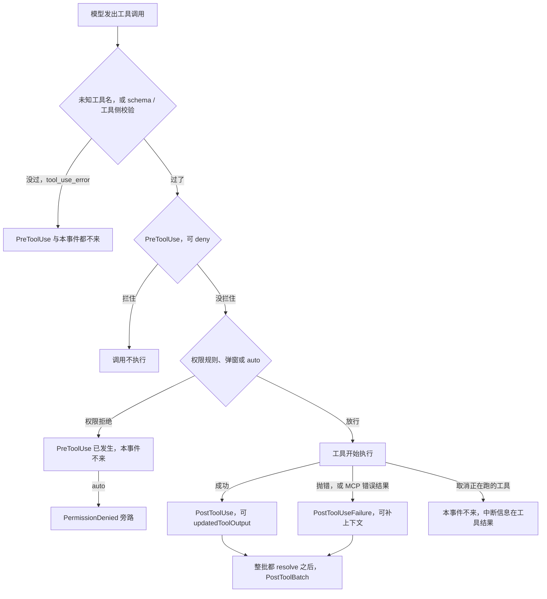

有人把「所有没跑成」的告警、重试，甚至「把错误抹掉再给模型」，写在 `PostToolUseFailure` 上。校验没过，权限拒了，用户取消了正在跑的工具，钩子都没来。等它真的来了，再交一份 `updatedToolOutput`，错误原文还是进了模型。

`PostToolUseFailure` 只在已经开始执行的工具失败时开火。工具自己抛错，或者 MCP 工具返回错误结果，它才来。未知工具名、schema 或工具侧校验失败、权限拒绝，都不会触发它。取消正在跑的工具也不会。到来之后，exit 2 只是把 stderr 交给模型，失败已经成立。`additionalContext` 可以补一句。专项写明这只事件不能改写结果，失败命令的原文会原样到达模型。

我在 2026-11-15 打开并重读了 [Hooks reference](https://code.claude.com/docs/en/hooks) 的生命周期表、生命周期图、matcher 表、`if`、退出码、[Decision control](https://code.claude.com/docs/en/hooks#decision-control)、[Add context for Claude](https://code.claude.com/docs/en/hooks#add-context-for-claude)、[PostToolUse](https://code.claude.com/docs/en/hooks#posttooluse)、[PostToolUseFailure](https://code.claude.com/docs/en/hooks#posttoolusefailure) 和 [Prompt-based hooks](https://code.claude.com/docs/en/hooks#prompt-based-hooks)，以及 [Automate actions with hooks](https://code.claude.com/docs/en/hooks-guide) 的事件表、matcher 表和 `if`。Agent SDK 的表和 Hook timeout 只作对照。changelog 页首是 2.1.325，日期 November 13, 2026。最新 GitHub release 也是 [v2.1.325](https://github.com/anthropics/claude-code/releases/tag/v2.1.325)，`published_at` 是 2026-11-13T20:40:01Z，北京时间 2026-11-14 04:40。全份 changelog 里，这只事件只出现一次：2.1.119，日期 April 23, 2026，写在 Changed 里，Hooks: `PostToolUse` and `PostToolUseFailure` hook inputs now include `duration_ms`。对应 release 是 [v2.1.119](https://github.com/anthropics/claude-code/releases/tag/v2.1.119)，`published_at` 是 2026-04-23T23:24:19Z，北京时间 2026-04-24 07:24。这一行说明到那时事件已经存在，并补了字段。我没有找到「Added `PostToolUseFailure` hook」这样的首次加入行，不编诞生版本。没有跑 Claude Code，没有配真实 hook。字段名和时序只转述这些页。

[昨天](https://cfireworks.github.io/2026/11/14/2026-11-14-permissiondenied-retry/)讲过 auto 拒绝的旁路：拒绝已经成立，`retry` 不是改判，并点过这只失败事件不会因为权限拒绝而来。今天把触发面展开。[11 月 4 日](https://cfireworks.github.io/2026/11/04/2026-11-04-pre-vs-post-hooks/)把闸放在 Pre，`PostToolUse` 时工具已经跑完。[11 月 6 日](https://cfireworks.github.io/2026/11/06/2026-11-06-updatedtooloutput-redaction/)讲成功结果才能改写。这一刀切在「已经执行、然后失败」。[11 月 7 日](https://cfireworks.github.io/2026/11/07/2026-11-07-posttoolbatch/)的整批、[11 月 5 日](https://cfireworks.github.io/2026/11/05/2026-11-05-permissionrequest-vs-pretooluse/)的弹窗闸，不重写。

<!-- more -->

## 已经开跑，然后失败了



生命周期表这一行是 After a tool call fails。节奏那一行只点名了 `PreToolUse` 和 `PostToolUse`，并写 `EndConversation` 会跳过这两只。图注把失败事件放进同一层 agentic loop，工具主链是 `PreToolUse`、`PermissionRequest`、`PostToolUse`、`PostToolUseFailure`、`PostToolBatch`。`PermissionDenied` 的图注原文是 side branch from PermissionRequest for auto-mode denials。我按图注放位置。节奏那一行没点名这只失败事件，也不点名 `EndConversation` 会不会跳过它。「未核实」。

专项原句是：Runs when a tool that started executing fails: the tool threw an error, or an MCP tool returned an error result. Use this to log failures, send alerts, or provide corrective feedback to Claude。

注记把执行前的拒绝划出去。未知工具名、schema 或工具侧校验失败、权限拒绝，都不来。校验拒绝以 `tool_use_error` 返回，发生在 hooks 之前，所以 `PreToolUse` 和这只事件都不来。权限拒绝会触发 `PreToolUse`，不会触发这只事件。auto 那条旁路昨天写过。名单点名的是这三样。`PreToolUse` 自己的 deny 没有单独写进这句。工具被拦住时还没开跑，按「已经开始执行才开火」，这只事件不来。

matcher 按工具名，例子仍是 `Bash`、`Edit|Write`、`mcp__.*`。`if` 只在 `PreToolUse`、`PostToolUse`、`PostToolUseFailure`、`PermissionRequest`、`PermissionDenied` 上求值。写在这只事件上，会求值。

`PostToolUse` 在成功之后才跑。失败的调用要另挂在这只事件下。Bash 或外部进程改了文件，匹配 `Edit|Write` 的 `PostToolUse` 不会因此跑。那是 `FileChanged`。点到这里。

## 四列并排

| 维度 | PostToolUse | PostToolUseFailure | PermissionDenied | 校验拒绝，`tool_use_error` |
| --- | --- | --- | --- | --- |
| 何时 | 工具成功之后 | 已经开始执行，然后失败。工具抛错，或 MCP 返回错误结果 | auto 已经拒绝之后。细则见昨天 | 执行前。未知工具名，或 schema / 工具侧校验没过 |
| 工具是否已开跑 | 已跑完，而且成功 | 已开跑，然后失败 | 没有跑 | 没有跑。hooks 还没开始 |
| 给模型的原文 | `tool_response` | 顶层 `error`。没有 `tool_response` | 拒绝消息。`retry` 只是另加一句 | `tool_use_error`。不是这只钩子的输入 |
| exit 2 | 不挡。stderr 交给模型，工具已经跑过 | 不挡。stderr 交给模型，失败已经成立 | 退出码和 stderr 都忽略 | 没有这只钩子 |
| 能不能改写 | `updatedToolOutput` 能换成功结果 | 不能。失败命令的输出原样到达 | 不能改判。昨天写过 | 这只事件看不见 |
| 适合 | 成功后的审计、改写、脱敏 | 记下失败、告警、补一句纠正上下文 | 记下 auto 拒绝。有裁决时告诉模型可以再试 | 别假装这只事件能看见 |

退出码表这一格是 No。原文是：Shows stderr to Claude; the tool already failed。exit 0 的 stderr，模型看不见。要从 `PostToolUse` 或这只事件把警告交给模型，应 exit 2。

它不在「None, No decision control」那一行。那一行是 `Setup`、`Notification`、`SessionEnd`、`PostCompact`、`InstructionsLoaded`、`StopFailure`、`CwdChanged`、`DirectoryAdded`、`FileChanged`。总表给了它一个决策位。这个位在专项里写成什么样，下一节拆开。

## 补得了上下文，改不了原文

改写总述的原文是：For redaction or transformation use cases, intercept at `PreToolUse` for outbound tool inputs and `PostToolUse` for the results of successful calls. `PostToolUseFailure` can't rewrite a result, so a failing command's output reaches Claude unchanged。

出站参数走 `PreToolUse`。成功结果走 `PostToolUse` 的 `updatedToolOutput`。MCP 成功结果还有 `updatedMCPToolOutput`，参考页让优先用前一个。11 月 6 日写过形状和遥测。失败专项的决策节只列了 `additionalContext`。把那两个改写字段填到这只事件上，专项没有这个出口。

专项示范的形状是这一份：

```json
{
  "hookSpecificOutput": {
    "hookEventName": "PostToolUseFailure",
    "additionalContext": "Additional information about the failure for Claude"
  }
}
```

`additionalContext` 包进 system reminder，插在钩子开火的位置。对 `PreToolUse`、`PostToolUse`、这只事件和 `PostToolBatch`，位置是 next to the tool result。界面里不显示为一条聊天消息。同一事件上好几只钩子都返回，全部送达。字符串里若有 `<system-reminder>` 标签，小于号会按页上的写法被转义，避免被当成系统提醒。超过 10,000 字符会写进会话目录，模型只拿到路径和最多前 2,000 字符的预览。它能读那个文件，Claude Code 不主动叫它去读。

exit 2 且没有 JSON：模型能看见 stderr，失败已经成立。这段 stderr 不是撤销，也不是改写 `error`。总述写，退出码和 JSON 混用时，exit 2 仍保留它的效果，JSON 字段仍会被读，另有一处 elicitation 例外。这只事件的 exit 2 本来就不是拦截。失败专项没有把混用和 `additionalContext` 合成一句。「未核实」。夹具的 exit 2 不打印 JSON。

Decision control 总表把这只事件和 `PostToolUse`、`PostToolBatch` 放在同一行。模式是顶层 `decision: "block"` 加 `reason`。`PostToolUse` 专项写过：block 把 `reason` 加在结果旁边，模型仍看到原文，要换掉得再给 `updatedToolOutput`。失败专项没有这句。我不把成功路径的语义抄过来。总表有这一行，专项只示范了 `additionalContext`。`block` 对失败结果做什么、回合是否继续，两处没有对照。「未核实」。

prompt 钩子和 agent 钩子会在这只事件上跑。支持的类型是 command、http、mcp_tool、prompt、agent。`ok: false` 的原文是：the reason is returned to Claude as a tool error and the turn continues, regardless of `continueOnBlock`。`PostToolUse` 不同。那边默认结束回合，reason 在聊天里是一行警告。要 `continueOnBlock: true`，才把 reason 喂回并继续。

agent 钩子在 `ok: false` 时，按同一事件上 `continueOnBlock: true` 的 prompt 钩子处理。而这只事件的 prompt 行为不看这个开关。两句叠在一起，agent 钩子也是把 reason 当 tool error 送回，回合继续。我没有另找一句专写 agent。reason 会不会换掉顶层 `error` 那段原文，prompt 那一节没有写。「未核实」。

Agent SDK 的表只作对照。这一行 Python 和 TypeScript 都有。触发是 Tool execution failure，用途是 Handle or log tool errors。Hook timeout 写，超时后丢掉该 callback 的输出。对 `PostToolUse` 和 `PostToolUseFailure`：keeps the tool result and the turn continues。这是超时，不是 `decision: "block"` 的效果。

指南的事件表有同一句 After a tool call fails。matcher 和 `if` 跟参考页同一组。指南没有为这只事件单开教程节。format-on-save 挂在 `PostToolUse` 的 `Edit|Write` 上。我没有把它改写成失败事件的能力。

## error 按首行分支，其余当展示文本

公共字段不在这里重列。失败输入和 `PostToolUse` 一样有 `tool_name`、`tool_input`。失败信息是顶层字段，没有 `tool_response`。例子是一次失败的 `npm test`：

```json
{
  "hook_event_name": "PostToolUseFailure",
  "tool_name": "Bash",
  "tool_input": {
    "command": "npm test",
    "description": "Run test suite"
  },
  "error": "Exit code 1\nError: Cannot find module 'express'",
  "is_interrupt": false,
  "duration_ms": 4187
}
```

MCP 工具另有 `mcp_server`。形状指向 PreToolUse：对象里有 `name` 和 `source`，字段要 Claude Code v2.1.274 或更新。上面这份例子是 Bash，没有这个对象。

`error` 一般就是模型作为失败结果看到的同一段文字。格式随工具和失败类型而变。钩子按 `tool_name`、`is_interrupt`、以及首行 `Exit code N` 分支。其余当展示文本，不要当成稳定 schema。

Bash 和 PowerShell：命令跑起来并退出时，首行是 `Exit code N`，后面是 stdout 与 stderr 交错的一整块。也可能没有 exit-code 行。那是 Claude Code 没能启动 shell 进程本身。长字符串会在 `... [N characters truncated] ...` 处从中间截断，也可能插入 Claude Code 自己的行，例如 `Command timed out after 2m 0s`。Bash 之外的内置工具有没有稳定首行，专项只说格式随工具而变。「未核实」。

`is_interrupt` 可选。原文是：True when the failure reached Claude Code as an abort rather than as an error the tool reported. Cancelling a running tool does not fire this hook; the tool result carries the interruption message instead。两句并列。专项没有列出哪些 abort 会把这个字段设为 true，并且钩子仍然开火。取消正在跑的工具，看工具结果里的中断信息。那句中断原文，专项没有引用。「未核实」。我没有编一个会开火的 abort 案例。

`duration_ms` 可选。工具执行的毫秒数。不包括权限弹窗和 `PreToolUse` 花的时间。例子是 4187。2.1.119 补的就是这个字段。

## 记失败用这只，拦调用用前面的闸

要审计、告警，或给模型补一句纠正上下文，把钩放在 `PostToolUseFailure`。日志是你自己的文件，exit 0。参考页不规定这条路径。补上下文用上面的 JSON。Add context 让你写成事实句。命令式的系统口吻可能触发提示注入防护，模型会把这段翻出来给你看，而不是当成项目信息。所以「这类测试失败先看 lockfile」写成「这类测试失败时，依赖以 lockfile 为准。」想把一句警告直接交给模型，走 exit 2 的 stderr。失败已经成立。

要拦危险调用，走 `PreToolUse` 或 deny 规则。不要等失败事件。失败事件到来时，工具已经开跑。

要改写或脱敏成功输出，走 `PostToolUse` 的 `updatedToolOutput`。11 月 6 日那篇不在这里重写。

要记录 auto 拒绝，或在有裁决时告诉模型可以再试，走 `PermissionDenied`。11 月 14 日那篇不在这里重写。权限拒绝到不了这只失败事件。

校验失败和未知工具名根本走不到 hook。要观测，得在模型已经看到的 `tool_use_error` 之外另想办法。不要假装这只事件能看见它们。

用户取消正在跑的工具，看工具结果里的中断信息。不要等这只钩子。

成功和失败都要跑同一段审计，就在 `PostToolUse` 和 `PostToolUseFailure` 各挂一份，matcher 对齐。整批结束之后、下一次模型调用之前，才是 `PostToolBatch`。它不是失败总闸。11 月 7 日写过，失败那一刀进不进批数组，例子没给。「未核实」。

## 夹具里，错误原文还在

演示在 [`demos/posttoolusefailure/`](https://github.com/cFireworks/cfireworks.github.io/tree/main/demos/posttoolusefailure)。不读密钥，不访问网络，不启动 Claude Code。假一次未知工具名，一次校验失败，一次权限拒绝，一次取消正在跑的工具，一次工具抛错，一次 MCP 错误结果。另有一条 shell 没启动起来的裸消息。处理器一次只挂一只。这不是 settings 里的 hook。

抛错那条用专项的 `npm test`。`error` 是 `Exit code 1` 加 `Error: Cannot find module 'express'`，`is_interrupt` 是 false，`duration_ms` 是 4187。输入里没有 `tool_response`。MCP 的工具名和错误字符串是夹具自己的。专项没给例子，所以不当成稳定 schema。`mcp_server` 只用点名的 `name` 和 `source`。

`python3 demos/posttoolusefailure/run_demo.py` 我跑过，最后一行是 `result=pass`。

| 夹具 | 在看什么 | 跑完的旗标 |
| --- | --- | --- |
| `unknown_tool` | 未知工具名 | `pre_fired=0`。`failure_fired=0`。`tool_use_error=1` |
| `schema_validation` | 校验没过，exit 2 没人收 | 两只钩子都不来。`handler_ran=0` |
| `permission_deny` | 权限拒绝 | `pre_fired=1`。`failure_fired=0` |
| `user_cancel_running` | 取消正在跑的工具 | `failure_fired=0`。`interrupt_on_tool_result=1` |
| `tool_threw_exit2` | exit 2，没有 JSON | `failed_still=1`。`stderr_for_model=1`。`error_rewritten=0` |
| `tool_threw_exit0_stderr` | exit 0 仍写了 stderr | `stderr_for_model=0`。失败仍成立 |
| `tool_threw_context` | 文档形状的 `additionalContext` | `context_attached=1`。`error_rewritten=0` |
| `tool_threw_updated` | 填了 `updatedToolOutput` | `rewrite_accepted=0`。`error` 仍是例子原文 |
| `mcp_error_updated` | MCP 错误结果，填了 `updatedMCPToolOutput` | `failure_fired=1`。`has_error=1`。`failure_input_has_tool_response=0`。`rewrite_accepted=0` |
| `tool_threw_block` | 顶层 `decision: "block"` | `block_specified=0`。不当成改写，也不当成撤销 |
| `tool_threw_prompt_off` / `tool_threw_prompt_on` | `ok: false`，开关一假一真 | `prompt_reason_as_tool_error=1`。`turn_continues=1`。`continue_on_block_honored=0` |
| `shell_not_started` | 没有 exit-code 行 | `first_line_exit=-`。上下文可附上，原文不改 |

`tool_threw_block` 的 `failed_still=1` 和 `error_rewritten=0` 只表示夹具拒绝把 block 当成撤销或改写。专项没规定效果，这不是测到了官方运行时。prompt 两行的 `error_rewritten=0` 只表示没走改写字段。reason 作为 tool error 送回之后，顶层 `error` 还在不在，专项没写，夹具不断言替换。

取消那一行的 `pre_fired=1`，是按「工具已经在跑，PreToolUse 的时刻已经过去」记的。专项没有单独写取消时这只前置事件来不来。`is_interrupt: true` 且仍然开火的案例，夹具拒绝构造。

matcher 写成 `Edit|Write`、工具是例子里的 Bash 时，事件仍到，处理器不跑。空 matcher 在输出里写成 `matcher=empty`。不模拟逗号，也不模拟正则。

## 开跑之后的失败，只能补话

控制环里，「失败了」和「没让它跑」不是同一件事。没开跑的拒绝走校验、`PreToolUse`、权限规则和 `PermissionDenied`。这只事件只看见已经开跑后的失败。它加得了上下文，exit 2 也只是把 stderr 交给模型。失败已经成立，错误原文也改不了。

你们把告警挂在「所有没跑成」上，还是只挂在已经开跑并且失败的那一刀？想抹掉的那段，是成功结果上的 `updatedToolOutput`，还是失败命令里模型本来就会看见的原文？

## 扩展阅读

- [Hooks reference：PostToolUseFailure](https://code.claude.com/docs/en/hooks#posttoolusefailure)
- [Hooks reference：Exit code 2](https://code.claude.com/docs/en/hooks#exit-code-2-behavior-per-event)
- [Hooks reference：Decision control](https://code.claude.com/docs/en/hooks#decision-control)
- [Hooks reference：Add context for Claude](https://code.claude.com/docs/en/hooks#add-context-for-claude)
- [Hooks reference：Prompt-based hooks](https://code.claude.com/docs/en/hooks#prompt-based-hooks)
- [Automate actions with hooks](https://code.claude.com/docs/en/hooks-guide)
- [Agent SDK hooks](https://code.claude.com/docs/en/agent-sdk/hooks)
- [changelog](https://code.claude.com/docs/en/changelog) / [release v2.1.119](https://github.com/anthropics/claude-code/releases/tag/v2.1.119)
- [别把 PermissionDenied 当成放行](https://cfireworks.github.io/2026/11/14/2026-11-14-permissiondenied-retry/)
- [别把脱敏交给模型自己做](https://cfireworks.github.io/2026/11/06/2026-11-06-updatedtooloutput-redaction/)
- [别把批当成单刀](https://cfireworks.github.io/2026/11/07/2026-11-07-posttoolbatch/)
- [别在事后装闸门](https://cfireworks.github.io/2026/11/04/2026-11-04-pre-vs-post-hooks/)
- [别把 PermissionRequest 当成 PreToolUse](https://cfireworks.github.io/2026/11/05/2026-11-05-permissionrequest-vs-pretooluse/)

## 讨论

总表写了 `decision: "block"`，专项决策节只写 `additionalContext`。`block` 对失败结果做什么、回合是否继续，两处没有对照。`is_interrupt: true` 究竟哪些 abort 会开火？专项只写了取消正在跑的工具不会来。Bash 之外的内置工具，`error` 有没有稳定首行？专项只说格式随工具而变。prompt 钩子把 reason 作为 tool error 送回之后，顶层 `error` 那段还在不在，也没有写。我没有跑 Claude Code，也不替这四处补一句。
