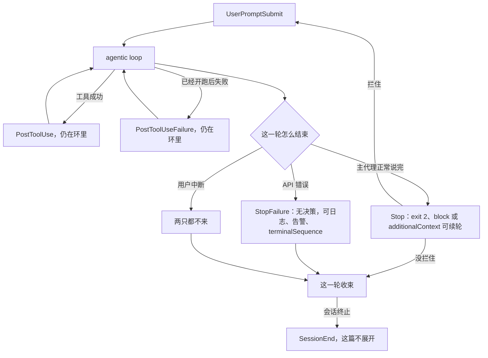

有人把限流告警、自动续跑，甚至「报错了再催它把这轮说完」，写在 `Stop` 上。或者把 `decision: "block"` 和 exit 2 抄到 `StopFailure` 上，指望改判。接口一挂，`Stop` 根本没来。等 `StopFailure` 来了，退出码和 JSON 决策都被丢掉。这一轮已经因 API 错误结束了。

`Stop` 和 `StopFailure` 写在同一档「每轮」节奏里。后两只不会在同一次收束里一起开火。主代理正常说完，走 `Stop`。用户中断，两只都不来。API 错误改走 `StopFailure`，专项的原句是 Runs instead of Stop。`Stop` 能用 exit 2、`decision: "block"` 或 `additionalContext` 拦住收工并续轮。`StopFailure` 没有 decision control。输出和退出码被忽略，只留下 `terminalSequence` 这种副作用。限流之后再催它继续，不要挂在这只事件上。只挂了 `Stop` 的钩子，也看不见接口挂掉。

我在 2026-11-16 打开并重读了 [Hooks reference](https://code.claude.com/docs/en/hooks) 的三种节奏、生命周期表、图注、matcher 规则和 matcher 表、退出码、[Decision control](https://code.claude.com/docs/en/hooks#decision-control)、[terminalSequence](https://code.claude.com/docs/en/hooks#emit-terminal-notifications)、[Stop](https://code.claude.com/docs/en/hooks#stop)、[StopFailure](https://code.claude.com/docs/en/hooks#stopfailure)、[Prompt-based hooks](https://code.claude.com/docs/en/hooks#prompt-based-hooks) 的支持列表，以及 Timeouts、`if` 的求值范围。图是图片。markdown 导出没带上图，我读的是页面上的 alt。相关半句是：嵌套的 agentic loop 之后，Stop or StopFailure，再往后才是 TeammateIdle、PreCompact、PostCompact、SessionEnd。[Automate actions with hooks](https://code.claude.com/docs/en/hooks-guide) 的事件表、matcher 表和 Limitations 里那句 Stop，我对照过。指南没有为 StopFailure 单开教程节。Agent SDK 的表和 Hook timeout 只作对照。changelog 页首仍是 2.1.325，日期 November 13, 2026。GitHub releases 第一页最新也是 [v2.1.325](https://github.com/anthropics/claude-code/releases/tag/v2.1.325)，`published_at` 是 2026-11-13T20:40:01Z，北京时间 2026-11-14 04:40。没有跑 Claude Code，没有配真实 hook。字段名和时序只转述这些页。

[11 月 2 日](https://cfireworks.github.io/2026/11/02/2026-11-02-goal-vs-stop-hook/)讲过正常停轮时谁来判收工：`/goal` 换评估器，硬闸仍是 command Stop，连拦有八次上限。那篇不重写。[昨天](https://cfireworks.github.io/2026/11/15/2026-11-15-posttoolusefailure/)讲的是工具已经开跑之后的失败。工具失败还在 agentic loop 里，不会替掉 `Stop`。今天切在「这一轮怎么结束」。[11 月 8 日](https://cfireworks.github.io/2026/11/08/2026-11-08-userpromptsubmit-vs-sessionstart/)是开始一侧的分流。这边是对称的结束一侧：`Stop` / `StopFailure` 是每轮收束，`SessionEnd` 是会话终止。点到为止。

<!-- more -->

## 说完、被打断、接口挂了，是三件事



权限拒绝是 `PermissionRequest` 的旁路。图注原文是 side branch from PermissionRequest for auto-mode denials。11 月 14 日写过，图里不展开。`EndConversation` 会跳过 `PreToolUse` 和 `PostToolUse`。节奏那一行没把 `StopFailure` 和这句绑在一起。「未核实」。

生命周期表：`Stop` 是 When Claude finishes responding。`StopFailure` 是 When the turn ends due to an API error。图注在 agentic loop 之后写的是 Stop or StopFailure。专项把话说死了。`Stop`：Does not run if the stoppage occurred due to a user interrupt。API errors fire StopFailure instead。`StopFailure`：Runs instead of Stop when the turn ends due to an API error。

用户中断没有被写成 `StopFailure` 的触发条件。文档也没有给中断另点一只事件的名字。有没有别的钩子能看见这次中断，「未核实」。

## 三列并排

| 维度 | Stop | StopFailure | PostToolUseFailure |
| --- | --- | --- | --- |
| 何时 | 主代理说完。用户中断不来。API 错误不来 | 这一轮因 API 错误结束，替掉 Stop | 工具已经开跑，然后失败。还在环里 |
| 这一轮是否已因 API 错误结束 | 否 | 是 | 否 |
| 能否拦住并续轮 | 能。exit 2、`decision: "block"`、`additionalContext` | 不能 | exit 2 不拦。`additionalContext` 能补一句。`block` 的效果昨天标了未核实 |
| exit 2 | Prevents Claude from stopping, continues the conversation | Output and exit code are ignored, except `terminalSequence` | Shows stderr to Claude; the tool already failed |
| decision control | 有。顶层 `decision: "block"` 加必填 `reason` | 无。和 Setup、Notification、SessionEnd 同一行 | 总表有顶层 `decision`。专项只示范了 `additionalContext` |
| matcher | 不支持。写了会被静默忽略，每次都来 | 按 `error`。精确匹配只认字母、数字、下划线和竖线 | 按工具名。逗号和竖线都能分隔 |
| `last_assistant_message` | Claude 最后一轮回复正文 | 渲染给会话的 API 错误原文，例如 `API Error: Rate limit reached` | 输入表和例子里没有这个字段 |
| 适合 | 收工闸、测试没绿不让停 | 日志、告警、副作用。改不了结局 | 记下工具失败、补一句纠正上下文 |
| prompt / agent | 五种类型都支持 | 只有 command、http、mcp_tool | 五种类型都支持 |

`/goal` 是会话级、基于 prompt 的 Stop hook 的内置快捷方式。它挂在能续轮的那只上。`StopFailure` 的支持列表里没有 prompt，也没有 agent。把评估器挂过来指望它判要不要继续，名单里没有这个类型。Met、Impossible、八次连拦，都在 11 月 2 日。这里只借一句：`Stop` 续轮受 `stop_hook_active` 和八次上限保护。`additionalContext` 走同一套保护，transcript 标成 `Stop hook feedback`，不弹 hook error。`StopFailure` 没有这条续轮路径。

指南的 Limitations 有同一句：`Stop` hooks fire whenever Claude finishes responding, not only at task completion. They don't fire on user interrupts. API errors fire StopFailure instead。指南里的 prompt 示例挂在 `Stop` 上。我没有把它改写成这只事件的能力。「Stop hook hits the block cap」是 `Stop` 的排障，不在这里展开。

## 分流是为了把失败收束拆出闸门

changelog 小节 **2.1.78**（March 17, 2026）有首次加入行：Added `StopFailure` hook event that fires when the turn ends due to an API error (rate limit, auth failure, etc.)。同一版的 bug fix：Fixed infinite loop when API errors triggered stop hooks that re-fed blocking errors to the model。对应 release 是 [v2.1.78](https://github.com/anthropics/claude-code/releases/tag/v2.1.78)，`published_at` 是 2026-03-17T23:42:55Z，北京时间 2026-03-18 07:42。

两行并列，能读出的是：API 错误若仍走能把 blocking error 喂回模型的 Stop hook，会打成死循环。同一版加上的这只事件，把已经失败的收束从能续轮的闸里拆出去。运行时除此之外怎么实现，changelog 没写。我不补。

## 匹配键是 error，不是 HTTP 状态码

公共字段不在这里重列。`StopFailure` 另有三样：`error`、可选的 `error_details`、可选的 `last_assistant_message`。`error` 就是 matcher 对的那一列：

`rate_limit`、`overloaded`、`authentication_failed`、`oauth_org_not_allowed`、`account_on_hold`、`billing_error`、`invalid_request`、`model_not_found`、`server_error`、`max_output_tokens`、`cloud_credential_error`、`unknown`。

例子是这一份。里面没有 `stop_hook_active`，没有 `background_tasks`，也没有 `session_crons`。那三样是 `Stop` 的输入。我打开的这一页没有把它们写进 `StopFailure`。

```json
{
  "hook_event_name": "StopFailure",
  "error": "rate_limit",
  "error_details": "429 Too Many Requests",
  "last_assistant_message": "API Error: Rate limit reached"
}
```

`error_details` 的说明是 Additional details about the error, when available。例子里的 `429 Too Many Requests` 是展示文本。不要把 HTTP 状态码直接写成 matcher，也不要给各错误类型编一套稳定 schema。

`last_assistant_message` 在两只事件里不是同一个东西。`Stop` 和 `SubagentStop` 里，它是 Claude 的对话回复。`StopFailure` 里，它是会话里渲染出来的 API 错误字符串本身。拿 `API Error: Rate limit reached` 去判「它说做完了没有」，判的是错误原文。那种判断属于 `Stop` 上的最后回复。正常停轮时要不要信那句「做完了」，是 11 月 2 日的题目。

matcher 规则有一条特例。`FileChanged` 和 `StopFailure` 的精确匹配只认字母、数字、`_` 和 `|`。连字符、空格或逗号会把这只事件的 matcher 留在正则路径上，备选项只用 `|` 分隔。工具事件那种 `Edit, Write` 不要抄过来。空 matcher、`"*"` 或省略，仍是全部匹配。给 `Stop` 加 matcher 没有用：没有 matcher 支持的事件会静默忽略这个字段。

`if` 只在 `PreToolUse`、`PostToolUse`、`PostToolUseFailure`、`PermissionRequest`、`PermissionDenied` 上求值。写在别的事件上，这只钩子 never runs。抄一条工具事件的 `if` 到 `Stop` 或 `StopFailure`，闸或告警都不会跑。

`cloud_credential_error` 要 Claude Code v2.1.267 或更新。hooks 页写：这是把凭证加载失败报到这个值、而不再标成 `server_error` 或 `unknown` 的第一个版本。我打开的 changelog，**2.1.267**（September 9, 2026）的可见条目里没有单独一行 Added `cloud_credential_error` to StopFailure。同版本有一条相关修复：宿主应用下过期的 AWS 或 Google Cloud 凭证，会先用通用 "request failed" 重试十次，才出现重新认证错误。**2.1.317**（November 3, 2026）另有一句：Microsoft Foundry 上 Azure 凭证加载不了时，错误提示得到改进，and reports as `cloud_credential_error`。这是后来把 Foundry 这类失败报到同一取值。不要写成 2.1.267 的原文。

按错误类型分流的日志可以写成这样。这是参照 matcher 表写的形状，不是我配进 settings 的 hook。

```json
{
  "hooks": {
    "StopFailure": [
      {
        "matcher": "rate_limit|overloaded|authentication_failed",
        "hooks": [
          {
            "type": "command",
            "command": "jq -c '{error, error_details}' >> \"$CLAUDE_PROJECT_DIR/.claude/stopfailure.jsonl\""
          }
        ]
      }
    ]
  }
}
```

## 收工闸挂在 Stop，失败记录挂在这边

测试没绿不让停，或者要用 `/goal` 看条件，挂在 `Stop`。11 月 2 日写过 command 闸和 prompt 评估器的分工。不要把这套挂到 `StopFailure`。

限流、鉴权失败、过载、账单错误，要记一笔、发告警、做你自己的清理（关隧道、打点、写一份失败记录），挂在 `StopFailure`，用 `error` 分流。专项把 recovery actions 和 logging、alerts 并列。同一段又写：这只事件没有 decision control，只为通知和日志而跑。没有「自动重试这一轮」的字段。exit 2 无效，`decision: "block"` 也无效。恢复做到你自己的副作用为止：告警、记录、进程外面的重试器。不是改判这一轮。下一轮会不会自己开始，专项没写。「未核实」。

想在终端响一声「接口挂了」，把允许的序列放进 `terminalSequence`，让 Claude Code 代写。钩子没有控制终端，自己写 `/dev/tty` 不行。这个字段在会丢掉 `systemMessage` 和 `continue` 的事件上仍然有效，文档点名包括 `Notification` 和 `StopFailure`。限制也写了：只在交互会话、界面开着的时候写入。`-p` 和 Agent SDK 忽略它。background、`async`、`asyncRewake` 的钩子不能交这个字段。点到为止。

工具命令失败的纠正上下文，走 `PostToolUseFailure`。昨天那篇不重写。不要等到 `StopFailure`。工具失败不等于这一轮被接口打断。

会话级清理不要只挂在 `Stop` 上。正常说完会来。接口报错走的是另一只。用户中断两只都不来。会话终止看 `SessionEnd`。它同样没有 decision control，能做清理，拦不住结束。matcher 不在这里展开。

Agent SDK 的表只作对照。`Stop` 两套 SDK 都有。`StopFailure` 这一行是 Python SDK **No**，TypeScript SDK **Yes**。触发写的是 The turn ends with an API error instead of a normal stop，用途是 Log failures or send alerts。不要把 SDK 回调的语义套回 CLI hook。Hook timeout 对 `PostToolUse` 和 `PostToolUseFailure` 写了 keeps the tool result and the turn continues。这句没有写在 `StopFailure` 上。参考页的 Timeouts 说，command、http、mcp_tool 超时会丢掉输出，多数事件因此不再做决策。点名的例外是 `PreModelSwitch`，以及 `PreToolUse` 的 `onFailure`。没有单独写 `StopFailure` 超时之后会不会续轮。它本来就不能决策。超时那一句我不补。

## 夹具里，exit 2 续不了这一轮

演示在 [`demos/stopfailure/`](https://github.com/cFireworks/cfireworks.github.io/tree/main/demos/stopfailure)。不读密钥，不访问网络，不启动 Claude Code。假一次正常说完，一次用户中断，一次还在工具环里的失败，以及 `rate_limit` 和 `authentication_failed` 两种 API 错误。处理器一次只挂一只。这不是 settings 里的 hook。

`python3 demos/stopfailure/run_demo.py` 我跑过，最后一行是 `result=pass`。

| 夹具 | 在看什么 | 跑完的旗标 |
| --- | --- | --- |
| `agent_finished_allow` | 正常说完，没拦 | `stop_fired=1`。`continued=0`。`turn_end=normal` |
| `agent_finished_exit2` | Stop 的 exit 2 | `continued=1`。`stop_failure_fired=0` |
| `agent_finished_block` | `decision: "block"` | `continued=1`。`turn_end=continued` |
| `agent_finished_context` | `additionalContext` | `continued=1`。`context_honored=1` |
| `agent_finished_matcher` | Stop 上写了 matcher | `matcher_path=ignored`。闸仍跑 |
| `stop_if_never_runs` | Stop 上写了 `if` | `if_blocked=1`。`handler_ran=0`。`continued=0` |
| `user_interrupt` | 用户中断，exit 2 没人收 | `stop_fired=0`。`stop_failure_fired=0` |
| `tool_failure_in_loop` | 工具还在环里 | `turn_end=open`。两只都不来 |
| `rate_limit_exit2` | `error=rate_limit`，exit 2 | `stop_failure_fired=1`。`continued=0`。`output_ignored=1` |
| `auth_block` | `authentication_failed`，block | `match_result=hit`。`continued=0`。`output_ignored=1` |
| `rate_limit_context` | 把续轮上下文交给这只事件 | `context_honored=0`。`output_ignored=1` |
| `rate_limit_bell` | 只有裸 BEL | `terminal_sequence_kept=1`。`continued=0` |
| `rate_limit_block_bell` | block 加 BEL | `terminal_sequence_kept=1`。`continued=0` |
| `rate_limit_csi` | CSI 颜色序列 | `terminal_sequence_kept=0`。`output_ignored=1` |
| `rate_limit_wrong_field` | 把错误原文当成模型回复 | `wrong_field_semantics=1`。`judged_done=0` |
| `matcher_miss` | `rate_limit` 对上鉴权失败 | `match_result=miss`。`handler_ran=0`。事件仍到 |
| `matcher_pipe` | 竖线把 `rate_limit` 和 `authentication_failed` 拼在一起 | `matcher_path=exact`。`match_result=hit`。仍不续轮 |
| `matcher_comma` | 逗号写法 | `matcher_path=regex`。`match_result=not_simulated` |
| `matcher_hyphen` | 连字符写法 | 同样 `regex`。`match_result=not_simulated` |
| `prompt_refused` | prompt 类型 | `prompt_supported=0`。`prompt_refused=1`。`handler_ran=0` |
| `failure_if_never_runs` | StopFailure 上写了 `if` | `if_blocked=1`。`handler_ran=0` |

`agent_finished_allow` 的 `continued=0` 是闸放行，这一轮正常停。`rate_limit_exit2` 的 `continued=0` 是结局已经定了，exit 2 改不了。两个零不是同一件事。`turn_end` 把它们分开：`normal` 和 `api_error`。

`rate_limit` 的输入用专项例子。`message_role=api_error_text`。`authentication_failed` 没有可选字段，`message_role=absent`。Stop 那几行是 `message_role=model_reply`，句子是专项的 refactoring 摘要。夹具拒绝把错误字符串读成这一种。

逗号和连字符没有匹配结果。页上说它们走正则，没给这只事件的匹配样例。夹具不算。`prompt_refused` 是夹具拒绝跑评估器，不是测到了官方的跳过文案。`tool_failure_in_loop` 只表示这一刻还在环里。模型后来正常说完，仍会走 `Stop`。

`terminal_sequence_kept=1` 不写进终端。裸 BEL 按允许名单收下。CSI 按页上的拒绝名单丢掉。别的 OSC 序列夹具直接拒绝解析。

## 能拦住收工的是 Stop

控制环里，「模型说完了」和「这一轮被接口打断了」不是同一件事。能拦住收工、让它再干一轮的，是 `Stop`。`StopFailure` 只看见已经结束的 API 错误。它适合记录和告警。exit 2 也改不了结局。

你们的续跑闸，是挂在主代理说完之后，还是挂在接口已经把这一轮打断之后？限流那条告警，匹配的是 `rate_limit`，还是把 `429` 写进了 matcher？

## 扩展阅读

- [Hooks reference：Stop](https://code.claude.com/docs/en/hooks#stop)
- [Hooks reference：StopFailure](https://code.claude.com/docs/en/hooks#stopfailure)
- [Hooks reference：Exit code 2](https://code.claude.com/docs/en/hooks#exit-code-2-behavior-per-event)
- [Hooks reference：Decision control](https://code.claude.com/docs/en/hooks#decision-control)
- [Hooks reference：Emit terminal notifications](https://code.claude.com/docs/en/hooks#emit-terminal-notifications)
- [Hooks reference：Prompt-based hooks](https://code.claude.com/docs/en/hooks#prompt-based-hooks)
- [Automate actions with hooks](https://code.claude.com/docs/en/hooks-guide)
- [Agent SDK hooks](https://code.claude.com/docs/en/agent-sdk/hooks)
- [changelog](https://code.claude.com/docs/en/changelog) / [release v2.1.78](https://github.com/anthropics/claude-code/releases/tag/v2.1.78) / [release v2.1.325](https://github.com/anthropics/claude-code/releases/tag/v2.1.325)
- [别让干活的模型自己判收工](https://cfireworks.github.io/2026/11/02/2026-11-02-goal-vs-stop-hook/)
- [别把没跑成当成工具失败](https://cfireworks.github.io/2026/11/15/2026-11-15-posttoolusefailure/)
- [别把入口闸挂在会话开头](https://cfireworks.github.io/2026/11/08/2026-11-08-userpromptsubmit-vs-sessionstart/)
- [别把 PermissionDenied 当成放行](https://cfireworks.github.io/2026/11/14/2026-11-14-permissiondenied-retry/)

## 讨论

用户中断时，有没有一只可观测的 hook？专项只说 `Stop` 不来，没有点名另一只。`error_details` 在各错误类型下有没有稳定形状？页上只说 when available。recovery actions 具体能做哪些、会不会在下一轮自动发生？专项把这三个词和日志、告警并列，又写了没有 decision control。Python SDK 为什么没有 `StopFailure`？表上是 No，没有原因。这四处我没有从打开的页里读到，也不替它们补一句。
