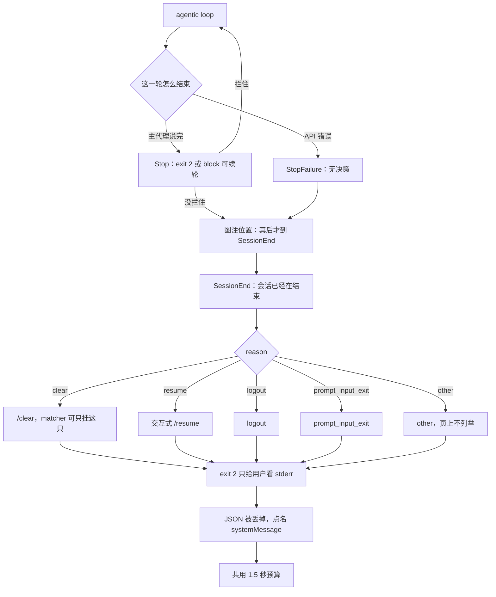

有人把「拦住 `/clear`」「退出前再逼它说完一句」「把每轮收工检查抄到会话结尾」写在 `SessionEnd` 上。或者把 `decision: "block"` 和 exit 2 从 `Stop` 抄过来，指望改判。会话已经在结束。

`Stop` 和 `StopFailure` 是每轮收束。`SessionEnd` 是会话终止。`/clear`、交互式 `/resume` 也会走这只，不只是进程退出。它没有 decision control，拦不住终止。exit 2 只把 stderr 给用户看。JSON 输出会被丢掉，专项点名包括 `systemMessage`。默认还共用 1.5 秒预算。清理、记日志、存状态可以挂在这里。收工闸留在 `Stop`。

我在 2026-11-17 08:24（Asia/Shanghai）打开并重读了 [Hooks reference](https://code.claude.com/docs/en/hooks) 的三种节奏、生命周期表、图注、matcher 规则和 matcher 表、退出码表、[Decision control](https://code.claude.com/docs/en/hooks#decision-control)、[SessionEnd](https://code.claude.com/docs/en/hooks#sessionend)、[Prompt-based hooks](https://code.claude.com/docs/en/hooks#prompt-based-hooks) 的支持列表、MCP tool hook 的等待句，以及调试日志那一节。图是图片。markdown 导出没带上图，我读的是页面上的 alt。相关半句是：嵌套的 agentic loop 之后，Stop or StopFailure，followed by TeammateIdle, PreCompact, PostCompact, and SessionEnd。`Notification`、`ConfigChange`、`InstructionsLoaded`、`CwdChanged`、`FileChanged`、`DirectoryAdded` 在同一句 alt 里是 standalone async events。[Automate actions with hooks](https://code.claude.com/docs/en/hooks-guide) 的事件表、matcher 表、Clean up on session end，以及 Limitations 里的 1.5 秒预算，我对照过。[Agent SDK hooks](https://code.claude.com/docs/en/agent-sdk/hooks) 的表、Hook timeout，和 Session hooks not available in Python，只作对照。changelog 页首是 **2.1.326**，日期 November 16, 2026。GitHub latest 是 [v2.1.326](https://github.com/anthropics/claude-code/releases/tag/v2.1.326)，`published_at` 是 2026-11-16T22:11:05Z，北京时间 2026-11-17 06:11。这一版的 Added 和 Changed 里，我没有读到改写 `SessionEnd` 决策或超时语义的条目。没有跑 Claude Code，没有配真实 hook。字段名和时序只转述这些页。

[昨天](https://cfireworks.github.io/2026/11/16/2026-11-16-stopfailure/)讲每轮怎么结束：主代理正常说完走 `Stop`，API 错误改走 `StopFailure`，两只互斥。用户中断时两只都不来。那篇把 `SessionEnd` 点到会话终止为止。[11 月 8 日](https://cfireworks.github.io/2026/11/08/2026-11-08-userpromptsubmit-vs-sessionstart/)是开始一侧。今天是对称的会话结束一侧。图注把 TeammateIdle、PreCompact、PostCompact 放在 Stop or StopFailure 之后、`SessionEnd` 之前。那是图上的位置。我没有把它读成「每次终止都会先空闲、先压缩」。压缩闸在 [11 月 11 日](https://cfireworks.github.io/2026/11/11/2026-11-11-precompact-vs-postcompact/)。评估器对退出码在 [11 月 2 日](https://cfireworks.github.io/2026/11/02/2026-11-02-goal-vs-stop-hook/)。这两篇不重写。

<!-- more -->

## 会话已经在结束



三种节奏写在参考页开头。per session 是 `SessionStart` 和 `SessionEnd`。per turn 是 `UserPromptSubmit`、`Stop` 和 `StopFailure`。agentic loop 里是 `PreToolUse` 和 `PostToolUse`，`EndConversation` 会跳过这两只。生命周期表里，`SessionEnd` 的 When it fires 是 When a session terminates。

同一张退出码表：`Stop` 的 Can block? 是 Yes，exit 2 的效果是 Prevents Claude from stopping。`StopFailure` 是 No，输出和退出码被忽略，除了 `terminalSequence`。`SessionEnd` 是 No，Shows stderr to user only。`SessionStart` 也是这一格。开场细节不在这里展开。

Decision control 把 `Setup, Notification, SessionEnd, PostCompact, InstructionsLoaded, StopFailure, CwdChanged, DirectoryAdded, FileChanged` 放在同一行：None。No decision control. Used for side effects like logging or cleanup。

## 三列并排

| 维度 | Stop | StopFailure | SessionEnd |
| --- | --- | --- | --- |
| 节奏 | per turn。主代理说完 | per turn。API 错误，替掉 Stop | per session。会话终止 |
| 何时还能看见 | 用户中断不来。API 错误不来 | 这一轮已经因 API 错误结束 | `/clear`、交互式 `/resume`、logout、`prompt_input_exit`、`other` |
| 能否拦住 | 能。exit 2、`decision: "block"`、`additionalContext` 可续轮 | 不能 | 不能。拦不住会话终止 |
| exit 2 | Prevents Claude from stopping | 输出和退出码被忽略，除了 `terminalSequence` | Shows stderr to user only |
| decision control | 有。顶层 `decision: "block"` | 无 | 无。JSON 输出被丢掉，点名 `systemMessage` |
| 默认时间 | 不在 SessionEnd 这只 1.5 秒预算里 | 参考页没有把它写进这只共享预算 | 指南写 any type 共用 1.5 秒 |
| matcher | 不支持。写了会被静默忽略 | 按 `error`。精确匹配字符更窄 | 按 why the session ended |
| 适合 | 收工闸 | 日志、告警、副作用 | 清理、记日志、存状态 |
| prompt / agent | 五种类型都支持 | 只有 command、http、mcp_tool | 只有 command、http、mcp_tool |

`/goal` 挂在能续轮的那只上。支持列表里，`SessionEnd` 和 `StopFailure` 都没有 `prompt`，也没有 `agent`。把评估器挪到会话结尾，名单里没有这个类型。

## clear 不是普通退出

专项开场：Runs when a Claude Code session ends. Useful for cleanup tasks, logging session statistics, or saving session state. Supports matchers to filter by exit reason.

`reason` 表：

| reason | 页上的说明 |
| --- | --- |
| `clear` | Session cleared with `/clear` command |
| `resume` | Session switched via interactive `/resume` |
| `logout` | User logged out |
| `prompt_input_exit` | User exited while prompt input was visible |
| `other` | Other exit reasons |
| `bypass_permissions_disabled` | Removed in v2.1.234; Claude Code doesn't send it. Drop it from your `SessionEnd` matchers |

最后一行是删除说明，不是第六只仍会发送的值。我打开的 changelog 页里没有搜到 `bypass_permissions_disabled` 这串字。版本号以 reason 表为准，不补一条 changelog 原文。

`other` 只写到 Other exit reasons。`prompt_input_exit` 只写到用户在提示输入还看得见时退出。页上没有把它们写成 Ctrl+C、`:q` 或某个进程信号。

指南的 Clean up on session end 把 matcher 设成 `clear`，并写明：只在 `/clear` 时开火，not on normal exits。普通退出要清理的话，这个 matcher 盖不住。省略 matcher、写成 `"*"` 或 `""`，才是每次这个事件都跑。

输入除公共字段外有 `reason`。专项例子是这一份。里面没有 `stop_hook_active`，也没有 `last_assistant_message`。那两样属于每轮收束。我打开的这一页没有把它们写进 `SessionEnd`。

```json
{
  "session_id": "abc123",
  "transcript_path": "/Users/.../.claude/projects/.../00893aaf-19fa-41d2-8238-13269b9b3ca0.jsonl",
  "cwd": "/Users/...",
  "hook_event_name": "SessionEnd",
  "reason": "other"
}
```

matcher 走普通规则。只含字母、数字、`_`、`-`、空格、`,`、`|` 时，按精确字符串匹配，`|` 或 `,` 分隔备选项，两侧空白可以有。`FileChanged` 和 `StopFailure` 那套更窄字符集不要抄过来：那边连字符、空格或逗号会把 matcher 留在正则路径上。`SessionEnd` 的 `clear, resume` 仍是精确匹配。连字符是允许的精确字符，不是分隔符，`clear-resume` 对不上 `clear`。出现这套字符以外的符号，才走不锚定的 JavaScript 正则。页上没给这只事件的正则样例，我不算。

`if` 只在五只工具事件上求值。写在别的事件上，这只钩子 never runs。抄一条 `Bash(git *)` 到 `SessionEnd`，清理不会跑。

指南那段清理可以写成这样。这是参照示例写的形状，不是我配进 settings 的 hook。

```json
{
  "hooks": {
    "SessionEnd": [
      {
        "matcher": "clear",
        "hooks": [
          {
            "type": "command",
            "command": "rm -f /tmp/claude-scratch-*.txt"
          }
        ]
      }
    ]
  }
}
```

## 1.5 秒是这只事件的预算

handler 字段表里，`command`、`http`、`mcp_tool` 的默认 `timeout` 是 600 秒。同一格后半句把 `SessionEnd` 摘出去：SessionEnd hooks share a 1.5-second budget。settings 里更长的 per-hook `timeout` 会把预算抬到与之匹配，上限 60 秒。指南的 Limitations 再写一遍：`SessionEnd` hooks of any type share a 1.5-second budget。http 和 mcp_tool 也在这个预算里。600 秒那一档不要抄过来。

专项把适用时机写死了。默认 1.5 秒用在你退出、跑 `/clear`，或用交互式 `/resume` 换会话的时候。加时只有两条路。

第一条，给某一只 hook 写 `timeout`。总体预算自动升到设置文件里最高的那个 per-hook `timeout`，上限 60 秒。用这种方式抬预算时，没有自己 `timeout` 的 hook 仍保持默认。插件提供的 hook 上的 timeout 不会抬预算。

第二条，环境变量 `CLAUDE_CODE_SESSIONEND_HOOKS_TIMEOUT_MS`，单位毫秒，显式覆盖预算。你设的值也会成为每个没有自己 `timeout` 的 hook 的超时。页上的例子是：

```bash
CLAUDE_CODE_SESSIONEND_HOOKS_TIMEOUT_MS=5000 claude
```

Before v2.1.268，这个变量只抬总体预算，没有自己 `timeout` 的 hook 仍会在 1.5 秒被取消。changelog **2.1.268**（September 10, 2026）的对应修复是：Fixed `CLAUDE_CODE_SESSIONEND_HOOKS_TIMEOUT_MS` not extending SessionEnd hooks that have no per-hook `timeout` (they were still cancelled after 1.5 seconds)。

能拦或改结果的事件，例如 `PreToolUse` 或 `Stop`，会等仍在连接的 MCP 服务器，至多 `MCP_TIMEOUT`，并且还在这只 hook 自己的 `timeout` 里。观察性事件，文档点名例如 `Notification` 或 `SessionEnd`，不等待。

调试日志从 v2.1.296 起，工具事件、`UserPromptSubmit`、`SessionStart`、`Stop` 等 command hook 结束时会留下带耗时的 `Hooks:` 行。`Notification`、`SessionEnd`、`PreCompact` 上，command hook 留下的是 `completed with status` 行，没有 duration。页上给的样例行是 `PostToolUse`。我没有照着编一条 `SessionEnd` 的完整日志。

`async: true` 的总述是：后台 command hook 不再强制 `timeout`，结果只在会话还在时送达；`-p` 收尾会杀掉仍在跑的 async hook，工作必须活过这次 `claude -p` 时，得自己拉起一个完全脱离的进程。SessionEnd 的加时清单里没有 `async`。它能不能盖过这只 1.5 秒预算，专项没写。「未核实」。

## 清理可以挂在这里

记一笔会话统计、删掉这次会话的临时文件、把状态写到你自己的地方，挂在 `SessionEnd`。副作用发生在 hook 进程里。退出码 0 的清理脚本做的是这件事。exit 2 只把 stderr 给用户看，终止照旧发生。顶层 `decision: "block"` 和 `systemMessage` 都落在会被丢掉的 JSON 字段里。

要拦住这一轮收工，用 `Stop`。昨天写过：只有主代理正常说完才走这只。API 错误在 `StopFailure`，exit 2 改不了那一轮。用户中断时两只都不来。会话级清理若只挂在 `Stop` 上，这三条路都看不见。

要拦住一句提示，用 `UserPromptSubmit`。11 月 8 日写过，这里只留链接。

只想在 `/clear` 时清掉草稿，matcher 用 `clear`。交互式 `/resume`、logout、提示输入还在时退出、以及 `other`，都要另配，或干脆不要 matcher。已经删掉的 `bypass_permissions_disabled` 从 matcher 里拿掉。

清理超过 1.5 秒，就在那只 hook 上写 `timeout`，或设 `CLAUDE_CODE_SESSIONEND_HOOKS_TIMEOUT_MS`。只给旁边一只 hook 加时，没写 `timeout` 的仍是 1.5 秒。插件 hook 上的数字抬不起这份预算。上限是 60 秒。

`terminalSequence` 那一节点名的是会丢掉 `systemMessage` 和 `continue`、但这个字段仍然有效的例子：`Notification` 和 `StopFailure`。`SessionEnd` 不在那句例子里。专项只说 JSON 输出字段会被丢掉，并点了 `systemMessage`。这只事件上响不响铃，页上没写。「未核实」。

## 夹具里，exit 2 留不住会话

演示在 [`demos/sessionend/`](https://github.com/cFireworks/cfireworks.github.io/tree/main/demos/sessionend)。不读密钥，不访问网络，不启动 Claude Code。假的是文档里的输入和输出契约：五只仍会发送的 `reason`、已删除的那只、exit 2 与 JSON、以及 1.5 秒预算的两条加时路。这不是 settings 里的 hook。

`python3 demos/sessionend/run_demo.py` 我跑过，最后一行是 `result=pass`。

| 夹具 | 在看什么 | 跑完的旗标 |
| --- | --- | --- |
| `clear_hit` | matcher `clear` | `match_result=hit`。`blocks_termination=0` |
| `clear_miss_other` | 同一 matcher 对上 `other` | `match_result=miss`。`handler_ran=0`。事件仍到 |
| `resume_hit` | 交互式 `/resume` | `match_result=hit` |
| `logout_hit` | `logout` | `match_result=hit` |
| `prompt_input_exit_hit` | `prompt_input_exit` | `matcher_path=exact`。`match_result=hit` |
| `pipe_hit` | `clear\|resume` | `matcher_path=exact`。`match_result=hit` |
| `comma_hit` | `clear, resume` | 仍是 `exact`。`match_result=hit` |
| `hyphen_not_separator` | `clear-resume` | `matcher_path=exact`。`match_result=miss` |
| `regex_not_simulated` | `^clear$` | `matcher_path=regex`。`match_result=not_simulated` |
| `match_all_other` | 省略 matcher | `other` 也会 `handler_ran=1` |
| `removed_not_sent` | 已删除的 reason | `reason_sent=0`。`event_fired=0` |
| `removed_matcher_miss` | 用已删除的值去配 `other` | `match_result=miss` |
| `exit2_shows_stderr` | SessionEnd 的 exit 2 | `stderr_to_user=1`。`blocks_termination=0`。`turn_continued=0` |
| `block_discarded` | `decision: "block"` | `json_discarded=1`。`decision_honored=0` |
| `system_message_discarded` | `systemMessage` | `json_discarded=1`。`system_message_kept=0` |
| `stop_exit2` | Stop 的 exit 2，最小对照 | `turn_continued=1`。`event_fired=0` |
| `stop_block` | Stop 的 block | `turn_continued=1`。`decision_honored=1` |
| `budget_default` | 没写 timeout | `budget_ms=1500`。`rejected_600=1` |
| `budget_per_hook` | settings 里 `timeout: 5`，旁边一只没写 | `budget_ms=5000`。`unset_hook_ms=1500` |
| `budget_cap_60` | `timeout: 90` | `budget_ms=60000`。`cap_applied=1` |
| `plugin_no_raise` | 只有插件 hook 写了 10 秒 | `budget_ms=1500`。`plugin_raises_budget=0`。`plugin_wait_ms=unspecified` |
| `settings_not_plugin` | settings 5 秒，插件 30 秒 | `budget_ms=5000`。插件不抬预算 |
| `env_current` | 环境变量 `5000`，另有一只 `timeout: 2` | `unset_hook_ms=5000`。`own_hook_ms=2000` |
| `env_before_268` | 同一变量，旧行为 | `budget_ms=5000`。`unset_hook_ms=1500` |
| `prompt_refused` | `prompt` | `prompt_supported=0`。`handler_ran=0` |
| `agent_refused` | `agent` | `agent_supported=0`。`handler_ran=0` |
| `if_never_runs` | 写了 `if` | `if_blocked=1`。`handler_ran=0` |
| `http_allowed` | `http` 在支持列表里 | `handler_ran=1`。`blocks_termination=0` |
| `mcp_no_wait` | SessionEnd 的 mcp_tool | `waits_for_server=0` |
| `stop_mcp_waits` | Stop 会等仍在连接的服务器 | `waits_for_server=1`。不连服务器 |

`clear_miss_other` 用的是专项例子里的 `reason: "other"`。指南说 matcher `clear` 在普通退出上不开火。夹具没有另造一个 reason 字符串，也没有列举 `other` 里面还有哪些路径。`regex_not_simulated` 不算正则结果。`prompt_refused` 是夹具拒绝跑评估器，不是测到了官方的跳过文案。`plugin_wait_ms=unspecified` 是因为页上只说插件 timeout 不抬预算，没写这只插件 hook 自己能跑多久。`stop_exit2` 的 `turn_continued=1` 和 `exit2_shows_stderr` 的 `turn_continued=0` 是两只事件。前一只还能续轮，后一只会话已经在结束。

`budget_cap_60` 把 `timeout: 90` 的可等待时间记成 60 秒预算。页上写总体预算升到与 per-hook `timeout` 相匹配，上限 60 秒。夹具没有另造「单只 hook 可以超过这份预算还继续跑」。

## Python 里它仍是 settings 里的命令

Agent SDK 的表上，`SessionEnd` 这一行是 Python SDK **No**，TypeScript SDK **Yes**。触发写的是 Session termination，示例用途是 Clean up temporary resources。同一张表里，`Stop` 的示例用途是 Save session state before exit。CLI 专项则把 saving session state 和清理、记统计写在一起。示例不是一份互斥清单。不要把 SDK 回调的语义套回 CLI hook。

Hook timeout 写：Claude Code 在 shutdown 时跑 `SessionEnd` callbacks，走更短的 SessionEnd timeout budget，默认 1.5 秒。超时之后这一行没有单独写「会不会改终止」。参考页已经说它不能决策。超时那一句我不补。

Python 小节的标题是 Session hooks not available in Python。`SessionStart` 和 `SessionEnd` 可以在 TypeScript 里注册成 SDK callback。Python SDK 的 `HookEvent` 类型省略了它们。在 Python 里，它们只作为 settings 文件（如 `.claude/settings.json`）里的 shell command hooks 可用。设置了 `setting_sources` 或 `settingSources` 时，要包含存放这些 hooks 的那一路来源。这不是「Python 完全没有 SessionEnd」。

## 能拦住收工的仍是 Stop

控制环里，「这一轮说完了」和「这个会话正在结束」不是同一只事件。能拦住收工、让它再干一轮的，是 `Stop`。`SessionEnd` 到来时，终止已经在发生。exit 2 留不住它。1.5 秒是清理窗口，不是再开一轮的预算。

你们的收工检查，是挂在主代理说完之后，还是挂在 `/clear` 已经清掉会话之后？只想在 `/clear` 时删草稿的那条 matcher，写的是 `clear`，还是把已删除的 `bypass_permissions_disabled` 留在列表里？

## 扩展阅读

- [Hooks reference：SessionEnd](https://code.claude.com/docs/en/hooks#sessionend)
- [Hooks reference：Exit code 2](https://code.claude.com/docs/en/hooks#exit-code-2-behavior-per-event)
- [Hooks reference：Decision control](https://code.claude.com/docs/en/hooks#decision-control)
- [Hooks reference：Prompt-based hooks](https://code.claude.com/docs/en/hooks#prompt-based-hooks)
- [Automate actions with hooks](https://code.claude.com/docs/en/hooks-guide)
- [Agent SDK hooks](https://code.claude.com/docs/en/agent-sdk/hooks)
- [changelog](https://code.claude.com/docs/en/changelog) / [release v2.1.326](https://github.com/anthropics/claude-code/releases/tag/v2.1.326) / [release v2.1.268](https://github.com/anthropics/claude-code/releases/tag/v2.1.268)
- [别把接口报错当成正常停轮](https://cfireworks.github.io/2026/11/16/2026-11-16-stopfailure/)
- [别把入口闸挂在会话开头](https://cfireworks.github.io/2026/11/08/2026-11-08-userpromptsubmit-vs-sessionstart/)
- [别让干活的模型自己判收工](https://cfireworks.github.io/2026/11/02/2026-11-02-goal-vs-stop-hook/)
- [别把压缩当成已经发生](https://cfireworks.github.io/2026/11/11/2026-11-11-precompact-vs-postcompact/)

## 讨论

`other` 具体覆盖哪些退出路径？表上只写 Other exit reasons。用户中断的那一轮，`Stop` 和 `StopFailure` 都不来，后面还会不会走 `SessionEnd`？非交互 `-p` 退出时的 `reason` 是哪一只？页上写超时适用于 you exit，没有把这次 exit 标成某个 reason。交互式 `/resume` 以外，`--resume` 或 `--continue` 会不会带 `reason: "resume"`？表上写的是 interactive `/resume`。环境变量和一只更长的 per-hook `timeout` 叠在一起时，预算听谁的？`async` 能不能盖过这只 1.5 秒预算？`terminalSequence` 在这只事件上还在不在？这几处我没有从打开的页里读到，也不替它们补一句。
