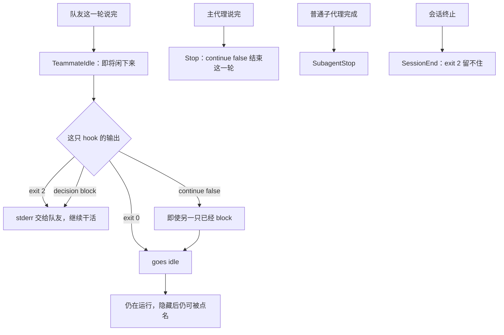

有人把主代理每轮收工的检查，或者 `{"continue": false, "stopReason": "..."}`，原样抄到 `TeammateIdle` 上。前一种指望同样续工，后一种指望同样「结束」。还有人把它当成 `SubagentStop`，或者当成昨天的 `SessionEnd`。队友只是即将闲下来。

`TeammateIdle` 在 [agent team](https://code.claude.com/docs/en/agent-teams) 队友结束自己这一轮、马上要闲下来时开火。它没有 matcher。exit 2 把 stderr 交给队友，`{"decision": "block", "reason": "..."}` 把 `reason` 交给队友，两只都让它继续干活。`continue: false` 方向相反：队友闲下来，`stopReason` 出现在它的 transcript 里，而且另一只 `TeammateIdle` hook 已经 block 也挡不住这次放行。闲下来的队友仍在运行，仍可被点名。那不是被停掉，也不是会话终止。

我在 2026-11-18 08:28（Asia/Shanghai）打开并重读了 [Hooks reference](https://code.claude.com/docs/en/hooks) 的三种节奏、生命周期表、图的 alt、matcher 表、退出码表、[Decision control](https://code.claude.com/docs/en/hooks#decision-control)、[TeammateIdle](https://code.claude.com/docs/en/hooks#teammateidle)、prompt 与 agent 的 Response schema，以及 MCP tool hook 的等待句。markdown 导出没带上图，alt 是从页面 HTML 里读的。相关半句是：嵌套的 agentic loop 之后，Stop or StopFailure，followed by TeammateIdle, PreCompact, PostCompact, and SessionEnd。`Notification`、`ConfigChange`、`InstructionsLoaded`、`CwdChanged`、`FileChanged`、`DirectoryAdded` 在同一句 alt 里是 standalone async events。[Automate actions with hooks](https://code.claude.com/docs/en/hooks-guide) 的事件表和 matcher 表我对照过，指南没有单独的 `TeammateIdle` 示例。[Orchestrate teams of Claude Code sessions](https://code.claude.com/docs/en/agent-teams) 的质量闸、空闲行和 `Press x` 那句，我读过。[Agent SDK hooks](https://code.claude.com/docs/en/agent-sdk/hooks) 的表、`onFailure` 和 Hook timeout 只作对照。changelog 页首是 **2.1.327**，日期 November 17, 2026。GitHub latest 是 [v2.1.327](https://github.com/anthropics/claude-code/releases/tag/v2.1.327)，`published_at` 是 2026-11-17T23:17:45Z，北京时间 2026-11-18 07:17。这一版的 Added、Changed 和 bug fixes 里，我没有读到改写 `TeammateIdle` 决策或空闲语义的条目。没有跑 Claude Code，没有配真实 hook，没有启动 agent team。字段名和时序只转述这些页。

[昨天](https://cfireworks.github.io/2026/11/17/2026-11-17-sessionend/)讲会话已经在结束：`SessionEnd` 没有 decision control，exit 2 留不住。那篇的图注把 `TeammateIdle` 点到 Stop or StopFailure 之后、压缩和 `SessionEnd` 之前，点到为止。[11 月 16 日](https://cfireworks.github.io/2026/11/16/2026-11-16-stopfailure/)和 [11 月 2 日](https://cfireworks.github.io/2026/11/02/2026-11-02-goal-vs-stop-hook/)是主代理这一轮怎么停。今天切在队友即将闲下来这一侧。图上的前后位置，我仍然不读成「每次停轮都会先走 `TeammateIdle`，再压缩，再结束会话」。压缩闸在 [11 月 11 日](https://cfireworks.github.io/2026/11/11/2026-11-11-precompact-vs-postcompact/)。开场闸在 [11 月 8 日](https://cfireworks.github.io/2026/11/08/2026-11-08-userpromptsubmit-vs-sessionstart/)。[10 月 30 日](https://cfireworks.github.io/2026/10/30/2026-10-30-fold-subagents-single-loop/)写的是把子代理折回一条循环。这三篇不重写。

<!-- more -->

## 即将闲下来，才是这只事件



三种节奏写在参考页开头。per session 是 `SessionStart` 和 `SessionEnd`。per turn 是 `UserPromptSubmit`、`Stop` 和 `StopFailure`。agentic loop 里是 `PreToolUse` 和 `PostToolUse`，`EndConversation` 会跳过这两只。`TeammateIdle` 不在这三句里。生命周期表的 When it fires 是 When an agent team teammate is about to go idle。

专项开场更具体：Runs when an agent team teammate is about to go idle after finishing its turn。用途写的是质量闸，例如要求 lint 通过，或者确认输出文件还在。同一段也用了 before a teammate stops working。决策控制里的结果词是 goes idle，这个词链到 agent teams 的 [start your first agent team](https://code.claude.com/docs/en/agent-teams#start-your-first-agent-team)。页上写：面板里每个 agent 都闲下来之后，空闲行在 30 秒后隐藏，到这个队友的下一次回合再出现；the teammate stays running and addressable while hidden。故障排查里还有一句：消失的那一行是 hidden, not stopped。通用字段表里，`continue: false` 的说明是 Claude stops processing entirely。这只事件的决策表和专项三条不沿用那句，写的是 the teammate goes idle。我按专项和决策表写。

退出码表同一行：Can block? 是 Yes。exit 2 的效果是 Prevents the teammate from going idle, so it continues working。对照格只点到：`Stop` 是 Prevents Claude from stopping，`SubagentStop` 是 Prevents the subagent from stopping，`SessionEnd` 是 No，Shows stderr to user only。

## 五列并排

| 维度 | Stop | SubagentStop | TeammateIdle | SessionEnd | TaskCompleted |
| --- | --- | --- | --- | --- | --- |
| 对象 | 主代理说完这一轮 | 普通子代理完成 | agent team 队友即将闲下来 | 会话终止 | 任务被标完成，或队友回合结束时仍有进行中的任务 |
| 能否拦住 | 能 | 能 | 能。拦住的是空闲 | 不能 | 能。拦住的是标完成 |
| exit 2 | 阻止 Claude 停下，对话继续 | 阻止子代理停下 | 阻止闲下来，队友继续干活 | 只把 stderr 给用户看 | 任务不会被标成完成 |
| `continue: false` | 优先于 exit 2，这一轮结束 | 优先于 exit 2，子代理结束这一轮 | 队友闲下来，即使另一只 `TeammateIdle` 已经 block。`stopReason` 进 transcript | 无决策。JSON 被丢掉，点名 `systemMessage` | 回合结束时队友闲下来，任务仍进行。`TaskUpdate` 上忽略这个字段 |
| matcher | 不支持 | 按 agent type | 不支持。每次都开火 | 按会话为何结束 | 不支持 |
| prompt 的 `ok: false` | 默认把 reason 交回去并续轮，除非 `impossible` | 同 Stop | 默认闲下来，reason 进 transcript。`continueOnBlock: true` 才续工 | 不支持 prompt | `TaskUpdate` 上继续，不论 `continueOnBlock`。回合结束时的默认与 `TeammateIdle` 相同 |

`Stop` 和 `SubagentStop` 上「字段优先于 exit 2」的原文，写的是 on events such as `Stop` and `SubagentStop`。我没有把这句改写成 `TeammateIdle` 的原文。`TaskUpdate` 上忽略 `continue: false`，是 `TaskCompleted` 的注解。决策表把两只事件写在同一行，后半句不要套到 `TeammateIdle` 上。

## 两套杠杆，方向相反

专项把杠杆写成三条。

exit 2：the teammate receives the stderr message as feedback and continues working。

`{"decision": "block", "reason": "..."}`：the teammate receives `reason` and continues working。

`{"continue": false, "stopReason": "..."}`：the teammate goes idle even if another of your TeammateIdle hooks blocks。`stopReason` 出现在队友的 transcript 里。

想留住它，用前两只。想让它闲下来并留下原因，用第三只。把 `Stop` 上「`continue: false` 会结束回合」的记忆抄过来，得到的是放行。多只 hook 同时在时，第三只仍然放行。质量闸若有一只写成 `continue: false`，旁边那只 exit 2 留不住人。

参考页上的 bash 例子检查 `./dist/output.js`。文件不在，就往 stderr 写 `Build artifact missing. Run the build before stopping.`，然后 exit 2；在，就 exit 0。这是页上的例子。我没有把它配进 settings，也没有在 Claude Code 里跑过。

changelog **2.1.33**（February 6, 2026）加入了 `TeammateIdle` 和 `TaskCompleted`。**2.1.69**（March 5, 2026）的一条修复写的是 to stop the teammate, matching `Stop` hook behavior。我今天打开的专项和决策表写的是 goes idle。空闲语义以这两处和 agent teams 的「仍在运行、仍可被点名」为准。不把 2.1.69 的 stop 读成进程退出。

## 名字能读，matcher 不能筛

`TeammateIdle` hooks don't support matchers and fire on every occurrence。参考页还写：给没有 matcher 支持的事件加上 `matcher`，会被静默忽略。不能靠 matcher 只挂在名叫 `researcher` 的队友上。要分支，读输入里的 `teammate_name`。

指南的「no matcher support」那一行，比参考页多写了 `CwdChanged`。参考页把 `CwdChanged` 单独列成 no matcher support，分组那一行没有它。两页对 `TeammateIdle` 的写法一致：不支持，每次都开火。名单的分行以参考页为准。我没有把这个差别收成第三种过滤规则。

专项例子是这一份。里面没有 `agent_id`。

```json
{
  "session_id": "abc123",
  "transcript_path": "/Users/.../.claude/projects/.../00893aaf-19fa-41d2-8238-13269b9b3ca0.jsonl",
  "cwd": "/Users/...",
  "permission_mode": "default",
  "hook_event_name": "TeammateIdle",
  "teammate_name": "researcher",
  "team_name": "session-a1b2c3d4"
}
```

字段表：

| 字段 | 页上的说明 |
| --- | --- |
| `teammate_name` | Name of the teammate that is about to go idle |
| `team_name` | Deprecated。Session-derived team name，以后的版本会去掉 |
| `agent_id` | 这只事件上，公共字段标识即将闲下来的 in-process teammate。May be absent。需要 Claude Code v2.1.290 或更晚 |

`team_name` 还在例子里，不要再拿它做过滤，也不要把它当成必填的决策依据。`agent_id` 可以缺席。字段说明写的是 in-process teammate，没有写「每个队友，包括分屏的，都一定带这个字段」。

changelog **2.1.290**（October 5, 2026）同一条 Changed 写了两件事：in-process teammate 在 Agent 结果里的 `agent_id` 改成它的 agent ID，`name@team` 仍留在 `teammate_id`；`TeammateIdle` hooks no longer fire from its subagents or forks。队友自己的子代理或 fork 不再点燃这只事件。普通子代理完成，走的仍是 `SubagentStop`。

队友可以由 subagent 定义生成。agent teams 打开时，主会话里被点名的 subagent 会以队友身份启动。想让点名的 subagent 回到普通子代理，把 `CLAUDE_CODE_EXPERIMENTAL_AGENT_TEAMS` 设成 `0`。那一节的链接在 [Claude spawns teammates instead of subagents](https://code.claude.com/docs/en/agent-teams#claude-spawns-teammates-instead-of-subagents)。这里不重写团队架构。显示模式有 in-process 和分屏。`agent_id` 那一格只把 in-process 写进标识范围。

## prompt 默认是放它闲下来

五种类型那一组包含 `TeammateIdle`：`command`、`http`、`mcp_tool`、`prompt`、`agent`。不要写成这只事件不支持 prompt 或 agent。

prompt 的 Response schema 对这只事件，以及队友回合结束时的 `TaskCompleted`，写的是：by default the teammate goes idle and the reason appears in its transcript。Set `continueOnBlock: true` to send the reason to the teammate and keep it working。`Stop` 和 `SubagentStop` 上，`ok: false` 默认是把 reason 交回去并续轮。那个默认不要抄过来。这只事件上，prompt 要续工，得显式打开 `continueOnBlock`。

agent hook 没有 `continueOnBlock`。`ok: false` 时，Claude Code 按同一事件上 `continueOnBlock: true` 的 prompt hook 来处理。所以 agent 的 `ok: false` 是把 reason 交给队友并让它继续干活。prompt 的默认和 agent 的 `ok: false` 不是同一方向。agent hook 页上标了实验性。

SDK 表上，`TeammateIdle` 的 Python SDK 是 No，TypeScript SDK 是 Yes。触发列写 Teammate becomes idle，用例是 Reassign work or notify。触发措辞比参考页的 about to go idle 松。时序以参考页为准，不把这张表读成「已经闲了才开火」。Session hooks not available in Python 只点名了 `SessionStart` 和 `SessionEnd`。那一节不套到 `TeammateIdle` 上。表上 Python 是 No，我只记这个差异，不补一条「可以用 settings 文件挂 Python callback」。

SDK 的 `onFailure: "block"`，在 `Stop`、`SubagentStop`、`TaskCompleted` 和 `TeammateIdle` 上被忽略，so the action goes ahead。这是 callback 失败时的行为。参考页对同一组事件另有一句：`onFailure` 没有作用，因为 exit 2 会把 Claude 送回去继续干活，而 Claude can't repair a hook that won't run。command hook 成功退出 2，和 callback 没跑成，是两条路。

Hook timeout 的默认是多数事件 600 秒，`UserPromptSubmit`、`PreModelSwitch`、`PostModelSwitch` 是 30 秒，`MessageDisplay` 是 10 秒，`SessionEnd` 默认 1.5 秒。页上没有给 `TeammateIdle` 单独一个数字。我不编。

能拦或改结果的事件，例如 `PreToolUse` 或 `Stop`，会等仍在连接的 MCP 服务器。观察性事件，例如 `Notification` 或 `SessionEnd`，不等待。`TeammateIdle` 在退出码表上能拦，等待句没有点名它。我不补「文档写明它会等待」。

exit 2、stdout 为空、stderr 说文件缺失（如 `No such file or directory`）时当成 non-blocking error，点名的是 `Stop`、`SubagentStop`、`TaskCompleted` 和插件的 `UserPromptSubmit`。没有点名 `TeammateIdle`。这句不补到这只事件上。

## 质量闸挂在即将空闲的这一侧

lint 还是红的，或者产物文件不在，可以挂在 `TeammateIdle` 上，用 exit 2 或 `decision: "block"` 把反馈交回去。agent teams 的质量闸一节写的也是：Exit with code 2 to send feedback and keep the teammate working。旁边两只是 `TaskCreated` 和 `TaskCompleted`，点到即可。任务能不能关，看 [TaskCompleted](https://code.claude.com/docs/en/hooks#taskcompleted)。

已经决定让这个队友闲下来，并且要在 transcript 里留下原因，用 `continue: false` 和 `stopReason`。不要把 `Stop` 的同一份 JSON 抄过来，还指望它把人留在工位上。

普通子代理的完成检查用 `SubagentStop`。会话结束时的清理用 `SessionEnd`。主代理这一轮的收工闸用 `Stop`。四只事件的对象不一样，exit 2 的方向也不一样。

脚本里要分队友，读 `teammate_name`。`team_name` 已弃用。`agent_id` 从 v2.1.290 起可能出现，也可能缺席，缺了不要当成这次事件没发生。

## 夹具里，exit 2 留得住，continue:false 留不住

演示在 [`demos/teammateidle/`](https://github.com/cFireworks/cfireworks.github.io/tree/main/demos/teammateidle)。不读密钥，不访问网络，不启动 Claude Code，不启动 agent team。假的是文档里的输入和输出契约：续工、放行、matcher 被忽略、`team_name` 不参与、prompt 的默认，以及 `Stop` / `SessionEnd` 各一行对照。这不是 settings 里的 hook。

`python3 demos/teammateidle/run_demo.py` 我跑过，最后一行是 `result=pass`。

| 夹具 | 在看什么 | 跑完的旗标 |
| --- | --- | --- |
| `exit2_keeps_working` | exit 2 | `continues_working=1`。`goes_idle=0` |
| `block_keeps_working` | `decision: "block"` | `continues_working=1`。`feedback=lint failed` |
| `exit0_goes_idle` | exit 0 | `goes_idle=1` |
| `continue_false_overrides_block` | `continue: false` 盖过 block | `goes_idle=1`。`overrode_other_block=1` |
| `continue_false_overrides_exit2` | 盖过另一只 exit 2 | `goes_idle=1`。`stop_reason_in_transcript=1` |
| `matcher_ignored` | matcher 写了 `researcher`，输入是另一只名字 | `event_fired=1`。`matcher_honored=0` |
| `script_branches_on_name` | 脚本读 `teammate_name` | `researcher` 缺产物时 `continues_working=1` |
| `team_name_ignored` | 两份 `team_name` | `team_name_used=0`。裁决相同 |
| `agent_id_absent` | 例子 JSON 没有 `agent_id` | `agent_id_present=0`。`agent_id_required=0` |
| `prompt_default_idle` | prompt 默认 | `goes_idle=1`。`reason_in_transcript=1` |
| `prompt_continue_on_block` | `continueOnBlock: true` | `continues_working=1` |
| `agent_ok_false_keeps` | agent 的 `ok: false` | `continues_working=1` |
| `same_hook_mix_unspecified` | 同一只输出里的 exit 2 和 `continue: false` | `simulated=0`。`note=not_simulated` |
| `sessionend_exit2` | SessionEnd 的 exit 2 | `stderr_to_user=1`。`blocks_termination=0` |
| `stop_continue_false` | Stop 上 exit 2 再加 `continue: false` | `note=turn_ended`。`continues_working=0` |
| `sdk_on_failure_ignored` | callback 失败且 `onFailure: "block"` | `on_failure_honored=0`。`action_goes_ahead=1` |
| `file_missing_not_named` | 文件缺失那条规则 | `named_in_file_missing_rule=0`。`simulated=0` |
| `mcp_wait_unspecified` | MCP 是否等待 | `waits_for_server=unspecified`。`simulated=0` |

`fixture-other` 这个队友名是夹具自己的，页上的例子只有 `researcher`。`same_hook_mix_unspecified` 不算裁决。`Stop` 那一行只证明「字段优先」写在 `Stop` 上时，这一轮结束。它不证明 `TeammateIdle` 的同一只输出也照搬那句。

## 读不到的，先留着

分屏队友是不是总是没有 `agent_id`？字段表写的是 in-process，并且 May be absent。没有写「分屏一定缺这个字段」。

同一只 hook 的 stdout 里既有 `continue: false`，退出码又是 2，`TeammateIdle` 是否完全沿用 `Stop` 那套字段优先？专项写的是「另一只 hook 已经 block」。总述里的 such as `Stop` and `SubagentStop` 没有点名这只事件。退出码一节还说，exit 2 和 `continue: false` 写在一起时，先看 Exit code 2，因为结果可以和事件那一行不一样。这只事件上的同一只输出，我没有从打开的页里读到一句完整裁决。

in-process 面板里，选中队友后 `Press x` to stop it。另有一节是让 lead 发 shutdown request，队友可以同意并退出，也可以拒绝。这两处都没有点名 `TeammateIdle`。手动按 `x`，或者关队友的那次请求，会不会走这只事件，页上没写。

这三处我都不补。

## 闲下来，还在这张桌子上

控制环里，「主代理这一轮说完了」「子代理完成了」「队友要闲下来了」「会话正在结束」，是四只闸。能把队友留在工位上的，是 `TeammateIdle` 的 exit 2 或 `decision: "block"`。`continue: false` 是放它闲下来。闲下来的行可以隐藏，人还在，还能被点名派活。

你们挂在队友空闲上的那份 JSON，是把 stderr 交回去的 exit 2，还是从 `Stop` 抄来的 `continue: false`？

## 扩展阅读

- [Hooks reference：TeammateIdle](https://code.claude.com/docs/en/hooks#teammateidle)
- [Hooks reference：Decision control](https://code.claude.com/docs/en/hooks#decision-control)
- [Hooks reference：Exit code 2](https://code.claude.com/docs/en/hooks#exit-code-2-behavior-per-event)
- [Hooks reference：Prompt-based hooks](https://code.claude.com/docs/en/hooks#prompt-based-hooks)
- [Automate actions with hooks](https://code.claude.com/docs/en/hooks-guide)
- [Agent teams：质量闸](https://code.claude.com/docs/en/agent-teams#enforce-quality-gates-with-hooks)
- [Agent SDK hooks](https://code.claude.com/docs/en/agent-sdk/hooks)
- [changelog](https://code.claude.com/docs/en/changelog) / [release v2.1.327](https://github.com/anthropics/claude-code/releases/tag/v2.1.327)
- [别把收工闸挂在会话结尾](https://cfireworks.github.io/2026/11/17/2026-11-17-sessionend/)
- [别把接口报错当成正常停轮](https://cfireworks.github.io/2026/11/16/2026-11-16-stopfailure/)
- [别让干活的模型自己判收工](https://cfireworks.github.io/2026/11/02/2026-11-02-goal-vs-stop-hook/)
- [别把入口闸挂在会话开头](https://cfireworks.github.io/2026/11/08/2026-11-08-userpromptsubmit-vs-sessionstart/)

## 讨论

分屏队友的输入里，`agent_id` 是经常缺席，还是另一种标识？同一只 `TeammateIdle` 输出同时带 exit 2 和 `continue: false` 时，听哪一条？面板上按 `x`，以及 lead 发出的 shutdown request，会不会经过这只事件？MCP tool hook 挂在这只事件上时，会不会等仍在连接的服务器？这几处我没有从打开的页里读到，也不替它们补一句。
