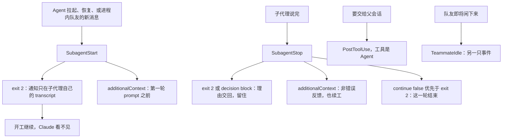

有人在 `SubagentStart` 里 exit 2，以为能拦住不该开工的子代理。子代理自己的 transcript 里多了一条 hook error。父会话没有这条。Claude 看不见。活还是开了。

`SubagentStart` 在子代理被拉起时开火，恢复时也会开火，进程内 agent team 队友处理一条新消息时也会开火。它没有 decision control。能做的是往子代理上下文里塞 `additionalContext`。要拦住收工、把理由交回去让它继续干，用的是 `SubagentStop`：exit 2，或 `decision: "block"`。同一份输出里的 `continue: false` 优先于 exit 2，子代理这一轮还是结束。想把话交给父会话，挂在 `Agent` 工具的 `PostToolUse` 上。

我在 2026-11-19 08:27（Asia/Shanghai）打开并重读了 [Hooks reference](https://code.claude.com/docs/en/hooks) 的三种节奏、生命周期表、图的 alt、matcher 表、退出码表、[Decision control](https://code.claude.com/docs/en/hooks#decision-control)、[SubagentStart](https://code.claude.com/docs/en/hooks#subagentstart)、[SubagentStop](https://code.claude.com/docs/en/hooks#subagentstop)、prompt 与 agent 的类型名单和 Response schema。markdown 导出没带上图，alt 是从页面 HTML 里读的。相关半句是：嵌套的 agentic loop 里有 PreToolUse、PermissionRequest、PostToolUse、PostToolUseFailure、PostToolBatch、SubagentStart/Stop、TaskCreated、TaskCompleted，然后是 Stop or StopFailure，followed by TeammateIdle, PreCompact, PostCompact, and SessionEnd。[Automate actions with hooks](https://code.claude.com/docs/en/hooks-guide) 的事件表和 matcher 表我对照过。[Create custom subagents](https://code.claude.com/docs/en/sub-agents) 的名字、插件作用域锚点和 frontmatter hooks，我读过。[Agent teams](https://code.claude.com/docs/en/agent-teams) 只核对质量闸那一节有没有开工钩。changelog 页首是 **2.1.327**，日期 November 17, 2026。GitHub latest 是 [v2.1.327](https://github.com/anthropics/claude-code/releases/tag/v2.1.327)，`published_at` 是 2026-11-17T23:17:45Z，北京时间 2026-11-18 07:17。这一版的 Added 和 Changed 里，我没有读到改写这两只决策的条目。bug fixes 里有一条是后台子代理的 `SubagentStop` 失败时什么都不显示，修的是显示。没有跑 Claude Code，没有配真实 hook，没有启动子代理。字段名和时序只转述这些页。

[昨天](https://cfireworks.github.io/2026/11/18/2026-11-18-teammateidle/)讲队友即将闲下来：`TeammateIdle` 的 exit 2 才留得住，`continue: false` 是放它闲下来，并点到它不是子代理的 `SubagentStop`。今天只切开工和收工这一对。图上的前后位置，我不读成「每次工具调用都会先走这两只」。主代理每轮怎么停，在 [11 月 16 日](https://cfireworks.github.io/2026/11/16/2026-11-16-stopfailure/)和 [11 月 2 日](https://cfireworks.github.io/2026/11/02/2026-11-02-goal-vs-stop-hook/)。会话结尾在 [11 月 17 日](https://cfireworks.github.io/2026/11/17/2026-11-17-sessionend/)。把子代理折回一条循环，在 [10 月 30 日](https://cfireworks.github.io/2026/10/30/2026-10-30-fold-subagents-single-loop/)。这几篇不重写。

<!-- more -->

## 开工塞上下文，收工才是闸



三种节奏写在参考页开头。per session 是 `SessionStart` 和 `SessionEnd`。per turn 是 `UserPromptSubmit`、`Stop` 和 `StopFailure`。agentic loop 里是 `PreToolUse` 和 `PostToolUse`，`EndConversation` 会跳过这两只。`SubagentStart` 和 `SubagentStop` 不在这三句里。生命周期表的短句是 When a subagent is spawned，以及 When a subagent finishes。三次开火写在专项，不写在这张短表上。

## 并排看能力

| 维度 | SubagentStart | SubagentStop | TeammateIdle |
| --- | --- | --- | --- |
| 何时开火 | Agent 拉起、恢复、进程内队友处理新消息 | 子代理说完。内部代理结束时也会来 | 队友即将闲下来。昨天写过，这里只作对照 |
| 能否拦住 | 不能。Context only，没有 decision control | 能。拦住的是停止 | 能。拦住的是空闲 |
| exit 2 | 只给用户看。通知在子代理自己的 transcript，不在父会话。Claude 看不见，开工继续 | 阻止子代理停下。stderr 交给子代理 | 阻止闲下来。不展开两套杠杆 |
| `continue: false` | 这只事件不靠它做决定 | 同一份输出里优先于 exit 2，子代理结束这一轮。想留住它，把字段留空 | 放它闲下来，即使另一只 `TeammateIdle` 已经 block。那句不抄到这边 |
| matcher | 按 `agent_type`。插件名要锚点 | 同一套值 | 不支持 |
| hook 类型 | `command`、`http`、`mcp_tool`。没有 `prompt`，没有 `agent` | 五种都支持 | 五种都支持。prompt 的默认方向昨天写过 |

决策表把 `SessionStart`、`SubagentStart`、`PostModelSwitch` 放在同一行：Context only，No blocking or decision control。`Stop` 和 `SubagentStop` 在另一行：顶层 `decision`，也可以用 `hookSpecificOutput.additionalContext` 做非错误反馈并续工。

## 三次开火，一份缓存友好的上下文

专项开场：Runs when Claude spawns a subagent with the Agent tool, when Claude resumes a subagent, and each time an in-process agent team teammate handles a new message。

内置类型是 `general-purpose`、`Explore`、`Plan`。自定义子代理用 frontmatter 的 `name`，不是文件名。插件子代理用插件作用域标识，例如 `my-plugin:reviewer`，不是裸的 frontmatter 名字。冒号会把这个名字放到正则路径上。精确匹配要写成 `^my-plugin:reviewer$`。子代理页的例子是 `^my-plugin:db-agent$`，规则相同。

团队页的质量闸只列了 `TeammateIdle`、`TaskCreated`、`TaskCompleted`。那里没有 `SubagentStart`。第三次开火以 hooks 专项这句为准。我不把质量闸改写成四只。

拦不住创建，但可以注入。返回：

```json
{
  "hookSpecificOutput": {
    "hookEventName": "SubagentStart",
    "additionalContext": "Follow security guidelines for this task"
  }
}
```

这段加在子代理上下文里，在它的第一轮 prompt 之前。同一子代理再次开火时，只有上下文里还没有先前那份拷贝，才会再注入。开场塞进去的那份留在原地，prompt cache 就还在。auto-compaction 丢掉那份拷贝之后，下一次运行会再注入。

指南的事件表和参考页一样，短句仍是 When a subagent is spawned。指南 matcher 表的例子值停在 `general-purpose`、`Explore`、`Plan` 和自定义名字，没有插件作用域那一格。参考页的例子值写了 `^my-plugin:reviewer$`。这一格以参考页为准。我不把两页收成第三种名单。

## 收工：理由交回去，或者放它停

`SubagentStop` 在子代理说完时开火。matcher 与 Start 相同。输入另有 `stop_hook_active`、`agent_id`、`agent_type`、`agent_transcript_path`、`last_assistant_message`。`transcript_path` 是主会话。`agent_transcript_path` 在嵌套的 `subagents/` 里，是子代理自己的 transcript。transcript 文件异步写，可能滞后。要这一轮的最后文本，读 `last_assistant_message`。

`stop_hook_active` 出现在这只输入里。它为 true 的说明写在 `Stop` 那一节：已经因为 stop hook 在续着。八次连拦写在同一节。`SubagentStop` 说决策格式与 `Stop` 相同，没有把这个数字再写一遍。我不把八次搬到子代理收工上。那是 11 月 2 日的账。

决策三条：

`{"decision": "block", "reason": "..."}`：子代理继续，`reason` 当作下一条指令。

exit 2：stderr 同样交给子代理，阻止它停下。

`hookSpecificOutput.additionalContext`，`hookEventName` 为 `"SubagentStop"`：非错误反馈，子代理继续，好让它按反馈做。这和 `decision: "block"` 不是同一条标签。`Stop` 那一节写，这段反馈让对话继续，transcript 标成 `Stop hook feedback`，不弹 hook error，并点了 `stop_hook_active` 和八次上限。`SubagentStop` 只点名接受这个字段，当作非错误反馈并续工。我没有把那个标签和那两个保护再贴到子代理上。

`continue: false` 写在 Exit code 2 那一节：on events such as `Stop` and `SubagentStop`, the field takes precedence over exit code 2, so Claude or the subagent ends its turn。想留住它，把这个字段留空。这是同一份输出里的优先关系。`TeammateIdle` 另有一句：即使另一只 hook 已经 block，`continue: false` 也放它闲下来。`SubagentStop` 没有这句。另一只 hook 已经 exit 2，这一只再写 `continue: false`，我没有读到完整裁决。夹具不算。

要往父会话注入，用挂在 `Agent` 工具上的 `PostToolUse`。不要写在 `SubagentStop` 上。前台 `Agent` 调用完成时，`tool_response` 里有这次运行的结果。那张遥测表我不全文搬。通道只认这一句。

v2.1.271 或更晚，子代理若用 `SubagentHandback` 交报告再停，`last_assistant_message` 里是收工前的收尾文本，如果有的话，不是那份报告。报告在该次调用的 `tool_input.message` 里，要靠 matcher 为 `SubagentHandback` 的 `PreToolUse` 或 `PostToolUse` 去取。[Tools reference](https://code.claude.com/docs/en/tools-reference) 写这只工具要 v2.1.271 或更晚，只在 auto mode 里提供给 Agent 本地拉起的、非 fork 的子代理。changelog **2.1.271**（September 14, 2026）的 Changed 写的是：auto mode 里子代理改经一次专门的 hand-back 调用向调用方报告，由安全分类器审阅。那一条没有印出工具名 `SubagentHandback`。版本号以两份参考页为准，changelog 对得上「这一版有了 hand-back 调用」。

`background_tasks` 和 `session_crons` 会出现在这只输入里。两份数组的作用域是父会话，不是子代理。不要把它读成子代理自己的任务列表。

exit 2、stdout 为空、stderr 说文件缺失（如 `No such file or directory`）时当成 non-blocking error，点名了 `Stop`、`SubagentStop`、`TaskCompleted` 和插件的 `UserPromptSubmit`。这句点了收工钩，没有点开工钩。我不把它扩到 `SubagentStart`。

`onFailure` 在 `Stop`、`SubagentStop`、`TaskCompleted` 和 `TeammateIdle` 上没有作用：exit 2 会把 Claude 送回去继续干活，而 Claude can't repair a hook that won't run。command hook 成功退出 2，和钩子根本没跑起来，是两条路。

## matcher、空类型，以及文件里的 Stop

matcher 的字符决定走哪条路。只有字母、数字、`_`、`-`、空格、逗号和 `|` 时，按精确字符串，或用 `|`、逗号分开的精确名单。出现别的字符，就按未锚点的 JavaScript 正则，`RegExp.prototype.test` 在任意位置命中就算。`my-plugin:reviewer` 因为冒号走上正则路径。不写 `^` 和 `$`，`my-plugin:reviewer-extra` 也会命中。

不是每只 `SubagentStop` 都来自 Claude 拉起的子代理。prompt suggestions、`/btw` 旁路提问这类内部代理结束时也会开火。这时 `agent_type` 是会话自己的 `--agent` 或 `agent` 设置里的名字，没有则是空字符串。点名类型的 matcher 匹配不到空字符串。matcher 省略、`""`、`"*"`，或能匹配空字符串的正则，才会跑到这些事件。changelog **2.1.275**（September 17, 2026）修过：点了名的 `SubagentStop` matcher 对空 `agent_type` 也开火。现在这一段写的是点名匹配不到空字符串。我按现在这一段写。

子代理 frontmatter 里的 hooks 只在它运行期间注册，结束就撤掉。这里的 `Stop` 会被转换成 `SubagentStop`。项目级子代理文件要先接受该文件夹的 workspace trust，这些 frontmatter hooks 才会跑。没接受，子代理仍会跑，hooks 被跳过。用户级 `~/.claude/agents/` 和 `--agents` 不用这一步。技能 hooks 的 `once` 和条数上限不在这里展开。

`SubagentStop` 在支持全部五种类型的那一组。`SubagentStart` 在只支持 `command`、`http`、`mcp_tool` 的那一组。开工钩上不要挂 `prompt` 或 `agent`。收工钩上可以。prompt 的 `ok: false` 会把 reason 交给子代理并续工，除非同时 `impossible: true`，那才放行停止。`continueOnBlock` 默认 false，但这一行的行为按 Response schema 写。不要把 `TeammateIdle`「默认闲下来，要 `continueOnBlock: true` 才续工」抄过来。agent hook 没有 `continueOnBlock`。`ok: false` 时，按同一事件上 `continueOnBlock: true` 的 prompt hook 处理，所以也是把 reason 交回去并续工。agent hook 不读 `impossible`。

## 清单

开工钩上 exit 2，拦不住创建。要带的上下文放进 `hookSpecificOutput.additionalContext`，`hookEventName` 写 `"SubagentStart"`。同一子代理再次进来、上下文还持有那份拷贝时，不要指望再塞一遍。压缩丢掉之后，下一次才会再塞。

收工要留住人，用 exit 2 或 `decision: "block"`，或者用 `additionalContext` 做非错误反馈。同一份输出里不要顺手写上 `continue: false`。那个字段会放它停。

父会话要收内容，matcher 挂在 `Agent` 上，事件是 `PostToolUse`。`SubagentStop` 的 `additionalContext` 喂的是子代理。

要这一轮原文，读 `last_assistant_message`。走了 `SubagentHandback` 的报告，改去工具钩的 `tool_input.message`。

插件作用域名写成 `^my-plugin:reviewer$`。省略 matcher 的收工钩会打到空 `agent_type`，包括内部代理。要筛队友名，那是昨天的 `TeammateIdle`，这只事件的 matcher 不干那件事。

## 夹具里，开工继续，收工才留得住

演示在仓库的 `demos/subagentstart-stop/`。不读密钥，不访问网络，不启动 Claude Code，不启动子代理，不启动 agent team。假的是文档里的输入和输出契约。这不是 settings 里的 hook。

`python3 demos/subagentstart-stop/run_demo.py` 我跑过，最后一行是 `result=pass`。

| 夹具 | 在看什么 | 跑完的旗标 |
| --- | --- | --- |
| `start_exit2_notice` | 开工 exit 2 | `blocks_spawn=0`。`notice_in_subagent_transcript=1`。`notice_in_parent=0`。`claude_sees_stderr=0` |
| `start_context_injected` | 第一次注入 | `injected=1`。原文是专项那句 security guidelines |
| `start_context_held` | 拷贝还在 | `injected=0` |
| `start_context_after_compact` | 压缩丢掉拷贝 | `injected=1` |
| `stop_exit2_keeps` | 收工 exit 2 | `continues=1`。`feedback=Tests are still failing.` |
| `stop_block_keeps` | `decision: "block"` | `continues=1` |
| `stop_additional_keeps` | 非错误反馈 | `continues=1`。`error_notice=0` |
| `stop_exit0_allows` | exit 0 | `stopped=1` |
| `stop_continue_false_overrides_exit2` | 同一份输出里的优先 | `stopped=1`。`precedence=1` |
| `stop_other_hook_continue_false` | 另一只 hook 已经 exit 2 | `simulated=0`。`note=other_hook_not_stated` |
| `matcher_plugin_unanchored` | 未锚点的插件名 | `extra_hit=1` |
| `matcher_plugin_anchored` | `^my-plugin:reviewer$` | `extra_hit=0`。`bare_hit=1` |
| `matcher_empty_named` | 空 `agent_type` 对上 `Explore` | `hit=0` |
| `matcher_empty_star` | `"*"` | `hit=1`。省略和 `""` 同样是 1 |
| `prompt_ok_false_keeps` | 收工 prompt | `continues=1`。开工那行 `prompt_supported=0` |
| `prompt_impossible_allows_stop` | `impossible: true` | `stopped=1` |
| `parent_via_posttooluse` | 父会话通道 | `event=PostToolUse`。`tool=Agent`。`subagentstop_targets_parent=0` |
| `teammateidle_no_matcher` | 最小对照 | `matcher_supported=0`。`same_event_as_subagent_stop=0` |

`Tests are still failing.` 是夹具自己的 stderr。参考页没有给 `SubagentStop` 一份 bash 例子。`stop_other_hook_continue_false` 不算裁决。`TeammateIdle` 那一行只证明它不在 matcher 表的支持侧，闲下来也不是这只收工。昨天的续工套件不在这里重放。

## 读不到的，先留着

分屏队友处理新消息时，会不会也打 `SubagentStart`？专项写的是 in-process。没有写分屏。

另一只 `SubagentStop` hook 已经 block，这一只的 `continue: false` 听谁的？总述写的是同一份输出里字段优先于 exit 2。指南只把多只 hook 的合并规则写在 `PreToolUse` 的 deny、defer、ask、allow 上。这只事件的跨 hook 合并，页上没写。

八次连拦算不算在子代理收工上？数字写在 `Stop` 的输入节。`SubagentStop` 没有再写一遍。

这三处我都不补。

## 开工和收工不是对称的两只闸

控制环里，子代理被拉起来的那一下，和它说完的那一下，能力不一样。`SubagentStart` 塞上下文，exit 2 只在它自己的 transcript 里留一条给用户看的通知。`SubagentStop` 才把理由交回去，让它接着干。`continue: false` 抄进同一份收工输出，放行的是停止。队友要闲下来，仍是昨天那只 `TeammateIdle`。

你们写在开工钩上的 exit 2，是真想拦住创建，还是其实该挪到收工钩上？

## 扩展阅读

- [Hooks reference：SubagentStart](https://code.claude.com/docs/en/hooks#subagentstart)
- [Hooks reference：SubagentStop](https://code.claude.com/docs/en/hooks#subagentstop)
- [Hooks reference：Decision control](https://code.claude.com/docs/en/hooks#decision-control)
- [Hooks reference：Exit code 2](https://code.claude.com/docs/en/hooks#exit-code-2-behavior-per-event)
- [Hooks reference：Prompt-based hooks](https://code.claude.com/docs/en/hooks#prompt-based-hooks)
- [Automate actions with hooks](https://code.claude.com/docs/en/hooks-guide)
- [Create custom subagents](https://code.claude.com/docs/en/sub-agents)
- [Agent teams：质量闸](https://code.claude.com/docs/en/agent-teams#enforce-quality-gates-with-hooks)
- [Tools reference](https://code.claude.com/docs/en/tools-reference)
- [changelog](https://code.claude.com/docs/en/changelog) / [release v2.1.327](https://github.com/anthropics/claude-code/releases/tag/v2.1.327)
- [别把停轮 JSON 抄到队友空闲](https://cfireworks.github.io/2026/11/18/2026-11-18-teammateidle/)
- [别把收工闸挂在会话结尾](https://cfireworks.github.io/2026/11/17/2026-11-17-sessionend/)
- [别让干活的模型自己判收工](https://cfireworks.github.io/2026/11/02/2026-11-02-goal-vs-stop-hook/)

## 讨论

分屏队友的新消息，会不会走 `SubagentStart`？两只 `SubagentStop` hook 同时在场，一只 exit 2、一只 `continue: false`，听哪一条？子代理收工的续工次数，有没有和主代理 `Stop` 一样的上限？这几处我没有从打开的页里读到，也不替它们补一句。
