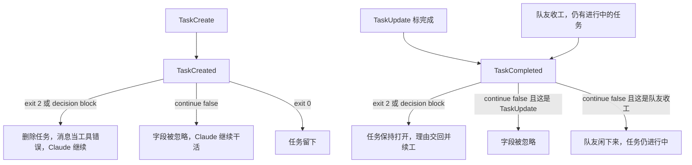

有人把质量闸挂在「勾掉任务」上。清单里那一行消失了，就以为这一轮也收住了。或者把 `{"continue": false, "stopReason": "..."}` 抄到 `TaskCompleted` 上，抄的是停轮那份 JSON。还有人在 `TaskCreated` 里写 `continue: false`，以为模型会停下来。任务清单动了。这一轮不一定停。

`TaskCreated` 只在用 `TaskCreate` 往会话任务清单里建任务时开火。没有 Task 工具的会话里，它不开火。它不支持 matcher。exit 2 或 `decision: "block"` 会删掉刚建的任务，把 stderr 或 `reason` 当作这次工具调用的错误交回 Claude。`continue: false` 被忽略，Claude 继续干活。

`TaskCompleted` 有两个开火点：有人用 `TaskUpdate` 把任务标成完成，或者 agent team 的队友收工时手里还有进行中的任务。exit 2 或 `decision: "block"` 拦住勾完，任务保持打开，理由交回模型。`continue: false` 两边不对称。只在队友收工这一下，队友会闲下来，任务仍进行中，即使另一只 hook 已经 block。在 `TaskUpdate` 上，这个字段被忽略。停轮闸仍是 `Stop` 和 `SubagentStop`。

我在 2026-11-20 08:34（Asia/Shanghai）打开并重读了 [Hooks reference](https://code.claude.com/docs/en/hooks) 的生命周期表、图的 alt、matcher 表、退出码表、[Decision control](https://code.claude.com/docs/en/hooks#decision-control)、[TaskCreated](https://code.claude.com/docs/en/hooks#taskcreated)、[TaskCompleted](https://code.claude.com/docs/en/hooks#taskcompleted)、文件缺失与 `onFailure` 两份名单，以及 prompt / agent 的类型名单和 Response schema。专项决策和生命周期表那几句，markdown 导出和页面 HTML 一致。图的 alt 把 `TaskCreated`、`TaskCompleted` 和 `SubagentStart/Stop` 放在嵌套的 agentic loop 里，然后才是 Stop or StopFailure。[Automate actions with hooks](https://code.claude.com/docs/en/hooks-guide) 的事件表和 matcher 表我对照过。[Tools reference](https://code.claude.com/docs/en/tools-reference) 的任务清单工具和 [Task tool availability](https://code.claude.com/docs/en/tools-reference#task-tool-availability) 我读过。[Agent teams](https://code.claude.com/docs/en/agent-teams) 只核对质量闸，以及没有 Task 工具时改走消息的那句。changelog 页首是 **2.1.329**，日期 November 19, 2026。GitHub latest 是 [v2.1.329](https://github.com/anthropics/claude-code/releases/tag/v2.1.329)，`published_at` 是 2026-11-19T22:14:41Z，北京时间 2026-11-20 06:14。这一版的 Added、Changed 和 bug fixes 里，我没有读到改写这两只决策的条目。没有跑 Claude Code，没有配真实 hook，没有启动 Task 工具，没有启动 agent team。字段名和时序只转述这些页。

[昨天](https://cfireworks.github.io/2026/11/19/2026-11-19-subagentstart-vs-subagentstop/)把子代理开工和收工讲完：`SubagentStart` 不是闸，`SubagentStop` 才留得住，并在同一张生命周期图里点到今天这两只。今天只切「建一条任务」和「勾掉一条任务」。图上的前后位置，我不读成「每次工具调用都会先走这两只」。队友空闲的两套杠杆在 [11 月 18 日](https://cfireworks.github.io/2026/11/18/2026-11-18-teammateidle/)。每轮怎么停，在 [11 月 16 日](https://cfireworks.github.io/2026/11/16/2026-11-16-stopfailure/)和 [11 月 2 日](https://cfireworks.github.io/2026/11/02/2026-11-02-goal-vs-stop-hook/)。MCP Tasks 与两分钟后台在 [10 月 29 日](https://cfireworks.github.io/2026/10/29/2026-10-29-mcp-tasks-claude-code/)。这几篇不重写。

<!-- more -->

## 创建能退回去，勾完能留在未完成

生命周期表的短句：`TaskCreated` 是 When a task is being created via `TaskCreate`。`TaskCompleted` 是 When a task is being marked as completed。三种节奏仍是 per session、per turn、以及 agentic loop 里的 `PreToolUse` / `PostToolUse`。这两只不在那三句里。`Bash` 这类工具调用不会打它们。夹具里 `created_bash_does_not_fire` 的 `fires=0`。

## 并排看两只，把勾完拆开

| 维度 | TaskCreated | TaskCompleted，TaskUpdate | TaskCompleted，队友收工 |
| --- | --- | --- | --- |
| 何时开火 | 经 `TaskCreate` 创建。没有 Task 工具就不开火 | 有人用 `TaskUpdate` 把任务标成完成 | 队友收工时手里还有进行中的任务 |
| 能否拦住 | 能。回滚的是创建 | 能。拦住的是勾完 | 能。拦住的是勾完 |
| exit 2 | 删掉任务。stderr 当作工具错误 | 不标完成。stderr 交给模型当反馈 | 同样不标完成，队友继续干活 |
| `decision: "block"` | 删掉任务。`reason` 当作工具错误 | 任务保持打开。Claude 收到 `reason` 并继续 | 任务保持打开，队友继续干活 |
| `continue: false` | 忽略。Claude 继续干活。单独写它，任务还在 | 忽略。不因此停轮。没有别的拦住时，勾完照样发生 | 队友闲下来，任务仍进行中。另一只 hook 已经 block 也挡不住 |
| matcher | 不支持。每次都开火 | 不支持 | 不支持 |
| hook 类型 | `command`、`http`、`mcp_tool`、`prompt`、`agent` | 同样五种 | 同样五种 |
| prompt 的 `ok: false` | 当作工具错误交回，回合继续，不论 `continueOnBlock` | 当作工具结果交回，回合继续，不论 `continueOnBlock` | 默认闲下来，reason 进 transcript。`continueOnBlock: true` 才续工 |

退出码表上，`TaskCreated` 的 Can block? 是 Yes，exit 2 是 Rolls back the task creation。`TaskCompleted` 的 Can block? 是 Yes，exit 2 是 Prevents the task from being marked as completed。对照格只点到：`Stop` 是 Prevents Claude from stopping，`SubagentStop` 是 Prevents the subagent from stopping，`TeammateIdle` 是 Prevents the teammate from going idle。`SubagentStart` 的 Can block? 是 No。昨天那只开工钩不在这里重写。

决策表把 `TeammateIdle, TaskCompleted` 放在同一行：exit 2 或 `decision: "block"` keeps the teammate working or the task open。With `continue: false`, the teammate goes idle。这一行链到 TaskCompleted 的决策，并写 Claude Code ignores `continue: false` on a `TaskUpdate` call。短句按队友收工读。`TaskUpdate` 以专项那句为准。11 月 18 日说过，不要把「TaskUpdate 上忽略」套回 `TeammateIdle`。今天要看的不对称，在 `TaskCompleted` 自己的两个开火点里。

`TaskCreated` 单独一行：exit 2 或 `decision: "block"` cancels the task and returns the message to Claude。`continue: false` is ignored。

通用字段表写，`continue: false` 时 Claude stops processing entirely。这两只的专项不沿用那句。退出码 2 那一节里，「字段优先于 exit 2」写的是 on events such as `Stop` and `SubagentStop`。我不把这句改写成今天这两只的原文。八次连拦写在 `Stop` 上，不搬过来。

## 只跟 TaskCreate 走

专项开场：Runs when a task is being created via the `TaskCreate` tool。用来 enforce naming conventions、要求描述，或阻止某些任务被创建。In a session without the Task tools, this event doesn't fire。不支持 matcher，每次发生都开火。

[工具页](https://code.claude.com/docs/en/tools-reference#task-tool-availability)写：`TaskCreate`、`TaskGet`、`TaskList`、`TaskUpdate` 是会话任务清单。`TodoWrite` 默认关掉，设 `CLAUDE_CODE_ENABLE_TASKS=0` 才换回来；换回来的是 `TodoWrite`，四只 Task 工具不在。默认只在 Opus 4.7、Sonnet 4.6、Haiku 4.5 及更早的模型上提供。其他模型要 opt-in。没有这些工具时，Claude 不会往 task list 里写东西。钩子因此也不响。这只说到「会不会开火」。`TaskOutput` 已在 v2.1.277 移除，不拿来当主线。

团队页同一边界写了一句：没有 Task 工具的 agent，改用消息协调，不走共享任务清单。质量闸那一节对创建的说法是：Exit with code 2 to prevent creation and send feedback。

决策两句放在一起：Either way, Claude Code deletes the task and returns your message to Claude as the tool's error。Claude Code ignores `continue: false` from this event and Claude keeps working。

* exit 2：stderr 当作那条消息。
* `{"decision": "block", "reason": "..."}`：`reason` 当作那条消息。

单独一份 `continue: false` 删不掉任务，也停不了这一轮。和 exit 2 写在同一份输出里，任务仍被删掉，Claude 仍继续。字段被忽略。同一份输出里既 exit 2 又写了 `decision: "block"`，消息用 `reason`。这是退出码 2 那一节的总述：钩子同时给出拦的 JSON 时，用那份 decision 的 reason，不用 stderr。

输入在公共字段之外有 `task_id`、`task_subject`，以及可选的 `task_description`、`teammate_name`、`team_name`。`team_name` 写着 Deprecated，session-derived team name，will be removed。`agent_id` 在这只事件上标识正在创建任务的子代理或进程内队友，可能缺席，需要 v2.1.290 或更晚。例子 JSON 里没有 `agent_id`，也没有 `permission_mode`。

页上的 bash 要求 subject 以 `[TICKET-数字]` 开头，否则往 stderr 写 `Task subject must start with a ticket number, e.g. '[TICKET-123] Add feature'`，然后 exit 2。例子里的 `Implement user authentication` 对不上这个前缀。我没有把脚本配进 settings。

五种类型都支持。prompt 的 `ok: false`：the reason is returned to Claude as a tool error and the turn continues, regardless of `continueOnBlock`。`impossible` 只在 `Stop` 和 `SubagentStop` 上放行停止。原文写 Agent hooks and other events ignore it。agent hook 的 `ok: false` 按同一事件上 `continueOnBlock: true` 的 prompt hook 处理。创建这条上，`continueOnBlock` 本来就不改方向，所以 agent 和 prompt 落到同一边：工具错误，回合继续。

`onFailure` 没有作用的名单是 `Stop`、`SubagentStop`、`TaskCompleted`、`TeammateIdle`。文件缺失被当成 non-blocking error 的名单是 `Stop`、`SubagentStop`、`TaskCompleted`，以及插件的 `UserPromptSubmit`。`TaskCreated` 不在这两份名单里。我不补。

## 勾完有两条路

专项开场：Runs when a task is being marked as completed。两种情况：when any agent explicitly marks a task as completed through the TaskUpdate tool, or when an agent team teammate finishes its turn with in-progress tasks。用来在任务关闭前 enforce completion criteria。不支持 matcher。

输入和创建对称。`TaskCompleted` 的例子多一个 `permission_mode`。`agent_id` 同样标识正在完成任务的子代理或进程内队友，可能缺席，同样要 v2.1.290 或更晚。`team_name` 同样标了 Deprecated。

三条决策：

exit 2：the task is not marked as completed and the stderr message is fed back to the model as feedback。页上的 bash 在测试没过时写 `Tests not passing. Fix failing tests before completing:`，后面接 subject。我没有跑 `npm test`。

`{"decision": "block", "reason": "..."}`：the task stays open. Claude receives `reason` and keeps working。

`{"continue": false, "stopReason": "..."}`：at the end of a teammate's turn, the teammate goes idle with the task still in progress, even if another of your TaskCompleted hooks blocks。`stopReason` 出现在队友的 transcript。On a `TaskUpdate` call, Claude Code ignores `continue: false`。

所以同一份字段，两条路的结果相反。`TaskUpdate` 上只写 `continue: false`，勾完照样发生，这一轮也不停。旁边再有 exit 2，勾完被拦住，这个字段仍然被忽略，模型继续收到 stderr。队友收工这一下，只写 `continue: false`，队友闲下来，任务仍是进行中。旁边那只钩已经 exit 2 或 `decision: "block"`，也改不了这次闲下来。这和 11 月 18 日 `TeammateIdle` 上「即使另一只已经 block 也放它闲下来」是同一方向的句子，事件不是那一只。那边的两套杠杆不在这里重写。

同一只钩的输出里同时有 exit 2 和 `continue: false`，页上写的是另一只 hook。总述那句优先关系又没有点名 `TaskCompleted`。这一格我没有补裁决。

prompt 的 `ok: false` 也拆开：

* `TaskUpdate`：Claude receives the reason as the tool result and the turn continues, regardless of `continueOnBlock`。
* 队友收工：by default the teammate goes idle and the reason appears in its transcript。Set `continueOnBlock: true` to send the reason to the teammate and keep it working。

agent hook 没有 `continueOnBlock`。`ok: false` 按 `continueOnBlock: true` 处理。队友收工这条上，prompt 默认是闲下来，agent hook 会把 reason 交给队友并让它继续干。创建和 `TaskUpdate` 上，这个差别显不出来。`impossible: true` 不要从 `Stop` 抄过来。夹具里它被忽略，队友收工的 prompt 仍按默认闲下来。

exit 2、stdout 为空、stderr 说文件缺失（如 `No such file or directory`）时当成 non-blocking error，点名了 `TaskCompleted`。勾完会放行。同一份 stderr 出现在 `TaskCreated` 上，例外名单没有它，我按退出码表的回滚走，不把它读成这条 non-blocking。

`onFailure` 在 `TaskCompleted` 上没有作用：exit code 2 on these events sends Claude back to keep working, and Claude can't repair a hook that won't run。命令钩真的退出 2，和钩子根本没跑起来，是两条路。`TaskCreated` 不在这句里。

质量闸对完成的说法只到：Exit with code 2 to prevent completion and send feedback。共享清单的三态是 pending、in progress、completed。开火点里的 in-progress，对得上中间这一态。assign 和 claim 的其余句子不展开。

matcher 两边都不支持。参考页的合并行是 `UserPromptSubmit`、`PostToolBatch`、`Stop`、`TeammateIdle`、`TaskCreated`、`TaskCompleted`、`WorktreeCreate`、`WorktreeRemove`、`MessageDisplay`。`CwdChanged` 单独成行，同样写 no matcher support，不在这行里。指南的 no-matcher 行把 `CwdChanged` 写进去了，没有单独那一行。两页都说它不支持 matcher。分行以参考页为准。我不把两页收成第三张表。昨天 `SubagentStart` / `SubagentStop` 按 `agent_type` 过滤。这边配了 `Explore` 或 subject，也筛不掉，每次创建、每次勾完都会开火。

## 拦的是清单

`Stop` 的 exit 2 拦住的是主代理停轮。`SubagentStart` 的 exit 2 拦不住开工。`TaskCreated` 拦住的是创建，删的是刚写进清单的那条。`TaskCompleted` 拦住的是标完成。方向就这四格。队友要不要闲下来，仍看 `TeammateIdle`，除非你走的是今天这只钩在「队友收工」上的 `continue: false`。那一格放闲的是队友，任务还开着，主代理这一轮并没有因此被 `Stop` 收掉。

`TaskStop` 停的是后台任务、队友，或具名后台代理。工具页写：When no task matches the ID, the error lists the running background agents。它不勾会话任务清单。

10 月 29 日的 MCP Tasks 是协议句柄，加上主会话里超过两分钟的阻塞调用被挪到后台。那不是 `TaskCreate` / `TaskUpdate`，也不是今天这两只事件。

**2.1.329** 的 Added 写：`/tasks` 现在也列出本会话的 scheduled tasks、`/loop` wakeups、the goal 和 this conversation's forks。Changed 里还有一句，`/tasks` 的标题和页脚计数合成一个数，盖住 shells、monitors、MCP calls、agents、workflows 和 scheduled tasks。这是 `/tasks` 界面。我没有把它读成 `TaskCreated` / `TaskCompleted` 的决策改了。同一版 Changed 还把 `Stop` 和 `SubagentStop` 输入里 Monitor 的脚本在 `background_tasks` 中标成 `monitor`，不再标成 `shell`。那是停轮输入的标签，不是这两只的决策。

## 清单

要拦的是建任务，用 exit 2 或 `decision: "block"`。消息会变成这次 `TaskCreate` 的工具错误。别在 `TaskCreated` 上指望 `continue: false` 把模型停住。单独写它，任务还留着。

要拦的是勾完，同样用 exit 2 或 `decision: "block"`。别在 `TaskUpdate` 这条路上指望 `continue: false`。没有别的拦住时，任务会被标成完成，这一轮也不停。

队友收工、手里还有进行中的任务时，`continue: false` 会让队友闲下来，任务仍进行中。质量闸里若有一只写成这个字段，旁边那只 exit 2 留不住这次收工。想留住队友，两只都用 exit 2 或 `decision: "block"`，不要混进 `continue: false`。

prompt 的 `continueOnBlock` 在创建和 `TaskUpdate` 完成上不起作用。队友收工的 prompt 默认是闲下来，要续工得写成 `continueOnBlock: true`。agent hook 在队友收工这条上按续工处理。不要把 `Stop` 的 `impossible: true` 抄到这两只上。

`TaskCompleted` 上，exit 2、stdout 为空、stderr 说文件缺失，可能被当成 non-blocking error，勾完放行。脚本路径先核对。这条不要自行扩到 `TaskCreated`。

没有 Task 工具，创建钩不开火。`CLAUDE_CODE_ENABLE_TASKS=0` 换回 `TodoWrite` 之后没有 `TaskCreate`，同样没有那次调用可跟。matcher 写了也不筛。`team_name` 已标废弃，别拿它当长期主键。

不要把 `TaskStop`、MCP Tasks、`/tasks` 里的定时任务和 `/loop` 当成这只清单。

## 夹具里，清单能动，轮次不一定停

演示在仓库的 `demos/taskcreated-completed/`。不读密钥，不访问网络，不启动 Claude Code，不启动 Task 工具，不启动 agent team，也不跑页上的 `npm test`。假的是文档里的输入和输出契约。这不是 settings 里的 hook。

`python3 demos/taskcreated-completed/run_demo.py` 我跑过，最后一行是 `result=pass`。

| 夹具 | 在看什么 | 跑完的旗标 |
| --- | --- | --- |
| `created_exit2_rolls_back` | 创建 exit 2 | `deleted=1`。`message_from=stderr`。`claude_keeps_working=1`。`blocks_turn=0` |
| `created_block_rolls_back` | `decision: "block"` | `deleted=1`。`message_from=reason`。reason 是夹具自己的句子 |
| `created_exit2_continue_false` | 同一份输出里的 `continue: false` | `deleted=1`。`continue_false_ignored=1`。`blocks_turn=0` |
| `created_continue_false_alone` | 只写这个字段 | `task_kept=1`。`continue_false_ignored=1`。`claude_keeps_working=1` |
| `created_exit0_keeps` | exit 0 | `task_kept=1` |
| `created_ticket_subject_rejects` | 例子 subject 对不上票据前缀 | `script_exit=2`。`deleted=1` |
| `created_ticket_subject_allows` | `[TICKET-123] Add feature` | `script_exit=0`。`task_kept=1` |
| `created_no_task_tools` | 没有 Task 工具 | `fires=0` |
| `created_todowrite_instead` | 这次调用是 `TodoWrite` | `fires=0`。`has_task_create=0` |
| `created_matcher_ignored` | 配了 `Explore` | `matcher_applied=0`。`fires=1` |
| `created_prompt_ok_false` | prompt，`continueOnBlock` 为 false | `message_as=tool_error`。`turn_continues=1`。`continue_on_block_matters=0` |
| `created_prompt_ok_false_cob` | 打开 `continueOnBlock` | 方向不变。`continue_on_block=1` |
| `created_file_missing_still_rolls_back` | 文件缺失的 stderr | `named_in_file_missing_rule=0`。`deleted=1` |
| `update_exit2_stays_open` | `TaskUpdate` exit 2 | `stays_open=1`。`turn_continues=1`。`blocks_turn=0` |
| `update_block_stays_open` | `TaskUpdate` block | `stays_open=1`。`feedback_from=reason` |
| `update_continue_false_ignored` | 只写 `continue: false` | `marked_completed=1`。`continue_false_ignored=1`。`blocks_turn=0` |
| `update_exit2_continue_false` | exit 2 再加这个字段 | `stays_open=1`。`continue_false_ignored=1` |
| `update_prompt_ok_false` | `TaskUpdate` 的 prompt | `message_as=tool_result`。`turn_continues=1`。`continue_on_block_matters=0` |
| `update_file_missing_nonblocking` | 文件缺失的 exit 2 | `non_blocking=1`。`marked_completed=1` |
| `teammate_exit2_keeps_working` | 队友收工 exit 2 | `teammate_working=1`。`stays_open=1`。`blocks_turn=0` |
| `teammate_block_keeps_working` | 队友收工 block | `teammate_working=1`。`feedback_from=reason` |
| `teammate_continue_false_idles` | 只写 `continue: false` | `teammate_idle=1`。`still_in_progress=1`。`blocks_turn=0` |
| `teammate_continue_false_overrides_exit2` | 另一只已经 exit 2 | `overrode_other_block=1`。`teammate_idle=1`。`still_in_progress=1` |
| `teammate_continue_false_overrides_block` | 另一只已经 block | `overrode_other_block=1`。`other=block` |
| `teammate_same_hook_exit2_continue_false` | 同一份输出里两样都有 | `simulated=0`。`note=same_output_not_stated` |
| `teammate_prompt_default_idles` | prompt 默认 | `goes_idle=1`。`reason_in_transcript=1` |
| `teammate_prompt_continue_on_block` | `continueOnBlock: true` | `keeps_working=1`。`reason_to_teammate=1` |
| `teammate_agent_ok_false_keeps` | agent hook | `keeps_working=1`。按 `continueOnBlock: true` 处理 |
| `teammate_exit0_allows` | 没有拦住 | `marked_completed=1`。`teammate_idle=0`。闲不闲下来不由这只成功路径写 |
| `contrast_stop` | 最小对照 | `blocks_turn=1`。`blocks_list=0`。`effect=prevents_stop` |
| `contrast_subagentstart` | 最小对照 | `blocks_spawn=0`。`effect=stderr_to_user_only` |
| `contrast_created_list` | 最小对照 | `blocks_list=1`。`blocks_turn=0`。`effect=rolls_back_creation` |
| `contrast_completed_list` | 最小对照 | `blocks_list=1`。`blocks_turn=0`。`effect=prevents_mark_completed` |
| `taskstop_not_checklist` | `TaskStop` | `marks_list_complete=0`。`fires_taskcompleted=0` |
| `mcp_tasks_different_list` | 另一只清单 | `same_list=0` |
| `scheduled_not_hook_decision` | 2.1.329 的 `/tasks` | `decision_rewrite_read=0`。`tasks_ui_lists_scheduled=1` |
| `cwd_row_disagrees` | 两页的 matcher 行 | `reference_combined_has_cwd=0`。`guide_combined_has_cwd=1` |

`Completion criteria are not met` 和 `Task still in progress` 是夹具自己的 `reason` / `stopReason`。票据那句和测试那句来自参考页的 bash。`teammate_same_hook_exit2_continue_false` 不算裁决。`Stop` 和 `SubagentStart` 各一行，不重放 11 月 2 日、11 月 16 日和 11 月 19 日的套件。

## 读不到的，先留着

prompt 的 `ok: false` 在队友收工路径上，任务还算不算 in progress？页上写的是闲下来，或把 reason 交给队友继续干。still in progress 那句写在命令钩的 `continue: false` 上。我不把任务状态抄到 prompt 上。

队友收工时有多条进行中的任务，是打一次还是每条打一次？专项用了 tasks 复数，没有写次数。

分屏队友算不算「finishes its turn」的那一下？`agent_id` 的说明写的是 in-process。开火点那句写的是 agent team teammate。我没有读到分屏的单独句子。

同一只 `TaskCompleted` 钩同时 exit 2 和 `continue: false`，听谁的？另一只钩的句子不能直接当成同一份输出的裁决。

这四处我都不补。

## 建和勾，拦的都是清单

控制环里，建一条任务，和勾掉一条任务，都能拦。`TaskCreated` 把创建退回去，错误交回这次工具调用，`continue: false` 不停轮。`TaskCompleted` 把勾完留在未完成；`continue: false` 只在队友收工那一下把队友放闲，任务还开着。`TaskUpdate` 上这个字段当没写。这一轮该不该停，仍看 `Stop` 或 `SubagentStop`。

你们写在勾完钩上的 `continue: false`，是想拦住这条任务，还是其实抄了停轮那份 JSON？

## 扩展阅读

- [Hooks reference：TaskCreated](https://code.claude.com/docs/en/hooks#taskcreated)
- [Hooks reference：TaskCompleted](https://code.claude.com/docs/en/hooks#taskcompleted)
- [Hooks reference：Decision control](https://code.claude.com/docs/en/hooks#decision-control)
- [Hooks reference：Exit code 2](https://code.claude.com/docs/en/hooks#exit-code-2-behavior-per-event)
- [Hooks reference：Prompt-based hooks](https://code.claude.com/docs/en/hooks#prompt-based-hooks)
- [Automate actions with hooks](https://code.claude.com/docs/en/hooks-guide)
- [Tools reference：Task tool availability](https://code.claude.com/docs/en/tools-reference#task-tool-availability)
- [Agent teams：质量闸](https://code.claude.com/docs/en/agent-teams#enforce-quality-gates-with-hooks)
- [changelog](https://code.claude.com/docs/en/changelog) / [release v2.1.329](https://github.com/anthropics/claude-code/releases/tag/v2.1.329)
- [别把子代理开工当成能拦的闸](https://cfireworks.github.io/2026/11/19/2026-11-19-subagentstart-vs-subagentstop/)
- [别把停轮 JSON 抄到队友空闲](https://cfireworks.github.io/2026/11/18/2026-11-18-teammateidle/)
- [别让干活的模型自己判收工](https://cfireworks.github.io/2026/11/02/2026-11-02-goal-vs-stop-hook/)

## 讨论

prompt 在队友收工时说了闲下来，有没有同时把任务留在 in progress？多条进行中的任务，会打出几次 `TaskCompleted`？分屏队友的收工走不走这只钩？同一份输出里既 exit 2 又写 `continue: false`，队友收工听哪一条？这几处我没有从打开的页里读到，也不替它们补一句。
