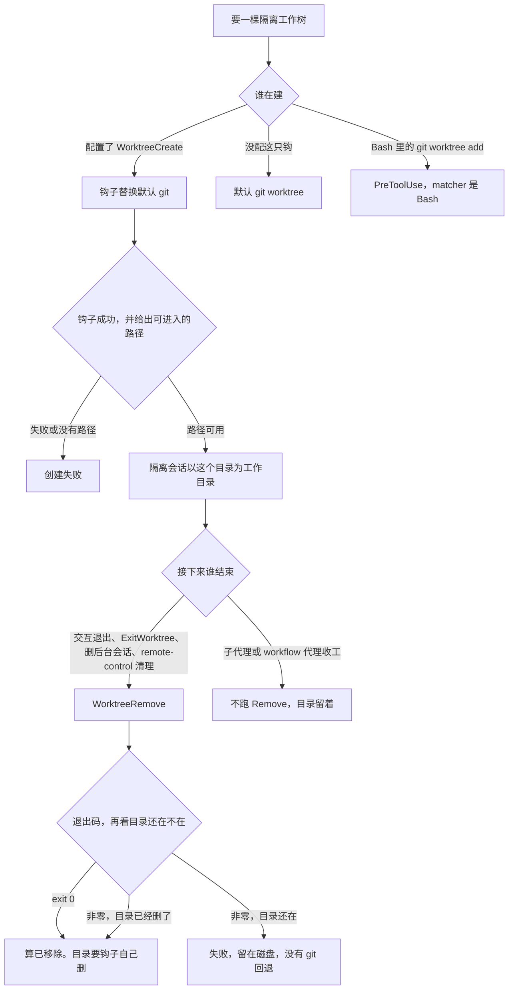

有人写一只 `WorktreeCreate`，打算「记一下路径」，或者创建完再拷一份 `.env`。默认的 `git worktree` 和 `.worktreeinclude` 在他的图里还在。还有人把 `{"decision": "block"}` 或 `{"continue": false}` 抄到这只钩上，抄的是别的事件那份决策。也有人以为子代理 `isolation: "worktree"` 收工时会自动跑 `WorktreeRemove`。

挂上 `WorktreeCreate` 之后，默认 git 已经不负责创建了。`.worktreeinclude` 不再被处理。command hook 必须把工作树路径打在 stdout 最后一行非空输出上，HTTP hook 则交 `hookSpecificOutput.worktreePath`。钩子失败，或没给出路径，创建就失败。这只钩不走 allow/block。`systemMessage` 和 `continue` 被丢掉。command hook 也不能靠 stdout 里的 JSON 带这些字段，因为 stdout 就是路径。

`WorktreeRemove` 只在清理「你的 `WorktreeCreate` 钩子建出来的」工作树时开火。exit 0 就算移除成功，目录得钩子自己删。非零退出，只有目录还在才算失败，没有 git 回退。JSON 丢掉。子代理和 workflow 代理收工时不跑它，工作树留在磁盘上。

我在 2026-11-21 08:37（Asia/Shanghai）打开并重读了 [Hooks reference](https://code.claude.com/docs/en/hooks) 的 markdown（`hooks.md`）。生命周期表、matcher 表、退出码表、[Decision control](https://code.claude.com/docs/en/hooks#decision-control)、[WorktreeCreate](https://code.claude.com/docs/en/hooks#worktreecreate)、[WorktreeRemove](https://code.claude.com/docs/en/hooks#worktreeremove)、类型名单，以及 `${CLAUDE_PROJECT_DIR}` 那条说明，都在这份导出里。开火点以专项页为准。[Run parallel sessions with worktrees](https://code.claude.com/docs/en/worktrees) 我只读和钩子契约直接相关的段：替换创建、非 git、`.worktreeinclude`、清扫、符号链接、钩子路径不跟着工作树走。[Automate actions with hooks](https://code.claude.com/docs/en/hooks-guide) 的事件表和 matcher 表我对照过。`ExitWorktree` 的 `discard_changes: true` 链到 [Agent SDK TypeScript](https://code.claude.com/docs/en/agent-sdk/typescript#exitworktree)，我打开核对了那一型。[Tools reference](https://code.claude.com/docs/en/tools-reference) 只核对 `EnterWorktree` / `ExitWorktree` 那一行。[Agent view](https://code.claude.com/docs/en/agent-view#what-deleting-a-session-removes) 只核对「删会话时工作树怎么处理」。changelog 页首是 **2.1.330**，日期 November 20, 2026。GitHub latest 是 [v2.1.330](https://github.com/anthropics/claude-code/releases/tag/v2.1.330)，`published_at` 是 2026-11-20T22:32:56Z，北京时间 2026-11-21 06:32。这一版的 Added、Changed 和 bug fixes 里，我没有读到改写这两只决策的条目。Fixed 里有一条：`ExitWorktree` and the worktree exit dialog deleting a worktree that another running Claude Code session was working in。这是默认清理，我没有把它读成钩子的决策模型改了。没有跑 Claude Code，没有配真实 hook，没有执行 `git worktree` 或 `svn checkout`，没有启动 remote-control。字段名和时序只转述这些页。

[昨天](https://cfireworks.github.io/2026/11/20/2026-11-20-taskcreated-vs-taskcompleted/)把任务清单的创建和勾完讲到「能拦，但拦的不是停轮」。今天只切隔离工作树的创建和清理。决策模型换成「返回路径 / 退出码」。`isolation: "worktree"` 会让 Create 开火，收工不跑 Remove，只在这一处点到 [11 月 19 日](https://cfireworks.github.io/2026/11/19/2026-11-19-subagentstart-vs-subagentstop/)。Bash 里的 `git worktree add` 交给 `PreToolUse`，点到 [11 月 4 日](https://cfireworks.github.io/2026/11/04/2026-11-04-pre-vs-post-hooks/)。隔离边界和这棵目录不是同一道门，点到 [11 月 3 日](https://cfireworks.github.io/2026/11/03/2026-11-03-permission-mode-vs-isolation/)。这几篇不重写。

<!-- more -->

## 路径交对了才进得去



生命周期表里，Create 是 When a worktree is being created via `--worktree`, `isolation: "worktree"`, or for a background session. Replaces default git behavior。Remove 是 When a worktree that a `WorktreeCreate` hook created is being removed。指南事件表是同一对。长名单在专项页。

## 一对事件，两套契约

| 维度 | WorktreeCreate | WorktreeRemove |
| --- | --- | --- |
| 何时开火 | `--worktree`、会话中 `EnterWorktree`、子代理 `isolation: "worktree"`、workflow 在自己的 worktree 里跑代理、后台会话隔离子自己的 worktree、`claude remote-control` 的 `worktree` 模式 | 只清理你的 Create 钩子建出来的工作树。见下面的清理名单 |
| 不开火 | Bash 里的 `git worktree add`。`--worktree` 加 `--tmux` 时，插件里的这只钩不跑 | 子代理收工、workflow 代理收工。默认 git 建的工作树也不走这只 |
| 替换默认 git | 配置了就整段替换。`.worktreeinclude` 不处理 | 有 Create 就要配 Remove 来管清理。没有 Remove 时的回退不对称 |
| 怎样算成功 | command：路径在 stdout 最后一行非空。HTTP：`hookSpecificOutput.worktreePath` | exit 0。运行时不读钩子的其他输出，目录要自己删 |
| 非零退出 | 任意非零都让创建失败，JSON 说什么都一样。不只是 exit 2 | 任意非零，并且事后目录还在，移除才失败。目录已被删掉则算已移除 |
| JSON | 不走 allow/block。`systemMessage` 和 `continue` 丢掉。command 的 stdout 就是路径，不能交 JSON | JSON 丢掉，包括 `systemMessage` 和 `continue` |
| matcher | 不支持。每次都开火 | 不支持 |
| hook 类型 | `command`、`http`、`mcp_tool`。没有 `prompt`、`agent` | 同样这三只 |

决策表把 Create 写成 path return：Command hook prints path on stdout; HTTP hook returns `hookSpecificOutput.worktreePath`. Hook failure or missing path fails creation。Remove 写成 Exit code：Any non-zero exit code makes the removal fail if the directory still exists afterward. JSON output is discarded。

退出码表上，两只的 Can block? 都是 Yes。Create 那格是 Any non-zero exit code causes worktree creation to fail。Remove 那格多半句：if the directory still exists afterward。退出码输出那一节把这两只从通用表里摘出来，原句同样是 any non-zero，Create 还写了 whatever your JSON says。不要把「exit 2」抄成唯一失败码。

matcher 表：参考页的合并行是 `UserPromptSubmit`、`PostToolBatch`、`Stop`、`TeammateIdle`、`TaskCreated`、`TaskCompleted`、`WorktreeCreate`、`WorktreeRemove`、`MessageDisplay`，写 no matcher support。`CwdChanged` 单独成行，也是 no matcher support。指南把 `CwdChanged` 写进了同一行。两页都说不支持 matcher。分行以参考页为准。配了 `feature-auth` 也筛不掉。

类型名单把这两只放在「支持 `command`、`http`、`mcp_tool`，不支持 `prompt` 或 `agent`」那一组。昨天的 `TaskCreated` 五种都支持。这边不要抄。`Setup` 只支持 command，不在这一对里。

## 创建：替换，然后必须交回路径

专项列出的开火点，我按打开的页记：

* `claude --worktree`
* 会话中用 `EnterWorktree` 创建并切进去
* 子代理使用 `isolation: "worktree"`
* workflow 在自己的 worktree 里跑代理
* 后台会话被隔离子自己的 worktree
* `claude remote-control` 在 `worktree` 模式启动会话

两处不开火。经 Bash 跑 `git worktree add`：要观察或拦截，用带 `Bash` matcher 的 `PreToolUse`。`--worktree` 加上 `--tmux`：Claude Code 在加载插件之前就建好工作树，插件里的 WorktreeCreate 不跑。两个旗标都在、仍要跑钩子，把钩子写在 settings 文件里。Before v2.1.300, a plugin's WorktreeCreate hook didn't run with `--worktree` alone either。changelog **2.1.300**（October 14, 2026）记下这件旧修复：Fixed plugin `WorktreeCreate` and `WorktreeRemove` hooks not running when Claude Code starts with `--worktree` (not yet with `--tmux`)。

默认用 `git worktree` 建隔离副本。Configuring a WorktreeCreate hook replaces that default git behavior。因此 `.worktreeinclude` is not processed。要拷 `.env` 这类本地文件，写在钩子脚本里。worktrees 页同一句写在 `--worktree` 上，并说钩子可以把工作树放到 `.claude/worktrees/` 以外。非 git（SVN、Perforce、Mercurial）靠这一对钩子换掉默认逻辑。`/batch` 在非 git 仓库里也靠这只钩提供工作树，需要 v2.1.281 或更晚。changelog 同一版写了这句改进。这里不展开 `/batch`。

页上的 command 例子把检出的输出转到 stderr，最后 `echo` 目录：

```json
{
  "type": "command",
  "command": "bash -c 'NAME=$(jq -r .name); DIR=\"$HOME/.claude/worktrees/$NAME\"; svn checkout https://svn.example.com/repo/trunk \"$DIR\" >&2 && echo \"$DIR\"'"
}
```

我没有跑这段 `svn checkout`。要读的是最后一行：The `echo` on the last line is what Claude Code reads as the worktree path。

输入在公共字段之外有 `name`。slug，用户指定或自动生成，例子里是 `feature-auth`，说明里还有 `bold-oak-a3f2`。

输出不走标准 allow/block。成功或失败决定结果。Claude Code acts on the hook's success and the returned path, and discards `systemMessage` and `continue`。

* command：print the path as the last non-empty line of stdout。先剥 ANSI，所以路径前面的 shell 启动横幅会被忽略。其他输出转到 stderr。
* HTTP：响应体里 `{ "hookSpecificOutput": { "hookEventName": "WorktreeCreate", "worktreePath": "/absolute/path" } }`。

钩子失败或没给出路径，worktree creation fails with an error。相对路径按钩子运行目录解析，并折叠 `.` / `..`。解析结果若不是可进入的目录，会话打印错误并以退出码 1 结束。绝对路径里若含 `.` 或 `..` 段，拒绝，错误会点名那段。经过仓库根以下符号链接的路径也拒绝，错误点名被拒的部分。A symlink committed to the repository could redirect the worktree outside it. Return a normalized path that doesn't pass through a symlink inside the repository。

command hook 不能交 JSON，因为 stdout 被读成路径。终端通知那一节写，HTTP 的这只钩可以带 `terminalSequence`。我没有模拟终端把序列打出去。

worktrees 页还有一道采纳检查，和「路径是不是目录」分开。没有 git 元数据的目录，只有不被任何 git 仓库包住时才通过。钩子把目录建在某个仓库里面，git 会把它解析成那个检出，Claude Code 用 `git resolves its working tree to` 拒绝，目录留在磁盘。页上的建议是把目录建在任何仓库之外。我没有跑 git 去验证这句，夹具用旗标表示「被一个仓库包住」。

符号链接有两条，不要并成一句。默认 git 创建：`.claude`、`.claude/worktrees` 或工作树目录本身是符号链接时，创建被拒绝，错误点名那条路径。Before v2.1.212，仓库里已经提交的这类符号链接曾被跟着走。这是没配钩子时的默认路径。钩子返回的路径，走的是上面那条「拒绝经过仓库内符号链接」。changelog **2.1.325**（November 13, 2026）Changed 里有一句：Changed EnterWorktree to refuse a `WorktreeCreate` hook path that goes through a symlink inside the project; have the hook print the real path。对得上当前专项，不是今天这版新改的决策。

`${CLAUDE_PROJECT_DIR}` 在进入 worktree 之后仍指向会话开始时的项目根。钩子输入 JSON 的 `cwd` 才跟着工作树走。脚本路径用项目根那个变量，不要把 `cwd` 当成钩子脚本自己的位置。

输出那一节只写了 command 和 HTTP 怎么交路径。`mcp_tool` 在支持名单里。它的路径从哪个字段回来，我没有读到。`prompt` 和 `agent` 写明不支持。配了之后是跳过还是报错，这只事件上没有写成 `PermissionRequest` 那种 skip 句。多只 Create 钩同时跑，用谁的路径，也没有读到。这三格我不补。

## 清理：只认退出码，而且只认钩子建的那棵

`WorktreeRemove` 的开火点，按专项记：

* 交互式 worktree 会话退出，并在提示里选择移除
* 没命名的会话退出，Claude Code 找不到已改或未跟踪文件，不提示就移除
* 删除跑在该工作树里的后台会话
* 会话中让 Claude 用 `ExitWorktree` 退出并移除
* `claude remote-control` 在 `worktree` 模式启动的会话正常结束，且没有已改文件、未跟踪文件、新提交
* 停掉 `claude remote-control` 时，它启动的 worktree 会话还在跑，并且同样是干净的

子代理或 workflow 代理收工：Claude Code keeps the worktree your WorktreeCreate hook made for it and doesn't run your WorktreeRemove hook。活干完后自己删。

remote-control 清理时钩子会跑，而且不提示。若让 Claude 移除钩子建的工作树，expect `ExitWorktree` to refuse unless Claude passes `discard_changes: true`。这句的链接打开是 TypeScript SDK 的 `ExitWorktree`：`action` 为 `"keep" | "remove"`，`discard_changes?` 是可选布尔。说明写的是 current git worktree：`remove` deletes both（工作树和分支）；有未提交文件或未合并提交时，`discard_changes` must be `true`。钩子页另有一句：Claude Code never deletes a branch belonging to a hook-created worktree, because it only knows the path your WorktreeCreate hook returned。Create 若建了分支，在 Remove 里自己删。两句的主语不一样。我不收成「钩子工作树的 remove 也会删分支」。

Claude Code 用 git 找已改或未跟踪文件。工作树不是 git checkout、也不在一个里面时，它找不到，哪怕目录里有未提交的活。Remove 钩子删任何东西之前，先自己看一眼。

没有 `WorktreeRemove` 时，页上按场景分开写，我不把它们收成一条回退：

* 退出会话，或 Claude 调用 `ExitWorktree`：按 `git worktree remove --force` 那样移除 Create 返回的路径。git 认得出的会删掉。git 认不出的（例如非 git VCS）留在磁盘。
* `claude remote-control` 清理：工作树留在磁盘，终端显示 `worktree removal failed, kept: <path>`。
* 删除后台会话：跟到 agent view 的 [What deleting a session removes](https://code.claude.com/docs/en/agent-view#what-deleting-a-session-removes)。`claude rm` 遇到「没对照仓库检查过的文件」、又是 `WorktreeCreate` 在管、且没有 Remove 钩子时，那张表写：自己删掉目录，再跑一次 `claude rm`。

有钩子时：

* exit 0：the worktree counts as removed。运行时不再读钩子的其他输出。目录要钩子自己删掉。exit 0 但目录还在，按这句仍算移除。这是页上的风险，不是夹具另造的成功。
* 非零，且 `worktree_path` 上的目录还在：移除失败，工作树留在磁盘，没有 git 回退。钩子先把目录删了再非零退出，算已移除。
* 后台会话这一路：会话也留下。agent view 的拒绝信息会报告钩子怎么结束，例如 `exited 1`，引用 stderr 开头，并说明再删一次会不会仍然删目录。remote-control 则显示 `worktree removal failed, kept: <path>`。
* JSON 字段丢掉，包括 `systemMessage` 和 `continue`。`decision` 不在这只的决策模型里。

后台会话删除前会校验存下来的路径，拒绝符号链接，或经过仓库根以下符号链接的路径。有文件的工作树，只在 agent view 确认删除时才跑钩子。对这类工作树，`claude rm` 会留下会话和工作树。

输入里的 `worktree_path` 就是 Create 返回的那条绝对路径。例子是 `.../my-project/.claude/worktrees/feature-auth`。

默认 `--worktree` 的退出清理（干净就删分支、有改动就问、命名会话先问、子模块、另一条分支）只适用于 Claude 用 git 建的工作树。钩子建的，看 `WorktreeRemove`。周期清扫会给 git 建的工作树写标记，没有标记的留下，including a worktree a `WorktreeCreate` hook created。钩子建给子代理或后台会话的目录，不会被这套 git 清扫收走。

## 和另外三道门只隔开

昨天的清单闸用 exit 2 或 `decision: "block"`。今天不沿用那套字段。Create 失败，是钩子没成功，或路径没给成可进入的目录。Remove 失败，是非零退出且目录还在。

子代理 `isolation: "worktree"` 会触发 Create。收工不跑 Remove。工具表写，`ExitWorktree` 对已经在自己工作目录里的子代理不可用，例子就是 `isolation: worktree`。11 月 19 日那只收工闸留住的是子代理这一轮，不负责删这棵目录。

Bash 里手打的 `git worktree add` 不进 Create。要拦，是 `PreToolUse` 的 `Bash` matcher。11 月 4 日的前后闸不在这里重放。

11 月 3 日把权限模式和沙箱分成两道门。进了隔离工作树之后挡住主检出的那些检查，是进目录之后的隔离。今天这只钩决定目录从哪来、创建失败听什么、清理听谁的退出码。

## 清单

要换掉默认 git，才配置 `WorktreeCreate`。配上之后，`.worktreeinclude` 不再拷文件。`.env` 写在钩子脚本里。

command hook 的 stdout 只留路径，放在最后一行非空。横幅和别的输出走 stderr。不要在 stdout 里打 `decision` 或 `continue`。HTTP 用 `hookSpecificOutput.worktreePath`。没路径，或钩子非零退出，创建失败。

交回去的路径要是可进入的目录。绝对路径里不要带 `.` 或 `..` 段。不要经过仓库根以下的符号链接。没有 git 元数据时，目录不要建在某个 git 仓库里面。

不要用这只钩去看 Bash 里的 `git worktree add`。`--worktree --tmux` 时，插件钩子不跑，写到 settings。

`WorktreeRemove` 和 Create 成对。exit 0 之前先删掉目录。不要指望 `decision: "block"` 把目录留住。非零且目录还在，才是失败，没有 git 回退。非 git 目录在 git 的「有没有改动」里看起来是干净的，删之前自己检查。

子代理和 workflow 代理收工不会跑 Remove。周期清扫也不收没有 git 标记的钩子目录。这两处要自己清。

钩子若建了分支，Remove 里自己删。运行时只知道 Create 返回的路径。

脚本路径用 `${CLAUDE_PROJECT_DIR}`。不要把跟着工作树走的 `cwd` 当成脚本所在目录。

## 夹具里，路径和退出码是两套

演示在 `demos/worktreecreate-remove/`。不读密钥，不访问网络，不启动 Claude Code，不执行 `git worktree` 或 `svn checkout`。删的是脚本自己的临时目录。这不是 settings 里的 hook。

`python3 demos/worktreecreate-remove/run_demo.py` 我跑过，最后一行是 `result=pass`。

| 夹具 | 在看什么 | 跑完的旗标 |
| --- | --- | --- |
| `create_command_path_last_line` | 横幅和 ANSI 在路径前面 | `creation_ok=1`。`read_as=path_line`。`ansi_ignored=1`。`include_processed=0` |
| `create_command_no_path` | stdout 是空的 | `creation_failed=1`。`fail=no_path` |
| `create_command_exit1` | 退出码 1，路径本可进入 | `fail=nonzero`。`path_not_used=1`。退出码 2 再夹一份 JSON 同样是 `fail=nonzero`，`only_exit2=0` |
| `create_command_json_read_as_path` | 整段 stdout 是 `decision` JSON | `read_as=path_line`。`decision_applied=0`。`fail=not_enterable`。`session_exit=1` |
| `create_http_discards_fields` | 有路径，同时带了 `continue` / `systemMessage` | `creation_ok=1`。两个字段 `applied=0`。缺 `worktreePath` 的那格是 `fail=no_path` |
| `create_absolute_dotdot_refused` | 绝对路径含 `..` | `rejected=..`。`session_exit_stated=0` |
| `create_symlink_below_root_refused` | 临时符号链接在仓库根以下 | `rejected=alias` |
| `create_include_not_processed` | 配了钩子 | `include_processed=0`。`env_present=0` |
| `create_script_copies_env` | 脚本自己拷 | `include_processed=0`。`copied_by_script=1`。`env_present=1` |
| `create_bash_does_not_fire` | Bash 的 `git worktree add` | `fires=0`。`gate=PreToolUse`。`pretooluse_outcome_simulated=0` |
| `create_plugin_tmux_skips` | 插件，`--worktree --tmux` | `fires=0`。同一对旗标写在 settings 里则 `fires=1` |
| `subagent_finish_keeps` | 子代理收工 | `fires=0`。`kept=1`。`exitworktree_available=0` |
| `workflow_finish_keeps` | workflow 代理收工 | `fires=0`。`kept=1` |
| `remove_exit0_deleted` | exit 0 且目录已删 | `counts_as_removed=1`。`dir_exists=0`。`trap=0` |
| `remove_exit0_dir_remains` | exit 0 但目录还在 | `counts_as_removed=1`。`trap=1`。`dir_exists=1` |
| `remove_nonzero_dir_remains` | 退出码 3，目录还在 | `stayed=1`。`git_fallback=0`。目录已先删掉的那格则 `counts_as_removed=1` |
| `remove_json_discarded_exit0` | JSON 里是 `decision` / `continue`，exit 0，目录还在 | `json_discarded=1`。`decision_applied=0`。`counts_as_removed=1` |
| `no_hook_exit_git_recognized` | 没有 Remove，退出，git 认得出 | `fallback=git_worktree_remove_force`。`counts_as_removed=1` |
| `no_hook_exit_unrecognized` | 没有 Remove，git 认不出 | `stayed=1`。`fallback=none_unrecognized` |
| `no_hook_remote_control` | 没有 Remove，remote-control 清理 | `stayed=1`。`message=worktree removal failed, kept:` |
| `nongit_looks_clean` | 目录里有文件，git 检查却是干净 | `git_sees_changes=0`。`files_present=1`。钩子自己看见文件后非零退出，`stayed=1` |
| `remove_does_not_delete_branch` | Create 记下了分支名 | `runtime_deletes_branch=0` |
| `changelog_330` | 2.1.330 | `decision_rewrite_read=0`。`other_session_fix=1`。`fix_is_hook_decision=0` |
| `exitworktree_pages_not_merged` | 钩子页和 SDK 那一型 | `merged=0` |

`create_prompt_unsupported`、`create_agent_unsupported`、`create_mcp_tool_path_unread`、`create_wrong_event_name`、`create_multi_hook_winner` 是 `simulated=0`。不算裁决。HTTP 的 non-2xx 我按「这只事件有自己的失败契约，钩子失败则创建失败」读，夹具记成 `fail=hook_failed`。通用表里 non-2xx 是 non-blocking，那一列写明 WorktreeCreate 除外。我没有读到一句单独把 HTTP 状态码翻译成退出码。

`remove_exit0_dir_remains` 的 `trap=1` 是文档里的风险：运行时仍算移除。README 里写了同一句。

## 读不到的，先留着

`mcp_tool` 的路径字段、`prompt` / `agent` 配错之后的处置、多只 Create 钩谁的路径生效、`hookEventName` 写错时算不算「没路径」，这四处页上没有写成可执行的结果。

TypeScript 那一型说 `remove` 删掉工作树和分支，`discard_changes` 在脏的 git 工作树上必须为 true。钩子页说钩子建的工作树会拒绝 `ExitWorktree`，除非带上 `discard_changes: true`，又说运行时不删这棵工作树的分支。我不把三句收成一条。

相对路径里的 `..` 会先折叠。绝对路径里的 `..` 直接拒绝。折叠之后若落到仓库外面、又没有穿过仓库内符号链接，页上没有再加一条拒绝。我不补。

`onFailure` 在这两只上怎么作用，我没有读到单独的句子。HTTP 那节把 WorktreeCreate 标成有自己的失败契约。我不把别的事件的 `onFailure: "block"` 抄过来。

## 建得成，是因为路径交对了

控制环里，「建一棵隔离工作树」也能失败。失败条件是钩子没成功，或路径没给成可进入的目录，不是 `decision: "block"`。清理是另一只钩子。它只认退出码，而且只清理你这只 Create 建出来的目录。子代理收工不会替你跑那一下。

你们写在 `WorktreeCreate` 里的 JSON，是想拒绝创建，还是其实把别的事件的决策抄过来了？

## 扩展阅读

* [Hooks reference：WorktreeCreate](https://code.claude.com/docs/en/hooks#worktreecreate)
* [Hooks reference：WorktreeRemove](https://code.claude.com/docs/en/hooks#worktreeremove)
* [Hooks reference：Decision control](https://code.claude.com/docs/en/hooks#decision-control)
* [Hooks reference：Exit code 2](https://code.claude.com/docs/en/hooks#exit-code-2-behavior-per-event)
* [Run parallel sessions with worktrees](https://code.claude.com/docs/en/worktrees)
* [Automate actions with hooks](https://code.claude.com/docs/en/hooks-guide)
* [Agent view：What deleting a session removes](https://code.claude.com/docs/en/agent-view#what-deleting-a-session-removes)
* [Agent SDK：ExitWorktree](https://code.claude.com/docs/en/agent-sdk/typescript#exitworktree)
* [changelog](https://code.claude.com/docs/en/changelog) / [release v2.1.330](https://github.com/anthropics/claude-code/releases/tag/v2.1.330)
* [别把勾掉任务当成停轮](https://cfireworks.github.io/2026/11/20/2026-11-20-taskcreated-vs-taskcompleted/)
* [别把子代理开工当成能拦的闸](https://cfireworks.github.io/2026/11/19/2026-11-19-subagentstart-vs-subagentstop/)

## 讨论

`mcp_tool` 的 `WorktreeCreate` 把路径放在哪一个字段？配了 `prompt` 或 `agent`，是跳过还是报错？多只 Create 钩同时跑，会话进哪一条路径？`ExitWorktree` 的 `remove` 在钩子建的工作树上，到底删不删分支？这几处我没有从打开的页里读成同一句，也不替它们补。
