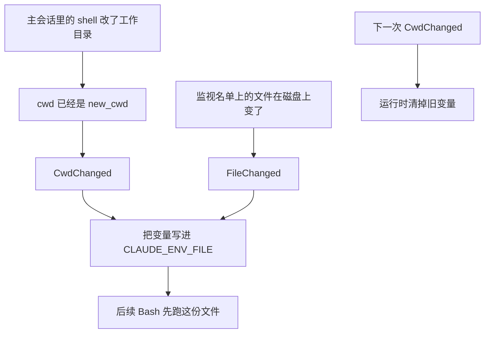

有人在项目里用 direnv，以为 Claude 执行了 `cd` 之后，下一句 Bash 已经带着新目录的 `.envrc`。还有人写一只 `CwdChanged`，用 exit 2，或者在 JSON 里放 `decision: "block"` 和 `continue: false`，想把这次换目录拦回去。

Bash 工具不会自己吃进 direnv。`CwdChanged` 也拦不住已经发生的换目录。它在主会话里的 shell 命令改了工作目录之后才开火，例如 Claude 执行了 `cd`。它没有 decision control。exit 2 只是把 stderr 给用户看。环境要写进 `CLAUDE_ENV_FILE`。写进去的变量会持续到下一次 `CwdChanged`，那时运行时清掉它们。

`FileChanged` 是看磁盘的姐妹事件。监视器不检查工具调用，文件已经改过，同样拦不住。它的 matcher 在建监视名单时按 `|` 切开，按字面文件名注册。

我在 2026-11-22 08:32（Asia/Shanghai）打开了 [Hooks reference](https://code.claude.com/docs/en/hooks) 的 markdown（`hooks.md`）、[Automate actions with hooks](https://code.claude.com/docs/en/hooks-guide) 和 [changelog](https://code.claude.com/docs/en/changelog)。同一轮向 GitHub releases/latest 核对，tag 仍是 [v2.1.330](https://github.com/anthropics/claude-code/releases/tag/v2.1.330)，`published_at` 是 2026-11-20T22:32:56Z，北京时间 2026-11-21 06:32。changelog 页首同为 **2.1.330**，日期 November 20, 2026。这一版的 Added、Changed，以及我在全文里检索到的 `CwdChanged` / `FileChanged` 条目，都没有改写今天这套决策。没有跑 Claude Code，没有配真实 hook，没有跑 direnv、nix 或 devbox。字段名和时序只转述这些页。

[昨天](https://cfireworks.github.io/2026/11/21/2026-11-21-worktreecreate-vs-worktreeremove/)把隔离工作树讲到「不走 allow/block，走路径和退出码」。今天只切主会话里 shell 改了工作目录之后，环境怎么续上。进隔离工作树，和这次换 cwd，是两道门。专项没有写 `EnterWorktree` 会不会让 `CwdChanged` 开火，我不补。启动目录的环境要靠 `SessionStart` 写进 `CLAUDE_ENV_FILE`，换目录再靠 `CwdChanged` 写一次，点到 [11 月 8 日](https://cfireworks.github.io/2026/11/08/2026-11-08-userpromptsubmit-vs-sessionstart/)。要在 `cd` 发生前观察或拦截，那是带 `Bash` matcher 的 `PreToolUse`，点到 [11 月 4 日](https://cfireworks.github.io/2026/11/04/2026-11-04-pre-vs-post-hooks/)。这三篇不重写。

<!-- more -->

## 目录已经换过去了



生命周期图的说明把 `CwdChanged`、`FileChanged`、`DirectoryAdded` 和 `WorktreeCreate` 等放在同一组 standalone async events 里。`DirectoryAdded` 的专项另写了：加目录立刻完成，钩子在后台跑，默认超时 600 秒。`CwdChanged` 和 `FileChanged` 的专项没有这句「不等钩子」。我不把图注收成「`cd` 也不等钩子」。

事件表对 `CwdChanged` 的一句是：工作目录变了的时候，例如 Claude 执行了 `cd`。适合拿 direnv 这类工具做反应式的环境管理。专项把主语收得更紧：主会话里的 shell 命令改了工作目录。

## 两只续环境，一只只作边界

| 维度 | CwdChanged | FileChanged | DirectoryAdded，只作边界 |
| --- | --- | --- | --- |
| 何时开火 | 主会话里的 shell 命令改了工作目录，例如执行了 `cd` | 被监视的文件在磁盘上变了。监视器看文件系统，不看是 `Edit`、`Write`、`Bash`，还是 Claude 外面的进程 | 会话中途 `/add-dir`，或 SDK `register_repo_root` |
| 不开火 | 没有 matcher。`EnterWorktree` 和子代理里的 `cd`，专项没写 | 什么都没点名时，监视器不开始 | `--add-dir` 启动，归 `SessionStart`。`/permissions` 的 Workspace 页。已经是工作目录，或在其内部 |
| 能否拦截 | 不能。换目录已经发生 | 不能。文件改动已经发生 | 不能。添加已经完成 |
| exit 2 | Shows stderr to user only | Shows stderr to user only | Stderr goes to the debug log; the directory is already added |
| JSON | 读 `watchPaths` 和 `systemMessage`，丢掉 `continue`。没有 decision control | 同样读这两项，丢掉 `continue` | 丢掉 `continue`。`systemMessage` 按 source 分投 |
| matcher | 不支持。写了会被静默忽略，每次都开火 | 建名单按 `\|` 切成字面文件名。过滤走标准规则，字符集更窄 | `slash_command`、`register_repo_root` |
| `CLAUDE_ENV_FILE` | 有。持续到下一次 `CwdChanged` | 有。同一条清除规则 | 没有。名单只有 SessionStart、Setup、CwdChanged、FileChanged |
| `watchPaths` | 返回的数组替换动态名单。空数组清掉动态名单。matcher 路径始终还在 | 同样是替换 | 专项没有这个字段 |

决策表把这三只和 Setup、Notification、SessionEnd 等写在同一行：None。No decision control. Used for side effects like logging or cleanup。

类型名单把这三只放在「支持 `command`、`http`、`mcp_tool`，不支持 `prompt` 或 `agent`」那一组。官方示例是 command hook。配了 `prompt` 或 `agent` 之后是跳过还是报错，这三只的专项没有写成 `PermissionRequest` 那种 skip 句。我不补。

## 换目录之后，把变量再写一次

官方示例里，`cwd` 和 `new_cwd` 是同一条路径，都是换过去之后的目录。`old_cwd` 才是原来的：

```json
{
  "session_id": "abc123",
  "transcript_path": "/Users/.../.claude/projects/.../transcript.jsonl",
  "cwd": "/Users/my-project/src",
  "hook_event_name": "CwdChanged",
  "old_cwd": "/Users/my-project",
  "new_cwd": "/Users/my-project/src"
}
```

这只钩子可以返回 `watchPaths`，绝对路径数组，用来动态设定 `FileChanged` 监视哪些路径。它替换当前的动态名单。matcher 配置里的路径始终被监视。返回空数组会清掉动态名单，页上说这是进入新目录时的典型做法。交互会话里，`systemMessage` 是一条短暂的终端通知，不进 SDK 消息流。

`CLAUDE_ENV_FILE` 只给 `SessionStart`、`Setup`、`CwdChanged`、`FileChanged`。别的事件没有这个变量。以 `"shell": "powershell"` 跑的钩子没有，没有 Git Bash 的 Windows 上默认跑 PowerShell 的钩子也没有。

持久化那一节让你把 `export` 语句写进这个文件，并建议用追加 `>>`，把别的钩子写过的变量留住。每一条 Bash 命令在自己执行之前，先把文件内容当 shell 代码跑一遍。指南把 `SessionStart` 和 `CwdChanged` 配成一对：启动目录靠前者装上变量，Claude 换目录时靠后者再装一次。两边都写 `CLAUDE_ENV_FILE`。示例命令是 `direnv export bash > "$CLAUDE_ENV_FILE"`，用的是覆盖 `>`。每个有 `.envrc` 的目录要先 `direnv allow` 一次。devbox 或 nix 可以换成 `devbox shellenv` 或 `devbox global shellenv`。我没有跑这三条命令。

两份原文都在，我不收成「必须追加」或「必须覆盖」。`>>` 是持久化那一节为了留下别的钩子的变量。`>` 是指南让 direnv 的导出整份替换文件。钩子并行时，后写的 `>` 会不会盖住先写的，页上没有写在这两只事件上。

下一次 `CwdChanged` 会清掉旧变量。夹具的读法是：这次事件一开始先把文件截空，再让钩子写。页上没有给出清文件的那条命令。先清再写，后一次 Bash 才带得上新目录、又不会留下旧目录。若清发生在钩子写完之后，指南这一对就写不进去。这是两句接起来的读法，不是页上的第三句。

PowerShell 从 v2.1.296 起也会收到这些变量，但它从不执行这份文件。运行时只在每一行都是普通赋值时，才把值拷进环境。空白行和 `#` 注释可以有。赋值要写成 `export NAME=value`、`declare -x NAME=value` 或 `NAME=value`，值还得是 Bash 会按字面使用的那一类。只要有别种行，例如 `export PATH="$PATH:./node_modules/.bin"` 里未转义的 `$PATH`、`source`，或 `direnv export bash` 打出来的 `$'...'`，PowerShell 命令一条变量都拿不到，`claude --debug` 会打 `Session environment is not all plain assignments`。Bash 命令仍然全部拿到。沙盒里的 PowerShell 命令一份都拿不到。Windows 上，值里含 `/` 或 `\` 的变量，PowerShell 命令也拿不到，因为 Git Bash 和 Windows 写路径的方式不一样。我没有跑 PowerShell，也没有在 Windows 上试。

matcher 表以参考页为准：`CwdChanged` 单独成行，no matcher support，每次出现都开火。指南把 `CwdChanged` 写进 `UserPromptSubmit`、`WorktreeCreate` 那一行，同样是不支持 matcher。两页在「没有 matcher、每次都开火」上一致，表格分组不同。给没有 matcher 的事件写 `matcher`，参考页写会被静默忽略。配了 `feature-auth` 也滤不掉一次换目录。

## 文件变了，看的是磁盘

`FileChanged` 在被监视的文件于磁盘上发生变化时跑。Claude Code 用文件系统监视器发现变化，不靠检查工具调用。所以谁改的都算：`Edit` 或 `Write`，Claude 用 `Bash` 跑的脚本，或者完全在 Claude Code 外面的进程。常见用途是项目配置文件变了就重载环境变量。

`PreToolUse` 专项写了：文件在磁盘上变了就用 `FileChanged`。它在变化之后才跑，拦不住这次写入。匹配 `Edit|Write` 的 `PostToolUse` 看不见 Bash 改的同一文件。11 月 4 日不重放。

matcher 有两个角色，不要写成一件事。

建监视名单时，值按 `|` 切开，每一段注册成工作目录里的字面文件名。`.envrc|.env` 监视的就是这两个名字。正则在这里没用：`^\.env` 会去监视一个真的叫 `^\.env` 的文件。建名单不走下面那套 exact / regex 分类。

过滤哪一组钩子跑时，同一个值按标准 matcher 规则，去对变化文件的 basename。总论里还有一条更窄的约束：`FileChanged` 和 `StopFailure` 的精确匹配只认字母、数字、`_` 和 `|`。连字符、空格或逗号会让这两只事件的 matcher 留在正则路径上，而且只有 `|` 能分开备选。因此 `.envrc|.env` 里的 `.` 会让「过滤」走正则。页上写了建名单是字面量、过滤走标准规则。它没有给出「`.envrc` 变动时，`.env` 那一截会不会也开火」的例子。我不推这个结果。

`"*"` 也会匹配每一个文件，但 Claude Code 把它像别的值一样注册进名单，当成一个叫 `*` 的文件。要接动态路径，给那一组省略 matcher：它匹配每一个已监视的文件，并且不往名单里加任何名字。空字符串 `""` 在总表里和省略、`"*"` 一起算 Match all。`FileChanged` 专项没有再写 `""` 会不会注册一个空文件名。我不补。

监视器只在有人点了要监视的文件时才启动。播种可以是一组 matcher 里至少有一个文件名的 `FileChanged`，也可以是 `SessionStart` 或 `CwdChanged` 返回的 `watchPaths`。只有省略 matcher、又没有 `watchPaths` 时，名单是空的，监视器不开始。

输入在公共字段之外是 `file_path`（绝对路径）和 `event`：`"change"` 修改，`"add"` 创建，`"unlink"` 删除。输出同样可以返回 `watchPaths`，规则和 `CwdChanged` 一样：替换动态名单，matcher 路径始终保留。它也有 `CLAUDE_ENV_FILE`。写进去的变量持续到下一次 `CwdChanged`，届时被清掉。`FileChanged` 自己不清。

页上有一个会死循环的警告。钩子即使用户文件无需改动也改写它，例如 `perl -i` 即使没有替换也重写文件，监视器会再次开火。官方示例先用 `grep` 看行尾还有没有 CR，有才 `perl -pi`。更松的守卫会一直循环。我没有跑那段 `perl`。

`systemMessage` 的投递和 `CwdChanged` 相同：交互会话里是短暂终端通知，不进 SDK 消息流。`continue` 丢掉。exit 2 把 stderr 给用户看，文件改动留在磁盘上。

## 另外三道门只隔开

`DirectoryAdded` 不是换 cwd。它在你于会话中途用 `/add-dir` 加了一个工作目录之后跑，或者 SDK 客户用 `register_repo_root` 加了一个之后跑。三处不开火。启动时用 `--add-dir` 传入的目录，归 `SessionStart`。在 `/permissions` 的 Workspace 页上加目录。加的目录已经是工作目录，或者在某个工作目录里面。

它在刷新沙盒和权限状态之后开火，所以钩子跑的时候，沙盒里的工具已经看得见新目录。钩子命令本身不在沙盒里跑。Claude Code 不等这只钩子。添加立刻完成，钩子在后台跑，默认超时 600 秒。

matcher 是 `slash_command` 或 `register_repo_root`。输入有 `directory`（绝对路径）和 `source`。没有 decision control，拦不住这次添加，因为钩子跑的时候添加已经完成。`continue` 丢掉。`systemMessage` 按 source 分投：`slash_command` 把它作为下一轮上下文交给 Claude，而不是展示给你，失败计数出现在 transcript，完整失败输出进调试日志；`register_repo_root` 则 `systemMessage` 和失败输出都只进调试日志。exit 2 那一格是 Stderr goes to the debug log; the directory is already added。不要抄成 `CwdChanged` 的「Shows stderr to user only」。

这只事件是 **2.1.219**（July 24, 2026）加进 changelog 的。`CwdChanged` 和 `FileChanged` 则是 **2.1.83**（March 25, 2026）的 Added：reactive environment management，例子是 direnv。两只都不是今天的新事件。**2.1.327**（November 17, 2026）的 Fixed 里有一条：失败的钩子什么都不显示，点名了后台代理里的 SubagentStop、`/clear` 和 `/resume` 时的 SessionEnd，以及全屏里的 CwdChanged 和 FileChanged。这是显示修复，不是新事件，也不在 2.1.330 的条目里。

**2.1.330** 还加了 self-hosted runner 的 `--start-dir` / `SELF_HOSTED_RUNNER_START_DIR`：让 Claude 在仓库的某个文件夹里开始工作，同时 settings 和 hooks 照常加载。这是启动时的工作目录。我没有读到把它和 `CwdChanged` 连起来的句子，这里不展开。

想在 `cd` 执行前看一眼或拦住，用带 `Bash` matcher 的 `PreToolUse`。那一只能挡的是工具调用还没发生。`CwdChanged` 看到调用时，目录已经是 `new_cwd`。

昨天的 `WorktreeCreate` 替换的是默认 git 建树，成功条件是交回路径。它不负责把新目录的 `.envrc` 灌进后续 Bash。主会话里一次 `cd` 也不走那只创建钩。

## 清单

别把 `CwdChanged` 当成闸。exit 2、`decision: "block"`、`continue: false` 都不把目录换回去。`continue` 会被丢掉。

别以为 Bash 会自己加载 direnv。启动目录用 `SessionStart` 写 `CLAUDE_ENV_FILE`，每次换目录用 `CwdChanged` 再写一次。持久化那一节的例子用 `>>`。指南的 direnv 例子用 `>`。按你要留住的东西选，不要合成一条页上没有的规则。

`direnv export bash` 的 `$'...'` 会让 PowerShell 一条变量都拿不到。Bash 仍然拿得到。沙盒里的 PowerShell 也拿不到。钩子自己若以 PowerShell 跑，就没有 `CLAUDE_ENV_FILE` 可以写。

`FileChanged` 的 `.envrc|.env` 在建名单时是两个字面文件名。过滤因为有 `.` 而走正则。不要自行断言两个名字会互相开火。`"*"` 注册的是名叫 `*` 的文件。动态路径用省略 matcher 的那一组。

`watchPaths` 是替换，不是追加。空数组清掉动态名单，matcher 配上的路径还在。进入新目录时，页上的典型做法就是返回空数组。什么都不点名，监视器不会开始。

钩子不要无条件改写被监视的文件。先判断文件是不是已经是你要的样子，再写。否则监视器会再开火。

`DirectoryAdded` 的 exit 2 进调试日志。不要把它和 `CwdChanged` 的「只给用户看」抄成一行。

## 夹具里，旧变量会被清掉

演示在 `demos/cwdchanged-filechanged/`。不读密钥，不访问网络，不启动 Claude Code，不跑 direnv。Bash 预执行是子进程 `source` 夹具自己的临时文件，不改这个进程以外的环境。监视和改写的文件都在临时目录里。这不是 settings 里的 hook。

下一次换目录先清文件，再让钩子写。建名单只做字面切开：

```python
def begin_cwd_changed(env_file: EnvFile) -> None:
    """下一次 CwdChanged 清掉旧变量。夹具的读法是先把文件截空，再让钩子写。"""
    env_file.clear()


def literal_watch_names(matcher: str | None) -> list[str]:
    """建名单：按 | 切开，每段是字面文件名。省略 matcher 什么都不加。"""
    if matcher is None:
        return []
    return matcher.split("|")
```

`python3 demos/cwdchanged-filechanged/run_demo.py` 我跑过，stdout 最后一行是 `result=pass`。

| 夹具 | 在看什么 | 跑完的旗标 |
| --- | --- | --- |
| `cwd_input_example` | 官方示例 | `cwd_equals_new=1`。`cwd_still_old=0` |
| `bash_preamble` | 钩子写入之后，Bash 预执行 | `bash_sees=src`。`direnv_executed=0` |
| `next_cwd_clears` | 下一次 CwdChanged 先清再写 | `old_remains=0`。`after_write_new=two` |
| `append_vs_overwrite` | `>>` 与 `>` 各跑一次 | `append_b=2` 且 `append_a=1`。覆盖那次 `overwrite_a` 为空。`merged_rule=0` |
| `no_decision_control` | exit 2，外加 `decision` 与 `continue: false` | `exit2_blocked=0`。`continue_applied=0`。`decision_applied=0`。`system_message_sdk=0`。`watchpaths_read=1` |
| `cwd_no_matcher` | 配了 matcher | `silently_ignored=1`。`fires=2`。参考页单独成行，指南并进行 |
| `literal_watch_list` | `.envrc\|.env` 与 `^\.env` | 字面名字。`caret_is_prefix=0`。`pair_filter_outcome=not_deduced` |
| `star_vs_omitted` | `"*"` 与省略 | `star_watch=*`。`star_is_glob=0`。`omitted_adds=0`。`omitted_started=0` |
| `file_events` | `change` / `add` / `unlink` | 走 `watchPaths` 加省略 matcher。`delivered=change,add,unlink` |
| `filechanged_no_block` | 文件已经多了一行 | `file_has_new_line=1`。`blocked=0`。`exit2_stderr_to=user` |
| `watchpaths_replace` | 先 `[a,b]`，再 `[c]`，再 `[]` | `replace_has_a=0`。`empty_has_c=0`。`matcher_kept=1` |
| `watcher_seed` | 没人点名 | `bare_started=0`。点了文件名或 `watchPaths` 则开始 |
| `rewrite_retriggers` | 无条件改写 | `fires=2`。`stopped_by=cap`。`infinite=0` |
| `directory_added_boundary` | 启动旗标、Workspace 页、已是工作目录 | 不开火。`/add-dir` 与 `register_repo_root` 开火且 `blocked=0`。stderr 去 `debug_log` |
| `powershell_markers` | `$'...'` 和未转义的 `$PATH` | `bash_foo=bar`。`powershell_receives=none`。`powershell_executed=0` |
| `hook_shell_powershell` | 钩子自己以 PowerShell 跑 | `powershell_hook_has_file=0` |
| `types_and_unread` | 类型名单，以及页上没写的格子 | `example_type=command`。`enterworktree_simulated=0` |

`session_seed_join=seed_is_dynamic` 表示：夹具把 `SessionStart` 返回的 `watchPaths` 放进同一份动态名单，随后 `CwdChanged` 返回的空数组会清掉它。`FileChanged` 专项把 `SessionStart` 和 `CwdChanged` 的 `watchPaths` 都写成播种的办法，`CwdChanged` 专项说空数组清掉动态名单。页上没有另写「启动时播下的路径不受后来的空数组影响」。

## 读不到的，先留着

`EnterWorktree` 会不会让 `CwdChanged` 开火，专项没写。子代理里的 `cd` 算不算「主会话里的 shell 命令」，也没写。

`.envrc|.env` 作为过滤正则，到底会匹配哪些 basename，页上没有例子。`watchPaths` 在 JSON 的顶层还是在 `hookSpecificOutput` 里，`CwdChanged` 的输出表没有给出一份示例。`SessionStart` 的例子把 `sessionTitle` 放进 `hookSpecificOutput`，没有同时展示 `watchPaths`。

配了 `prompt` 或 `agent` 是跳过还是报错，这三只事件上没有写。matcher 注册的文件名在换目录之后会不会自动改挂到新的工作目录，专项只说它们始终被监视。钩子并行时两种重定向会不会互盖，也没有写。这几格夹具都是 `simulated=0`。

## 换目录已经发生，钩子把环境续上

控制环里，「换了一个工作目录」已经发生了。`CwdChanged` 接得住的是后续 Bash 的环境：写进 `CLAUDE_ENV_FILE`，并准备好下一次换目录时旧变量会被清掉。它接不住把 `cd` 滚回去。`FileChanged` 接得住的是磁盘上那份被点名的文件变了，同样接不住把写入撤掉。

你们写在 `CwdChanged` 里的 exit 2，是想告诉用户目录已经换了，还是其实把别的事件的闸抄过来了？

## 扩展阅读

* [Hooks reference：CwdChanged](https://code.claude.com/docs/en/hooks#cwdchanged)
* [Hooks reference：FileChanged](https://code.claude.com/docs/en/hooks#filechanged)
* [Hooks reference：DirectoryAdded](https://code.claude.com/docs/en/hooks#directoryadded)
* [Hooks reference：Persist environment variables](https://code.claude.com/docs/en/hooks#persist-environment-variables)
* [Hooks reference：Decision control](https://code.claude.com/docs/en/hooks#decision-control)
* [Hooks reference：Exit code 2](https://code.claude.com/docs/en/hooks#exit-code-2-behavior-per-event)
* [Automate actions with hooks](https://code.claude.com/docs/en/hooks-guide)
* [changelog](https://code.claude.com/docs/en/changelog) / [release v2.1.330](https://github.com/anthropics/claude-code/releases/tag/v2.1.330)
* [别把建工作树当成旁路观察](https://cfireworks.github.io/2026/11/21/2026-11-21-worktreecreate-vs-worktreeremove/)
* [别把入口闸挂在会话开头](https://cfireworks.github.io/2026/11/08/2026-11-08-userpromptsubmit-vs-sessionstart/)
* [别在事后装闸门](https://cfireworks.github.io/2026/11/04/2026-11-04-pre-vs-post-hooks/)

## 讨论

`watchPaths` 该写在 JSON 的哪一层？`EnterWorktree` 进隔离工作树时，`CwdChanged` 会不会再开一次火？`.envrc|.env` 走到正则过滤时，basename `.envrc` 会让哪几组钩子跑？这三处我没有从打开的页里读成可执行的一句，也不替它们补。
