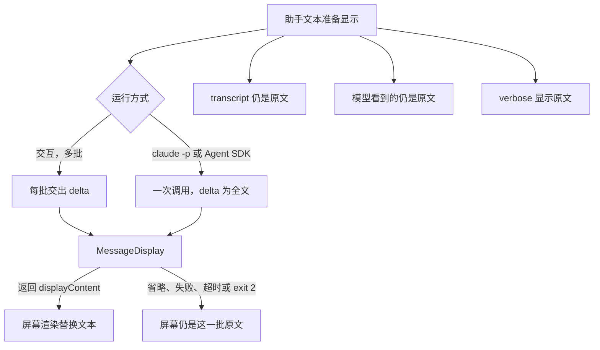

有人看见助手回复里冒出一串像密钥的字，就加一只 `MessageDisplay`，把屏幕上的 `sk-example-not-a-real-key` 换成 `***`。他以为密钥已经脱敏。verbose 里仍是原文。transcript 里仍是原文。模型下一轮要引用刚才那句，用的也是原文。

你改的是这一屏渲染出来的字。记录没动。模型看到的那份也没动。这只钩子不是脱敏闸，也不是拦消息的闸。

我在 2026-11-23 08:26（Asia/Shanghai）打开了 [Hooks reference](https://code.claude.com/docs/en/hooks) 的 markdown（`hooks.md`）、[Automate actions with hooks](https://code.claude.com/docs/en/hooks-guide) 和 [changelog](https://code.claude.com/docs/en/changelog)。同一轮向 GitHub releases/latest 核对，tag 仍是 [v2.1.330](https://github.com/anthropics/claude-code/releases/tag/v2.1.330)，`published_at` 是 2026-11-20T22:32:56Z，北京时间 2026-11-21 06:32。changelog 页首同为 **2.1.330**，日期 November 20, 2026。这一版的条目里没有 `MessageDisplay`。全文检索，这只事件只出现在 **2.1.152**（May 27, 2026）的 Added：lets hooks transform or hide assistant message text as it is displayed。那句的 hide 挂在 as it is displayed 上，说的是显示出来的那段字。参考页把契约写成 display-only。用途列表今天怎么措辞，不是一次产品发版。没有跑 Claude Code，没有配真实 hook。字段名只转述这些页。

[昨天](https://cfireworks.github.io/2026/11/22/2026-11-22-cwdchanged-vs-filechanged/)把「换目录已经发生，钩子只能把环境续上」讲完。[11 月 6 日](https://cfireworks.github.io/2026/11/06/2026-11-06-updatedtooloutput-redaction/)讲过，工具已经跑完，用 `updatedToolOutput` 替换模型即将读到的工具结果。今天切控制环里另一层：助手文本流到屏幕上时，替换发生在渲染。`displayContent` 改的是这一屏的字，不是 transcript，也不是模型上下文。

<!-- more -->

## 屏幕换了，旁边三份还是原文



生命周期表的一句是：While assistant message text is displayed。图注把它标成 display-only，在助手文本流式显示时跑。

交互会话里，消息按批出现。一批新完成的行准备好渲染，钩子就带着这些行跑一次，屏幕放上钩子交回的替换文本。长消息会有多次调用。短消息可能只有一次。Claude Code 会把这一批按住，直到钩子返回，所以钩子要快。失败或超时，屏幕显示原文。这只事件的默认超时是 10 秒。要更久，在钩子条目上写 `timeout`。

`claude -p` 和 Agent SDK 查询这类非交互运行，每条助手消息只调用一次，发生在消息完成之后。这一次 `index` 是 `0`，`final` 是 `true`，`delta` 是整段消息。按 `delta` 收集，两种模式拿到的总文本相同。页上把「按住这一批再渲染」写在流式那一段。非交互那次调用已经是消息完成之后。我不另补一套 `-p` 的等待语义。默认超时按事件写成 10 秒。hooks-guide 的 Limitations 是同一句。今天取到的 `hooks-guide.md` 是 66685 字节。全文检索 `MessageDisplay`，只出现在生命周期表、无 matcher 的那一行，以及这句超时里。指南没有单独的专项。

exit 2 那一格是：Can block? **No**。What happens on exit 2：**The original text is displayed**。

## 三层别叠在一起

| 维度 | MessageDisplay 的 displayContent | PostToolUse 的 updatedToolOutput | PreToolUse 的 updatedInput |
| --- | --- | --- | --- |
| 改的是哪一层 | 屏幕上这一批助手文本 | 成功调用之后、送给模型之前的工具结果 | 工具执行前的出站参数 |
| 模型看不看得到这份替换 | 看不到。页上写 Claude never sees the replacement | 这是入站视图上的替换。形状、遥测和 block 的对照在 11 月 6 日，这里不展开 | 工具按替换后的参数跑。拦截时序在 11 月 4 日，这里不展开 |
| transcript | 助手原文还在。verbose 也显示原文 | 11 月 6 日标过未核实，这里不补 | 不在这篇展开 |
| 能否拦住 | 不能。没有 decision control | 工具已经跑完 | 能挡住还没发生的调用 |
| 失败或超时 | 这一批屏幕回到原文。exit 2 也是原文 | 不在这篇展开 | 不在这篇展开 |
| 页上把它放在哪 | 能换屏幕上的字，同一格写明 display-only | 改写内容的名单里 | 改写内容的名单里。红线让出站脱敏走这里 |

决策总表里，`MessageDisplay` 的模式是 `hookSpecificOutput`。`displayContent` replaces the displayed text on screen。同一格写着：Display-only: the transcript and what Claude sees keep the original。

总表后面另列了能改写内容的事件，而不只是放行或拦截：

- `PreToolUse`：`hookSpecificOutput` 下的 `updatedInput`，在工具运行前替换参数
- `PermissionRequest`：`decision` 对象里的 `updatedInput`
- `PostToolUse`：`updatedToolOutput` 替换工具结果

同一段写明，`UserPromptSubmit` 不能替换提示词，只能在旁边注入 `additionalContext`。红线原文是：For redaction or transformation use cases, intercept at `PreToolUse` for outbound tool inputs and `PostToolUse` for the results of successful calls. `PostToolUseFailure` can't rewrite a result, so it can't redact a failing command's output.

`MessageDisplay` 不在这份名单里。它出现在总表里，是因为能换屏幕上的字。

今天打开的 `PostToolUse` 那一条还多了一句：Cowork 云会话里，工具若是 `AskUserQuestion` 或 `ExitPlanMode`，Claude Code 忽略 `updatedToolOutput`，Claude 读到的仍是原来的回答或计划。这句属于工具结果那一层。11 月 6 日没有展开它，这里只留这一句。

用途列表我读到两条：strip markdown for a minimal display；transform the text an Agent SDK application shows its users。页上没有把「从 Claude 的回复里 redact API keys or internal hostnames」列进这只事件的用途。display-only 已经写明，替换文本只改屏幕上看到的。列表为什么是这两条，页上没有写，我不补。

## 契约：一批字，一次替换

开火的条件是助手消息在往屏幕上流，而且流里有文本。没有文本的回复，例如只有工具调用的那一条，不触发。没有 matcher。matcher 表把它和 `UserPromptSubmit` 等写在一行：no matcher support，每次出现都开火。给不支持 matcher 的事件写了 `matcher`，参考页写会被静默忽略。配了 `Bash` 也滤不掉一条有文本的助手消息。

handler 上的 `if` 只在工具事件评估：`PreToolUse`、`PostToolUse`、`PostToolUseFailure`、`PermissionRequest`、`PermissionDenied`。别的事件只要写了 `if`，这只钩子永不跑。`MessageDisplay` 在这一侧。

输入在公共字段之外是：

| 字段 | 页上的含义 |
| --- | --- |
| `turn_id` | 当前轮次的 UUID |
| `message_id` | 这条助手消息的 UUID。同一条消息的每一批都稳定。不是 API 的 `msg_…` id，不能拿去对 transcript 里的消息 id |
| `index` | 这条消息内的零起始批次号 |
| `final` | 最后一批为 `true`。每条消息恰好有一批 final |
| `delta` | 上一批之后新完成的行，含行尾换行。除了最后一批可以停在行中间，其余都是整行 |

官方示例是这样一批：

```json
{
  "session_id": "abc123",
  "transcript_path": "/Users/.../.claude/projects/.../transcript.jsonl",
  "cwd": "/Users/my-project",
  "hook_event_name": "MessageDisplay",
  "turn_id": "0c9e6a2f-7d41-4f4e-9a15-3f4f7c2b8d10",
  "message_id": "5b2a9c8e-1f63-4d8a-b7c4-9e0d2a6f1c3b",
  "index": 0,
  "final": false,
  "delta": "Here is the plan:\n"
}
```

交互模式下，消息以换行结束时，最后一批的 `delta` 是空的，`final` 仍是 `true`。结束信号是 `final`，不是「`delta` 非空」。空的最后一批表示消息在换行处结束。它不表示已经拼好的屏幕文本要被清掉。最后一批也可以停在行中间，那时 `delta` 非空。两种都看 `final`。非交互那一次调用的 `delta` 则是全文。

钩子只收到助手消息文本。工具结果，以及你键入的文字，渲染保持原样。

输出可以给 `displayContent`，用来替换这一批在屏幕上的文本。省略它，屏幕显示原文。专项写明：没有 decision control。拦不住这条消息，也改不了存进 transcript、送给 Claude 的那份。Claude Code 采用 JSON 里的 `displayContent`，丢掉 `systemMessage` 和 `continue`。

类型名单把这只事件放在支持 `command`、`http`、`mcp_tool`、不支持 `prompt` 或 `agent` 的一组。官方示例是 command hook。配了 `prompt` 或 `agent` 之后是跳过还是报错，专项没有写成 `PermissionRequest` 那种 skip 句。未核实。

`command`、`http`、`mcp_tool` 的默认超时一般是 600 秒。Claude Code 把 `MessageDisplay` 降到 10 秒，把 `UserPromptSubmit`、`PreModelSwitch`、`PostModelSwitch` 降到 30 秒。指南的 Limitations 写了同一条。

官方示例用 `jq` 读每一批，去掉 `delta` 里的 `**` 和行内反引号，再作为 `displayContent` 返回。没有 markdown 的批次，替换前后是同一段字，原样通过。脚本失败，例如没有 `jq`，屏幕显示原文，失败只记在 debug，不进会话。

```bash
jq '{hookSpecificOutput: {hookEventName: "MessageDisplay", displayContent: (.delta | gsub("\\*\\*"; "") | gsub("`"; ""))}}'
```

## 旁边三只只隔开

`Notification` 在 Claude Code 发出通知时跑。它拦不住通知，也改不了通知，丢掉 `systemMessage` 和 `continue`。exit 2 那一格是 Exit code and stderr are ignored。通知不是助手正文。

`Setup` 只在 `--init-only`，或 `-p` 模式下的 `--init`、`--maintenance` 时开火。正常启动不开火。

`Elicitation` 可以替用户 accept、decline 或 cancel，服务器拿到的是钩子交回的内容。`ElicitationResult` 还能在回答送回 MCP 之前改掉字段，或把这次回答挡成 decline。那两只才碰得到送回去的内容。`MessageDisplay` 的契约停在屏幕上。

## 清单

别把屏幕上的 `***` 当成脱敏，也别当成审计删除。verbose、transcript、模型下一轮，拿的都是原文。

要改模型看到的工具结果，回到 11 月 6 日的 `updatedToolOutput`。出站参数走 `PreToolUse` 的 `updatedInput`。红线就是这两处。失败调用的输出，`PostToolUseFailure` 改不了。

助手已经说出口的那句原文进了 transcript。`MessageDisplay` 换不回那一份。

钩子要快。交互时每一批会等到它返回再渲染。超时，这一批回到原文。默认 10 秒。

收集全文时看 `final`。交互模式下以换行结束的消息，最后一批 `delta` 是空的。空批不是「还没完」，也不该把已经拼好的屏幕文本清掉。

`message_id` 只在这条消息的各批之间稳定。它不是 API 的 `msg_…` id。不要拿它去对 transcript。

不要指望它改工具结果的显示，或你键入的那一行。那两样不进这只钩子的输入。

配了 matcher 也会被静默忽略。只有工具调用、没有文本的回复不开火。写了 `if` 的这只钩子不会跑。

exit 2 不拦消息。成功时屏幕跟 `displayContent`。`continue: false` 和 `systemMessage` 丢掉。

## 夹具里，屏幕和记录是两份

演示在 `demos/messagedisplay/`。不读真实密钥，不访问网络，不启动 Claude Code，不调用 `jq`，也不睡眠。假密钥是 `sk-example-not-a-real-key` 和 `AKIA_EXAMPLE_NOT_REAL`。这不是 settings 里的 hook。

屏幕和记录在每一批就分开。超时、失败、exit 2 时，这一批屏幕等于原始 `delta`。成功并且 JSON 里有 `displayContent` 时，屏幕用那一段，记录仍是 `delta`。

```python
def render_batch(delta: str, handler: str, exit_code: int) -> dict:
    """结算一批屏幕。记录始终是原始 delta。消息不会被拦住。"""
    record = delta
    if handler in {"timeout", "fail"} or exit_code == 2:
        return {"screen": record, "record": record, "blocked": 0}
    specific = hook_json(delta, handler)["hookSpecificOutput"]
    if "displayContent" not in specific:
        return {"screen": record, "record": record, "blocked": 0}
    return {
        "screen": specific["displayContent"],
        "record": record,
        "blocked": 0,
    }
```

文件里的同名函数还记着 `slept=0`、失败记在 `debug`、以及 `continue` 和 `systemMessage` 没有生效。上面这段把那些旗标省掉了，只留屏幕和记录怎么分叉。

`python3 demos/messagedisplay/run_demo.py` 我跑过，stdout 最后一行是 `result=pass`。

| 夹具 | 在看什么 | 跑完的旗标 |
| --- | --- | --- |
| `interactive_strip` | 多批去掉 `**` 和反引号 | `screen_is_record=0`。屏幕上没有标记。记录里还有。假密钥两边都在。`end_signal=final` |
| `interactive_star` | 多批把假密钥换成 `***` | `keys_on_screen=0`。`keys_in_record=1`。`correlates_transcript_msg_id=0` |
| `empty_final_delta` | 以换行结束，最后一批 `delta` 为空 | `empty_delta_cleared_screen=0`。`nonempty_delta_used_as_end=0`。`screen_kept=1` |
| `midline_final` | 最后一批停在行中间 | `end_signal=final`。`last_delta_empty=0` |
| `noninteractive_once` | 一次调用带全文 | `calls=1`。`index=0`。`final=1`。收集到的 `delta` 和多批相同 |
| `omit_display_content` | JSON 里不给 `displayContent` | `screen_is_record=1` |
| `plain_batch_unchanged` | 这一批没有 markdown | 屏幕和记录都是原文 |
| `exit2_no_block` | exit 2，JSON 里还有 `displayContent`、`continue: false`、`systemMessage` | `blocked=0`。屏幕是原文。两个字段都是 `applied=0` |
| `discard_continue_and_system_message` | exit 0，同样两个字段，外加 `displayContent` | 屏幕按去掉 markdown 的那份。消息没有被拦住 |
| `fail_falls_back` | 脚本没有打出 JSON | 屏幕是原文。`noted_in=debug`。`session_notes_failure=0` |
| `timeout_falls_back` | 标记为超时 | 屏幕是原文。`slept=0` |
| `partial_timeout` | 含 markdown 的那一批超时，假密钥那一批仍换成星号 | `fell_back_indexes=1`。屏幕上还留着 `**`。假密钥不在屏幕上，记录里有 |
| `no_matcher` | 配了 `Bash` | `silently_ignored=1`。两条有文本的消息都开火。纯工具回复 `fires=0` |
| `tool_and_user_unchanged` | 工具结果和用户键入的文字 | `hook_received=0`。渲染仍是原文，假密钥还在 |
| `if_never_runs` | `MessageDisplay` 上写了 `if` | `message_display_with_if=0` |

`delta_totals_match` 里，交互多批拼起来的原始 `delta`，和非交互那一次的全文相同。这个夹具里标记没有跨批切开，所以去掉 markdown 之后的屏幕也相同。页上保证的是收集到的 `delta` 总量。两种模式的 `displayContent` 是否逐字相同，页上没有另写一句。

## 页上没写成一句的

多只 `MessageDisplay` 同时交回不同的 `displayContent`，留下谁的，专项没有写。`prompt` 或 `agent` 配在这只事件上是跳过还是报错，也没有写成 skip 句。`displayContent` 给空字符串，算省略还是显示成空，输出表只写了省略字段就显示原文。超时记在 debug 还是别处，页上把「只记在 debug、不进会话」写在脚本失败的例子上，例如缺 `jq`，没有把超时写进同一句。一条消息若出现两批 `final`，怎么结算，页上只说恰好一批。这几格夹具都是 `simulated=0`。

## 显示和记录不是同一层

控制环里，显示和记录是两层。屏幕可以被换成更干净的字：去掉 markdown，或者把一串假密钥换成星号。对话里那份原文还在。verbose 看得到。模型下一轮引用的也是原文。exit 2、失败、超时，连屏幕都回到原文。

要把密钥从模型即将读到的工具结果里拿掉，那是 `PostToolUse` 的 `updatedToolOutput`。要把密钥挡在出站参数上，那是 `PreToolUse`。`MessageDisplay` 只负责这一屏。

## 扩展阅读

- [Hooks reference：MessageDisplay](https://code.claude.com/docs/en/hooks#messagedisplay)
- [Hooks reference：Decision control](https://code.claude.com/docs/en/hooks#decision-control)
- [Hooks reference：Exit code 2 behavior per event](https://code.claude.com/docs/en/hooks#exit-code-2-behavior-per-event)
- [Automate actions with hooks](https://code.claude.com/docs/en/hooks-guide)
- [changelog](https://code.claude.com/docs/en/changelog) / [release v2.1.330](https://github.com/anthropics/claude-code/releases/tag/v2.1.330)
- [别把脱敏交给模型自己做](https://cfireworks.github.io/2026/11/06/2026-11-06-updatedtooloutput-redaction/)
- [别在事后装闸门](https://cfireworks.github.io/2026/11/04/2026-11-04-pre-vs-post-hooks/)
- [别把换目录当成环境已经切好](https://cfireworks.github.io/2026/11/22/2026-11-22-cwdchanged-vs-filechanged/)

## 讨论

有没有人把 `MessageDisplay` 当成过脱敏闸，后来在 transcript 或 verbose 里又看见了原文？收集全文的脚本，是在等 `final`，还是在等一个非空的最后一批？`message_id` 有没有被拿去对过 transcript 里的 `msg_…`？我没有生产会话。页上写不能对上，夹具也只标注了 `correlates_transcript_msg_id=0`。
