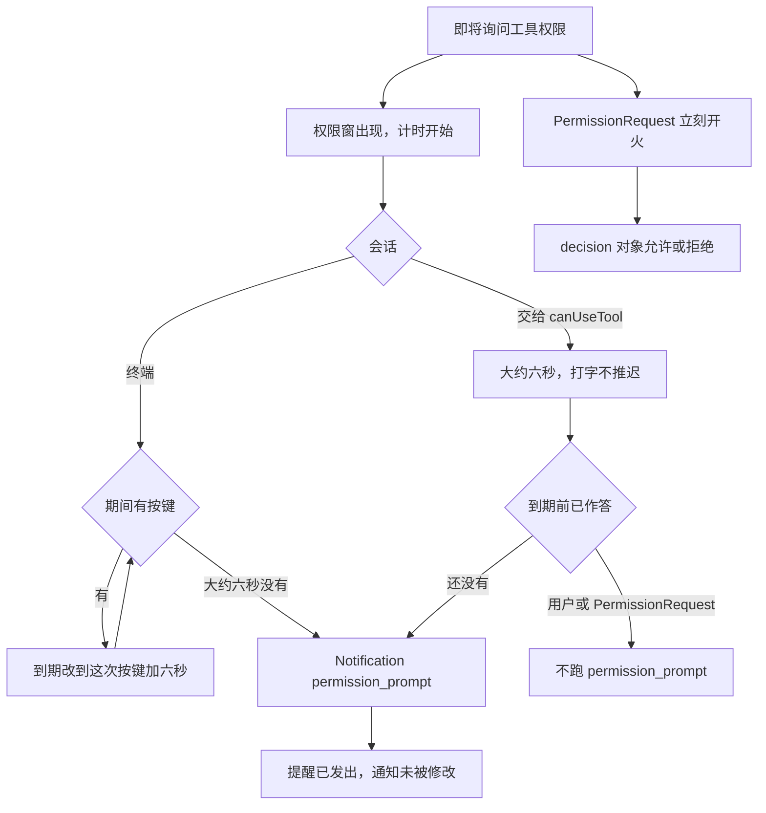

有人把桌面通知关掉，或者给 `Notification` 写上 `continue: false`、exit 2，就觉得这次工具已经被拦住。也有人看见权限窗，以为钩子会在同一瞬间跑。窗口还在等。钩子还没来。

`Notification` 在 Claude Code 发出通知时跑。它拦不住通知，也改不了通知。`preferredNotifChannel` 包括 `notifications_disabled`，只改你怎么被提醒，不改钩子会不会跑。终端里的 `permission_prompt` 要等大约六秒，而且你像不在终端才看得到。每次按键都会把这六秒再推迟。要在 Claude 一开口要权限时立刻跑钩子，用 `PermissionRequest`。

我在 2026-11-24 08:32（Asia/Shanghai）打开了 [Hooks reference](https://code.claude.com/docs/en/hooks) 的 markdown（`hooks.md`，293716 字节）、[Automate actions with hooks](https://code.claude.com/docs/en/hooks-guide)（`hooks-guide.md`，66719 字节）和 [changelog](https://code.claude.com/docs/en/changelog)。同一轮向 GitHub releases/latest 核对，tag 是 [v2.1.331](https://github.com/anthropics/claude-code/releases/tag/v2.1.331)，`published_at` 是 2026-11-23T21:34:41Z，北京时间 2026-11-24 05:34。changelog 页首同为 **2.1.331**，日期 November 23, 2026。这一版没有 `Notification` 专条。同版里和钩子相邻的两条，是 `PermissionDenied` 的 `retry: true` 改成告诉模型：只有在你要求过那次调用时，才再做一次被拒绝的调用。以及 Claude Desktop 里读 transcript 的 Stop 钩子补上了最后一条回复，SubagentStop 也会等它。这两条不是 `Notification` 的新能力。没有跑 Claude Code，没有配真实 hook，没有弹出系统通知。字段名只转述这些页。

[昨天](https://cfireworks.github.io/2026/11/23/2026-11-23-messagedisplay/)把屏幕上的字和记录分开。`MessageDisplay` 写着 no decision control，它换的是这一屏。[11 月 5 日](https://cfireworks.github.io/2026/11/05/2026-11-05-permissionrequest-vs-pretooluse/)讲过当场允许或拒绝：那是 `PermissionRequest`，用 `decision` 对象，没弹窗就不会来。那两套机制今天不重写。今天只切一层。通知钩子叫你回头。授权闸在询问发生时做决定。

<!-- more -->

## 提醒和判决被写进了同一只脚本

控制环里，这两层经常进同一个文件。脚本看见 `permission_prompt`，就 exit 2，或者交 `continue: false`，想的是这次工具先别跑。参考页把它们拆开了。

`PermissionRequest` 的原句是：Runs when Claude Code is about to ask you for permission to use a tool。下一句指定了用途：Use this event when you need a signal the moment Claude asks for permission to use a tool. Claude Code runs a Notification hook with the `permission_prompt` type only after the prompt has waited about six seconds.

exit 2 在两只事件上都不构成判决，格子里的字不同。`PermissionRequest` 那一格是 Not read as a decision。允许或拒绝要返回 `decision` 对象。11 月 5 日写过这个对象里的字段，这里不列。`Notification` 那一格是 Exit code and stderr are ignored。决策总表把它和 Setup、SessionEnd、PostCompact、InstructionsLoaded、StopFailure、CwdChanged、DirectoryAdded、FileChanged 放在同一行。模式是 None。原文是 No decision control. Used for side effects like logging or cleanup。

沙箱命令的网络请求不走 `PermissionRequest`。11 月 5 日点过。那种提示的信号是通知类型 `permission_prompt`。终端会话里要 v2.1.246 或更晚，而且仍然要等大约六秒。等来的还是提醒。



## 两列并排

| 维度 | Notification | PermissionRequest |
| --- | --- | --- |
| 何时开火 | Claude Code 发出通知时。`permission_prompt` 要等权限提示大约六秒。终端里每次按键推迟。交给 `canUseTool` 的会话里，打字不推迟；到期前已作答则不跑 | 即将询问工具权限的那一刻。没弹窗就不会来，11 月 5 日写过，这里不重写。沙箱命令的网络请求不到 |
| 能否拦住这次权限 | 不能。can't block or modify notifications | 能允许或拒绝。走 `decision` 对象 |
| exit 2 | Exit code and stderr are ignored | Not read as a decision |
| JSON 里丢掉什么 | `systemMessage` 和 `continue`。`terminalSequence` 仍由宿主发出 | 字段表在 11 月 5 日。这篇只用它对照：那边有 `decision`，这边没有 decision control |
| 关掉系统通知 | `preferredNotifChannel` 含 `notifications_disabled` 时钩子照跑 | 不靠这只设置 |
| 页上让它做什么 | 日志、清理这类副作用。桌面通知要钩子自己发 | 要「一开口要权限」的信号时用这只 |

## 契约停在通知已经发出

专项第一句：Runs when Claude Code sends notifications. Matches on notification type. Omit the matcher to run hooks for all notification types.

matcher 对的是 `notification_type`。`""`、`"*"` 或省略，每种都跑。`"permission_prompt"` 只打这一种。空 matcher 也会打到 `idle_prompt`、`auth_success`、`auth_storage_failure`、`elicitation_dialog`、`elicitation_url_dialog`、`elicitation_complete`、`elicitation_response`、`agent_needs_input`、`agent_completed`、三条 `quota_auto_resume_*`、`plugin_notification`。收集日志时按 `notification_type` 分。每一发都读成「需要权限」，会把 idle、登录、用量和插件通知算进同一只闸。

`auth_storage_failure` 在登录完成、凭据没能写入 credential storage 时开火，而且是代替 `auth_success`。需要 v2.1.288 或更晚。两条不会一起出现。三条 quota 需要 v2.1.234 或更晚。这篇不展开它们何时继续、何时放弃。`agent_needs_input` 里，队友的 terminal setup 问题需要 v2.1.248 或更晚。

输入在公共字段之外是 `message`、可选的 `title`、`notification_type`。官方示例是：

```json
{
  "session_id": "abc123",
  "transcript_path": "/Users/.../.claude/projects/.../00893aaf-19fa-41d2-8238-13269b9b3ca0.jsonl",
  "cwd": "/Users/...",
  "hook_event_name": "Notification",
  "message": "Claude needs your permission",
  "notification_type": "permission_prompt"
}
```

原句：Notification hooks can't block or modify notifications. Claude Code discards their `systemMessage` and `continue` fields but still emits `terminalSequence`.

退出码表：Can block? **No**。What happens on exit 2：**Exit code and stderr are ignored**。

stderr 里写 deny，退出码写成 2，通知仍视为已发送，文字也没被钩子改掉。`continue: false` 不会把会话停住。`systemMessage` 不会显示出来。

桌面通知关掉，钩子还是会收到这些事件。原句把 `preferredNotifChannel` 和 `notifications_disabled` 写在一起：changes only how you're alerted, not whether your hook runs.

指南的第一只动手示例就是这只事件。空 matcher。macOS 用 `osascript`，Linux 用 `notify-send`，由钩子自己去发系统通知。验证步骤是在提示符打 `/hooks`，确认它出现在 `Notification` 下面。测试步骤是切到 manual mode，让 Claude 做一件需要权限的事，然后离开终端。指南写：This hook uses the Notification event, which Claude Code fires when Claude is waiting for input or permission。下一句让去看每种类型的准确时机。waiting 不是「权限窗一出现钩子就跑」。

`osascript` 走系统自带的 Script Editor。Script Editor 没有通知权限时，命令静默失败，macOS 也不会弹出授权提示。Windows 那一则调用的是 `MessageBox`。指南写它打开的是对话框，可以出现在终端窗口后面，不是屏幕角落的通知。这篇不写成各平台怎么打开通知权限。

`elicitation_dialog` 和 `elicitation_url_dialog` 是大约六秒没打字之后，叫你回头看已经打开的表单或浏览器 URL。能替用户 accept、decline 或 cancel 的是 `Elicitation`。通知类型只负责叫你。`MessageDisplay` 能换屏幕上这一批字，专项同样写着 no decision control。`Notification` 连「换掉这条通知的文字」都没有对应字段。

类型名单里，`Notification` 支持 `command`、`http`、`mcp_tool`，不支持 `prompt` 或 `agent`。配了后两种是跳过还是报错，专项没有写成 `PermissionRequest` 那种 skip 句。未核实。配了 `mcp_tool` 时，能拦或能改结果的事件会等 MCP 服务器连上。参考页把 `Notification` 和 `SessionEnd` 写成 observational，这两只不等。

handler 上的 `if` 只在工具事件求值：`PreToolUse`、`PostToolUse`、`PostToolUseFailure`、`PermissionRequest`、`PermissionDenied`。写在 `Notification` 上，这只钩子不跑。

## 六秒、六十秒，终端和桌面不是同一只表

生命周期图的 alt 把 `Notification` 和 ConfigChange、CwdChanged、DirectoryAdded、FileChanged 等写在 standalone async events 里。这是图上的分组。专项没有写这只钩子默认 `async: true`。`async` 和 `asyncRewake` 是 handler 上的另外两个字段。下面的计时按 NOTE 走。

NOTE 写：`permission_prompt`、`idle_prompt`、`elicitation_dialog`、`elicitation_url_dialog` 和桌面通知共用计时。所以在终端会话里，你像不在终端才看得到。

`permission_prompt` 的期待是大约六秒没打字。计时从权限窗出现开始。每次按键都推迟。立刻跑钩子，用 `PermissionRequest`。

`idle_prompt` 的期待是 Claude 结束回复大约 60 秒之后，而且之后没打字，也没有仍在跑的 background agent，例如 background subagent。等待 claude.ai 用量限制重置期间不发 `idle_prompt`。等待自行结束时，改发 `quota_auto_resume_*` 里的一种。页上没有写「打过一次字就从按键再数 60 秒」。

两类 elicitation 对话框是大约六秒没打字。`each keystroke defers` 那半句写在 `permission_prompt` 那一条。elicitation 的按键是不是同一种逐次推迟，夹具不补。

另一只对话框还开着时，新的权限请求或 elicitation 仍用同一套六秒，从请求到达时起算。通知可能在请求还排在已打开的对话框后面时就送到。

交给 Agent SDK `canUseTool` 的会话另计。Claude Desktop 和 VS Code 扩展托管 Claude Code，走的就是这一路。

`permission_prompt` 在 Claude 要权限大约六秒之后。打字不推迟。你或 `PermissionRequest` 钩子先答了，Claude Code 不跑 `permission_prompt`。把 `CLAUDE_CODE_DISABLE_PERMISSION_PROMPT_NOTIFY_HOOKS` 设为 `1`，可以在这些会话里关掉 `permission_prompt`。v2.1.233 之前，这些会话里 `permission_prompt` 不会开火。

终端那一节没有写「人先点了允许，`permission_prompt` 就取消」。这格不补。这个环境变量在终端会话里关不关 `permission_prompt`，也没有写在那一句里。未核实。

## terminalSequence 还在，图注里的 async 不是这个字段

钩子没有控制终端。往 `/dev/tty` 写转义序列会失败。把序列放进 JSON 的 `terminalSequence`，由 Claude Code 自己的终端写入路径发出。Windows 上没有 `/dev/tty`，这条路径一样用。

允许 OSC 0、1、2，用来改窗口标题。允许 OSC 9，含 `9;4` 的任务栏进度。允许 OSC 99、OSC 777，以及裸 BEL。名单以外的序列，整个字段被忽略。CSI、OSC 52 都在名单外。

原句：The field works on events that discard `systemMessage` and `continue`, such as Notification and StopFailure。[11 月 16 日](https://cfireworks.github.io/2026/11/16/2026-11-16-stopfailure/)写过 `StopFailure` 改不了那一轮的结局。这里只留这个字段。两边都会丢掉 `continue` 和 `systemMessage`。`terminalSequence` 还能发出。

同一段写了限制。只在交互会话、界面开着时写入。`-p` 和 Agent SDK 忽略该字段。只对不在后台跑的钩子有效，所以把 `async` 和 `asyncRewake` 关掉。

官方示例就是一只 `Notification` 钩子。从 `message` 拼 OSC 777，再输出 `{terminalSequence: ...}`。对照用的收尾是：

```bash
jq -nc --arg seq "$seq" '{terminalSequence: $seq}'
```

夹具用 Python 拼同一条 OSC 777。不调用 `jq`，也不写终端。

## 清单

别把 exit 2 或 `continue: false` 当成拒绝工具。通知已经按原样发出。要当场拦，或代为批准，回到 `PermissionRequest` 的 `decision` 对象。

别以为 `preferredNotifChannel` 设成 `notifications_disabled`，钩子就停了。桌面通知要钩子自己发。macOS 上 `osascript` 可能静默失败。

要响铃或改窗口标题，用 `terminalSequence`。不要写 `/dev/tty`。不要把这只钩子设成 `async` 或 `asyncRewake`。`-p` 和 Agent SDK 里这个字段不会发出。图注里的 standalone async events 不是这个开关的默认值。

收集类型时读 `notification_type`。空 matcher 会打到 idle、auth、quota、plugin。别只按「需要权限」来写脚本。

终端里不要用 `permission_prompt` 当「窗一弹出」的信号。大约六秒，按键还推迟。立刻的信号是 `PermissionRequest`。它在即将询问时就开火。

Desktop 和 VS Code 里，六秒不因打字推迟。六秒内你或 `PermissionRequest` 已经答了，`permission_prompt` 不会来。把「我没收到通知，所以没人批过」写进这类会话，会漏掉先答掉的那一次。

`idle_prompt` 在后台 agent 还在跑、或正在等用量限制重置时不来。等重置的那一段自行结束，来的是 `quota_auto_resume_*` 里的一种。

写了 `if` 的 `Notification` 不会跑。指南还写了：像 `Notification` 这种事件上，command hook 失败时，看不到那条 non-blocking 的 hook error 通知。脚本挂了，会话里可能没有那一行。

## 夹具里，六秒是加出来的

演示在 `demos/notification/`。不访问网络，不启动 Claude Code，不弹系统通知，不写 `/dev/tty`，不睡眠。六秒和六十秒是虚拟时钟上的加法。这不是 settings 里的 hook，也不是 Claude Code 运行时。

```python
def permission_due(prompt_at: int, kind: str, keys: list[int]) -> int:
    """终端：从权限窗出现起算，之后每次按键把到期时刻推到这次按键加六秒。

    交给 canUseTool 的会话：出现加六秒，按键不参加。
    """
    if kind == "terminal":
        base = prompt_at
        for moment in keys:
            if moment >= prompt_at and moment >= base:
                base = moment
        return base + SIX
    return prompt_at + SIX
```

文件里的 `settle` 把通知记成 `sent=1`、`modified=0`、`blocked=0`。`continue` 和 `systemMessage` 是 `applied=0`。序列过了名单、钩子不在后台、宿主还能写，才把 `emitted_by` 写成 `host`。

`python3 demos/notification/run_demo.py` 我跑过。stdout 最后一行是 `result=pass`。

| 夹具 | 在看什么 | 跑完的旗标 |
| --- | --- | --- |
| `input_official` | 官方示例的字段 | `event=Notification`。`has_title=0`。带 `title` 的那条是 `has_title=1` |
| `matcher_empty` | 空 matcher、`*`、省略 | 14 种都是 1。`permission_prompt` 单独一条 `hits_idle=0`、`hits_auth=0` |
| `exit2_ignored` | exit 2，JSON 里还有 `continue: false` 和 `systemMessage` | `blocked=0`。`sent=1`。`modified=0`。两个字段都是 `applied=0`。`terminal_emitted=1` |
| `discard_keep_sequence` | exit 0，同样两个字段 | `emitted_by=host` |
| `async_drops_sequence` | `async: true` 或 `asyncRewake: true` | `terminal_emitted=0`。通知仍是 `sent=1` |
| `channel_disabled` | `notifications_disabled` | `hook_ran=1`。`stopped_by_channel=0` |
| `terminal_at_zero` | 权限窗刚出现 | `permission_request=1`。`permission_prompt=0`。`slept=0` |
| `terminal_at_six` | 终端里六秒无按键 | `permission_prompt=1`。`permission_request_waited=0` |
| `terminal_key_defers` | 第 4 秒有按键 | `now6=0`。`now10=1`。`permission_request_at=0` |
| `sdk_typing_no_defer` | Desktop / VS Code，第 4 秒有按键 | `now6=1` |
| `sdk_user_answered` | 到期前用户或 `PermissionRequest` 已答 | `permission_prompt=0`。`permission_request=1` |
| `sdk_disable_flag` | 上述环境变量为 1，或版本早于 v2.1.233 | `permission_prompt=0` |
| `idle_at_sixty` | 回复结束后无按键、无后台 agent | 第 59 秒是 0，第 60 秒是 1 |
| `idle_typed` / `idle_agent_running` / `idle_usage_wait` | 打过字、agent 还在、正在等用量重置 | `idle_prompt=0` |
| `idle_usage_ended` | 等待自行结束 | `quota_family=1`。`specific=not_picked` |
| `auth_storage_failure` | 凭据没写入 storage | `auth_success=0`。`both=0` |
| `sandbox_at_six` | 沙箱网络请求，v2.1.246 | `permission_request=0`。`permission_prompt=1`。v2.1.245 那条是 0 |
| `dialog_behind` | 另一只对话框还开着 | `notification_while_queued=1` |
| `allowlist` | OSC 777、OSC `9;4`、裸 BEL、CSI | `osc777=1`。`csi=0`。`osc52=0` |
| `if_never_runs` | `Notification` 上写了 `if` | `notification_with_if=0` |

## 页上没写成一句的

终端里，人先答掉权限窗之后，`permission_prompt` 还会不会发，NOTE 没有写。`preferredNotifChannel` 除了点名的 `notifications_disabled`，这一节没有列出其他取值。`CLAUDE_CODE_DISABLE_PERMISSION_PROMPT_NOTIFY_HOOKS` 在终端会话里是否生效，那一句只写了交给 `canUseTool` 的会话。`prompt` 或 `agent` 配在这只事件上是跳过还是报错，没有 skip 句。elicitation 的按键是否像 `permission_prompt` 那样逐次推迟，`each keystroke defers` 没有写在那一条上。用量等待自行结束时，`quota_auto_resume_*` 具体是三条里的哪一条，页上写的是 one of。这几格夹具都是 `simulated=0`，quota 那格是 `not_picked`。

降超时的名单点了 `UserPromptSubmit`、两只模型切换，以及 `MessageDisplay` 的 10 秒。没有点名 `Notification`。专项也没有另写一个默认超时。夹具不用超时去裁决。

changelog 2.1.331 的 `changelog_331_notification_item=0`。夹具没有把同版的 `retry` 改写或 Stop 的 transcript 修复，记成这只事件的新行为。

## 叫你回头，和做出判决，是两层

通知可以在你走开大约六秒之后响起。闸要在询问发生的时候就到位。`Notification` 负责叫你。`PermissionRequest` 负责在那一刻允许或拒绝。exit 2、`continue: false`、关掉系统通知，都留在提醒这一层。

## 扩展阅读

- [Hooks reference：Notification](https://code.claude.com/docs/en/hooks#notification)
- [Hooks reference：PermissionRequest](https://code.claude.com/docs/en/hooks#permissionrequest)
- [Hooks reference：Decision control](https://code.claude.com/docs/en/hooks#decision-control)
- [Hooks reference：Exit code 2 behavior per event](https://code.claude.com/docs/en/hooks#exit-code-2-behavior-per-event)
- [Hooks reference：Emit terminal notifications](https://code.claude.com/docs/en/hooks#emit-terminal-notifications)
- [Automate actions with hooks](https://code.claude.com/docs/en/hooks-guide)
- [changelog](https://code.claude.com/docs/en/changelog) / [release v2.1.331](https://github.com/anthropics/claude-code/releases/tag/v2.1.331)
- [别把 PermissionRequest 当成 PreToolUse](https://cfireworks.github.io/2026/11/05/2026-11-05-permissionrequest-vs-pretooluse/)
- [别把屏幕改写当成脱敏](https://cfireworks.github.io/2026/11/23/2026-11-23-messagedisplay/)
- [别把接口报错当成正常停轮](https://cfireworks.github.io/2026/11/16/2026-11-16-stopfailure/)

## 讨论

有没有人把 `Notification` 的 exit 2，或把 `notifications_disabled`，当成过授权已经可控？终端里的 `permission_prompt`，有没有被当成过权限窗一出现就会跑的信号？我没有生产会话。计时是参考页上的大约六秒和大约六十秒。夹具只做加法。
