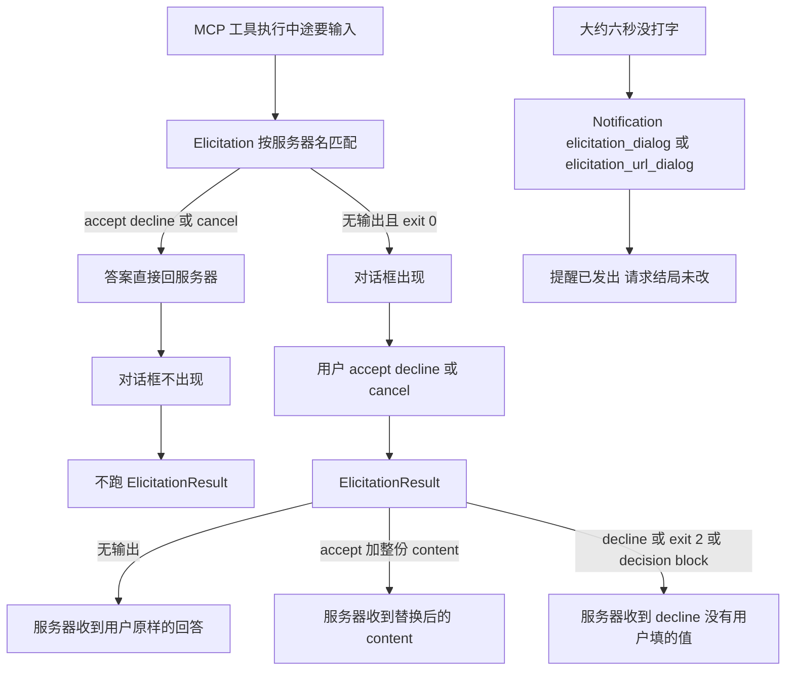

MCP 服务器在工具调用中途弹出一张表，或者要你打开登录页。有人已经挂了 `Notification` 的 `elicitation_dialog`，或者在那只通知钩子里写了 exit 2，就觉得这张表已经被拦住。对话框还是会出来。通知只是叫你回头。

`elicitation_dialog` 和 `elicitation_url_dialog` 是通知类型。表单或浏览器 URL 出现之后，大约六秒没打字，Claude Code 才发这只通知。参考页写明：Notification hooks can't block or modify notifications。exit 2 改不了这张表，也改不了那个 URL。

MCP 要输入的那一刻，能代为作答、拒绝或取消，从而跳过对话框的，是 `Elicitation`。用户在对话框里答完、答案还没送回服务器之前，能改值或拦住回传的，是 `ElicitationResult`。`Elicitation` 钩子一旦把请求处理完，答案直接发给服务器，**不会再跑** `ElicitationResult`。

我在 2026-11-25 08:27（Asia/Shanghai）用 curl 取了 [Hooks reference](https://code.claude.com/docs/en/hooks) 的 markdown（`hooks.md`，293845 字节）、[Automate actions with hooks](https://code.claude.com/docs/en/hooks-guide)（`hooks-guide.md`，66719 字节）和 [changelog](https://code.claude.com/docs/en/changelog)。同一轮向 GitHub releases/latest 核对，tag 仍是 [v2.1.331](https://github.com/anthropics/claude-code/releases/tag/v2.1.331)，`published_at` 是 2026-11-23T21:34:41Z，北京时间 2026-11-24 05:34。changelog 页首同为 **2.1.331**，日期 November 23, 2026。这一版没有 `Elicitation` 专条。两只事件是 **2.1.76**（March 14, 2026）加入的。没有跑 Claude Code，没有配真实 hook，没有弹出 MCP 对话框，也没有打开浏览器。字段名只转述这些页。

[昨天](https://cfireworks.github.io/2026/11/24/2026-11-24-notification/)把通知和授权闸拆开。`permission_prompt` 大约六秒才叫你，立刻拦的是 `PermissionRequest`。[11 月 5 日](https://cfireworks.github.io/2026/11/05/2026-11-05-permissionrequest-vs-pretooluse/)写过权限当场判决。那两套今天不重写。今天只切 elicitation 这一层：六秒后的 `elicitation_*` 通知仍然只是提醒。权限闸用 `PermissionRequest`。MCP 要输入，用的是 `Elicitation` 和 `ElicitationResult`。

<!-- more -->

## 提醒、当场处理、回传前再看一眼

控制环里，这三层容易进同一个文件。脚本看见 `elicitation_dialog`，就 exit 2，想的是服务器先别拿到这张表。参考页把它们拆开了。

生命周期图的图注把 `Notification` 和 ConfigChange、CwdChanged、FileChanged 等放在 standalone async events 里。同一句图注把 `Elicitation` 和 `ElicitationResult` 标成 nested inside MCP tool execution。表还在这次工具调用里面。通知是旁边的提醒，不是这张表的闸。

`Elicitation` 的原句是：Runs when an MCP server requests user input mid-task. By default, Claude Code shows an interactive dialog for the user to respond. Hooks can intercept this request and respond programmatically, skipping the dialog entirely.

`ElicitationResult` 的原句是：Runs after a user responds to an MCP elicitation. Hooks can observe, modify, or block the response before it is sent back to the MCP server.

紧接着的那句最容易写错：When an Elicitation hook answers a request, Claude Code sends that answer to the server without running ElicitationResult hooks.

「answers a request」和上一节的用词是同一套。上一节写钩子可以 answer、decline 或 cancel，服务器拿到你的答案，对话框不出现。Result 则写明跑在用户作答之后。钩子已经把请求处理完，用户没有再答，Result 不会跑。代答只是其中一条。拒绝和取消同样不经过 Result。

| 维度 | Notification 的 `elicitation_dialog` / `elicitation_url_dialog` | `Elicitation` | `ElicitationResult` |
| --- | --- | --- | --- |
| 何时开火 | 表单或浏览器 URL 已经出现，大约六秒没打字 | MCP 服务器在工具调用中途要输入 | 用户已经作答，回传给服务器之前 |
| 图上的位置 | standalone async events | nested inside MCP tool execution | 同上，紧跟在用户作答之后 |
| matcher | 通知类型 | MCP 服务器名 | 同一套服务器名 |
| 能否拦住 | 不能。can't block or modify notifications | 能。Can block? **Yes** | 能。Can block? **Yes** |
| exit 2 | Exit code and stderr are ignored | Declines the request, and no dialog appears | Blocks the response (action becomes decline) |
| JSON 里起作用的 | 没有 decision control | exit 0 的 `hookSpecificOutput.action`，或顶层 `decision: "block"` | 同样要带 `action`。`content` 整份替换用户的对象 |
| 丢掉的字段 | `systemMessage` 和 `continue`。昨天写过，这里不重写 | 无论哪种 `action`，都丢掉 `reason`、`systemMessage`、`continue` | 同样丢掉这三样 |

## 请求先到闸，六秒后的铃声改不了结局



铃声可以在你走开时响起。闸在 MCP 开口要输入的时候就要在。用户已经点了提交，第二道闸在回传之前。两道闸不会叠在同一次代答上。

## 代答、拒绝、取消，都发生在对话框之前

matcher 对的是 MCP 服务器名。`"*"`、`""` 或省略，每台服务器的请求都跑。空 matcher 会打到所有 MCP 服务器。`issue-tracker` 只打这一台。`issue-tracker|docs` 打这两台。

form 模式最常见。输入在公共字段之外是 `mcp_server_name`、`message`，以及可选的 `mode`、`url`、`elicitation_id`、`requested_schema`。官方示例是 `mode` 为 `form`，`requested_schema` 里有一个 `username` 字符串字段。url 模式用于浏览器认证，示例带 `url`，没有那份 schema。

要代答、拒绝或取消：exit 0，并打印带 `action` 的 `hookSpecificOutput`。官方对照是：

| 想要的结果 | 返回 | 服务器收到 |
| --- | --- | --- |
| 代答 | `"action": "accept"`，字段值放在 `content` | `accept` 和你的 `content` |
| 拒绝 | `"action": "decline"` | `decline` |
| 取消 | `"action": "cancel"` | `cancel` |
| 留给用户 | 无输出，exit 0 | 用户在对话框里的回答 |

`content` 的键是该请求 `requested_schema` 里的 property 名。官方脚本把 matcher 收在 `issue-tracker`：表单唯一字段是 `project_key` 时，`accept` 并填 `DOCS`；其他请求什么都不打印，对话框出现。手册写的确认方式是 `claude --debug`，debug log 含 `Elicitation resolved by hook:` 和 `accept`。我没有跑这条命令。

url 模式返回 `accept`，对话框被跳过，**那个 URL 不会被打开**。官方另一只脚本更直：`mode` 为 `url` 就 exit 2，表单请求留给对话框。

exit 2 的格子是：Declines the request, and no dialog appears。同一只钩子打印的 `hookSpecificOutput` 被忽略。JSON 总规则写：这两只事件只在 exit 0 时应用 `hookSpecificOutput`，其他退出码一律忽略。拒绝来自退出码本身，不来自那份被忽略的 JSON。

顶层 `"decision": "block"` 会覆盖同一份输出里的 `action`。你在 `hookSpecificOutput` 里写了 `accept`，旁边又放了 `decision: "block"`，服务器收到的是 `decline`。

多只钩子同时匹配时，其中一只的 decline 盖过另一只的 accept 或 cancel。先写代答、后写拒绝，结果仍是拒绝。

无论返回哪种 `action`，Claude Code 都丢掉 `reason`、`systemMessage` 和 `continue`。原句：Neither the user nor the server sees why your hook declined, because Claude Code doesn't show your stderr or your `reason`. 指南把 `ConfigChange` 和 `Elicitation` 放在一起：阻塞时你看不到那条说明。exit 2 可以把请求拒掉，解释留在你自己的日志里。

`if` 只在工具事件上求值。写在 `Elicitation` 或 `ElicitationResult` 上，这只钩子不跑。想按服务器收窄，用 matcher，不要抄工具钩子的 `if`。

## 用户已经提交，整份替换才算改过

对话框出现、用户答完之后，`ElicitationResult` 才开火。matcher 仍是服务器名。输入在公共字段之外是 `mcp_server_name`、`action`，以及可选的 `mode`、`elicitation_id`、`content`。官方示例是用户接受了，`content` 里 `username` 为 `alice`，`mode` 为 `form`。

无输出且 exit 0，服务器收到用户原样的回答。要改提交值，exit 0，`action` 为 `accept`，新值放在 `content`。你的 `content` **整份替换** 用户的 `content` 对象。没改的字段也要带上。只交一个新的 `username`，原来的 `team` 不会被运行时补回来。必须同时返回 `action`。没有 `action` 的 `hookSpecificOutput` 被忽略，用户的值照旧送出。

`decline` 拦住回传。服务器收到 `decline`，没有用户填的值。`cancel` 让服务器收到 `cancel`。官方补了一句：要扣住用户提交的值，返回 `decline`。`cancel` 本身扣不扣那些值，这句没有展开。

Result 在用户已经 `decline` 或 `cancel` 时仍会跑，你的 `action` 替换他们的。返回 `accept` 之前先看输入里的 `action` 是不是 `accept`。不看就代答，一次已经拒绝的请求会变成接受。官方脚本先判断，再改 `username`，其他字段留在同一份对象里；输入不是 `accept` 时什么都不打印：

```python
def rewrite_username(payload: dict) -> tuple[int, dict | None, str]:
    """先看输入里的 action 是 accept，再把没改的字段一起带上。

    jq 的 + 发生在脚本里。交出去的 content 仍由宿主整份替换。
    输入不是 accept 时不打印。
    """
    if payload.get("action") != "accept":
        return 0, None, ""
    content = dict(payload.get("content") or {})
    content["username"] = f"{content.get('username', '')}@example.com"
    return (
        0,
        {
            "hookSpecificOutput": {
                "hookEventName": "ElicitationResult",
                "action": "accept",
                "content": content,
            }
        },
        "",
    )
```

jq 示例里的 `+` 是脚本在拼一份完整对象。宿主收到的仍是整份替换，不会把你漏掉的键和用户的对象合并。

exit 2 和顶层 `"decision": "block"` 也会拦住回传，action 变成 decline。组合时以哪一条为准，Result 这一节指向同一处 Other ways to decline：exit 2 忽略同一只钩子的 `hookSpecificOutput`；`decision: "block"` 覆盖同一份输出里的 `action`。多只钩子里的 decline 同样盖过另一只的 accept 或 cancel。`reason`、`systemMessage`、`continue` 照样丢掉。

前面那道闸如果已经代答、拒绝或取消，这一节不会再被调用。想审一次「钩子填的 `DOCS` 能不能出站」，要写在 `Elicitation` 里，或者根本不要让 `Elicitation` 代答，把表留给用户，再在 `ElicitationResult` 里改或拦。两道闸串不成「先代答、再审一遍」。

## 版本只用来对齐今天这页

changelog **2.1.76** 的原句是：Added new `Elicitation` and `ElicitationResult` hooks to intercept and override responses before they're sent back。那一版同时加上了 MCP elicitation 本身：服务器可以在任务中途用表单或浏览器 URL 要结构化输入。

顶层 `decision` 不是今天才有的能力。参考页写明：从 v2.1.105 起，直到 v2.1.284 的修复，`Elicitation` 和 `ElicitationResult` 的顶层 `decision` 曾被忽略。changelog **2.1.284**（September 28, 2026）的原句是：Fixed `{"decision":"block"}` returned by Elicitation and ElicitationResult hooks being ignored; it now declines the MCP elicitation, as exit code 2 does。修复之后，它和 exit 2 一样会 decline。

**2.1.331** 没有这两只钩子的专条。夹具按今天打开的页模拟修复之后的行为，不把 2.1.331 里相邻的条目记成它们的新能力，也不在运行时去检测旧版本。

## 清单

别把 `elicitation_dialog` 或 `elicitation_url_dialog` 的 exit 2 当成已经拒表。那只钩子不能 block，也不能改通知。大约六秒没打字，它才叫你。

要代答、当场拒绝或取消，用 `Elicitation`。exit 0，带 `action`。故意用 exit 2 也可以 decline，对话框不会出现。不要指望 stderr 或 `reason` 被用户或服务器看见。

url 模式返回 `accept`，等于不打开那个 URL。若本意是让人去登录页，这一票不要投 `accept`，也不要 exit 2。无输出，把对话框留给用户。

要改或拦用户已经提交的内容，用 `ElicitationResult`。先看输入里的 `action`。改值时把没改的字段一起带上，并且带上 `action`。漏掉的字段不会悄悄留下。

`Elicitation` 已经代答、拒绝或取消，就不要指望 Result 再审一次。答案已经在去服务器的路上。

matcher 按服务器名收。空 matcher 会打到所有 MCP 服务器。`if` 写在这两只事件上，钩子不跑。

## 夹具里，六秒没有睡

演示在 `demos/elicitation/`。不访问网络，不启动 Claude Code，不弹 MCP 对话框，不打开浏览器，不调用 `jq`，不睡眠。这不是 settings 里的 hook，也不是 Claude Code 运行时。官方脚本的形状留在 README 里对照。

`python3 demos/elicitation/run_demo.py` 我跑过。stdout 最后一行是 `result=pass`。

| 夹具 | 在看什么 | 跑完的旗标 |
| --- | --- | --- |
| `input_form` / `input_url` / `input_result` | stdin 的字段 | `event=Elicitation` 或 `ElicitationResult`。form 有 `requested_schema`。url 有 `url` |
| `matcher_name` / `matcher_empty` / `matcher_list` | 按服务器名过滤 | 命中才跑。省略、`""`、`"*"` 六次都是 1。列表不打 `other` |
| `accept_skips_dialog_and_result` | exit 0，`accept`，旁边还挂了会 decline 的 Result | `dialog=0`。`result_calls=0`。`server_content=username:alice`。`spy_not_called` 是 `calls=0` |
| `leave_to_dialog` | 无输出，exit 0 | `dialog=1`。`server_action=pending` |
| `url_accept_skips_open` | url 模式 `accept` | `url_opened=0`。`dialog=0`。`result_calls=0` |
| `exit2_declines_without_reason` | exit 2，JSON 里仍是 `accept`，并带 `reason` | `server_action=decline`。`reason_seen=0`。`stderr_seen=0`。`continue_applied=0` |
| `decision_block_overrides_action` | 同一份输出里 `decision: "block"` 和 `accept` | `server_action=decline`。`pre_fix_ignore_simulated=0` |
| `decline_overrides_accept` / `decline_overrides_cancel` | 多只钩子 | 都是 `decline`。`accept` 对 `cancel`、没有 decline 的那格是 `not_stated`，`simulated=0` |
| `script_project_key` | 唯一字段 `project_key` | `server_content=project_key:DOCS`。别的字段或别的服务器留给对话框 |
| `script_url_exit2` | `mode` 为 `url` 则 exit 2 | `url_opened=0`。form 那条是 `dialog=1` |
| `result_passthrough` | Result 无输出 | `user_values_sent=1`。`team` 还在 |
| `result_replaces_whole_content` | 只交新的 `username` | `server_content=username:alice@example.com`。没有 `team` |
| `result_script_keeps_other_fields` | 脚本自己抄上 `team` | `team:docs,username:alice@example.com` |
| `result_without_action_ignored` | 有 `content`，没有 `action` | 用户的 `alice` 和 `docs` 照旧 |
| `result_decline_withholds` | `action: "decline"` | `user_values_sent=0` |
| `result_cancel` | `action: "cancel"` | `server_action=cancel`。`cancel_withholds=not_stated` |
| `result_runs_on_decline_and_can_flip` | 用户已拒绝，钩子仍返回 `accept` | `server_action=accept`。`server_content=username:hook` |
| `result_checks_action_before_accept` | 先看输入 `action` | 用户的 `decline` 留着 |
| `result_exit2_becomes_decline` / `result_decision_block_overrides` | 回传前的另外两种拒绝 | `server_action=decline`。用户的值不送出 |
| `if_never_runs` | 这两只事件上写了 `if` | `elicitation_ran=0`。Result 的 `result_calls=0` |
| `side_elicitation_dialog` / `side_elicitation_url_dialog` | 通知即使 exit 2 | `request_declined=0`。`slept=0`。`quiet_seconds=6` |

## 页上没写成一句的

同一请求里一只钩子 `accept`、另一只 `cancel`，又没有 decline，谁赢，Other ways to decline 没有写。`ElicitationResult` 返回 `cancel` 时，用户填的值还在不在回传里，页上只写了要扣住就返回 `decline`。这两只事件支持 `command`、`http`、`mcp_tool`，不支持 `prompt` 或 `agent`。`PermissionRequest` 配了 `agent` 会 skip，这两只没有同样的句子。是跳过还是报错，未核实。exit 不是 0 也不是 2 时，对话框还出不出，专项没有写成一句。只打印会被丢掉的 `reason`、`systemMessage`、`continue`、没有 `action`，算不算「无输出」，也没有写成一句。elicitation 通知的按键是不是像 `permission_prompt` 那样逐次推迟，昨天写过，`each keystroke defers` 不在那一条上。这几格夹具都是 `simulated=0`。

## 叫你回头，和把答案送出去，是两层

通知可以在你走开大约六秒之后响起。闸必须在 MCP 要输入的时候就到位，以及在答案送出之前再看一眼。`elicitation_dialog` 负责叫你。`Elicitation` 负责代答、拒绝或取消。`ElicitationResult` 负责改掉或拦住用户已经提交的那一份。前一只钩子一旦把请求处理完，后一只就不会再跑。

## 扩展阅读

- [Hooks reference：Elicitation](https://code.claude.com/docs/en/hooks#elicitation)
- [Hooks reference：ElicitationResult](https://code.claude.com/docs/en/hooks#elicitationresult)
- [Hooks reference：Other ways to decline an elicitation](https://code.claude.com/docs/en/hooks#other-ways-to-decline-an-elicitation)
- [Hooks reference：Answer a form request from a script](https://code.claude.com/docs/en/hooks#answer-a-form-request-from-a-script)
- [Hooks reference：Decision control](https://code.claude.com/docs/en/hooks#decision-control)
- [Hooks reference：Exit code 2 behavior per event](https://code.claude.com/docs/en/hooks#exit-code-2-behavior-per-event)
- [Hooks reference：Exit code output](https://code.claude.com/docs/en/hooks#exit-code-output)
- [Automate actions with hooks](https://code.claude.com/docs/en/hooks-guide)
- [changelog](https://code.claude.com/docs/en/changelog) / [release v2.1.331](https://github.com/anthropics/claude-code/releases/tag/v2.1.331)
- [别把 Notification 当成授权闸](https://cfireworks.github.io/2026/11/24/2026-11-24-notification/)
- [别把 PermissionRequest 当成 PreToolUse](https://cfireworks.github.io/2026/11/05/2026-11-05-permissionrequest-vs-pretooluse/)

## 讨论

有没有人把 `elicitation_dialog` 的通知，或把 `Elicitation` 的 exit 2，当成过表单已经可控，后来发现对话框照出、或拒绝原因谁也没看到？我没有生产会话。六秒是参考页上的大约六秒。夹具只把这个数记下来，不睡眠。
