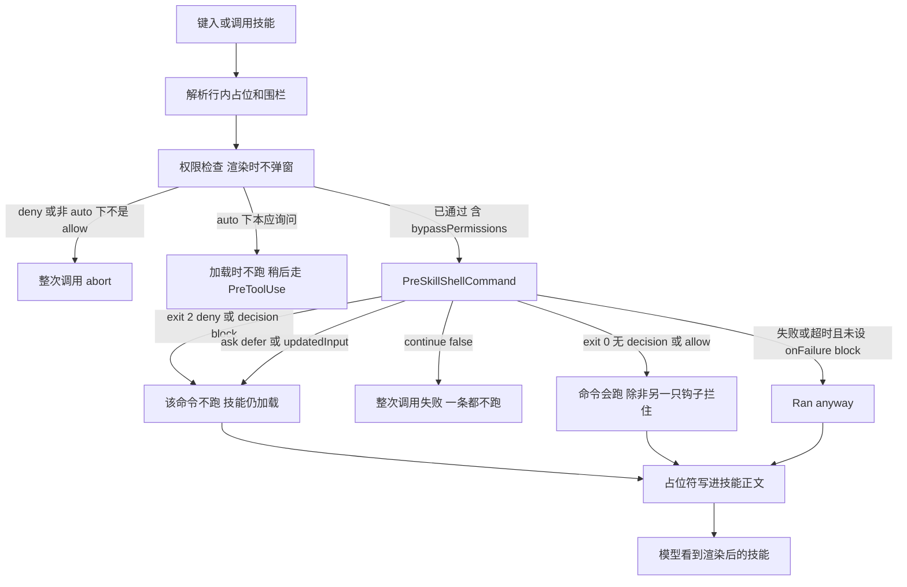

有人把「禁掉危险 shell」挂在 `PreToolUse` 上，matcher 写 `Bash`。技能文件里，或者 `/security-review` 这种命令加载时，行内的 `` !`echo 'rm -rf'` `` 还是会跑。模型看到正文之前，这条命令已经跑完了。`PreToolUse` 对它不开火。

从 Claude Code **v2.1.332** 起，能在它跑之前拦住的，是 `PreSkillShellCommand`。生命周期图的图注把它标成 standalone blocking event that runs before a shell command in a loading skill。它不在 agentic loop 里面，也不是 `PreToolUse` 换了个名字。这只钩子只能拦，不能批准，也不能改写。exit 2、`permissionDecision: "deny"`，或顶层 `decision: "block"`，命令不跑，技能仍加载，模型在输出的位置读到 `[not run: blocked by hook: <reason>]`。`ask`、`defer`，以及任何 `updatedInput`，一律按 deny 处理。

在 **v2.1.331 及更早**，settings 里写上这个事件名，每个交互式终端会话会弹出 `Unknown hook event "PreSkillShellCommand" was ignored`。旧版也不会调用它，注入命令照跑。

我在 2026-11-26 08:27（Asia/Shanghai）用 curl 取了 [Hooks reference](https://code.claude.com/docs/en/hooks) 的 markdown（`hooks.md`，301732 字节）、[Automate actions with hooks](https://code.claude.com/docs/en/hooks-guide)（`hooks-guide.md`，66983 字节）、[changelog](https://code.claude.com/docs/en/changelog)（`changelog.md`，1445423 字节）和 [skills](https://code.claude.com/docs/en/skills)（`skills.md`，121182 字节）。同一轮向 GitHub releases/latest 核对，tag 是 [v2.1.332](https://github.com/anthropics/claude-code/releases/tag/v2.1.332)，`published_at` 是 2026-11-25T01:32:14Z，北京时间 2026-11-25 09:32。changelog 页首同为 **2.1.332**，日期 November 25, 2026。Added 里这一条是：Added a `PreSkillShellCommand` hook event that can refuse a skill or command's inline shell commands as it loads; on 2.1.331 and older, a settings file naming it opens a dialog at start。没有跑 Claude Code，没有配真实 hook，没有执行注入命令。字段名只转述这些页。2.1.332 里同时列出的 MCP skills（beta）不是今天这只闸。[skills.md](https://code.claude.com/docs/en/skills#skills-from-mcp-servers) 写明 MCP 技能的 `` !` `` 命令不会跑，所以它们到不了这里。

[昨天](https://cfireworks.github.io/2026/11/25/2026-11-25-elicitation-vs-elicitationresult/)讲的是 MCP 要输入时的表单闸。[11 月 12 日](https://cfireworks.github.io/2026/11/12/2026-11-12-userpromptexpansion/)讲的是斜杠命令展开成提示时的 `UserPromptExpansion`。那是命令文本送到模型之前。今天切的是技能加载时已经通过权限检查、即将执行的注入 shell。[11 月 5 日](https://cfireworks.github.io/2026/11/05/2026-11-05-permissionrequest-vs-pretooluse/)写过 `PreToolUse` 和 `PermissionRequest`，[11 月 4 日](https://cfireworks.github.io/2026/11/04/2026-11-04-pre-vs-post-hooks/)写过工具调用前后的两只钩子。那两套 decision 对象今天不重写。只点一句：工具调用闸拦的是模型发起的工具调用。注入命令要另挂 `PreSkillShellCommand`。同一套脚本最好两只事件都挂。

<!-- more -->

## 权限先看，钩子只看见放行的那条

技能正文送到模型之前，`` !`<command>` `` 和 ` ```! ` 围栏会先跑。输出换掉占位符，模型收到的是数据，不是那条命令本身。行内形式只在行首或空白之后的 `!` 被认出来。`` KEY=!`cmd` `` 这种留着原文，命令不跑。替换只做一轮。命令输出里再写出 `` !` `` 占位符，不会被第二次展开。

跑它的工具由技能 frontmatter 的 `shell` 和环境决定，落到 Bash 或 PowerShell。这也是 matcher 的两个取值。`shell: bash` 但本机没有 bash 时，调用在任何命令之前失败，报 `` Skill <name> requires bash (`shell: bash` in frontmatter) but Git Bash was not found ``。这种失败同样没有命令送到钩子。

渲染期间不弹权限提示。Claude Code 先按权限规则检查每一条。deny 规则对上了，整次调用 abort，报 `Shell command permission check failed for pattern "..."`。非 auto mode 下，检查结果不是 allow，调用也会 abort。这些命令到不了 `PreSkillShellCommand`。

钩子跑在这次检查之后，所以它只看见已经通过的命令。`bypassPermissions` 里它仍会跑。auto mode 里，本应需要批准的命令在加载时不跑。技能带着「先去跑这条命令」的说明加载，随后 Claude 自己发起的工具调用走 `PreToolUse`，不是这只事件。所以同一套拦截脚本要同时挂在两只事件上。auto mode 里如果技能是设了 `agent` 的 fork，或者会话里没有跑注入命令的那个 shell 工具，本应询问的命令仍会让整次调用 abort。

命令自己失败，和钩子拦住，不是同一件事。命令失败默认 abort 整次调用，报 `Shell command failed for pattern "..."`，模型看不到这次的技能正文。钩子拦住时技能仍加载，占位符变成 `[not run: blocked by hook: <reason>]`。

`PreToolUse` 的警告写的是：PreToolUse runs when Claude calls a tool. It doesn't fire for injected commands。只在 `PreToolUse` 里拦了 Bash，技能里的 `` !` `` 命令没有被拦。

## 对照：三道闸各看各的

| 维度 | `UserPromptExpansion` | `PreSkillShellCommand` | `PreToolUse` |
| --- | --- | --- | --- |
| 何时开火 | 用户打的命令展开成提示、到达 Claude 之前 | 技能或命令加载时，注入 shell 执行之前 | Claude 发起工具调用、执行之前 |
| 图上的位置 | 每轮里、agentic loop 之前的展开 | standalone blocking event，在加载中的技能里、shell 命令之前 | agentic loop 里 |
| matcher | command name | 跑这条命令的工具：`Bash`、`PowerShell` | 工具名 |
| 能否 block | 能。拦住的是展开 | 能。Can block? **Yes**。只能拦，不能批准或改写 | 能。allow、deny、ask、defer，还能 `updatedInput` |
| exit 2 | 拦住展开 | Blocks the command, and the skill loads without its output | Blocks the tool call |
| JSON 里起作用的 | 顶层 `decision: "block"` | `permissionDecision`、`permissionDecisionReason`，或顶层 `decision: "block"` | `hookSpecificOutput.permissionDecision` |
| `ask` / `defer` / `updatedInput` | 这只事件不靠这三样放行 | 一律按 deny 拦住 | ask 会询问，defer 会推迟，`updatedInput` 会改参数 |
| 失败或超时、没设 `onFailure: "block"` | 11 月 12 日那篇标过未核实，这里不补 | 命令仍会跑，终端是 `Ran anyway in /<name>`。设了 `"block"` 才不跑 | 工具调用默认仍走权限流程 |

Decision control 总表把这只事件收成一行：`hookSpecificOutput` or top-level `decision`，关键字段是 `permissionDecision`、`permissionDecisionReason`，The hook can only block。

`if` 现在会在 `PreSkillShellCommand` 上求值，和 `PreToolUse`、`PostToolUse`、`PostToolUseFailure`、`PermissionRequest`、`PermissionDenied` 一样。写在别的事件上，带了 `if` 的钩子不跑。语法是权限规则，例如 `Bash(rm *)`。对不上，钩子不跑。hooks-guide 的事件表、matcher 和 `if` 范围同步了这一条。输入字段和决策表以 hooks 参考为准。

## 加载时序



图的旁边还有一条没有画进节点：auto mode 下未获批的命令不在加载时跑，稍后作为工具调用走 `PreToolUse`。那次调用不再经过 `PreSkillShellCommand`。

`continue: false` 和单条 deny 不是一档。页上写：Invoking the skill fails with `Operation stopped by hook: <stopReason>`. None of its injected commands runs, because Claude Code collects your hooks' answers before it runs the first one。还没轮到的命令也不跑。单条 deny 或 exit 2 只拿掉这一条，技能仍加载，别的已经通过检查的命令还可以跑。

exit 2 同时又写了 `continue: false` 时，总述让先看 exit 2，因为结果可能和事件那一行不一样。总述点名的是 `Stop`、`SubagentStop` 和 `PreToolUse`，没有把这只事件叠在一起的赢家写出来。夹具这一格是 `simulated=0`。

## 只能拦

要拦一条注入命令：exit 2，或返回 `permissionDecision: "deny"`。JSON 沿用 `PreToolUse` 的格式。同一脚本挂在两只事件上，`hookEventName` 留成 `PreToolUse`。只挂在这只事件上，可以写成 `PreSkillShellCommand`。

| 钩子结果 | 注入命令 |
| --- | --- |
| Exit 0 且无 decision，或 `permissionDecision: "allow"` | 会跑，除非另一只钩子拦住 |
| Exit 2、`permissionDecision: "deny"`，或顶层 `decision: "block"` | 不跑。技能仍加载。模型读到 `[not run: blocked by hook: <reason>]` |
| `permissionDecision: "ask"` 或 `"defer"`，或任何 `updatedInput` | 按 deny 拦住。不询问，也不改命令 |
| `continue: false` | 整次调用失败。一条注入命令都不跑 |
| `command` / `http` / `mcp_tool` 失败或超时，例如 exit 1 且没有 JSON | 默认仍会跑，除非这只钩子属于失败即拦截。Code Mode 里 Claude 已经跑过代码时，超时默认会拦 |

exit 2 的原因写在 stderr。JSON 里放在 `permissionDecisionReason`，或放在顶层 `decision` 旁边的 `reason`。总述还写了：exit 2 同时又打印了做出拦截决定的 JSON，用的是那份决定的 reason，不是 stderr。`permissionDecision: "allow"` 再配 exit 2，allow 放不过去，命令仍被 exit 2 拦住。

你在终端键入技能名时，`Not run in /<name>` 表示命令被钩子拦住。官方测试是建 `.claude/skills/hook-test/SKILL.md`，正文只有一行 `` !`echo 'rm -rf'` ``。这是只读命令，不需要批准，也删不了任何东西。会话里输入 `/hook-test`，应看到 `Not run in /hook-test: echo 'rm -rf' (blocked by hook: Destructive command blocked by hook)`。`Ran anyway in /<name>` 表示钩子失败或超时之后命令还是跑了。

Remote Control 已连接时，钩子仍会拦，你和 Claude 都看不到原因，只能去 debug log。占位符在这种连接下怎么拼，页上没有另给一句。夹具只断言拦住了、两边都看不见原因、原因在 debug log，不发明那串字。

夹具把 exit 0 的 JSON 收成这几档。`updatedInput` 出现就按拦，命令字符串保持原样。`ask` 在 `PreToolUse` 上会询问，那是工具调用那一页的行为，不抄到这里。

```python
def classify_stdout(stdout: dict | None) -> dict:
    """exit 0 时，PreSkillShellCommand 的 JSON 只能拦，不能批准或改写。"""
    if not stdout:
        return {"effect": "no_decision"}
    if stdout.get("continue") is False:
        return {"effect": "stop", "stop_reason": stdout.get("stopReason") or ""}
    spec = stdout.get("hookSpecificOutput") or {}
    permission = spec.get("permissionDecision")
    updated = "updatedInput" in spec
    if stdout.get("decision") == "block" or permission in ("deny", "ask", "defer") or updated:
        return {"effect": "block", "rewritten": 0, "asked": 0, "deferred": 0}
    if permission == "allow":
        return {"effect": "allow", "rewritten": 0}
    return {"effect": "no_decision"}
```

下面只保留分档。`hookEventName` 的校验，以及 reason 从 stderr、`permissionDecisionReason` 还是顶层 `reason` 取，都在脚本里。这不是 Claude Code。完整路径在 `demos/preskillshellcommand/run_demo.py`。`hookEventName` 缺了，按 schema 算无效 JSON：exit 0 时命令仍会跑，对应 `Ran anyway`。exit 2 仍拦，原因用 stderr。名字写成 `PreToolUse` 或 `PreSkillShellCommand` 才按上面的表读。写成别的事件名，页上没说认不认，夹具是 `simulated=0`。

输入除了公共字段里的 `permission_mode`，还有这几项。`tool_name` 是 `Bash` 或 `PowerShell`。`tool_input.command` 是即将执行的 shell 命令。`tool_use_id` 是这次命令的 ID，不对应 transcript 里的工具调用。`command_name` 是正在加载的技能或命令名，例如 `pr-summary`，插件技能则是 `my-plugin:deploy`。`command_source` 的例子是 `userSettings`、`projectSettings`、`policySettings`、`plugin`、`builtin`。`invoked_by` 为 `"user"` 时，是你键入了技能名，或 Agent SDK 应用发来的。`"claude"` 是 Claude 或会话级 scheduled task 调的。`"other"` 是其余情况，例如子代理 preload 技能。页上没有写这三种调用者会走出不同的拦截结果。夹具只把它们放进 stdin。

## 挂在哪，以及什么样的钩子算数

必须能拦住时，参考页把四件事写在一起。

Matcher 用 `Bash|PowerShell`，盖住会跑注入命令的两种工具。精确列表也认逗号，`Bash, PowerShell` 同样打这两种。只写 `Bash`，PowerShell 那条对不上。

Type 用 `command`、`http` 或 `mcp_tool`，而且不要 async。async 钩子不能 block。背景钩子那一节写明：`decision`、`permissionDecision`、`continue` 都不起作用，因为它要管的那一步已经往下走了。在这只事件上配 `prompt` 或 `agent`，Claude Code 跑不了它，并拦住该钩子匹配到的每条命令。matcher 没对上的命令，不由这只跑不了的钩子接手。

Location 写在 settings，例如 managed settings，或写在 plugin 里。技能自己 frontmatter 里的钩子，在该会话第一次加载时，以及在子代理内部加载时，打不到它自己的注入命令。被 fork 到子代理里跑的技能，自己的 frontmatter 钩子和子代理定义里的钩子都打不到。父会话里第二次加载时，frontmatter 打不打得到，这句没有写成正面的保证。夹具不补。参考页点名打不到的是这几处 frontmatter 和子代理定义。settings 和 plugin 不在那份名单里，夹具让这两处在第一次加载和 fork 里仍然生效。

Failures 设 `onFailure: "block"`。否则钩子失败或超时，命令还会跑，你在终端看到 `Ran anyway`。例外有两处，页上写了，夹具也走了。Windows 上没有 Git Bash 时，shell 形式的 `PreSkillShellCommand` 命令钩子失败，而且没设 `onFailure`，可能改成拦截。Code Mode 里 Claude 已经跑过代码，超时默认会拦。exit 1 但打印了能通过校验的 deny JSON、又没把失败设成拦截时，退出码被忽略，字段自己做决定。无 JSON 的 exit 1 才是「命令仍跑」的那一格。

政策上要彻底禁掉注入执行，用 settings 里的 `disableSkillShellExecution: true`。user、project、plugin、additional-directory 来源的每条命令换成 `[shell command execution disabled by policy]`，钩子看不到它们。bundled 和 managed skills 不受影响。这是另一条开关，不是 `PreSkillShellCommand` 的能力。

## 先升级，再把事件名写进 settings

先升到 v2.1.332，包括桌面端和 VS Code 扩展，再把 `PreSkillShellCommand` 写进 settings。旧版不调用它，注入命令照跑。v2.1.331 还会在每个交互式终端会话弹出未知事件对话框，链到 settings 页的 broken settings file 说明。要用最低版本卡住，看 `requiredMinimumVersion`。

matcher 写 `Bash|PowerShell`。需要再收窄时用 `if`，例如 `Bash(rm *)`。对不上就不要指望脚本会跑。Bash 的 `if` 会看子命令、`$()` 和反引号。模式比命令名更长时，碰到 `$()`、反引号或 `$VAR`，钩子会照跑。拆不开命令时也照跑。这层过滤是尽力而为，硬性的允许和拒绝仍走权限规则。

设 `onFailure: "block"`。不然失败和超时默认是 `Ran anyway`。Windows 没有 Git Bash 时，没设这个字段的 shell 形式钩子可能反过来变成拦截。要行为稳定，把 `"block"` 写上。

不要把 `ask`、`defer`、`updatedInput` 当成会询问或会改写。这只钩子没有这三条出路。`permissionDecision: "allow"` 只表示「这只钩子不拦」。另一只钩子仍可以拦住。它不是一张放行票。

不要只写在技能自己的 frontmatter 里，还以为第一次加载、子代理里的加载、fork 技能会被拦住。第一次加载时 frontmatter 里的钩子根本打不到自己的注入命令。

同一套策略脚本同时挂 `PreToolUse` 和 `PreSkillShellCommand`。共享脚本时 `hookEventName` 留成 `PreToolUse`。只挂在 `PreToolUse` 上，注入命令照样能跑。auto mode 里延后的那次工具调用只走 `PreToolUse`，只挂在 `PreSkillShellCommand` 上的脚本也看不见它。

`continue: false` 停掉的是整次技能调用，报 `Operation stopped by hook: <stopReason>`。要跳过一条、留下其余的，用 deny 或 exit 2。

Remote Control 连着时，原因只在 debug log。拦截本身还在。

要按策略关掉注入执行，用 `disableSkillShellExecution`。不要把占位符 `[shell command execution disabled by policy]` 写成这只钩子的输出。

官方示例的脚本在 macOS 和 Linux 上读 `tool_input.command`，里面有 `rm -rf` 就打印 deny，`hookEventName` 仍是 `PreToolUse`，原因是 `Destructive command blocked by hook`。夹具用同样的字段，不调用 `jq`，也不把那条字符串交给 shell。

## 夹具走的是契约，不是一次真实加载

`python3 demos/preskillshellcommand/run_demo.py` 在本地把上面这些格子走了一遍。我跑过这条命令，stdout 最后一行是 `result=pass`。同一行之前是 `executed=0`、`network=0`。没有跑 Claude Code，也没有输入 `/hook-test`。

| 夹具 | 断言 |
| --- | --- |
| `official_hook_test` | `echo 'rm -rf'` 被 deny。终端行是官方那句 `Not run in /hook-test: ...`。技能仍加载。`executed=0` |
| `pretooluse_only_misses_injection` | 脚本只挂在 `PreToolUse`。注入命令 `contract_runs=1`，这只事件的调用次数是 0 |
| `shared_script_on_both_events` | 两只事件挂同一只脚本，`hookEventName` 仍是 `PreToolUse`，注入命令被拦 |
| `ask_blocked_as_deny` / `defer_blocked_as_deny` / `updated_input_blocked_not_rewritten` | `asked=0`，`deferred=0`，`rewritten=0` |
| `continue_false_stops_every_command` | 第二条才返回 `continue: false`。两条都不跑。`Operation stopped by hook: stop now` |
| `exit1_without_json_runs` / `onfailure_block` | 前者终端是 `Ran anyway in /hook-test`。后者 `contract_runs=0` |
| `auto_ask_defers_to_pretooluse` | 加载时钩子次数是 0，`later_event=PreToolUse`。随后的工具调用才吃 deny |
| `frontmatter_first_load_misses` | 第一次加载，frontmatter 里的 deny 打不到，`contract_runs=1` |
| `disable_skill_shell_execution` | 占位符是策略那句，钩子次数是 0 |
| `mcp_skill_bang_does_not_run` | `` !` `` 不跑，`not_this_gate=1` |

Bash 的 `if` 只实现了参考页那张表里的五行。`echo $(rm -rf /)` 会让 `Bash(rm *)` 的钩子跑起来，deny 把它拦住，`executed=0`。拆不开时钩子照跑，夹具只用「单引号不成对」当成拆不开。PowerShell 的 `if` 没有这张表，`powershell_if_not_stated` 是 `simulated=0`。搜索命令 exit 1 算正常结果的那条豁免在另一页，夹具不模拟。父会话第二次加载时 frontmatter 打不打得到，也是 `simulated=0`。

## 页上没写成一句的

exit 2 和 `continue: false` 写在同一份输出里，这只事件谁先算，总述只说先看 exit 2，因为结果可能和事件那一行不一样。`hookEventName` 写成 `PreToolUse` 和 `PreSkillShellCommand` 以外的名字，认不认，schema 那句要求「设成事件名」，又单独允许共享脚本留成 `PreToolUse`。第三种名字没有例子。Remote Control 连着时，占位符字符串本身还在不在正文里，页上只说你和 Claude 都看不到原因。子代理定义里的钩子，在一次不是 fork 的加载里打不打得到，也没有单独的句子。这四格夹具都是 `simulated=0`。

默认 bash 下，搜索和比较命令的 exit 1 可以当成正常输出注入。那份命令名单在工具参考的 Output limits，不在这只钩子的正文里。夹具不把 `grep` 或 `git diff` 的 exit 1 判成成功或失败。

## 模型发起的 Bash，和加载时先跑的那条，不是一层

`PreToolUse` 够不到技能加载时已经通过权限检查的注入 shell。v2.1.332 的 `PreSkillShellCommand` 够得到，而且只能拦、不能放行。`ask` 不会变成提问，`updatedInput` 不会变成新命令。旧版连这只事件的名字都不认，命令还是会跑。

## 扩展阅读

- [Hooks reference：PreSkillShellCommand](https://code.claude.com/docs/en/hooks#preskillshellcommand)
- [Hooks reference：PreSkillShellCommand decision control](https://code.claude.com/docs/en/hooks#preskillshellcommand-decision-control)
- [Hooks reference：Decision control](https://code.claude.com/docs/en/hooks#decision-control)
- [Hooks reference：Exit code 2 behavior per event](https://code.claude.com/docs/en/hooks#exit-code-2-behavior-per-event)
- [Hooks reference：PreToolUse](https://code.claude.com/docs/en/hooks#pretooluse)
- [Skills：Inject dynamic context](https://code.claude.com/docs/en/skills#inject-dynamic-context)
- [Skills：Permission checks on injected commands](https://code.claude.com/docs/en/skills#permission-checks-on-injected-commands)
- [Skills：How injected commands run](https://code.claude.com/docs/en/skills#how-injected-commands-run)
- [Settings：requiredMinimumVersion](https://code.claude.com/docs/en/settings-reference#requiredminimumversion)
- [Settings：Fix a broken settings file](https://code.claude.com/docs/en/settings#fix-a-broken-settings-file)
- [Automate actions with hooks](https://code.claude.com/docs/en/hooks-guide)
- [changelog](https://code.claude.com/docs/en/changelog) / [release v2.1.332](https://github.com/anthropics/claude-code/releases/tag/v2.1.332)
- [别把 elicitation_dialog 当成表单闸](https://cfireworks.github.io/2026/11/25/2026-11-25-elicitation-vs-elicitationresult/)
- [别把斜杠命令当成工具调用](https://cfireworks.github.io/2026/11/12/2026-11-12-userpromptexpansion/)
- [别把 PermissionRequest 当成 PreToolUse](https://cfireworks.github.io/2026/11/05/2026-11-05-permissionrequest-vs-pretooluse/)

## 讨论

有没有人以为 `PreToolUse` 已经拦住了技能里的 `` !` `` 命令，或在 2.1.331 上先把 `PreSkillShellCommand` 写进 settings，结果弹了未知钩子对话框、命令照跑？我没有生产会话。夹具按 2.1.332 的契约模拟，不探测本机版本。
