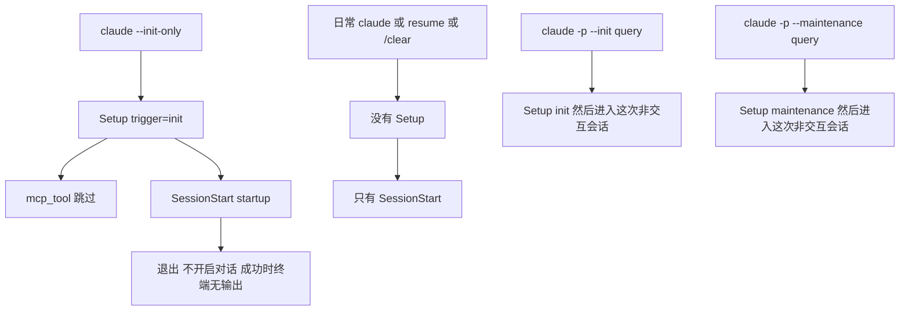

有人把「装依赖、清缓存、准备仓库」写进 hooks，以为每次打开 Claude Code 都会跑。日常键入 `claude`，脚本一次都没动。反过来，把本该只在 CI 里跑一次的安装挂在 `SessionStart` 上，每次开聊、恢复、`/clear` 都要等它。

`Setup` 不是每场会话的准备钩子。它只在你显式加上 `--init-only`，或在非交互的 `-p` 模式里加上 `--init` / `--maintenance` 时开火。每场会话的初始化要挂 `SessionStart`。`Setup` 没有 decision control：任何退出码都继续，`systemMessage`、`continue`、`hookSpecificOutput.additionalContext` 这类 JSON 字段会被丢掉。`--init-only` 成功时终端什么都不印。要确认钩子跑过，得加 `--debug-file`。

我在 2026-11-27 08:35（Asia/Shanghai）用 curl 取了 [Hooks reference](https://code.claude.com/docs/en/hooks) 的 markdown（`hooks.md`，301732 字节）、[Automate actions with hooks](https://code.claude.com/docs/en/hooks-guide)（`hooks-guide.md`，66983 字节）、[changelog](https://code.claude.com/docs/en/changelog)（`changelog.md`，1445423 字节）、[CLI reference](https://code.claude.com/docs/en/cli-reference)（`cli-reference.md`，52983 字节）、[headless](https://code.claude.com/docs/en/headless)（`headless.md`，39107 字节）、[plugins/components](https://code.claude.com/docs/en/plugins/components)（38271 字节）和 [plugins/loading](https://code.claude.com/docs/en/plugins/loading)（47490 字节）。hooks、hooks-guide、changelog 的字节数与当天 08:30–08:32 的笔记一致。同一轮向 GitHub releases/latest 核对，tag 仍是 [v2.1.332](https://github.com/anthropics/claude-code/releases/tag/v2.1.332)，`published_at` 是 2026-11-25T01:32:14Z，北京时间 2026-11-25 09:32。changelog 页首同为 **2.1.332**，日期 November 25, 2026。没有跑 Claude Code，没有配真实 hook，没有执行安装或清理。

这不是今天的新事件，也不是 2.1.332 的能力。changelog 在 **2.1.10**（January 17, 2026）写了：Added new `Setup` hook event that can be triggered via `--init`, `--init-only`, or `--maintenance` CLI flags for repository setup and maintenance operations。2.1.332 里的 `PreSkillShellCommand` 是[昨天](https://cfireworks.github.io/2026/11/26/2026-11-26-preskillshellcommand/)那只闸，这里不展开。

[11 月 8 日](https://cfireworks.github.io/2026/11/08/2026-11-08-userpromptsubmit-vs-sessionstart/)写过：入口闸是 `UserPromptSubmit`，`SessionStart` 的 exit 2 只把 stderr 给用户看，会话照旧。今天只补一层：`SessionStart` 是每场都会跑的会话初始化；`Setup` 是 CI 或脚本里要显式拉的一次性准备，而且决策权更弱，退出码和 stderr 在决策意义上被忽略。[11 月 22 日](https://cfireworks.github.io/2026/11/22/2026-11-22-cwdchanged-vs-filechanged/)写过 `CLAUDE_ENV_FILE` 的资格名单和换目录后的清除。今天只点一句：`Setup` 也能写这个文件；这次启动若还会进入会话，变量能进后续 Bash。direnv 和清除时机不重写。

<!-- more -->

## 生命周期图上，它是可选的那一截

hooks 参考开篇的生命周期图，图注把 `Setup` 标成 optional Setup feeding into SessionStart。它画在进入 `SessionStart` 之前，不是和 `SessionStart` 并列的 per-session 事件。事件表这一行是：When you start Claude Code with `--init-only`, or with `--init` or `--maintenance` in `-p` mode. For one-time preparation in CI or scripts。hooks-guide 的事件表同步了这一句，没有 `Setup` 专节。输入、决策和退出码以 hooks 参考为准。

专节的原句是：Fires only when you launch Claude Code with `--init-only`, or with `--init` or `--maintenance` in non-interactive mode with the `-p` flag. Use it for one-time dependency installation or scheduled cleanup that you trigger explicitly from CI or scripts. For per-session initialization, use SessionStart instead.

三面旗帜不要合成一面。CLI reference 写：

| 旗帜 | 页上的句子 | 例子 |
| --- | --- | --- |
| `--init` | Run Setup hooks with the `init` matcher before the session（print mode only） | `claude -p --init "query"` |
| `--init-only` | Run Setup and SessionStart hooks, then exit without starting a conversation | `claude --init-only` |
| `--maintenance` | Run Setup hooks with the `maintenance` matcher before the session（print mode only） | `claude -p --maintenance "query"` |

`--init` 和 `--maintenance` 只在 `-p` 里。它们在会话前面跑对应 matcher 的 `Setup`，然后这次非交互会话仍然开始。`--init-only` 不要求 `-p`，也不带 query。它跑 `Setup`，再跑 matcher 为 `startup` 的 `SessionStart`，然后退出，不开启对话。

matcher 对的是触发它的 CLI 旗帜，不是会话怎么开始。`init` 对应 `claude --init-only` 或 `claude -p --init`。`maintenance` 对应 `claude -p --maintenance`。`SessionStart` 的 matcher 仍是 `startup`、`resume`、`clear`、`compact`、`fork`。官方让 `SessionStart` 保持快，因为每场都会跑。把重的安装挂在 `startup` 上，`--init-only` 仍会跑到它：这面旗帜本来就要跑 `startup`。

用 `-p` 开始或继续对话时，还要提供 prompt，参数或 stdin 都行。可以不写 prompt 的两种情况：`SessionStart` 提供了 `initialUserMessage`，或恢复会话时带着 deferred tool call。这不是 `--init-only` 之外的默认。`--init-only` 自己就不开启对话，所以谈不上补一句 prompt。

matcher 省略、写成 `""` 或 `"*"`，按参考页是匹配该事件的每一次出现。对 `Setup` 来说，事件本身只在 `init` 和 `maintenance` 两种 `trigger` 下出现。日常 `claude` 不会把这个事件交过来。夹具里 `no_setup_on_claude` 的 `setup_mcp_skipped=0`：钩子写成 `*` 也没有跳过记录，因为事件没开火。输入里的 `trigger` 若是 `startup`，这份 JSON 不算 `Setup`。`startup` 属于 `SessionStart` 的 matcher。

settings 里的形状沿用别的事件：一组带 `matcher` 的对象，里面是 `hooks`。下面只说明分层，命令字符串不要在仓库里执行。

```json
{
  "hooks": {
    "Setup": [
      {
        "matcher": "init",
        "hooks": [{ "type": "command", "command": "echo init-side-effect" }]
      },
      {
        "matcher": "maintenance",
        "hooks": [{ "type": "command", "command": "echo maintenance-side-effect" }]
      }
    ]
  }
}
```

`echo` 在这里只是占位，表示 side effect。真正的安装或清理不要靠钩子退出码表达成败：任何退出码都会继续，stderr 也不进入决策。页上没有另写 `claude` 进程自己的退出码。不要把 exit 2 当成会停住这次准备的信号。

## 对照

| 维度 | `Setup` | `SessionStart` |
| --- | --- | --- |
| 何时开火 | 只在 `--init-only`，或 `-p` 的 `--init` / `--maintenance` | 新会话或恢复。每场都会跑，保持快 |
| matcher | `init`、`maintenance` | `startup`、`resume`、`clear`、`compact`、`fork` |
| 能否 block | 不能。Can block? **No**。任何退出码都继续 | 不能拦会话。exit 2 只给用户看，会话照旧。细则见 11 月 8 日 |
| exit 2 | Exit code and stderr are ignored | Shows stderr to user only |
| JSON 字段 | 任何退出码都丢掉 JSON 输出字段，例如 `systemMessage`、`continue`、`hookSpecificOutput.additionalContext` | 可以注入。示例把 `additionalContext` 放在 `hookSpecificOutput` |
| hook 类型 | 只有 `type: "command"` | `command` 和 `mcp_tool` |
| MCP | 每一次都在 MCP 服务器对钩子可用之前。`mcp_tool` 跳过，没有稍后补跑 | 启动时（含 `--continue` / `--resume`）跳过。`/clear` 或 compaction 后再开火会跑 |
| `CLAUDE_ENV_FILE` | 有。`--init-only` 几乎没有后续 Bash。`-p` 进入会话后，变量能进后续命令 | 有。启动目录的环境。清除见 11 月 22 日 |
| 怎么确认跑过 | 成功的 `--init-only` 终端无输出，看 `--debug-file`。`-p` 的 stdout、stderr、退出码只在 `stream-json --verbose` 的 `hook_response` | 纯文本 stdout 可以进上下文。这篇不重写那条投递路径 |

决策总表把 `Setup` 和 `Notification`、`SessionEnd` 等写在同一行：None。No decision control. Used for side effects like logging or cleanup。

## 三条路径



图上 `mcp_tool` 被跳过的原因，写在「Events that fire before MCP servers are available」：`SessionStart` at launch（包括 `--continue` / `--resume`）和每一次 `Setup`，都发生在会话的 MCP 服务器对钩子可用之前。debug log 会记 `mcp_tool hooks are not available for the 'Setup' hook event (no MCP client context)`。`SessionStart` 是同一句，事件名换成 `SessionStart`。会话后期因 `/clear` 或 compaction 再次开火时，`SessionStart` 的 `mcp_tool` 会跑。`Setup` 没有这个稍后补跑。

类型也收在同一处。Prompt-based / Agent-based 那节写明 `Setup` supports only `command` hooks。`http`、`prompt`、`agent` 不在这只事件的支持名单里。页上没有再给这三种各自的调试原文，夹具只记它们没跑。`SessionStart` 支持 `command` 和 `mcp_tool`，`mcp_tool` 何时真的调用，以上面那句为准。

输入在公共字段之外是 `trigger`，值为 `"init"` 或 `"maintenance"`。参考页的示例是：

```json
{
  "session_id": "abc123",
  "transcript_path": "/Users/.../.claude/projects/.../00893aaf-19fa-41d2-8238-13269b9b3ca0.jsonl",
  "cwd": "/Users/...",
  "hook_event_name": "Setup",
  "trigger": "init"
}
```

示例里没有 `permission_mode`。公共字段那张表写过，不是每个事件都带这个字段，以各事件的 JSON 示例为准。夹具只要求示例里出现的这几项，不把 `permission_mode` 补成必填。

## 拦不住，字段会被丢掉

专节写：Setup hooks can't block; execution continues on any exit code. On every exit code, Claude Code discards a Setup hook's JSON output fields, such as `systemMessage`, `continue`, and `hookSpecificOutput.additionalContext`.

退出码 0、1、2 都停不了流程。`continue: false` 停不了。顶层 `decision` 也进不了决策，因为这只事件的决策模式是 None，JSON 输出字段一律丢掉。页上举例点名的是 `systemMessage`、`continue` 和 `hookSpecificOutput.additionalContext`。顶层再写一份 `additionalContext` 或 `decision`，同样不是注入，也不是中止。`SessionStart` 能把 `additionalContext` 放进 `hookSpecificOutput`，那是 11 月 8 日已经对齐过的层级，今天不重写。

hooks-guide 说，exit 0 的纯文本 stdout 会加进上下文的，是 `UserPromptSubmit`、`UserPromptExpansion`、`SessionStart` 和 `PostModelSwitch`。`Setup` 不在这张名单里。它的 stdout 不会变成 Claude 看得见的上下文。

`-p` 下面还有半句：stdout、stderr 和退出码只在你用 `--output-format stream-json --verbose` 启动时，作为 `hook_response` 出现在这次运行的输出里。普通终端文本里看不到它们。headless 的「Read session metadata」写的是：配置了 `SessionStart` 或 `Setup` 时，`hook_started`、`hook_progress`、`hook_response` 会在钩子产出时流入，并且可以排在 `system/init` 前面。那说的是这条流，不是把钩子输出印回普通终端。两句合在一起：要看见 `Setup` 的 stdout、stderr、退出码，走 `stream-json --verbose` 的 `hook_response`。

`--include-hook-events` 把钩子生命周期事件并进输出流，而且要求 `--output-format stream-json`。同一格写明：`SessionStart` 和 `Setup` 的钩子事件本来就会包含，不需要这面旗帜。不要把它理解成「不加这面旗就看不到 Setup」。

`--init-only` 成功时对终端什么都不打印。确认跑过的办法是 `claude --debug-file <path> --init-only`，在日志里查 `Setup` 和 `SessionStart` 的条目。`--debug-file` 会隐式打开 debug mode。页上把「什么都不印」写在成功时。退出码不是成功时终端会不会多一行，没有另给一句。退出码表已经说 stderr 被忽略，所以夹具不把 exit 2 记成用户可见的拦截通知，也不编那一行终端原文。

`Setup` 可以写 `CLAUDE_ENV_FILE`。写进去的变量会进入该会话后续 Bash 命令，规则同 `SessionStart` 的 Persist environment variables。PowerShell 钩子拿不到这个变量，无论是 `"shell": "powershell"`，还是没有 Git Bash 的 Windows 上默认的 PowerShell。`--init-only` 不开启对话，这次运行几乎没有后续 Bash，文件写了也没有命令去吃。`--init` 或 `--maintenance` 带着 `-p` 进入会话时，才谈得上后续命令。下一次 `CwdChanged` 会清掉变量，那是 11 月 22 日的规则，不要安到这次直接退出的 `--init-only` 上。

夹具把丢掉字段收成这个函数。它不读取那些键来决定停或注入：

```python
def classify_setup_output(stdout: dict | None, exit_code: int) -> dict:
    """任何退出码都继续。JSON 输出字段丢掉，不能当成注入或中止。"""
    discarded: list[str] = []
    if isinstance(stdout, dict):
        for key in ("systemMessage", "continue", "decision"):
            if key in stdout:
                discarded.append(key)
        if "additionalContext" in stdout:
            discarded.append("additionalContext")
        nested = stdout.get("hookSpecificOutput")
        if isinstance(nested, dict) and "additionalContext" in nested:
            discarded.append("hookSpecificOutput.additionalContext")
    return {
        "continued": 1,
        "blocked": 0,
        "injected_context": 0,
        "discarded": ",".join(discarded),
        "exit_code": exit_code,
    }
```

## 插件不能只靠它装依赖

因为 `Setup` 不是每次启动都开火，需要依赖的插件不能只挂它。参考页给的实用做法是第一次用到时检查，没有再装，例如钩子或技能测试 `${CLAUDE_PLUGIN_DATA}/node_modules`，没有就 `npm install`。plugins/components 里可运行的示例挂在 **SessionStart** 上：比较 `${CLAUDE_PLUGIN_ROOT}/package.json` 和 `${CLAUDE_PLUGIN_DATA}/package.json`，有差异再在数据目录里 `npm install`。那不是 `Setup` 示例。

经 marketplace 分发时，Claude Code 在缓存插件时会自动安装符合条件的 Node.js 包依赖，可能根本不用手写这套。自动安装有边界，这里只点到为止：根目录要同时有 `package.json` 和支持的 lockfile；依赖得是 lockfile 里钉死版本的 registry 包；安装使用 `--ignore-scripts`，lifecycle scripts 不跑；超过 60 秒算失败。对不上这些边界时，loading 页让你改从钩子装进持久数据目录。夹具不跑 `npm`，也不把 lockfile 规则再实现一遍。

## 挂的时候按这一层来

一次性的 CI 准备挂 `Setup`。`init` 和 `maintenance` 分成两个 matcher：装依赖走 `init`，定时清理走 `maintenance`。调用面也分开。只跑准备、不要对话，用 `claude --init-only`。清理若要在一次非交互会话前面跑，用 `claude -p --maintenance "query"`，会话仍会开始，所以还是要给 prompt。只想在 CI 里跑、不想在每次开聊时跑的脚本，不要挂 `SessionStart`。反过来，每场都要的上下文和环境挂 `SessionStart`，并且保持快。挂在 `startup` 上的重活，`--init-only` 一样会跑，因为这面旗帜在退出前会把 `startup` 也拉起来。交互启动、启动时的 resume、以及 `/clear`，都不会来碰 `Setup`。

不要指望 `Setup` 的 exit 2、`continue: false` 或顶层 `decision` 能停掉准备，也不要指望它注入 `additionalContext`。确认 `--init-only` 用 `--debug-file`。看 `-p` 的钩子输出用 `stream-json --verbose`，不必再加 `--include-hook-events`。

`Setup` 只用 `type: "command"`。`mcp_tool` 在这只事件上不会跑。要在启动时做的事，用 `SessionStart` 的 `command` 钩子。会话后半段才用得上的 MCP 工具钩子，要等 `/clear` 或 compaction 让 `SessionStart` 再开火，不要写在 `Setup` 上。

插件依赖优先用官方的 `SessionStart` 检查，或交给 marketplace 的自动安装。只写一只 `Setup`，交互里 `claude` 一次都不会装。

## 夹具走的是契约，不是一次真实启动

`python3 demos/setup-hook/run_demo.py` 在本地把上面这些格子走了一遍。我跑过这条命令，stdout 最后一行是 `result=pass`。同一行之前是 `network=0`、`npm_invoked=0`、`claude_invoked=0`、`runtime_version_probe=0`。没有跑 Claude Code，没有把脚本放进 settings，没有执行 `npm install`。

| 夹具 | 断言 |
| --- | --- |
| `init_only_runs_setup_and_startup_then_exits` | `Setup` 的 `init` 与 `SessionStart` 的 `startup` 都跑，`conversation=0`，成功时 `terminal` 为空 |
| `no_setup_on_claude` / `resume` / `clear` | `setup_command_calls=0`，只有对应的 `SessionStart` |
| `json_fields_discarded` | `continued=1`，`blocked=0`，`injected_context=0`。五处字段都在 `discarded` 里 |
| `exit_2_continues` | exit 2 仍继续，`user_notice=0` |
| `stream_json_verbose_hook_response` | 只有 `stream-json --verbose` 时 `hook_response=1`，stdout、stderr、退出码在里面。普通终端 `terminal_has_stdio=0` |
| `mcp_tool_skipped_on_setup` | `setup_mcp_calls=0`，debug 串点名 `Setup` 和 no MCP client context。`http` / `prompt` / `agent` 共 3 个被跳过 |
| `env_no_later_bash_on_init_only` | 文件可以写，`subsequent_bash=0` |
| `env_reaches_later_bash_on_print_init` | `-p --init` 进入会话后 `bash_sees=1` |
| `plugin_setup_only_misses_everyday` | 只挂 `Setup` 时，日常启动 `would_install=0` |
| `plugin_sessionstart_installs_on_miss` | 挂 `SessionStart`、`node_modules` 缺失时 `would_install=1`，`npm_invoked=0` |

`fork` 时 `SessionStart` 的 `mcp_tool` 跑不跑，页上没有单独的句子，`fork_mcp_simulated=0`。`--init-only` 在非成功退出时终端的确切文字，`terminal_exact=0`。`-p` 缺 prompt 的报错原文，`prompt_error_exact=0`，只断言 `needs_prompt=1`。`hook_response` 除 stdout、stderr、退出码以外的键，不编。

## 每场开聊，和 CI 里显式拉一次，不是同一层

控制环里，每场会话的入口准备挂 `SessionStart`。CI 或脚本里显式触发的一次性准备挂 `Setup`，并且只听 `--init-only` 与 `-p` 的 `--init` / `--maintenance`。挂错事件，要么每次开聊都做重活，要么日常启动完全跑不到。它拦不住，也改不了对话里的上下文。

## 扩展阅读

- [Hooks reference：Setup](https://code.claude.com/docs/en/hooks#setup)
- [Hooks reference：Setup decision control](https://code.claude.com/docs/en/hooks#setup-decision-control)
- [Hooks reference：Decision control](https://code.claude.com/docs/en/hooks#decision-control)
- [Hooks reference：Exit code 2 behavior per event](https://code.claude.com/docs/en/hooks#exit-code-2-behavior-per-event)
- [Hooks reference：SessionStart](https://code.claude.com/docs/en/hooks#sessionstart)
- [Hooks reference：Persist environment variables](https://code.claude.com/docs/en/hooks#persist-environment-variables)
- [CLI reference](https://code.claude.com/docs/en/cli-reference)
- [Headless：Read session metadata](https://code.claude.com/docs/en/headless#read-session-metadata)
- [Plugin components：Path variables and persistent data](https://code.claude.com/docs/en/plugins/components#path-variables-and-persistent-data)
- [Plugin loading：Node.js package dependencies](https://code.claude.com/docs/en/plugins/loading#node-js-package-dependencies)
- [changelog](https://code.claude.com/docs/en/changelog) / [release v2.1.332](https://github.com/anthropics/claude-code/releases/tag/v2.1.332)
- [别把入口闸挂在会话开头](https://cfireworks.github.io/2026/11/08/2026-11-08-userpromptsubmit-vs-sessionstart/)
- [别把换目录当成环境已经切好](https://cfireworks.github.io/2026/11/22/2026-11-22-cwdchanged-vs-filechanged/)
- [别把技能里的内联 shell 当成工具调用](https://cfireworks.github.io/2026/11/26/2026-11-26-preskillshellcommand/)

## 讨论

有没有人把安装脚本挂在 `SessionStart` 上，结果每次开聊都在等依赖？或者写了 `Setup`，却只在交互里启动，以为钩子坏了？我没有生产会话。夹具按 2026-11-27 打开的参考页模拟，不探测本机 Claude Code 版本。
