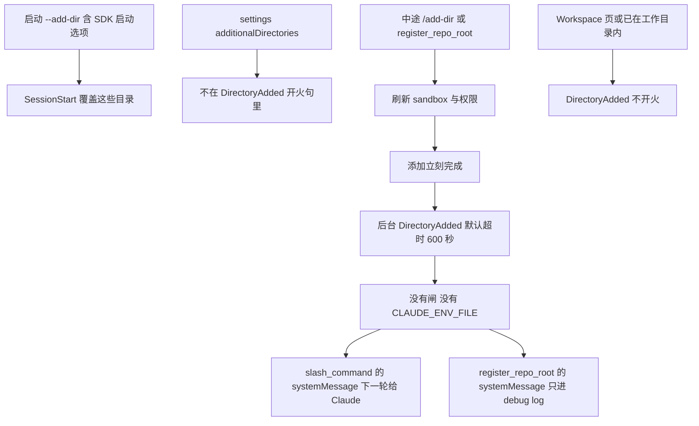

有人把「新加一个仓库就装依赖、灌环境」只挂在 `SessionStart` 上，以为中途 `/add-dir` 也会跑到。另一边只写了 `DirectoryAdded`，以为启动时的 `claude --add-dir ../apps` 会打这只钩。两条路各自只盖住一半。还有人把 [11 月 22 日](https://cfireworks.github.io/2026/11/22/2026-11-22-cwdchanged-vs-filechanged/) 的 `CLAUDE_ENV_FILE` 抄到这只钩上。资格名单里没有它。

启动时的 `--add-dir`，以及 Agent SDK 启动选项里被转成这面旗标的附加目录，归 `SessionStart`。`DirectoryAdded` 不开火。会话中途的 `/add-dir`，或 SDK 客户的 `register_repo_root` 控制请求，才是 `DirectoryAdded`。添加立刻完成，钩子在后台跑，默认超时 600 秒。没有 decision control，拦不住。`continue` 会被丢掉。这只事件也没有 `CLAUDE_ENV_FILE`。

我在 2026-11-28 08:32（Asia/Shanghai）用 curl 取了 [Hooks reference](https://code.claude.com/docs/en/hooks) 的 markdown（`hooks.md`，301732 字节）、[Automate actions with hooks](https://code.claude.com/docs/en/hooks-guide)（`hooks-guide.md`，66983 字节）、[changelog](https://code.claude.com/docs/en/changelog)（`changelog.md`，1445423 字节）、[CLI reference](https://code.claude.com/docs/en/cli-reference)（`cli-reference.md`，52983 字节）和 [permissions](https://code.claude.com/docs/en/permissions)（`permissions.md`，94797 字节）。`hooks.md`、`hooks-guide.md`、`cli-reference.md`、`permissions.md` 与当天 08:25–08:26 的早读快照字节相同。changelog 的字节数与早读记录一致，页首没有改版本。同一轮向 GitHub releases/latest 核对，tag 仍是 [v2.1.332](https://github.com/anthropics/claude-code/releases/tag/v2.1.332)，`published_at` 是 2026-11-25T01:32:14Z，北京时间 2026-11-25 09:32。changelog 页首同为 **2.1.332**，日期 November 25, 2026。没有跑 Claude Code，没有配真实 hook。

这不是今天的新事件，也不是 2.1.332 的能力。changelog 在 **2.1.219**（July 24, 2026）写了：Added `DirectoryAdded` hook that fires after `/add-dir` or the SDK `register_repo_root` control request registers a new working directory mid-session。2.1.332 的 Added 不改写这只事件。[11 月 26 日](https://cfireworks.github.io/2026/11/26/2026-11-26-preskillshellcommand/) 的 `PreSkillShellCommand` 留在那一篇。

[11 月 22 日](https://cfireworks.github.io/2026/11/22/2026-11-22-cwdchanged-vs-filechanged/) 在换 cwd 旁边点过这只事件。今天只切「新工作目录是怎么加进来的，准备动作该挂哪只钩」。[11 月 27 日](https://cfireworks.github.io/2026/11/27/2026-11-27-setup-vs-sessionstart/) 刚分清 `Setup` 和 `SessionStart`。每场会话的初始化，包括启动时 `--add-dir` 带进来的目录，走 `SessionStart`，不是 `Setup`，也不是 `DirectoryAdded`。

<!-- more -->

## 加进来的时机不同，钩也不同



事件表这一行是：When a working directory is added mid-session via `/add-dir` or the SDK `register_repo_root` control request。hooks-guide 同步了事件表和 matcher，没有 `DirectoryAdded` 专节。输入、决策和退出码以 hooks 参考为准。

生命周期图注把 `DirectoryAdded` 和 `CwdChanged`、`FileChanged`、`WorktreeCreate` 等放在同一组 standalone async events 里。`CwdChanged` 和 `FileChanged` 的专项没有「不等钩子」这句。我不把图注收成「目录类事件都不等钩子」。只有这只专项写了：Claude Code doesn't wait for the hook: the add completes immediately, and the hook runs in the background with the 600-second default timeout。

通用 `timeout` 表里，`command`、`http`、`mcp_tool` 默认 600 秒。专项说的就是这个默认值。Configure an async hook 另写：一旦 `"async": true` 的钩子已经在后台跑，Claude Code 不再强制 `timeout`，`asyncRewake` 除外。打开的页没有把 `DirectoryAdded` 和 `"async": true` 写成同一件事。我不宣布「它就是 async，因此 timeout 失效」。这一格是未核实。夹具记 `async_true_equated=0`，`timeout_default=600`。

## 六条路

| 维度 | 启动 `--add-dir`（含 SDK 启动选项转成旗标） | settings `additionalDirectories` | 中途 `/add-dir` | SDK `register_repo_root` | `/permissions` Workspace 页 | 已在工作目录内 |
| --- | --- | --- | --- | --- | --- | --- |
| 哪只钩 | `SessionStart`。`DirectoryAdded` 不开火 | 不在开火句里 | `DirectoryAdded`，`source=slash_command` | `DirectoryAdded`，`source=register_repo_root` | 不开火 | 不开火 |
| 能否拦截 | 这只添加不经过 `DirectoryAdded` | 钩不跑 | 不能。添加已经完成 | 不能。添加已经完成 | 钩不跑 | 钩不跑 |
| 是否后台 | 专项没把启动旗标写成后台的 `DirectoryAdded` | 钩不跑 | 后台跑，默认超时 600 秒 | 同左 | 钩不跑 | 钩不跑 |
| `systemMessage` | 不由这只事件分投 | 不由这只事件分投 | 下一轮交给 Claude，不展示给你 | 只进 debug log | 钩不跑 | 钩不跑 |
| exit 2 | 这只事件没开火 | 这只事件没开火 | stderr 进 debug log。失败计数在 transcript。目录已经加上 | stderr 与 `systemMessage` 都只进 debug log。目录已经加上 | 钩不跑 | 钩不跑 |
| `CLAUDE_ENV_FILE` | `SessionStart` 在资格名单里 | 这只事件不跑 | 没有 | 没有 | 钩不跑 | 钩不跑 |
| 给的是什么 | 文件访问，另有部分技能、命令、子代理。不是完整配置根 | 只给文件访问，不加载那些配置 | 与旗标同一类例外。不是完整配置根 | 配置例外那节把 SDK 写在经旗标。这条控制请求会不会加载同一份，页上没写。未核实 | 钩子页只写不开火。配置加载未对上 | 主目录子路径：权限页写加载技能、命令、子代理，且不新增工作目录 |

`/cd <path>` 是搬走主工作目录，不是在旁边再加一个。它会加载新目录的 `CLAUDE.md`，应用项目配置，并保留你用 `--add-dir` 或 `/add-dir` 加过的目录。那一格不是 `DirectoryAdded`。主会话 shell 里的 `cd` 是 11 月 22 日的 `CwdChanged`，这里不重写。

## 加完了才通知你

专节的原句是：Runs after you add a working directory mid-session with the `/add-dir` command, or after an SDK client adds one with the `register_repo_root` control request. Use this to prepare a newly added repository, for example by installing its dependencies.

官方把用途写成准备新仓库，比如装依赖。同一节也写了准备时做不到的事：拦不住这次添加，因为钩子跑的时候添加已经完成；写不了 `CLAUDE_ENV_FILE`；`systemMessage` 不会展示给你。启动旗标、Workspace 页、已经是工作目录或在其内部，都复用不了这只钩。

不开火的三条是原文列表：

* You pass a directory with the `--add-dir` startup flag；SessionStart covers those directories
* You add a directory on the `/permissions` Workspace tab
* You add a directory that is already a working directory or inside one

Claude Code fires DirectoryAdded after refreshing sandbox and permission state, so sandboxed tools already see the new directory when your hook runs. Hook commands themselves run unsandboxed.

权限页还写过：`permissions.blockWritesOutsideWorkingDirectories` 不限制 hook 跑起来的程序。两句各留各的。沙箱刷新只保证随后的沙箱工具已经能看见新目录。钩子命令不在沙箱里跑。

matcher 按添加方式过滤。`slash_command` 是你用 `/add-dir` 加的。`register_repo_root` 是 SDK 客户用这个控制请求加的。省略、`""` 或 `"*"` 按总表匹配每一次。我没有打开 SDK 控制请求专页，不编请求体字段。输入里的 `source` 和 `directory` 已经够用。

输入在公共字段之外是 `directory`（绝对路径）和 `source`。参考页的示例是：

```json
{
  "session_id": "abc123",
  "transcript_path": "/Users/.../.claude/projects/.../transcript.jsonl",
  "cwd": "/Users/my-project",
  "hook_event_name": "DirectoryAdded",
  "directory": "/Users/my-other-repo",
  "source": "slash_command"
}
```

示例里没有 `permission_mode`。公共字段那张表写过，不是每个事件都带这个字段，以各事件的 JSON 示例为准。夹具不把 `permission_mode` 补成必填。

没有 decision control。They can't block the add, which has already completed when the hook runs. Claude Code discards the `continue` field from their JSON output and surfaces the rest differently per source：

* `slash_command`：把 `systemMessage` 作为下一轮上下文交给 Claude，而不是展示给你。失败钩子的计数出现在 transcript。完整失败输出进 debug log
* `register_repo_root`：`systemMessage` 和失败输出都只进 debug log

退出码表这一格是：Can block? **No**。What happens on exit 2：Stderr goes to the debug log; the directory is already added。这和 `CwdChanged` 的「Shows stderr to user only」不是同一格。

决策总表把 `DirectoryAdded` 和 `Setup`、`Notification`、`SessionEnd`、`CwdChanged`、`FileChanged` 等写在同一行：None。No decision control. Used for side effects like logging or cleanup。

类型名单把这只放在「支持 `command`、`http`、`mcp_tool`，不支持 `prompt` 或 `agent`」那一组。配了 `prompt` 或 `agent` 之后是跳过还是报错，专项没有写成 `PermissionRequest` 那种 skip 句。我不补。11 月 22 日已经点过这组，这里不展开。

失败计数那句写在 `slash_command` 下面。`register_repo_root` 那条写的是只进 debug log。夹具不给这条补 transcript 计数，`transcript_failed=0`。

settings 里可以按来源拆 matcher。`echo` 只是占位，表示 side effect。安装失败也撤不回这次加目录。不要在仓库里执行这段。

```json
{
  "hooks": {
    "DirectoryAdded": [
      {
        "matcher": "slash_command",
        "hooks": [{ "type": "command", "command": "echo prepare-side-effect" }]
      },
      {
        "matcher": "register_repo_root",
        "hooks": [{ "type": "command", "command": "echo prepare-side-effect" }]
      }
    ]
  }
}
```

夹具把「先进入集合，再读输出」收成这个函数。看见 `decision` 也不把它读成闸：

```python
def apply_directory_added(
    working: set[str],
    directory: str,
    source: str,
    stdout: dict | None,
    exit_code: int,
    stderr: str,
) -> dict:
    """目录先进入集合，再读钩子输出。continue 丢掉。exit 2 的 stderr 进 debug_log。"""
    working.add(directory)
    discarded: list[str] = []
    system_message = ""
    decision_applied = 0
    if isinstance(stdout, dict):
        if "continue" in stdout:
            discarded.append("continue")
        if "decision" in stdout:
            decision_applied = 0
        system_message = str(stdout.get("systemMessage") or "")
    debug_log: list[str] = []
    next_turn = ""
    transcript_failed = 0
    if source == "slash_command":
        if system_message:
            next_turn = system_message
        if exit_code == 2:
            transcript_failed = 1
            if stderr:
                debug_log.append(stderr)
    elif source == "register_repo_root":
        if system_message:
            debug_log.append(system_message)
        if exit_code == 2 and stderr:
            debug_log.append(stderr)
    if system_message and source == "slash_command":
        system_message_to = "next_turn"
    elif system_message and source == "register_repo_root":
        system_message_to = "debug_log"
    else:
        system_message_to = "none"
    return {
        "blocked": 0,
        "still_added": 1 if directory in working else 0,
        "background": 1,
        "added_before_hook": 1,
        "continue_applied": 0,
        "decision_applied": decision_applied,
        "discarded": ",".join(discarded),
        "user_notice": 0,
        "next_turn": 1 if next_turn else 0,
        "system_message_to": system_message_to,
        "stderr_to": "debug_log" if exit_code == 2 else "none",
        "transcript_failed": transcript_failed,
        "debug_has_stderr": 1 if stderr and stderr in debug_log else 0,
        "debug_has_system": 1 if system_message and system_message in debug_log else 0,
        "timeout_default": TIMEOUT_DEFAULT,
        "async_true_equated": 0,
    }
```

`TIMEOUT_DEFAULT` 是 600，取自专项那句默认超时，不是一次计时。

## 没有环境文件

Persist environment variables 的 NOTE 写：`CLAUDE_ENV_FILE` is available for SessionStart, Setup, CwdChanged, and FileChanged hooks. Other hook events don't have access to this variable, and neither does a hook that runs in PowerShell, whether through `"shell": "powershell"` or by default on Windows without Git Bash.

中途加进来的工作目录不是换 cwd。`CwdChanged` 不会因此开火。`DirectoryAdded` 自己又不在资格名单里。想给后续 Bash 注入这个新目录的环境，不能靠这只钩去写环境文件。页上没有给出替代写法。我不编「改用 `FileChanged` 监视新目录的 `.envrc` 就会自动播种」。监视名单要先播种，那是 11 月 22 日的句子，不重写。

实践停在两句。别往一只不存在的 `CLAUDE_ENV_FILE` 里写。启动时带进来的目录，环境仍走 `SessionStart`。PowerShell 钩子同样没有这个变量。这是 NOTE 的后半，不是这只事件的专属条款。我没有跑 PowerShell。

## 旗标、持久项、已经在里面的路径

CLI reference 对 `--add-dir` 的句子是：Add additional working directories for Claude to read and edit files. Grants file access; Claude Code doesn't discover most `.claude/` configuration from these directories. Validates that each path exists as a directory. You can't add most network paths, such as `\\server\share`. To persist these directories across sessions, set `permissions.additionalDirectories` in settings。例子是 `claude --add-dir ../apps ../lib`。这是启动时传入的路径。

权限页把扩展访问分成三条。启动时用 `--add-dir <path>`。会话中用 `/add-dir`。持久配置写 settings 里的 `additionalDirectories`。

交互终端里用 `claude --add-dir` 或 `/add-dir` 加入尚未被 workspace trust 覆盖的文件夹时，Claude Code 会先请你信任。Requires Claude Code v2.1.326 or later。点到即可。

「Additional directories grant file access, not configuration」写的是：附加目录扩展读写范围，不是完整的配置根。例外只适用于 `--add-dir` 或 `/add-dir` 加进来的目录，包括 Agent SDK 经这面旗标加进来的。settings 里的 `permissions.additionalDirectories` 只给文件访问，不加载下面那些配置。钩子专文让你自己准备新仓库，和这一句是同一件事：文件能读了，不等于配置根换了。技能、命令、子代理这些例外不逐条抄。

Agent SDK 的 TypeScript `additionalDirectories` 和 Python `add_dirs`，页上写明是作为 `--add-dir` 传给 Claude Code 的，因此行为像启动旗标。名字和 settings 那把钥匙一样，路不一样。这不是 hooks 里的中途 `register_repo_root`。

对主工作目录的子目录发 `/add-dir`，权限页写：Claude Code loads them for the rest of the session without adding a working directory。Requires Claude Code v2.1.257 or later。钩子页的「already a working directory or inside one」则不开火。这是两页对读，不是我在运行时里试出来的。夹具把这一格标成 `runtime_tested=0`，`working_directory_added=0`。

「不新增工作目录」那句点名的是主目录的子目录。路径若在另一个已经加上的工作目录内部，钩子页仍然写了不开火。权限页那句没有跟着扩大。夹具对这一格记 `permissions_sentence=0`，`working_directory_added=not_read`。

settings 的 `additionalDirectories` 不在开火句里，也不在三条不开火的名单里。按开火句，`DirectoryAdded` 不会为它跑。`SessionStart covers those directories` 的主语是启动旗标。要在会话开始时做准备，挂本来就会跑的 `SessionStart`，不要等这只钩。

## 挂的时候按进来的路

启动就要的附加目录，用 `--add-dir` 或 settings 里的持久项，准备挂 `SessionStart`。旗标这条，页上写了 SessionStart covers those directories。持久项这条，页上没有这句归属，只是 `DirectoryAdded` 的开火条件不包括它。

会话中途才加入的仓库，挂 `DirectoryAdded`。matcher 分开 `slash_command` 和 `register_repo_root`。装依赖可以。添加已经完成，失败也撤不回这次加目录。exit 2 的 stderr 进 debug log。

不要把 `CLAUDE_ENV_FILE` 抄过来。加目录也不等于换了 cwd。

不要指望 settings 里的 `additionalDirectories` 或 Workspace 页会打这只钩。

对主目录内部的子目录发 `/add-dir`，权限页写的是加载技能、命令、子代理，并不新增工作目录。钩也不该开火。这是文档对照。

`systemMessage` 在 `/add-dir` 上会在下一轮进 Claude 的上下文，不是终端通知。`register_repo_root` 连这一步都没有，只进 debug log。

## 夹具走的是契约，不是一次真实添加

`python3 demos/directoryadded-vs-sessionstart/run_demo.py` 在本地把上面这些格子走了一遍。我跑过这条命令，stdout 最后一行是 `result=pass`。同一行之前是 `network=0`、`claude_invoked=0`、`runtime_version_probe=0`。没有跑 Claude Code，没有把脚本放进 settings。

| 夹具 | 断言 |
| --- | --- |
| `startup_add_dir` | `session_start=1`，`directory_added=0`，`covers_sentence=1`，路径已在集合里 |
| `sdk_launch_typescript` / `sdk_launch_python` | `passed_as=--add-dir`，`register_repo_root=0`，`DirectoryAdded` 不开火 |
| `settings_additional_directories` | `directory_added=0`，`in_fire_sentence=0`，`covers_sentence=0`，`file_access_only=1` |
| `workspace_tab` / `already_working` | 不开火。Workspace 那格目录仍在集合里 |
| `inside_primary_subdir` | 不开火，`working_directory_added=0`，`runtime_tested=0`，`permissions_requires=2.1.257` |
| `inside_added_dir` | 不开火，`permissions_sentence=0`，`working_directory_added=not_read` |
| `mid_slash_add_dir` | `source=slash_command`，`blocked=0`，`added_before_hook=1`，`background=1`，`timeout_default=600` |
| `slash_system_message_next_turn` | `system_message_to=next_turn`，`user_notice=0`，`debug_has_system=0` |
| `slash_exit_2_debug_log` | `stderr_to=debug_log`，`still_added=1`，`transcript_failed=1`，`continue` 在 `discarded` 里，`decision_applied=0` |
| `register_repo_root` | `system_message_to=debug_log`，`debug_has_stderr=1`，`next_turn=0`，`transcript_failed=0` |
| `no_env_file` | `env_var_present=0`，猜测路径写了 `export`，`runtime_read_guess=0`，`bash_sees=empty` |
| `startup_sessionstart_env` | `SessionStart` 有 `CLAUDE_ENV_FILE`，`bash_sees=from-start`，猜测路径不读 |
| `matcher_slash_skips_register` | 事件发生、目录已加上，这一组 `hook_ran=0` |

信任对话框和网络路径校验没有进夹具。`"async": true` 与这只事件是不是同一件事，页上没写成可执行的一句，`async_true_equated=0`。

## 多出来的目录，钩子看见之前就已经在了

控制环里，「又多了一个工作目录」在钩子看见之前就已经发生了。要做准备，先分清它是启动带进来的，还是中途加进来的。启动走 `SessionStart`。中途的 `/add-dir` 和 `register_repo_root` 才走 `DirectoryAdded`，而且加完了才跑，也没有环境文件。

## 扩展阅读

* [Hooks reference：DirectoryAdded](https://code.claude.com/docs/en/hooks#directoryadded)
* [Hooks reference：SessionStart](https://code.claude.com/docs/en/hooks#sessionstart)
* [Hooks reference：Persist environment variables](https://code.claude.com/docs/en/hooks#persist-environment-variables)
* [Hooks reference：Decision control](https://code.claude.com/docs/en/hooks#decision-control)
* [Hooks reference：Exit code 2 behavior per event](https://code.claude.com/docs/en/hooks#exit-code-2-behavior-per-event)
* [Automate actions with hooks](https://code.claude.com/docs/en/hooks-guide)
* [CLI reference](https://code.claude.com/docs/en/cli-reference)
* [permissions：Working directories](https://code.claude.com/docs/en/permissions#working-directories)
* [permissions：Additional directories grant file access, not configuration](https://code.claude.com/docs/en/permissions#additional-directories-grant-file-access-not-configuration)
* [permissions：Move the session to another directory](https://code.claude.com/docs/en/permissions#move-the-session-to-another-directory)
* [changelog](https://code.claude.com/docs/en/changelog) / [release v2.1.332](https://github.com/anthropics/claude-code/releases/tag/v2.1.332)
* [别把换目录当成环境已经切好](https://cfireworks.github.io/2026/11/22/2026-11-22-cwdchanged-vs-filechanged/)
* [别把日常开聊当成 CI 准备闸](https://cfireworks.github.io/2026/11/27/2026-11-27-setup-vs-sessionstart/)

## 讨论

有没有人只在 `SessionStart` 里装依赖，中途 `/add-dir` 进来的仓库却是空的？或者只写了 `DirectoryAdded`，以为 `claude --add-dir` 会打它？我没有生产会话。夹具按 2026-11-28 打开的参考页模拟，不探测本机 Claude Code 版本。
